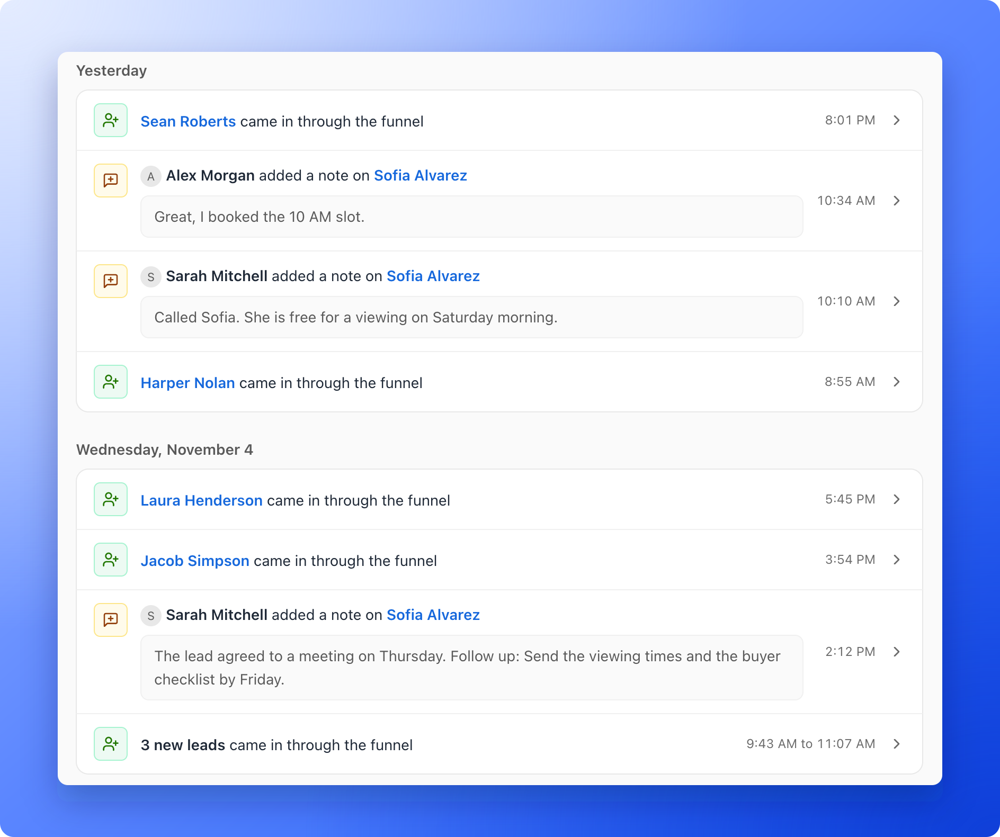

See what your team did without asking, and check the history of a lead. The **Activity** page is a timeline of everything that happens in one funnel: new leads, status changes, tags, assignments, notes, WhatsApp messages and funnel updates.

**Before you start**, you need:

- A role that can open the activity log: Global Admin, Workspace Admin or Contacts Manager. Content Editors do not have access because it contains lead details.

## Important to note

<Warning>
  - Deleting a lead removes its earlier entries. Only a short "deleted a lead" line remains. See [Delete leads](/leads/delete-leads).
  - The log shows one funnel at a time, the one you opened. Open another funnel to see its log.
  - Leads locked by your plan are not in the log, and their earlier entries are removed when they are locked. See [What happens when you reach your monthly lead limit](/billing/monthly-lead-limit).
</Warning>

## Open the activity log

Click **Funnels** in the sidebar, click the funnel, then click **Activity** in the funnel's menu. On a phone, tap **Menu** in the bottom bar first.

Entries are grouped by day (**Today**, **Yesterday**, then the weekday and date), newest first. Each one has a colored icon for the kind of event, a sentence that says who did what, and the time at the end. A person's entry shows their photo or initials. Actions done automatically, such as a lead arriving from your funnel, say **System**.

Three or more leads that come in through the funnel on the same day fold into one row, such as **12 new leads came in through the funnel**, with the times they came in. Click it to open the leads in place.

Click a row to open it. A lead's row opens the lead's side panel on the same page. A WhatsApp message opens its chat. Rows about the funnel itself, or about a lead that is gone, do not open anything.

## Filter and search

Above the timeline there is a search box and two filters.

- **Search activity:** type a word, for example "converted" to find every lead that reached that status, or a lead's name to see its history. Matches are highlighted. After a short pause, AskFunnel also searches the whole log of the funnel, including older entries that are not on the page yet. Put your words in quotes to look for that exact phrase only. If nothing matches, the page says **No matches for** your words, with **Clear search**.
- **Type:** show only **Leads**, **Notes**, **Funnel** or **WhatsApp** entries. You can pick more than one.
- **Person:** show only what chosen people did. The list has your team A to Z, then **System**. Use **Search members** to find a person in a long list.

A number on the filter shows how many are on. With filters on and nothing to show, the page says **No activity matches these filters**, with **Clear filters**. On a phone, the filters are in one **Filters** button.

If the search fails, the page says **Couldn't search activity.** with **Try again**. If you search very often, it asks you to wait: **Too many searches. Try again in a minute.**

## See older activity

Click **Load more** at the bottom of the timeline to load older entries. At the very end, the page says **That's all the activity.** New entries appear at the top on their own.

## What is recorded

- **New leads:** a lead that **came in through the funnel**, or that someone **added** or **imported**.
- **Status changes:** the lead's old and new status side by side, as colored chips.
- **Tag changes:** which tags were set on the lead.
- **Assignments:** who was assigned to a lead or removed from it.
- **Notes:** a note added, edited or deleted, with the note's words under the line.
- **WhatsApp messages:** a new message from a lead, one entry for a run of messages in a row. It opens the chat.
- **Deleted leads:** who deleted a lead. The entry does not show the lead's name. A delete of many leads at once is one entry, for example **deleted 5,000 leads**.
- **Funnel updates:** the funnel was created, published, unpublished or deleted, an earlier version was restored, or the funnel was brought back online.

## What to do next

<Columns cols={2}>
  <Card title="See where a lead came from" icon="magnifying-glass-chart" href="/analytics/lead-insights">
    Open a lead's Tracking tab and add notes.
  </Card>
  <Card title="Track leads with statuses" icon="list-check" href="/leads/contact-status">
    Change a lead's status and see it in the log.
  </Card>
</Columns>

Need help? Email [support@askfunnel.com](mailto:support@askfunnel.com).
