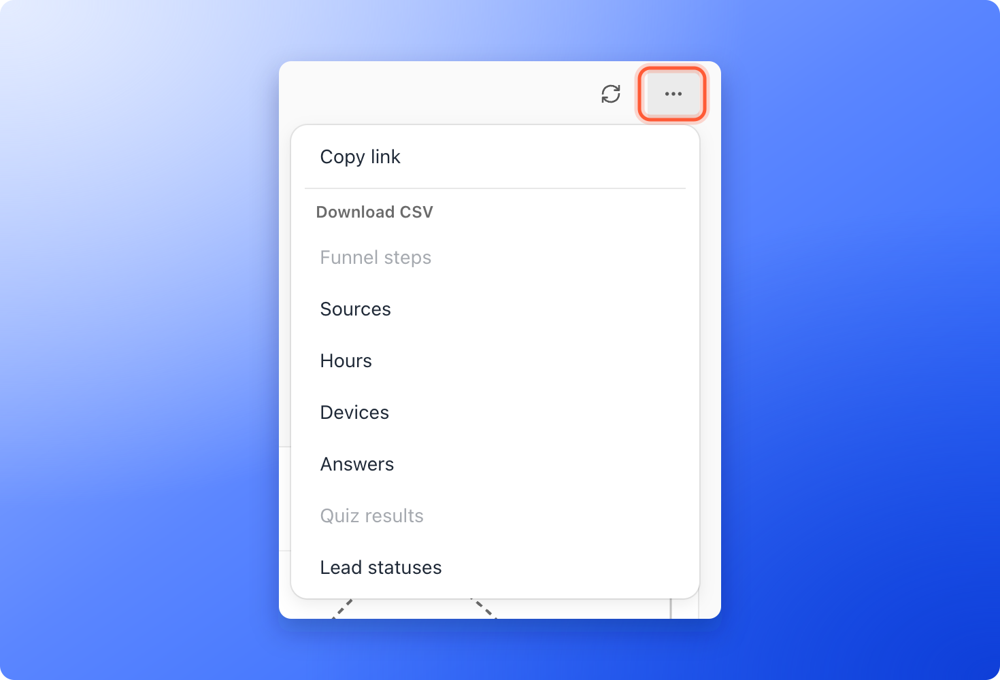

Download the numbers behind any section of the **Analytics** tab, to build a report, share results with a client or keep a record of a campaign. Every section that has data has its own download, and you find them all in one place.

**Before you start**, you need:

- A role that can open analytics: Global Admin, Workspace Admin or Contacts Manager.
- A funnel with analytics data. See [Read your funnel analytics](/analytics/funnel-analytics).

## Download a section's data

<Steps>
  <Step title="Choose your date range">
    Open your funnel, click **Analytics** and pick the dates you want in the date menu, for example **Last 28 days** or a **Custom range**. The file covers the range you have selected.
  </Step>
  <Step title="Open More options and pick a download">
    Click **More options** (the three dots) at the right end of the bar under the tabs. Under **Copy link**, the menu lists a download for each section, such as **Download Funnel as CSV** or **Download Devices as CSV**. The file downloads to your computer right away. A section without data has no entry, so if you do not see one, widen the date range.

    
  </Step>
  <Step title="Open the file">
    Open the CSV (a simple spreadsheet file) in Excel, Google Sheets or any other tool.
  </Step>
</Steps>

The numbers of the main chart (visitors, leads and the conversion rate for each day) have their own place: click the three dots (**Chart options**) in the corner of the chart and choose **Download as CSV**.

<Note>
  These files hold totals, not individual leads. To download names, emails and answers, see [Export your leads](/leads/export-contacts).
</Note>

## Which file you get

Each section downloads its own file, and the end of the file name tells you which one it is.

- **Chart options, Download as CSV** (ends in `_visitors.csv`): one row per day with visitors, leads, completions and the conversion rate, plus a total row. The file still calls the leads column `conversions`.
- **Download Funnel as CSV** (`_dropoff.csv`): how many times each step was reached.
- **Download Where visitors come from as CSV** (`_sources.csv`): visitors, leads and conversion rate for the tab you have open, such as sources or campaigns.
- **Download Visits by hour of day as CSV** (`_hours.csv`): visits for each hour.
- **Download Devices as CSV** (`_devices.csv`): visits by device type.
- **Download Answers as CSV** (`_responses.csv`): how often each answer was picked.
- **Download Quiz results as CSV** (`_results.csv`): how many visits ended on each result. It is offered for a funnel with more than one result.
- **Download Lead statuses as CSV** (`_pipeline.csv`): how many of the leads created in your date range are in each status.

The first few lines of each file say which funnel it is, the date range, the time zone and when the file was created. Days are always UTC. The hours file uses your own time zone where it can, and says which one it used. Delete those first lines if a tool you import into needs a clean table.

## What to do next

<Columns cols={2}>
  <Card title="Export your leads" icon="file-export" href="/leads/export-contacts">
    Download names, emails and answers.
  </Card>
  <Card title="See how your funnel performs" icon="chart-line" href="/analytics/funnel-analytics">
    Visitors, leads and where people drop off.
  </Card>
</Columns>

Need help? Email [support@askfunnel.com](mailto:support@askfunnel.com).
