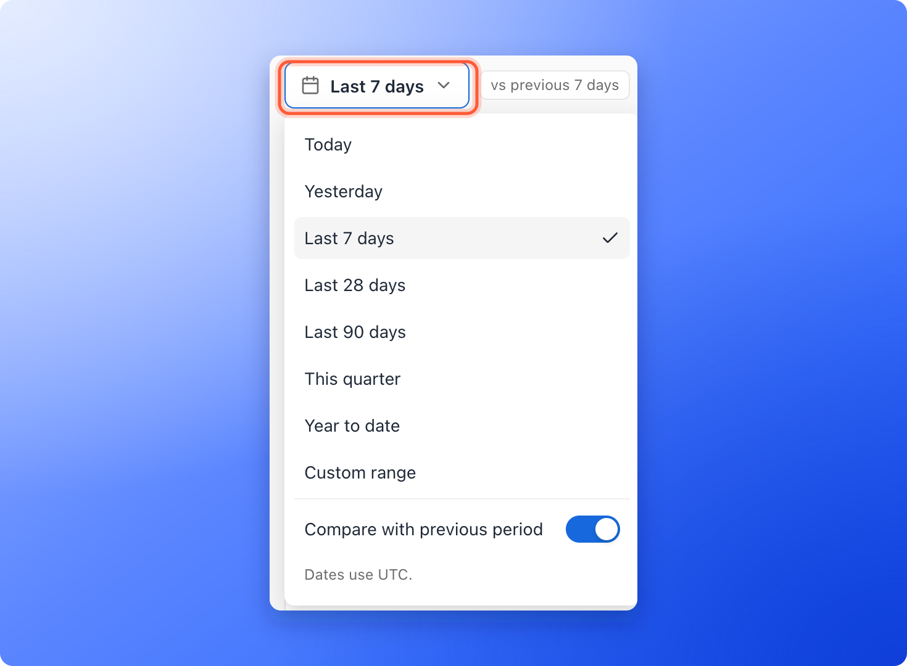
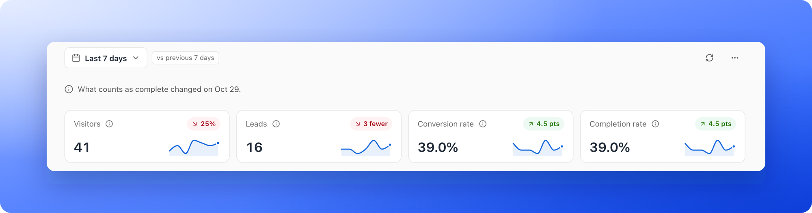
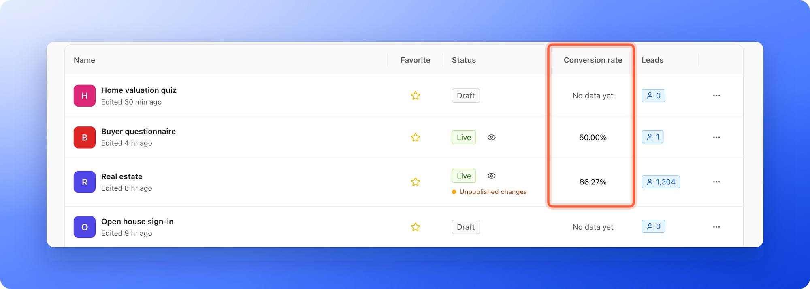

See how your funnel performs: how many people visit, how many become leads, where they come from and which steps they reach. Each funnel has an **Analytics** page for this. Use it to decide what to fix, and to check that your ads send the right traffic.

**Before you start**, you need:

- A role that can open analytics: Global Admin, Workspace Admin or Contacts Manager. Content Editors do not have access because analytics summarize lead data.
- A published funnel that has had some visitors. See [Share your funnel](/funnels/share-your-funnel).

## Important to note

<Warning>
  Days in analytics use UTC (standard world time), not your local time, so a day here can start at a different moment than a day in your [Leads table](/leads/filter-by-date). The date menu says it once: **Dates use UTC.** The one exception is **Visits by hour of day**, which uses your own clock where it can and says **Hours in UTC** when it cannot.
</Warning>

## Open your analytics

<Steps>
  <Step title="Open the funnel's Analytics tab">
    From your **Funnels** page, click the funnel, then click **Analytics** in the sidebar.
  </Step>
  <Step title="Choose a date range">
    Click the date button at the top left. It shows the range you are looking at, such as **Last 7 days**. In its menu, pick **Today**, **Yesterday**, **Last 7 days**, **Last 28 days**, **Last 90 days**, **This quarter**, **Year to date** or **Custom range**. With **Custom range**, pick a **Start date** and an **End date** (up to about a year), then click **"Apply"**. Nothing changes until you do. The page opens on **Last 7 days**.

    
  </Step>
  <Step title="Compare with the previous period (optional)">
    The same menu has a **Compare with previous period** switch. It is on when you first open the page, so every number shows its change against the period of the same length just before, and a tag such as **vs previous 7 days** appears next to the date button. Turn the switch off to see only this period.
  </Step>
</Steps>

Three more things sit in the same bar. The time **Updated 3:41 PM** shows when the numbers were last read. **Refresh** (the circular arrow) reads them again. **More options** (the three dots) holds **Copy link**, which copies a link to this exact view (date range, Compare and the chart you picked) to share with a teammate, and the downloads. See [Download your analytics as CSV](/analytics/export-conversions).

## Compare before and after a change

When a publish changed what ends your funnel (the success page or a quiz result), a line under the bar says **What counts as complete changed on Oct 9.** The **Completion rate** before and after that day is not measured the same way, so compare it with care.

Click **"Compare before and after"** to put the days after that publish against the days before it. While it is on, the date button names the days after, the tag reads **Before and after version 7**, and the chart calls its two lines **After** and **Before**. Click the small **x** in the tag to go **Back to Last 7 days**. The button needs a full day after the publish and says **Needs more days after this publish.** until then.

Publishes also show as small grey marks along the chart (not on a one day range). Click a mark to see its version and day, a line about what it changed such as **2 questions edited, 1 removed**, and the same **"Compare before and after"** button.

## The four numbers at the top

- **Visitors:** the sum of daily unique visitors. A person who comes back on another day counts again on that day.
- **Leads:** the total number of form submissions in the date range.
- **Conversion rate:** leads divided by visitors. In plain words, the share of visitors who become leads. Only leads that came with visitor tracking count, so leads you imported are left out.
- **Completion rate:** visits that reached the end, out of all visits. The end is the success page or a quiz result.

Each card shows its change against the previous period while Compare is on, and a small line of its days. Point at the info icon on a card to read how it is counted.

Under the numbers, the chart follows one of them. Use the switch above it to choose **Visitors**, **Leads** or **Conversion rate**. The previous period is drawn as a second line, and the last part of the chart is dashed when it ends today, because the day is not over. On a one day range, the chart shows **Visits by hour** instead.

## Find where visitors leave

Open **Funnel**. It lists every step of your funnel in order, from the first question to the success page, with a bar for how often each step was reached. Under each step except the last, a chip such as **12% left** shows the share of people who reached that step and did not go on to a later one in the same visit. The step with the biggest drop is red. A big drop points to a question that is too long, too personal or unclear.

Counts are recorded per step, so a step can be higher than the one before it. Use the chart as a guide rather than an exact headcount. With Compare on, a small tick on each bar marks the same step in the previous period. A step you have since removed from the funnel keeps its numbers and carries a **Removed** tag.

The end of the section's heading shows the **Average time to complete**, from a visitor's first page load to reaching the end. Visits that took more than 24 hours are left out, so an abandoned tab does not skew it.

If the **Funnel** section is missing, your funnel may not record steps. Open your funnel's settings, go to **Cookies & Consent** and set **Analytics tracking depth** to a **Detailed** option. See [Cookies and consent](/funnel-settings/cookies-and-consent).

<Tip>
  If your conversion rate is low, check **Funnel** first, then try removing one or two hard questions or switching answers to image cards, and watch the rate for a week.
</Tip>

## Mark events on your chart

Global Admins and Workspace Admins can pin a marker for a campaign launch, a release, an incident, an experiment or a note. Click the three dots (**Chart options**) in the corner of the chart, choose **"Add event marker"**, then in **Pin an event marker** choose a **Date**, a **Type**, a color and a **Label**, and click **"Pin marker"**. The marker shows on the chart so you can see how an event changed your traffic.

## The sections below

- **Funnel:** the steps, as described above.
- **Visits by hour of day:** when visitors are most active, in your own time, with the busiest hour beside the title. Use it to time your launches and ad spend. It is left out on a one day range, where the chart at the top already shows the hours.
- **Answers:** what people picked on each question. Choose a question from the list at the top of the section.
- **Quiz results:** how many visits ended on each result of a quiz. It appears for a funnel with more than one result.
- **Insights:** up to three plain sentences about the range, such as how your conversion rate moved, which group in **Where visitors come from** sent the most visitors or converts best, or which day was your best.
- **Where visitors come from:** the places visitors come from, ranked by volume, with the conversion rate for each. Use the tabs **Sources**, **Mediums**, **Campaigns**, **Referrers**, **Countries** and **Languages** to change the grouping.
- **Devices:** the share of **Mobile**, **Desktop**, **Tablet** and **Other** devices.
- **Lead statuses:** the current [status](/leads/contact-status) of the leads created in your date range, as one bar and a list. Leads locked by your plan are left out.

## Your conversion rate on the Funnels page

The **Conversion rate** column on your **Funnels** page shows each funnel's conversion rate over its whole life, for example **12.00%** when 12 of 100 visitors became leads.

A funnel with nothing to divide yet shows **No data yet**. Leads you imported, or that arrived before tracking began, have no visitor data, so a funnel with only those has no rate until new traffic arrives. Point at the words to see why.

## Troubleshooting

<AccordionGroup>
  <Accordion title="A banner says No visitor data for these dates">
    Every lead in that range was added before tracking started, so there are no visitors to compare them with and no conversion rate. Choose a later date range. A banner that says **Conversion rate counts the days since tracking started.** means tracking started partway through the range, so the rate only counts the time after it started. Click the **x** to dismiss it.
  </Accordion>
  <Accordion title="Where visitors come from is empty">
    Tag the links you use in ads and emails with UTM parameters (short tags that show where a visit came from), for example **utm_source**, **utm_medium** and **utm_campaign**. Until you do, try the **Referrers** or **Countries** tab to see other breakdowns. See [Track campaigns with UTM links](/analytics/utm-tracking).
  </Accordion>
  <Accordion title="The page says No visitors in this range">
    Your funnel has no visits on those days. Choose another range in the date menu. A funnel that was never published says **No visitors yet**: publish it to start collecting numbers.
  </Accordion>
  <Accordion title="My numbers are different from the Leads tab">
    Analytics uses UTC days and counts a returning visitor once per day. **Leads** here counts every form submission, including leads locked by your plan, while the Leads table uses your local time and does not show locked leads. See [Why your lead and analytics numbers differ](/analytics/why-numbers-differ).
  </Accordion>
</AccordionGroup>

## What to do next

<Columns cols={2}>
  <Card title="See where a lead came from" icon="magnifying-glass-chart" href="/analytics/lead-insights">
    Open a lead's Tracking tab for their source and device.
  </Card>
  <Card title="Download your analytics as CSV" icon="file-csv" href="/analytics/export-conversions">
    Get the numbers behind any section as a file.
  </Card>
  <Card title="Track your ads" icon="bullseye" href="/integrations/meta-pixel">
    Connect a pixel to see which ads bring leads.
  </Card>
  <Card title="Set up cookies and consent" icon="cookie-bite" href="/funnel-settings/cookies-and-consent">
    Choose how much visitor activity AskFunnel tracks.
  </Card>
</Columns>

Need help? Email [support@askfunnel.com](mailto:support@askfunnel.com).
