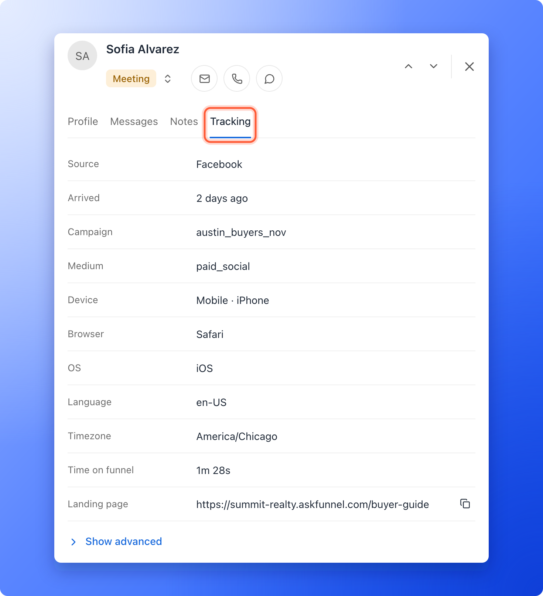

Check where a lead came from, what device they used and how long they spent in your funnel before you call or write, so your follow-up fits the lead. AskFunnel keeps this for every lead, next to their name and phone number.

**Before you start**, you need:

- A role that can see leads: Global Admin, Workspace Admin or Contacts Manager.
- A funnel with at least one lead. See [View and manage your leads](/leads/view-and-manage-leads).

## Open a lead's tracking details

<Steps>
  <Step title="Open the lead">
    In your funnel's **Leads** page, hover over the lead's name and click the **"Open lead"** icon. A panel opens on the right.
  </Step>
  <Step title="Open the Tracking tab">
    The panel has four tabs: **Profile**, **Messages**, **Notes** and **Tracking**. Click **Tracking**.

    
  </Step>
</Steps>

## Keep notes and update the lead

- **Write a note:** open the **Notes** tab to keep a record of calls and next steps, reply to teammates and mention them. See [Write notes on a lead](/leads/lead-notes).
- **Change the status:** click the status at the top of the panel. See [Track leads with statuses](/leads/contact-status).
- **Add tags or change details:** use the **Profile** tab. Click any field to edit it, for example **Tags** or **Preferred time**.
- **Contact the lead:** use the email, call and WhatsApp icons at the top of the panel. See [Message a lead on WhatsApp](/messages/whatsapp-template).
- **See their messages:** the **Messages** tab lists the [automated email](/messages/automated-emails) and WhatsApp flows the lead is in and what was sent.

<Tip>
  Notes and status changes also appear in your team's [activity log](/analytics/activity-log), so nobody has to ask who called whom.
</Tip>

## What the Tracking tab shows

The tab is one list of rows. A row with nothing to say is left out.

- **Source:** where the lead arrived from, for example a social network or a search engine. With no campaign tags, it shows the site they came from, or **Direct / Unknown**.
- **Arrived:** when they arrived. Point at it to see the exact date and time.
- **Medium**, **Campaign**, **Term** and **Content:** the marketing tags on the link the lead clicked. AskFunnel captures them automatically. See [Track campaigns with UTM links](/analytics/utm-tracking).
- **Referrer:** the website that sent them, shown only when it says more than **Source** does.
- **For a lead that clicked an ad:** **Campaign ID**, **Ad set ID**, **Ad ID**, **Placement**, **Clicked the ad** and **First visit**. See [See which ad each lead came from](/integrations/ad-tracking-links).
- **Device**, **Browser**, **OS**, **Language** and **Timezone:** what the lead used.
- **Time on funnel:** how long the lead spent before they submitted. A long time can mean strong interest, or that the funnel was hard to follow, so read it next to their answers.
- **Landing page:** the page they arrived on, with a button to copy it.

Click **Show advanced** for the rows a person fixing an ad setup needs: the **Screen** size, **Page title**, **Session ID**, **Click IDs** and the Meta click and browser IDs (**Facebook Click ID**, **Facebook click cookie** and **Facebook browser cookie**), and **Show raw user agent**. Click **Hide advanced** to tuck them away. If support asks for a session ID, it is here.

If a lead shows **No tracking data captured**, they may have submitted before tracking was turned on, come from an import, or used a browser that blocks visitor analytics. Their details are still saved in **Profile**.

## What to do next

<Columns cols={2}>
  <Card title="Track lead and team activity" icon="clock-rotate-left" href="/analytics/activity-log">
    See every status change, note and funnel update in one timeline.
  </Card>
  <Card title="See how your funnel performs" icon="chart-line" href="/analytics/funnel-analytics">
    Visitors, conversions and where people drop off.
  </Card>
</Columns>

Need help? Email [support@askfunnel.com](mailto:support@askfunnel.com).
