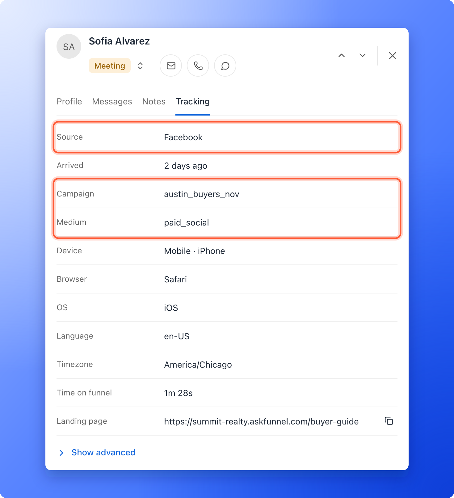
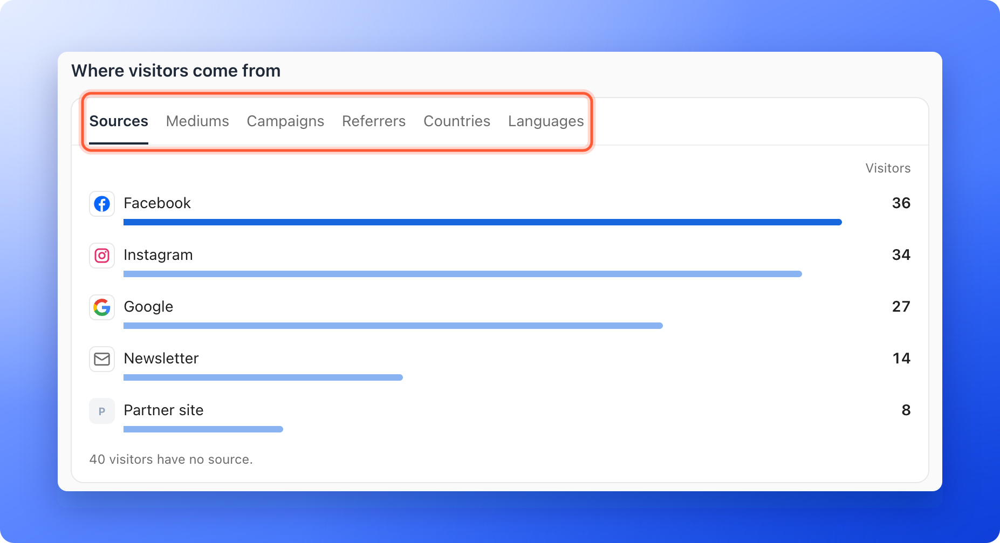

If you run ads or send emails, you want to know which one brought each lead. You do that with **UTM tags**: short labels you add to the end of your funnel link. When someone clicks the link, AskFunnel reads the tags and keeps them with the visit, so you can see the source, the medium and the campaign of every lead, and compare your campaigns in your analytics.

There is nothing to switch on in AskFunnel. You add the tags to your link, and AskFunnel does the rest.

**Before you start**, you need:

- A published funnel and its link. See [Find and share your funnel link](/funnels/share-your-funnel).
- To read the results, a role that can see leads and analytics: Global Admin, Workspace Admin or Contacts Manager.

## Important to note

<Warning>
  - The tags must be on the link people click. AskFunnel cannot add them for you, and a link without tags shows its leads as coming from the site that sent them, or as **Direct / Unknown**.
  - The tags only need to be on the link people click. They stay with the visit even though the next pages show no tags in the address.
  - If your funnel uses a cookie banner, a visitor who does not accept analytics cookies is left out of your campaign charts, and their tags are not sent to connected webhooks. The lead still keeps its tags on the **Tracking** tab. See [Cookies and consent](/funnel-settings/cookies-and-consent).
  - Keep personal details, such as an email address, out of your tags.
</Warning>

## The five UTM tags

You add them to your link one after the other, each written as a name, an equals sign and a value.

| Tag | What it answers | Example |
|---|---|---|
| `utm_source` | Where did the visitor come from? | `facebook`, `instagram`, `newsletter` |
| `utm_medium` | What kind of channel is it? | `paid_social`, `email`, `cpc` |
| `utm_campaign` | Which campaign is it? | `austin_buyers_nov` |
| `utm_term` | Which keyword was it? Optional. | `home_valuation` |
| `utm_content` | Which ad or version was it? Optional. | `video_ad_a` |

Start with `utm_source`, `utm_medium` and `utm_campaign`. Add the other two only if you need them.

## Add UTM tags to your link

<Steps>
  <Step title="Copy your funnel link">
    Copy the link of your live funnel. Your link looks like this:

    `https://summit-realty.askfunnel.com/buyer-guide`

    If you use your own domain, the link starts with your domain. See [Connect your custom domain](/funnel-settings/custom-domain).
  </Step>
  <Step title="Add the tags to the end">
    Type a question mark (**?**) after the link, then your tags with an ampersand (**&**) between them. For example:

    `https://summit-realty.askfunnel.com/buyer-guide?utm_source=facebook&utm_medium=paid_social&utm_campaign=austin_buyers_nov`

    If your link already has a question mark, add your tags with an ampersand instead. Write the tag names in lowercase, and write the values the same way every time, for example always `facebook`, never `Facebook` in one link and `facebook` in another.
  </Step>
  <Step title="Use the tagged link where people will click it">
    Use it as the destination of your ad, your email button or your bio link. Make one link for each source and campaign, so the results stay separate. Many ad platforms also have a field for URL parameters in the ad setup, where you can paste the tags instead of adding them to the link. For Facebook, Instagram, Google and TikTok ads, use the text from **Tracking links** instead: it adds these tags and the exact campaign, ad set and ad IDs. See [See which ad each lead came from](/integrations/ad-tracking-links).
  </Step>
  <Step title="Test it yourself">
    1. Open the tagged link in a private browser window.
    2. Go through your funnel and submit the form with details you will recognize.
    3. In the dashboard, open your funnel's **Leads** page and open your test lead.
    4. Click the **Tracking** tab. Check that **Source** shows the source you typed after `utm_source`, and that **Medium** and **Campaign** show the tags you added. AskFunnel may show a known source with a capital letter, so `facebook` appears as **Facebook**.

    
  </Step>
</Steps>

## Where you see the results

- **On every lead.** Open a lead and click **Tracking**. **Source** shows the `utm_source`. **Medium**, **Campaign**, **Term** and **Content** list the other tags you used. Sources AskFunnel knows, such as Facebook, Google and Instagram, show with their brand name, and other values show as you typed them. With no `utm_source`, AskFunnel shows the website the visitor came from, or **Direct / Unknown**. See [See where a lead came from](/analytics/lead-insights).
- **In your funnel analytics.** **Where visitors come from** ranks your sources by visitors. It shows the five biggest first, and **Show all** lists the rest. A line under the list says how many visitors have no source, for example **40 visitors have no source.** When the rows account for every lead in the range, each row also shows its conversion rate. Use the tabs **Sources**, **Mediums**, **Campaigns**, **Referrers**, **Countries** and **Languages** to change the grouping. See [Read your funnel analytics](/analytics/funnel-analytics).
- **In Google Sheets.** Each row includes the UTM tags and the referrer. See [Send leads to Google Sheets](/integrations/google-sheets).
- **In HighLevel.** Match a tag, such as **UTM source**, to a HighLevel field. See [Send your leads to HighLevel](/integrations/highlevel).
- **In a webhook.** The tags arrive in the `attribution` part of each lead. See [What AskFunnel sends](/integrations/webhook-reference).
- **On another page.** A button can pass the tags on to a booking page or another website. See [Pass UTM and custom URL parameters on to another page](/funnels/forward-url-parameters). You can also show a tag inside your funnel text. See [Personalize your funnel text with variables](/funnels/personalize-with-variables).

## How do I know it is working?

- Your test lead shows the source, medium and campaign you typed.
- In **Analytics**, the **Campaigns** tab of **Where visitors come from** shows your campaign after a few visits, instead of **No campaign data yet.**

## Troubleshooting

<AccordionGroup>
  <Accordion title="The lead's source says Direct / Unknown">
    The visitor arrived without tags and without a known referrer (the website that sent them). Check that the link you shared has the tags, and open it yourself to test. Link shorteners, redirects and some apps drop the part after the question mark, so test the exact link you use in your ad or message.
  </Accordion>
  <Accordion title="Where visitors come from says No source data yet">
    The tab also says **Tag your ad links with UTM parameters.** (the **Mediums** and **Campaigns** tabs say the same with **No medium data yet.** and **No campaign data yet.**). No visitor has arrived with those tags yet, or the visitors did not accept analytics cookies on a funnel with a cookie banner. Tag your links, test them, and give it a little time. Until then, try the **Referrers** tab to see where visitors come from.
  </Accordion>
  <Accordion title="One source shows up twice">
    The tags are saved exactly as you typed them, so `Facebook` and `facebook` can look like two sources. Write your tags the same way every time.
  </Accordion>
  <Accordion title="My tags are missing in the webhook">
    Tags only reach a webhook when the visitor allowed analytics. On a funnel with a cookie banner, a visitor who did not accept analytics cookies arrives without tags in the webhook, although the lead still shows them on the **Tracking** tab.
  </Accordion>
  <Accordion title="My numbers differ from Meta Ads Manager">
    The two tools count in different ways. See [Why your lead and analytics numbers differ](/analytics/why-numbers-differ).
  </Accordion>
</AccordionGroup>

## What to do next

<Columns cols={2}>
  <Card title="See where a lead came from" icon="magnifying-glass-chart" href="/analytics/lead-insights">
    Read a lead's source, device and time on your funnel.
  </Card>
  <Card title="Read your funnel analytics" icon="chart-line" href="/analytics/funnel-analytics">
    Compare your campaigns and find where visitors leave.
  </Card>
  <Card title="Track your Facebook and Instagram ads" icon="bullseye" href="/integrations/meta-pixel">
    Connect Meta Pixel to see which ads bring leads.
  </Card>
  <Card title="Set up cookies and consent" icon="cookie-bite" href="/funnel-settings/cookies-and-consent">
    Choose when tracking starts for your visitors.
  </Card>
</Columns>

Need help? Email [support@askfunnel.com](mailto:support@askfunnel.com).
