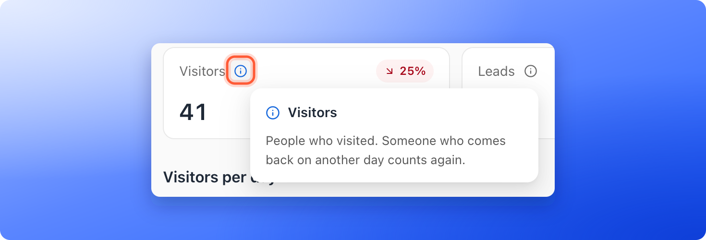

You open your **Leads** page and see 42 leads. You open **Analytics** and see 47 **Leads**. In Meta Ads Manager you see 35. Nothing is broken. Each place counts something slightly different, over slightly different days. This page explains each difference, so you can tell a real problem from a normal gap.

**Before you start**, you need:

- A role that can see leads and analytics: Global Admin, Workspace Admin or Contacts Manager.
- A funnel with some leads and visitors. See [Read your funnel analytics](/analytics/funnel-analytics).

## What each number counts

| Where you look | What it counts |
|---|---|
| **Leads** page, **Total leads** | The leads saved in AskFunnel that you can see. Locked leads are hidden, deleted leads are gone, and any filter or search you set narrows it. |
| **Funnels** list, **Leads** | The same count as **Total leads** on that funnel's **Leads** page before any filter: the leads you can see, including imported ones. |
| **Analytics**, **Leads** | Form submissions in the dates you picked. Locked leads still count, because the form was submitted. Deleted leads can still count too. |
| **Analytics**, **Visitors** | The people who visited in the dates you picked. Someone who comes back on another day counts again on that day. |
| **Analytics**, **Lead statuses** | The current status of the saved leads you can see that were created in the dates you picked. Locked leads are left out. |
| **Meta Ads Manager** | Only what Meta itself receives and credits to your ads. See [Meta Ads Manager](#meta-ads-manager). |

## Important to note

<Warning>
  - Analytics uses UTC (standard world time) for its days. The **Leads** table filters by your browser's local day. Leads near midnight can land on different days.
  - **Leads** on the Analytics page counts form submissions. It is not the number of leads you marked **Converted**.
  - Locked leads, leads over your plan limit, are hidden from the **Leads** table and left out of **Lead statuses**, but still counted in **Leads** on the Analytics page. See [What happens when you reach your monthly lead limit](/billing/monthly-lead-limit).
</Warning>

## Compare your numbers step by step

<Steps>
  <Step title="Start with the same funnel and clean filters">
    On your funnel's **Leads** page, clear the search and every filter, then note **Total leads**. If a banner above the table says leads are locked, note that number too.
  </Step>
  <Step title="Open Analytics for the same dates">
    Open the **Analytics** page of the same funnel and pick the dates you want to compare in the date menu. Click **Refresh** and wait for the numbers to settle. The date menu says **Dates use UTC.** to remind you that analytics days follow UTC.

    
  </Step>
  <Step title="Read what Visitors and Leads mean">
    Click the information icon on each card. **Visitors** counts the people who visited, and someone who comes back on another day counts again. **Leads** is the total number of form submissions in the dates, locked leads included.

    
  </Step>
  <Step title="Check the rates">
    **Conversion rate** is leads divided by visitors, counting only leads that came with visitor tracking, so imported leads are left out. **Completion rate** is the visits that reached the end divided by all visits. They divide by different numbers, so they are not always the same.
  </Step>
  <Step title="Compare with Lead statuses">
    Scroll to **Lead statuses**. The number at the end of its heading (for example **47 leads**) can differ from **Leads** at the top after leads are locked, deleted or imported, or while reporting catches up. Check your dates and filters before you treat a gap as a problem.
  </Step>
</Steps>

## The most common reasons

- **Different days.** Someone in New York who submits your form at 9 pm on 30 September has already reached 1 October in UTC. Analytics counts that submission on 1 October. A **Created** filter in your **Leads** table, which follows your browser's time zone, counts it on 30 September. See [Filter leads by date](/leads/filter-by-date).
- **Locked leads.** **Leads** on the Analytics page includes them. The **Leads** table and **Lead statuses** do not. Add capacity to unlock them.
- **Deleted leads.** A deleted lead leaves the **Leads** table, but its submission can still be part of **Leads** on the Analytics page for that period.
- **Imported leads.** Imported leads appear in your **Leads** table, but no visit happened behind them, so they can make the **Leads** table higher than the Analytics number. See [Import leads from a spreadsheet](/leads/import-leads). A funnel with only imported leads has no conversion rate.
- **Returning visitors.** **Visitors** counts a returning visitor once for each day they come, so it can be higher than the number of different people.
- **The Converted status.** **Leads** on the Analytics page is not linked to the **Converted** status on a lead.
- **Reporting catching up.** New numbers can take a moment to appear. Click **Refresh** in **Analytics**.

## Meta Ads Manager

Meta Ads Manager and AskFunnel rarely match, and they should not. AskFunnel counts every form submission from every source: ads, emails, your bio link and direct visits. Meta counts only the leads it can connect to your ads.

On the AskFunnel side, Meta can miss leads for these reasons:

- **Cookie choices.** With a cookie banner, the Meta Pixel only tracks visitors who accept marketing cookies. See [Cookies and consent](/funnel-settings/cookies-and-consent).
- **Blockers.** Ad blockers and some privacy browsers block the pixel.
- **Global Privacy Control.** If a visitor's browser sends this signal, AskFunnel keeps marketing scripts off for them.
- **The Conversions API.** On the Growth plan and above, AskFunnel also reports each new lead to Meta directly, but only for visitors who accepted marketing cookies, and not for locked leads.
- **Test mode.** Events sent with a test events code never reach your ads. Turn **Test mode** off once your setup works. See [Track your Facebook and Instagram ads with Meta Pixel](/integrations/meta-pixel).

On the Meta side, the gap can also come from how Meta reports. Meta credits a lead to an ad using its own attribution setting, it reports days in the time zone of your ad account, and it can take time to show recent results. Check these settings in Meta Ads Manager.

To compare fairly:

1. Pick the same dates in both tools, and remember the time zone difference.
2. In AskFunnel, open **Analytics** and use the tabs of **Where visitors come from** (**Sources** or **Campaigns**) to look at leads from your Facebook or Instagram campaign only. This needs tagged links. See [Track campaigns with UTM links](/analytics/utm-tracking).
3. In Meta Events Manager, open **Test events** and submit a test lead to check that the **Lead** event arrives.

## Which number should I use?

- **To follow up with people:** the **Leads** page. It holds the leads you can work with.
- **To see how your funnel performs over time:** **Analytics**.
- **To judge your ad spend:** Meta Ads Manager, read together with your AskFunnel leads for the same campaign.

## Troubleshooting

<AccordionGroup>
  <Accordion title="Analytics shows more leads than my Leads table">
    Some submissions are locked, deleted or from outside the dates of your filter. Look for a locked leads banner on the **Leads** page, and clear your filters.
  </Accordion>
  <Accordion title="My Leads table has more leads than Analytics shows">
    You may have imported leads, or some leads arrived before tracking started. Both appear in your table but have no visit to count.
  </Accordion>
  <Accordion title="The conversion rate is missing and a banner says No visitor data for these dates">
    Every lead in that range arrived before tracking started, so there are no visitors to compare them with. Choose a later date range.
  </Accordion>
  <Accordion title="A lead appears on a different day in Analytics than in my Leads table">
    Analytics uses UTC days, and the **Leads** table uses your browser's local day. Both are correct for their own clock.
  </Accordion>
  <Accordion title="The Leads column on my Funnels page is different from the Leads page">
    Both count the leads you can see. If they differ, a filter, a search or a status picked in **Total leads** is probably narrowing the table. Clear them and compare again.
  </Accordion>
</AccordionGroup>

## What to do next

<Columns cols={2}>
  <Card title="Read your funnel analytics" icon="chart-line" href="/analytics/funnel-analytics">
    Visitors, leads and where people drop off.
  </Card>
  <Card title="Track campaigns with UTM links" icon="link" href="/analytics/utm-tracking">
    See which campaign brought each lead.
  </Card>
  <Card title="Filter leads by date" icon="calendar-days" href="/leads/filter-by-date">
    Find the leads from a day, week or month.
  </Card>
  <Card title="Track your Facebook and Instagram ads" icon="bullseye" href="/integrations/meta-pixel">
    Connect Meta Pixel and the Conversions API.
  </Card>
</Columns>

Need help? Email [support@askfunnel.com](mailto:support@askfunnel.com).
