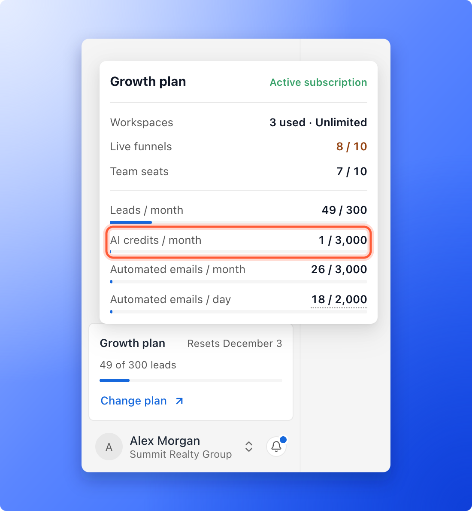
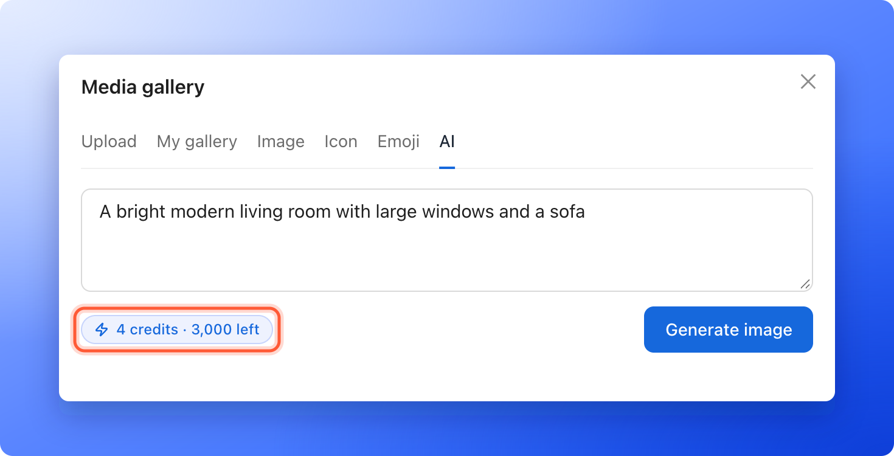
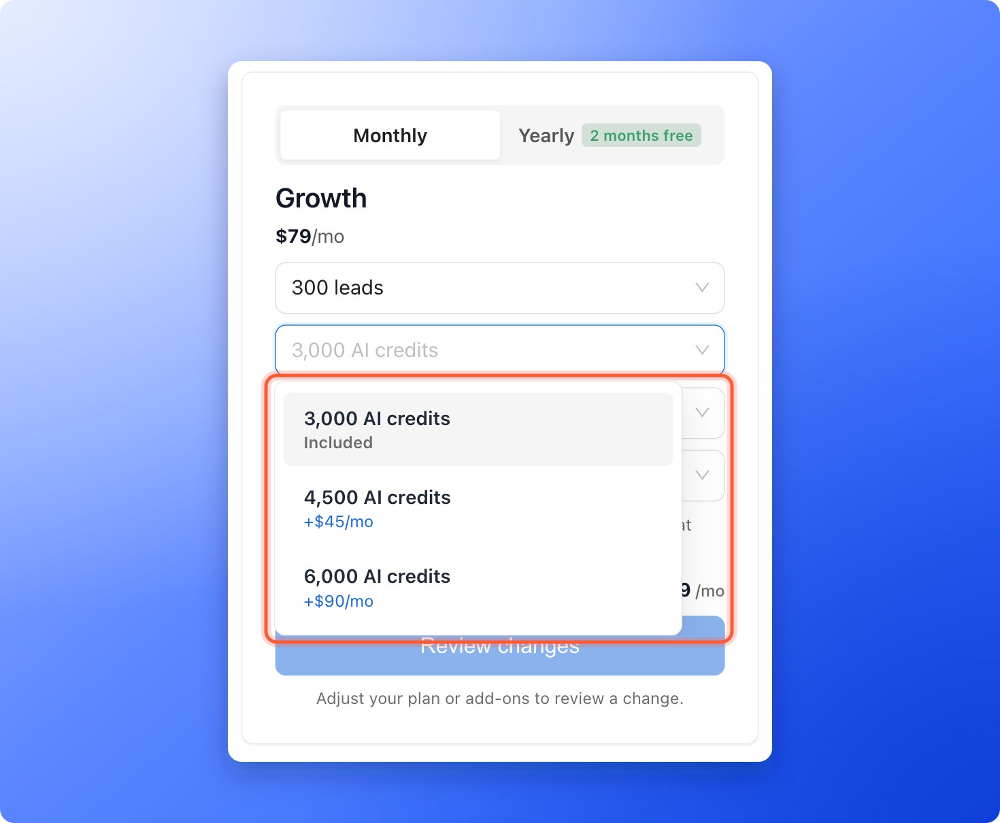

AI credits are the monthly allowance you spend on some AI features in AskFunnel, such as building a funnel or creating an image. Each of those actions costs a set number of credits. When your credits run out, those features pause until your credits reset on your billing date, or until you add more.

**Before you start**, you need:

- For reading your balance, nothing. Anyone on your team can open the plan card.
- To add credits, a Global Admin role (the organization owner, or anyone they gave that role to).
- A verified email address to use AI features. If yours is not verified, AskFunnel asks you to verify it first.

## What uses AI credits

| What you do | Credits |
|---|---|
| Build a whole funnel with AI | 25 |
| Create an image with AI | 4 per image |
| Dictate a note on a lead (Growth plan and above) | 1 for every minute you start, up to 5 minutes |
| Create a follow up with AI, **Email** or **WhatsApp** (Growth plan and above) | 3 |
| Write or fix a WhatsApp message with AI, **Write with AI** or **Fix with AI** (Growth plan and above) | 1 |

A dictated note is charged for every minute you start, so a 20 second note costs 1 credit and a 61 second note costs 2. A note stops at 5 minutes.

## Free AI features

Some AI features do not take credits: the AI button on the text toolbar (**Rewrite**, **Spell check**, **Simplify** and **Edit with AI**), and **Suggest reply** and the AI writing tools in **Conversations**. They need an active plan or free trial, but your credits stay as they are.

These features have their own monthly allowance, which is not shown as a number. If your team uses most of it, every Global Admin gets an email, **Your free AI features are busy this month**, and the features keep working. If it runs out, the feature says **Free AI features are paused until** a date or a time, and comes back by itself. On a free trial it comes back when you subscribe.

## Important to note

<Warning>
  - A funnel build holds its 25 credits while it runs and only charges them when your draft is ready. If the build fails or you cancel it, the credits are released.
  - AI images and dictated notes are different. Their credits are used when the action starts, even if the action then fails.
  - When AI writes a follow up, a WhatsApp message or a fix and it does not finish, the credits are given back. The history shows them as a refund.
  - Credits reset on your billing date, the day your billing period starts. On a yearly plan they reset every month on that day of the month. Unused credits do not carry over.
  - A free trial is different: its 100 credits last for the whole trial and do not reset. The credits you use during the trial do not count against your paid plan, which starts with its full amount when you subscribe.
  - Credits are shared by your whole organization, across all of your workspaces. The history shows which workspace and which person used each one.
</Warning>

## How many credits you get

| Plan | AI credits per month |
|---|---|
| **Free trial** (any plan) | 100 for the whole trial |
| **Starter** | 1,000 |
| **Growth** | 3,000 |
| **Scale** | 6,000 |
| **Enterprise** | 20,000 |

During a free trial you get 100 credits in total, whichever plan you try. That is enough for four funnel builds. The plan's full amount applies as soon as you subscribe. See [How the 14-day free trial works](/billing/free-trial).

## Check how many credits you have left

- **Plan card.** Click the plan card at the bottom of the sidebar. The **AI credits / month** row shows how many you have used out of your monthly amount, and the card says when your credits reset, for example **Resets December 3**. During a free trial the row is called **Trial AI credits** and says **For the whole trial**, because the 100 credits last the whole trial and never reset.
- **Plan page.** Click your name at the bottom of the sidebar, then **"Plan"**. **Usage this period** has a bar for AI credits. See [Check your plan and usage](/billing/plan-and-usage).
- **Credit history.** To see what used your credits, click **"View history"** under the **AI credits / month** row on the **Plan** page. See [See what used your credits](#see-what-used-your-credits).
- **Before you use a feature.** The **Build funnel** button shows its cost (**25**). In the image window, the **AI** tab shows a chip with the cost and your balance, for example **4 credits** and how many credits are left.
- **A heads-up.** When you have used 80% of your credits, the plan card shows an orange dot, and the **AI credits / month** row says **Close to the limit. AI features pause at 3,000 credits.** (with your own number).

## See what used your credits

Global Admins can see every use of the organization's AI credits from the last 13 months, newest first. Use it to find out where credits went, and which workspace and which person used them.

<Steps>
  <Step title="Open the Plan page">
    Click your name at the bottom of the sidebar, then click **"Plan"**.
  </Step>
  <Step title="Open the history">
    Under **Usage this period**, click **"View history"** below the **AI credits / month** row. A window titled **AI credit history** opens.
  </Step>
  <Step title="Read the table">
    Each row is one use, with these columns:

    - **Date:** when it happened.
    - **What:** what the credits were for: **AI funnel build**, **AI image**, **Voice note** (with its minutes, for example **Voice note, 3 min**), **AI email follow up**, **AI WhatsApp message** or **AI WhatsApp follow up**.
    - **Workspace:** the workspace it was used in. A dictated note counts under the workspace of its lead, and says **Other** when it is not for a lead. A workspace you deleted says **Deleted workspace**.
    - **Who:** the person who used it. Someone who has left your team says **Former member**. A refund or correction made by our team says **AskFunnel support**.
    - **Credits:** how many credits it used.

    The window shows 25 uses at a time. Click **"Show older"** under the table to load more. Before any credits are used it says **No AI credits used yet**.
  </Step>
</Steps>

<Note>
  - A funnel build appears once your draft is ready, with its 25 credits. A build that failed or that you canceled does not appear, because its credits were never charged.
  - When credits come back, **What** starts with **Refund** and **Credits** reads **4 back** (with your own number). When AI did not finish, a line under it says why. A correction made by our team says **Correction**, with a short reason under it.
</Note>

## Emails about your credits

AskFunnel emails every Global Admin (the organization owner is one) when your AI credits are running out, once for each month (once for the whole trial, during a free trial):

- **You have used 80% of this month's AI credits** when 80% are used. On a free trial the subject is **Your free trial has used 80% of its AI credits**.
- **Your AI credits are used up** when all of them are used. On a free trial the subject is **Your free trial AI credits are used up**.

Each email tells you when your credits renew (or, on a free trial, to subscribe) and has a button to the plan page.

## When you run out of credits

- The **Build funnel** button is grayed out, and the last step says **Not enough AI credits** and **This build needs 25 credits.**
- **Generate image** is grayed out.
- A dictated note that needs more credits than you have left says how many it needs, for example **This note is 3 minutes long and needs 3 credits. You have 2 left.**
- If an AI action reaches the limit, a window titled **Plan limit reached** says how many AI credits your plan includes, with **"Upgrade plan"** and **"Not now"**.
- A banner at the top of the page says **AI is paused.** and **You used all 3,000 AI credits this month. They renew on December 3.** (with your own numbers). During a free trial it says **You used your 100 trial AI credits.** and **AI is paused until you subscribe.** Global Admins see a button that names the plan with enough room, for example **"Upgrade to Scale"** or **"Subscribe to Growth"**. Everyone else sees **Ask a Global Admin to upgrade the plan.** or, on a free trial, **Ask a Global Admin to subscribe.**

Credits come back on your next billing date. To keep going sooner, add credits.

## Add more credits

<Steps>
  <Step title="Open the plan page">
    1. Click your name at the bottom of the sidebar, then click **"Plan"**.
    2. Click **"Change plan"** at the top right.

    The page is titled **Change plan** on a paid plan and **Choose plan** during a free trial.
  </Step>
  <Step title="Pick a larger amount of AI credits">
    In the panel on the right, open the drop-down list that shows your AI credits, for example **3,000 AI credits**. Each option shows **Included** or its extra monthly price. Pick a larger amount.

    
  </Step>
  <Step title="Review and pay">
    Click **"Review changes"**, then **"Confirm & pay"**. The new amount is available right away. The full steps are in [Upgrade your plan](/billing/upgrade).
  </Step>
</Steps>

You can also move to a bigger plan, which raises your monthly credits. Enterprise limits are set with our team.

## How do I know it is working?

- The **AI credits / month** row shows your new total.
- **Build funnel** is no longer grayed out.
- The **Plan** page lists the extra credits under **Add-ons**.

## Troubleshooting

<AccordionGroup>
  <Accordion title="My credits show 100 but my plan includes more">
    During a free trial, credits are limited to 100 for the whole trial, whichever plan you picked. The plan card and the **Plan** page show this limit. Your plan's full amount applies once you subscribe. The same limit applies while a subscription is not active.
  </Accordion>
  <Accordion title="My credits did not reset on the first of the month">
    Credits reset on your billing date, not on the first day of the month. The **Plan** page shows the date at the bottom of **Usage this period**, for example **Usage resets on December 3**. During a free trial they do not reset: the 100 credits last for the whole trial, and the **Plan** page shows no reset date for them.
  </Accordion>
  <Accordion title="I see Please verify your email address to use AI features">
    AI features need a verified email address. Open the verification email we sent you and click its link, then try again.
  </Accordion>
  <Accordion title="I see Choose a plan to continue">
    Building with AI needs an active plan or free trial. A Global Admin can subscribe. See [Upgrade your plan](/billing/upgrade).
  </Accordion>
  <Accordion title="My credits went down but my funnel build failed">
    For a funnel build, the credits are only held while it runs, and they are released when it fails or you cancel it. The number in the plan card menu goes back up. AI images and dictated notes are charged when they start, even if they fail.
  </Accordion>
  <Accordion title="I see Free AI features are paused">
    The text toolbar's AI button, Suggest reply and the AI writing tools share their own monthly allowance, and it has run out for now. The message says when they come back, and they come back by themselves. They do not use AI credits, so adding credits does not change this. On a free trial they come back when you subscribe.
  </Accordion>
  <Accordion title="I do not see View history">
    Only Global Admins can see the **Plan** page and the history. Ask your organization owner or another Global Admin.
  </Accordion>
  <Accordion title="A use in the history says Deleted workspace or Former member">
    The history keeps each use for 13 months, even after a workspace is deleted or a person leaves your team. The credits still count toward your monthly amount.
  </Accordion>
  <Accordion title="Credits were used by mistake">
    Email [support@askfunnel.com](mailto:support@askfunnel.com) with the date and what happened. Credits we give back show in the history as **back**.
  </Accordion>
  <Accordion title="Do the text tools on the toolbar use credits?">
    No. **Rewrite**, **Spell check**, **Simplify** and **Edit with AI** do not use credits.
  </Accordion>
  <Accordion title="I do not see Change plan or Plan in my menu">
    Only Global Admins can see **Plan** and change it. Ask your organization owner or another Global Admin.
  </Accordion>
</AccordionGroup>

## What to do next

<Columns cols={3}>
  <Card title="Create a funnel with AI" icon="wand-magic-sparkles" href="/funnels/create-funnel-with-ai">
    Answer three questions and let AI build a first draft.
  </Card>
  <Card title="Check your plan and usage" icon="gauge-high" href="/billing/plan-and-usage">
    See every limit in one place.
  </Card>
  <Card title="Upgrade your plan" icon="arrow-up" href="/billing/upgrade">
    Add credits or move to a bigger plan.
  </Card>
</Columns>

Need help? Email [support@askfunnel.com](mailto:support@askfunnel.com).
