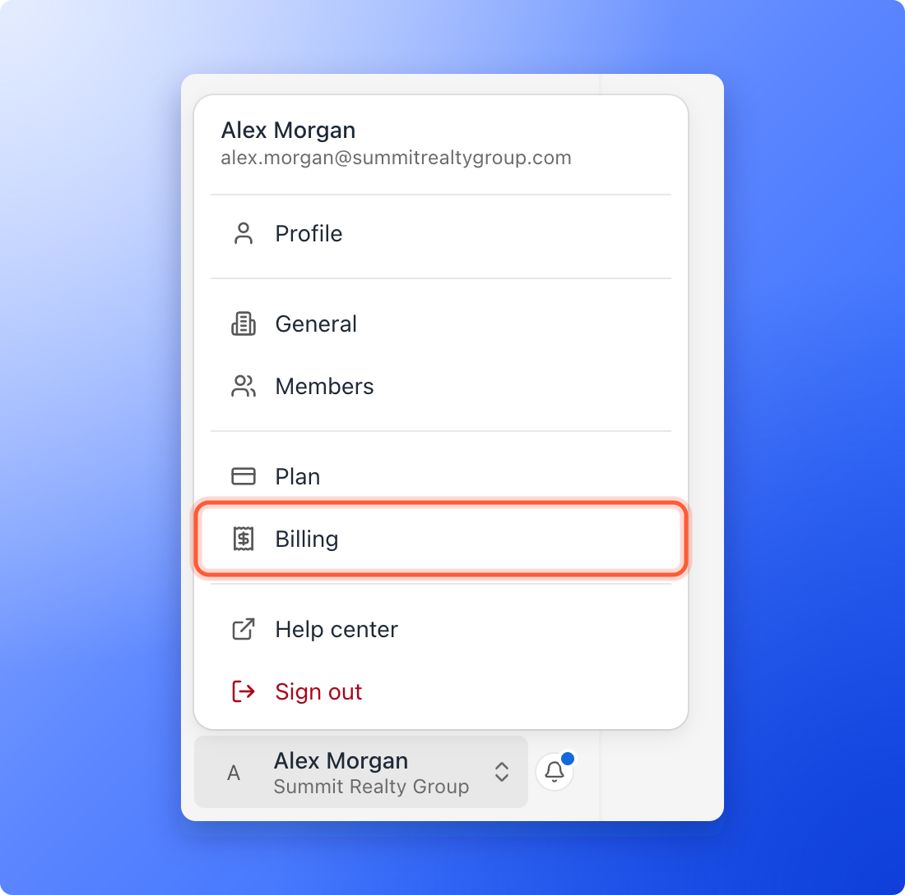
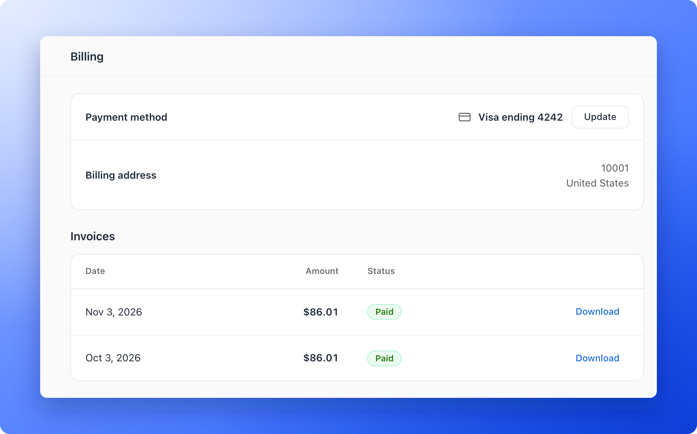

AskFunnel bills in advance, every month or every year, and renews automatically until you cancel. Payments are handled by Paddle, which sells your subscription to you, collects tax and issues your invoices. You see its name at checkout, on your invoices and on your bank statement.

**Before you start**, you need:

- A Global Admin role. Only Global Admins can open **Billing**. That is the organization owner, or anyone they gave that role to.

## Important to note

<Warning>
  - Prices do not include tax. Tax is added at checkout where it applies, and shown on your invoice.
  - Fees are non-refundable, except where the law requires it. If you were charged by mistake, see the troubleshooting section below.
</Warning>

## Find and download your invoices

<Steps>
  <Step title="Open the Billing page">
    Click your name at the bottom of the sidebar, then click **"Billing"**. On a phone, tap **"Menu"** at the bottom of the screen, then tap your name and **"Billing"**.

    

    The page shows your **Payment method** and, once you have paid, your **Billing address** and your **Invoices**. Before your first payment there are no invoices, so that section is not shown.

    

  </Step>
  <Step title="Find your invoice">
    Scroll to **Invoices**. Each row shows the **Date**, the **Amount** you paid, including tax, and the **Status**, which reads **Paid**.
  </Step>
  <Step title="Download it">
    Click **"Download"** at the end of the row. The invoice opens as a PDF in a new browser tab, where you can save or print it.
  </Step>
</Steps>

The **Billing address** comes from your latest payment.

## When you are charged

- **During a free trial:** never. No payment method is saved, so there is nothing to charge.
- **When you subscribe:** the same day. Your free trial ends at that point.
- **At each renewal:** automatically, on the same date every month or year, at the price in effect then. Your next date is on the **Plan** page, next to **Renews on**.
- **When you upgrade:** a prorated amount for the rest of the current period, the same day. See [Upgrade your plan](/billing/upgrade).
- **When you downgrade:** nothing today. The lower price starts at your next renewal. See [Downgrade your plan](/billing/downgrade).
- **If a payment fails:** we try again, and your account keeps working for 14 days from the first failed payment. Every Global Admin gets an email, **Your payment didn't go through**, and the plan card and the **Plan** page say **Payment failed**. Click **"Update card"** to fix it. See [Add or update your payment method](/billing/payment-methods).

## Monthly and yearly billing

- **Monthly:** you pay once a month. Starter is $29, Growth is $79 and Scale is $129, plus any add-ons and tax.
- **Yearly:** you pay once a year, and the price is 10 times the monthly price, so you get 2 months free. That is $290 for Starter, $790 for Growth and $1,290 for Scale, plus any add-ons and tax.

To change your cycle, go to **Plan**, click **"Change plan"** and use the **Monthly** and **Yearly** switch. Switching to yearly takes effect right away, and you pay for the year now. Switching to monthly takes effect when your yearly period ends.

## Troubleshooting

<AccordionGroup>
  <Accordion title="I do not see an Invoices section">
    Invoices appear after your first payment, and the section is not shown before that. If you are on a free trial, you have not been charged yet. If you have paid and still see no invoices, email support.
  </Accordion>
  <Accordion title="The invoice did not open">
    The invoice opens in a new tab, so your browser may have blocked the pop-up. Allow pop-ups for the AskFunnel dashboard and click **"Download"** again. If you see **Couldn't open the invoice. Try again.**, wait a moment and retry.
  </Accordion>
  <Accordion title="I cannot find an older invoice">
    The **Invoices** list shows your most recent 24 paid invoices. Email support for older ones.
  </Accordion>
  <Accordion title="I need my company details or VAT number on an invoice">
    Add your VAT number on the checkout page before you pay. See [Add a discount code or VAT number](/billing/discount-codes-and-vat). For an invoice you already have, email support.
  </Accordion>
  <Accordion title="My bank statement shows PADDLE.NET* instead of AskFunnel">
    Paddle processes card and PayPal payments for AskFunnel, so your bank or card statement shows a line that starts with **PADDLE.NET*** rather than AskFunnel. The amount and date match your AskFunnel invoice. If you do not recognize a charge, check your invoices on the **Billing** page first, then email support with the date and amount.
  </Accordion>
  <Accordion title="I was charged more than the plan price">
    Your total can include tax, add-ons you bought and a prorated amount for an upgrade in the middle of a period. The **Amount** column shows the full total.
  </Accordion>
  <Accordion title="I want a refund">
    Subscription fees are non-refundable except where the law requires it. If you were charged by mistake, email support with your account email and a short description. Refunds for online payments go back to the original payment method and usually appear within 5 to 10 business days, depending on your bank. See the [Refund Policy](https://askfunnel.com/refund-policy).
  </Accordion>
</AccordionGroup>

## What to do next

<Columns cols={3}>
  <Card title="Add or update your payment method" icon="credit-card" href="/billing/payment-methods">
    Pay by card or PayPal, and change it later.
  </Card>
  <Card title="Add a discount code or VAT number" icon="ticket" href="/billing/discount-codes-and-vat">
    Enter them at checkout.
  </Card>
  <Card title="Check your plan and usage" icon="gauge-high" href="/billing/plan-and-usage">
    See your renewal date and limits.
  </Card>
</Columns>

Need help? Email [support@askfunnel.com](mailto:support@askfunnel.com).
