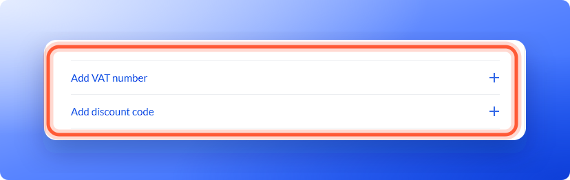

The **Order summary** updates as soon as you apply a code, so you see the new total before you subscribe.

**Before you start**, you need:

- Your discount code or your VAT number.
- A plan you are ready to subscribe to. You add both on the checkout page, before you pay. See [Upgrade your plan](/billing/upgrade).

## Important to note

<Warning>
  - You cannot add a discount code to a subscription you already have from the dashboard.
  - Some codes only work on certain plans or billing cycles. If a code does not cover the plan you chose, it is not applied, and a line under the code field says which plan or billing cycle it works with.
  - A discount lasts as long as the code says. It might cover the first month, a number of months or every payment. After that, the normal price applies.
</Warning>

## Add a discount code

<Steps>
  <Step title="Go to checkout">
    Click your name at the bottom of the sidebar, then **"Plan"**. Click **"Change plan"**, pick your plan and click **"Continue to payment"**.
  </Step>
  <Step title="Open the discount field">
    In the **Order summary** on the right, click **"Add a discount code"**. It sits under the plan and the total.
  </Step>
  <Step title="Enter your code">
    Type or paste your code and click **"Apply"**. The line **Discount code** and your code **applied** shows, with a **"Remove"** link to take it off. In the **Order summary**, a **Promo** line shows what you save, for example **Promo · First month free**, and the total updates.
  </Step>
  <Step title="Subscribe">
    Choose how you pay and click **"Subscribe now"**. See [Add or update your payment method](/billing/payment-methods).
  </Step>
</Steps>

    

If you signed up from a link that included a discount code, it is saved with your trial. The **Choose plan** page shows the offer, and at checkout the code is already in the field, as long as it covers the plan and billing cycle you choose.

## Add a VAT number

If you are buying for a business, add your VAT number before you pay. VAT is a sales tax that applies in many countries. Prices do not include tax, so the checkout shows the tax for your country as a separate **Tax** line.

1. On the checkout page, in the payment form below **Country**, click **"Add VAT number"**.
2. Enter your VAT number and any business details the form asks for.
3. Check the **Tax** line in the **Order summary**, then click **"Subscribe now"**.

In some countries the link has a local name. For example, in Australia it reads **Add ABN**.

## Troubleshooting

<AccordionGroup>
  <Accordion title="My discount code is not accepted">
    A line under the code field says why:

    - **This code isn't valid.** Check that you typed it exactly as you received it.
    - **This code has expired.** or **This code has been used up.** The code can no longer be used.
    - **This code works only with yearly billing.** or **monthly billing.** Click the **"Switch to yearly"** (or **"Switch to monthly"**) button next to the message.
    - **This code works only with the Scale plan.** (or the plan it names). Go back and pick that plan, or email support with the code.

    If you see **Couldn't check the code. Try again.**, click **"Apply"** again.
  </Accordion>
  <Accordion title="I do not see the Add a discount code or Add VAT number links">
    **Add a discount code** is in the **Order summary** on the right. **Add VAT number** is in the payment form, below **Country**. They stay grayed out or missing until the payment form has loaded, so wait a moment. If it shows **Couldn't start checkout**, click **"Try again"**.
  </Accordion>
  <Accordion title="I already subscribed and forgot to add my code or VAT number">
    Email support with your account email and the code or VAT number, and we will tell you what we can do.
  </Accordion>
  <Accordion title="My total includes tax I did not expect">
    Our prices do not include tax. Tax is worked out from your country when you pay, and the **Order summary** shows it on its own **Tax** line.
  </Accordion>
</AccordionGroup>

## What to do next

<Columns cols={3}>
  <Card title="Add or update your payment method" icon="credit-card" href="/billing/payment-methods">
    Pay by card or PayPal.
  </Card>
  <Card title="Billing, renewals and invoices" icon="file-invoice-dollar" href="/billing/billing-and-invoices">
    See when you are charged and download invoices.
  </Card>
  <Card title="Check your plan and usage" icon="gauge-high" href="/billing/plan-and-usage">
    See your renewal date and limits.
  </Card>
</Columns>

Need help? Email [support@askfunnel.com](mailto:support@askfunnel.com).
