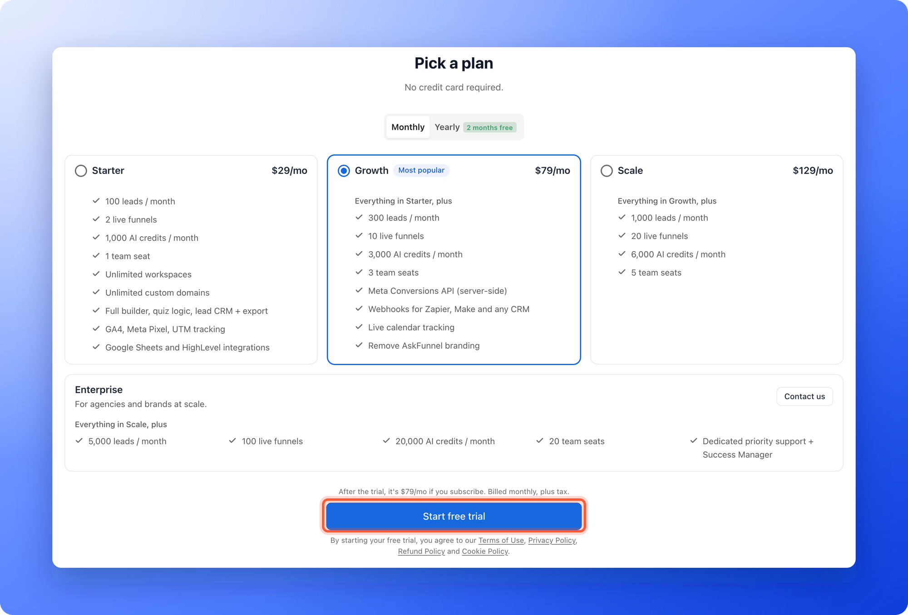
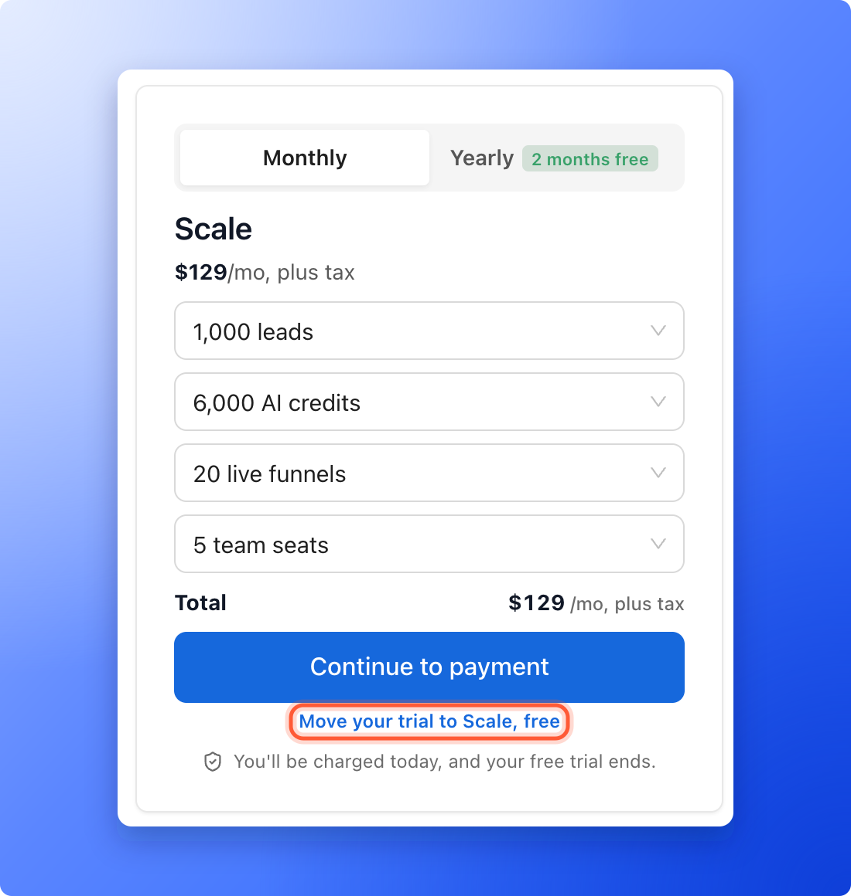

<Callout icon="star" color="#155DFC">
  Available on: **Starter, Growth and Scale**. Enterprise has no self-serve trial.
</Callout>

Try a plan free for 14 days. Every new AskFunnel account can do it. You do not need a credit card, and you are never charged unless you choose to subscribe.

With the free trial, you can:

- **Try any self-serve plan.** Pick Starter, Growth or Scale. You get that plan's limits and features for the whole trial. See [Choose the right plan](/billing/choose-a-plan) to compare them.
- **Start without a card.** Nothing is charged when the trial starts, and nothing is charged when it ends.
- **Switch plans for free.** During the trial you can move to a different plan at no cost. Your trial end date stays the same.
- **Subscribe when you are ready.** You can subscribe at any point in the 14 days.

**Before you start**, you need:

- A permanent email address. Temporary email addresses cannot start a trial, and you get one free trial.

## Important to note

<Warning>
  - Every trial includes 100 AI credits in total, whichever plan you try. The plan's full allowance unlocks when you subscribe.
  - During a trial your email flows can send up to 300 emails in total and up to 100 a day. Emails over a limit wait, they are not lost. See [Email limits and paused sequences](/messages/automated-emails#email-limits-and-paused-sequences).
  - Subscribing ends the trial. If you subscribe on day 5, you are charged that day and the remaining trial days end.
</Warning>

## Start your free trial

<Steps>
  <Step title="Create your account">
    Sign up and answer the quick setup questions. See [Create your account](/getting-started/create-account) if you need a walkthrough.
  </Step>
  <Step title="Pick a plan">
    The last setup screen is titled **Pick a plan**, with the line "No credit card required." Each plan is a card with its price and what it includes. Click a card to choose it. The plan you saw on our pricing page is chosen for you, or Growth when you did not pick one.

    Use the **Monthly** and **Yearly** switch at the top to see prices for each billing cycle. The switch only sets the cycle we suggest when you subscribe later. You can change it then. Under the cards, a line says what the chosen plan costs after the trial, for example "After the trial, it's $79/mo if you subscribe. Billed monthly, plus tax."

    
  </Step>
  <Step title="Click Start free trial">
    Click **"Start free trial"** under the cards. Your trial starts right away and you land in your dashboard. Enterprise is set up with our team, so click **"Contact us"** on the Enterprise card to book a call.
  </Step>
</Steps>

## Check how many days you have left

- The plan card at the bottom of the sidebar says **Free trial** and shows the days left. Click it to see your usage.
- Click your name at the bottom of the sidebar, then **"Plan"**. It shows **Your trial ends on** and the date.

See [Check your plan and usage](/billing/plan-and-usage) for details.

## Subscribe during your trial

When you are ready to keep your plan, click **"Upgrade plan"** on the plan card at the bottom of the sidebar. On the **Plan** page, click **"Change plan"**. The page is titled **Choose plan**. Pick your plan and click **"Continue to payment"**. You are charged the same day and your trial ends. The full steps are in [Upgrade your plan](/billing/upgrade).

If you only want to try a different plan, click it and then click **"Move your trial to [plan name], free"** under the main button instead. There is no charge. You see **You're now on the [plan name] plan.**

## What happens when the trial ends

If you do not subscribe, you are not charged, because no payment method was ever saved. Here is what you see:

- **Trial ended.** The plan card changes to **Trial ended**, and you have a grace period of 7 days to subscribe while you can still use your account.
- **Locked dashboard.** After the grace period, the dashboard shows **Your free trial has ended**. A Global Admin can click **"Upgrade plan"** to subscribe, and sees the day your live funnels pause and the day your data is kept until. Everyone else is asked to contact their Global Admin.
- **Paused funnels.** We email you before your live funnels are paused. Paused funnels stop collecting leads until you subscribe.

## Troubleshooting

<AccordionGroup>
  <Accordion title="I am worried I will be charged when my trial ends">
    You will not be charged automatically. A free trial has no payment method on file, so nothing can be charged. You are only charged after you subscribe and pay on the checkout page.
  </Accordion>
  <Accordion title="It says I already used my free trial">
    Each person gets one free trial, so a second one cannot be started with the same account or email address. You can subscribe to a plan instead. If you think this is a mistake, email support and we will look into it.
  </Accordion>
  <Accordion title="My AI credits show 100, not the amount on my plan">
    Trials are limited to 100 AI credits for the whole trial, and the plan card menu and the **Plan** page show this limit. When you subscribe, your plan's full monthly allowance applies.
  </Accordion>
  <Accordion title="My automated emails stopped during the trial">
    A free trial can send 100 emails a day and 300 in total. At 100 in a day, your sequences pause until the next day's count starts (midnight UTC, which the **Plan** page shows on your own clock) and then continue by themselves. At 300 in total, they pause until you subscribe and continue within a day of subscribing. The plan card and the email sequences pages show where you are. See [Email limits and paused sequences](/messages/automated-emails#email-limits-and-paused-sequences).
  </Accordion>
  <Accordion title="I do not see a Change plan or Upgrade plan button">
    Only Global Admins (the organization owner, or anyone they gave that role to) can change plans. Ask your Global Admin to subscribe.
  </Accordion>
</AccordionGroup>

## What to do next

<Columns cols={3}>
  <Card title="Make the most of your free trial" icon="list-check" href="/billing/make-the-most-of-your-trial">
    A short checklist to test what matters before your 14 days are up.
  </Card>
  <Card title="Choose the right plan" icon="tags" href="/billing/choose-a-plan">
    Compare price, limits and features.
  </Card>
  <Card title="Upgrade your plan" icon="arrow-up" href="/billing/upgrade">
    Subscribe when you are ready.
  </Card>
</Columns>

Need help? Email [support@askfunnel.com](mailto:support@askfunnel.com).
