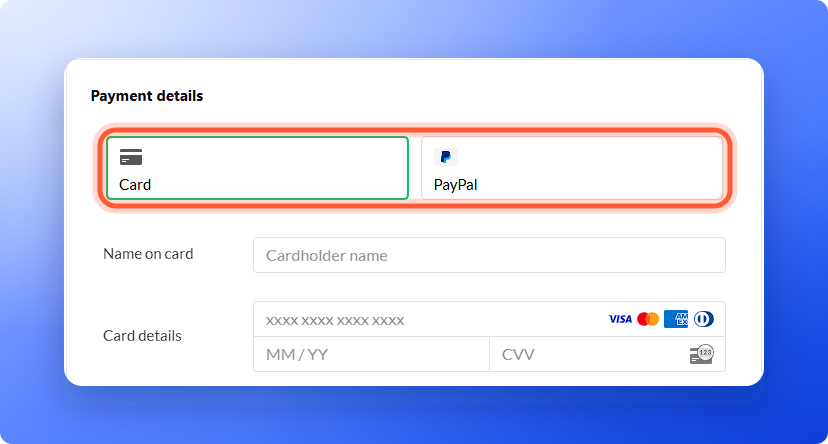
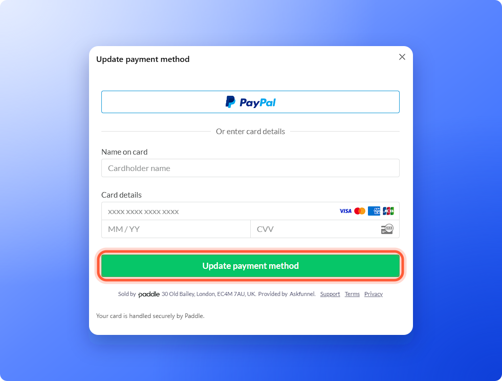

Your payment details are handled securely by Paddle, and AskFunnel does not store full card numbers. A free trial has no payment method. You add one when you subscribe.

**Before you start**, you need:

- A Global Admin role. Only Global Admins can manage payment methods. That is the organization owner, or anyone they gave that role to.

## Choose how you pay when you subscribe

<Steps>
  <Step title="Go to checkout">
    Click your name at the bottom of the sidebar, then **"Plan"**. Click **"Change plan"**, pick your plan and click **"Continue to payment"**. See [Upgrade your plan](/billing/upgrade).
  </Step>
  <Step title="Pay by card">
    On the **Checkout** page, keep the **Card** tab selected in the payment form and fill in:

    1. **Name on card**
    2. **Card details**: the card number, the expiry date (**MM / YY**) and the security code (**CVV**)
    3. **Country**, and **Postcode** if the form asks for it

    Then click **"Subscribe now"**.

    
  </Step>
  <Step title="Or pay with PayPal">
    Click the **PayPal** tab instead. The card fields disappear. Check your **Country**, then click the **PayPal** button and sign in to PayPal to approve the payment.
  </Step>
</Steps>

## Update the payment method on your subscription

<Steps>
  <Step title="Open the Billing page">
    Click your name at the bottom of the sidebar, then click **"Billing"**. On a phone, tap **"Menu"** at the bottom of the screen, then tap your name and **"Billing"**.
  </Step>
  <Step title="Click Update">
    Next to **Payment method**, click **"Update"**. It shows your current card, for example Visa ending 8317.

    - If it says **No payment method on file** with an **"Add"** button, click **"Add"**.
    - If it shows **"Subscribe"**, you do not have an active subscription yet. Click it to choose a plan and pay.
  </Step>
  <Step title="Enter the new method">
    A window titled **Update payment method** opens, and names the card it replaces. Use the **PayPal** button, or enter your card details under **Or enter card details**, then click **"Update payment method"**.

    
  </Step>
</Steps>

You see **Payment method updated.** The new method is used for your next payment.

## If a renewal payment fails

When a renewal payment does not go through, your account keeps working for 14 days from the first failed payment while we try again.

- **What you see:** every Global Admin gets an email, **Your payment didn't go through**. The plan card says **Payment failed** with an **"Update card"** link. On the **Plan** page the label reads **Payment failed**, with **Access ends on** and the date.
- **What to do:** click **"Update card"** and enter a new card in the **Update payment method** window. The overdue payment is taken with the new card, and the pages change back to normal by themselves.
- **A last warning:** two days before the 14 days end, you get an email, **Your account pauses on** a date.
- **If the 14 days pass:** your account becomes read only. Your funnels stay live and keep saving leads, but you do not see new leads, use AI or send follow ups until you update your card. A Global Admin sees **Your last payment didn't go through** with an **"Update card"** button. Everyone else is asked to contact their Global Admin.

## Ways to pay

- **Card:** major credit and debit cards, such as Visa, Mastercard and American Express.
- **PayPal:** pay from your PayPal account.
- **Bank transfer:** only for customers based in Pakistan, Saudi Arabia, the United Arab Emirates and India, by arrangement with us. Email support to set it up. Bank transfers do not renew automatically, so we activate or extend your plan after we confirm your payment. See our [Terms of Use](https://askfunnel.com/terms-of-use).

## Troubleshooting

<AccordionGroup>
  <Accordion title="The payment form does not load">
    You see **Couldn't open the payment form. Try again.** Click **"Try again"**. If it keeps failing, close the window, refresh the page and try once more, or email support.
  </Accordion>
  <Accordion title="My card was declined">
    Check the card number, expiry date, security code and country. Then try another card or PayPal, or ask your bank whether it blocked the payment. A bank can block an international online payment, so ask it to allow international online payments.
  </Accordion>
  <Accordion title="A renewal payment failed">
    We try the payment again, and your account keeps working for 14 days from the first failed payment. Click **"Update card"** on the plan card or the **Plan** page right away to avoid losing access. See [If a renewal payment fails](#if-a-renewal-payment-fails).
  </Accordion>
  <Accordion title="I pay with PayPal but Billing says No payment method on file">
    The **Billing** page shows cards only, so PayPal does not appear there. To switch to a card, click **"Add"** and enter your card details. If you are unsure which method is on your subscription, email support.
  </Accordion>
</AccordionGroup>

## What to do next

<Columns cols={3}>
  <Card title="Billing, renewals and invoices" icon="file-invoice-dollar" href="/billing/billing-and-invoices">
    See when you are charged and download invoices.
  </Card>
  <Card title="Add a discount code or VAT number" icon="ticket" href="/billing/discount-codes-and-vat">
    Enter them at checkout.
  </Card>
  <Card title="Upgrade your plan" icon="arrow-up" href="/billing/upgrade">
    Move to a bigger plan or add capacity.
  </Card>
</Columns>

Need help? Email [support@askfunnel.com](mailto:support@askfunnel.com).
