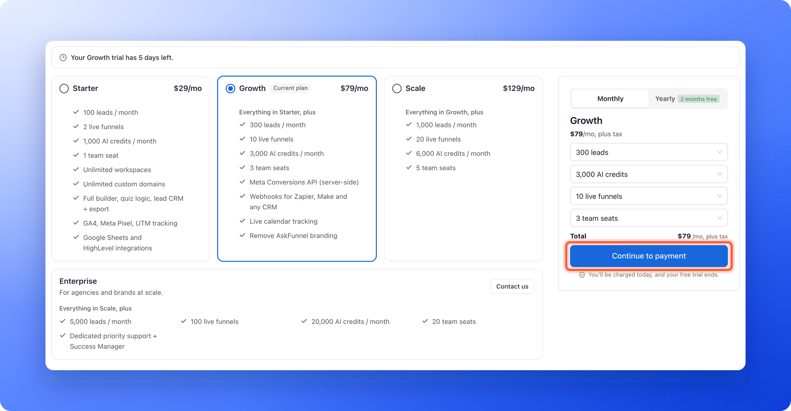

Move to a bigger plan when you need more leads, live funnels, team seats or AI credits, or when you want Growth features such as the Meta Conversions API. You can also add capacity to your current plan without changing plan, or subscribe at the end of your free trial.

**Before you start**, you need:

- A Global Admin role (the organization owner, or anyone they gave that role to). Only a Global Admin can change the plan.
- A card or PayPal account ready for checkout. See [Add or update your payment method](/billing/payment-methods).

## Important to note

<Warning>
  - Upgrades apply right away. On a paid plan, you pay a prorated amount (a share of the price, for the days left in your current billing period), and the exact amount is shown before you confirm. Switching from monthly to yearly billing is also applied right away, so you pay for the year now.
  - Subscribing during a free trial charges you that day, and the rest of your trial ends. See [How the 14-day free trial works](/billing/free-trial).
  - Enterprise is not self-serve. Click **"Contact us"** on the Enterprise plan to talk to our team.
</Warning>

## Upgrade a paid plan

<Steps>
  <Step title="Open the plan page">
    1. Click your name at the bottom of the sidebar, then click **"Plan"**. On a phone, tap **"Menu"** at the bottom of the screen, then tap the plan card.
    2. Click **"Change plan"** at the top right of the **Plan** page. On a phone it is under the plan card.
  </Step>
  <Step title="Pick your plan and add-ons">
    1. On the **Change plan** page, click the plan you want in the list. The current plan is marked **Current plan**.
    2. To add capacity, use the drop-down lists in the panel on the right for leads, AI credits, live funnels and team seats. Each option shows its extra monthly price.
    3. Use the **Monthly** and **Yearly** switch at the top of the panel if you want to change your billing cycle. **Yearly** has a **2 months free** label.

    <Tip>
      If a higher plan covers the capacity you picked for less money, a notice in the panel says so and gives you a **"Switch to [plan name]"** button.
    </Tip>

    On a phone or tablet, the plan, its price and the **Review changes** button are in a bar at the bottom of the screen. Tap the bar to open the **Monthly** and **Yearly** switch and the drop-down lists.
  </Step>
  <Step title="Review the change">
    Click **"Review changes"**. The **Review your change** window shows **Charged today (including tax)**, and **Then (including tax)** with your new price and date. When you are charged today, it also names the card, for example **Charged to your Visa ending 8317.**

    If **"Review changes"** is grayed out, you have not changed anything yet. Adjust your plan or add-ons first.
  </Step>
  <Step title="Confirm and pay">
    Click **"Confirm & pay"**. You see **Plan updated.** and the new capacity is available immediately.
  </Step>
</Steps>

## Subscribe at the end of your free trial

<Steps>
  <Step title="Open the plan page">
    1. Click **"Upgrade plan"** on the plan card at the bottom of the sidebar. Or click your name at the bottom of the sidebar, then click **"Plan"**.
    2. On the **Plan** page, click **"Change plan"**.
  </Step>
  <Step title="Pick your plan and add-ons">
    The page is titled **Choose plan**. Click the plan you want in the list, add capacity if you need it and choose **Monthly** or **Yearly**.
  </Step>
  <Step title="Continue to payment">
    Click **"Continue to payment"**. Under the button you see **You'll be charged today, and your free trial ends.**

    
  </Step>
  <Step title="Enter your payment details">
    The **Checkout** page has your payment form on the left and an **Order summary** on the right. Choose **Card** or **PayPal** in the payment form and add your [VAT number](/billing/discount-codes-and-vat) if you have one. If you have a discount code, click **"Add a discount code"** in the **Order summary**. Then click **"Subscribe now"**.
  </Step>
</Steps>

After payment you return to your dashboard and see **You're all set. Your subscription is active.**

<Tip>
  Only want to try a different plan for now? Click it, then click **"Move your trial to [plan name], free"** under the main button. There is no charge and your trial end date stays the same.
</Tip>

## If your trial or subscription already ended

A Global Admin sees a button on the lock screen: **"Upgrade plan"** after a free trial, or **"Resubscribe"** after a paid plan. It opens the same **Choose plan** page, which says **Your free trial has ended.** or **Your subscription has ended.** and **Subscribe to keep your funnels live.** If your last payment failed, the button is **"Update card"** instead. See [Add or update your payment method](/billing/payment-methods).

## How do I know it is working?

- The **Plan** page shows the new plan name, the **Active** label and your next **Renews on** date.
- The plan card at the bottom of the sidebar shows your plan name.
- The limits on the **Plan** page show the new numbers. See [Check your plan and usage](/billing/plan-and-usage).
- Leads that were locked because you were over your limit unlock as your new capacity allows, oldest first.

## Troubleshooting

<AccordionGroup>
  <Accordion title="I do not see Change plan or Upgrade plan">
    Only Global Admins can change plans. If you are not one, ask your organization owner. You will see the message **Only Global Admins can change the plan. Ask a Global Admin.**
  </Accordion>
  <Accordion title="I cannot switch my billing cycle">
    You cannot switch between monthly and yearly while a promotional discount with an end date is active. The message reads "Switching your billing cycle isn't available while a promotional discount is active. Contact support to change your billing cycle." Email support and we will help you change your cycle.
  </Accordion>
  <Accordion title="The payment form does not load">
    Click **"Try again"** on the **Couldn't start checkout** message. If it keeps failing, click **"Back to plans"** and start again, or email support.
  </Accordion>
  <Accordion title="I was charged a different amount than the plan price">
    Your total can include tax, add-ons, and a prorated amount for the rest of the current period. The **Review your change** window and the **Order summary** show the exact figures before you pay.
  </Accordion>
</AccordionGroup>

## What to do next

<Columns cols={2}>
  <Card title="Check your plan and usage" icon="gauge-high" href="/billing/plan-and-usage">
    See your new limits and renewal date.
  </Card>
  <Card title="Add or update your payment method" icon="credit-card" href="/billing/payment-methods">
    Keep your card or PayPal up to date.
  </Card>
  <Card title="View your billing and invoices" icon="file-invoice" href="/billing/billing-and-invoices">
    Find receipts and payment history.
  </Card>
  <Card title="Use a discount code or VAT number" icon="percent" href="/billing/discount-codes-and-vat">
    Add them at checkout.
  </Card>
</Columns>

Need help? Email [support@askfunnel.com](mailto:support@askfunnel.com).
