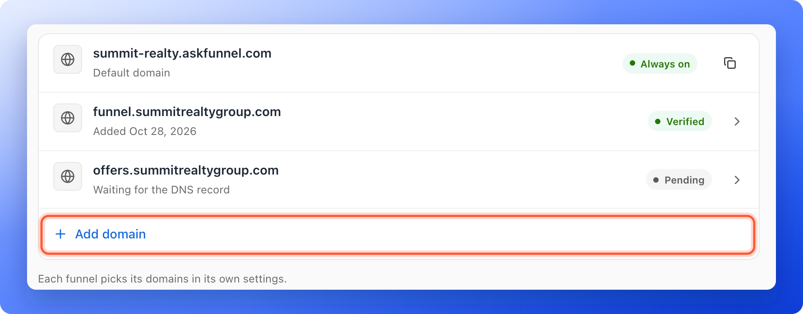
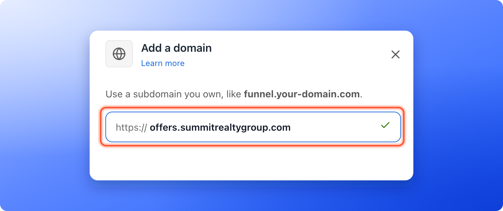
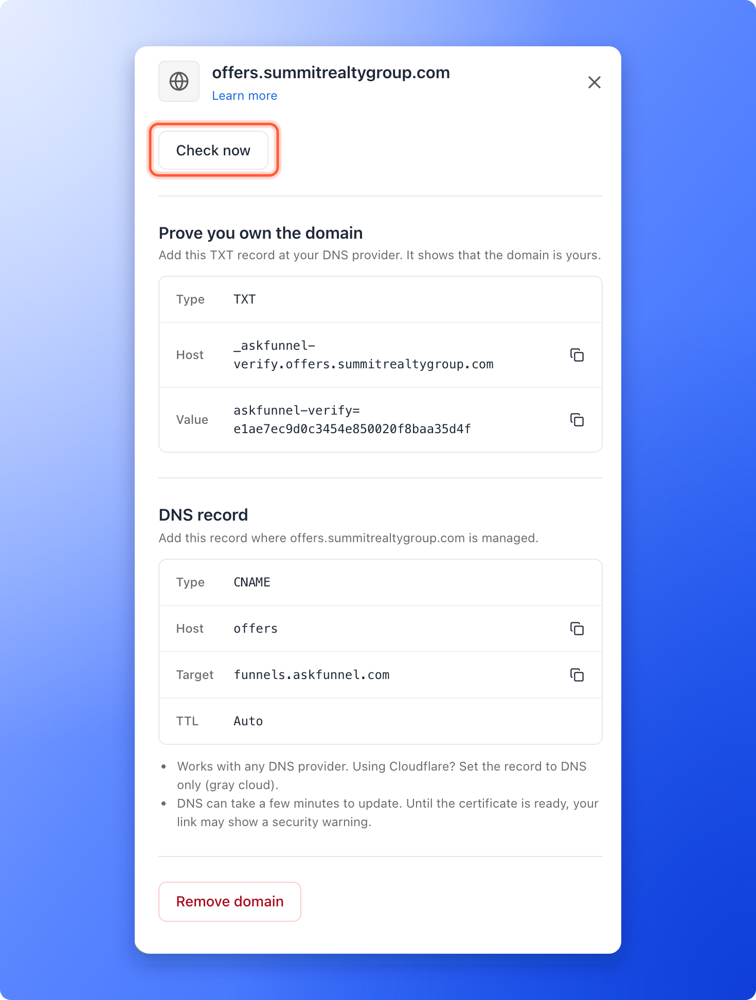
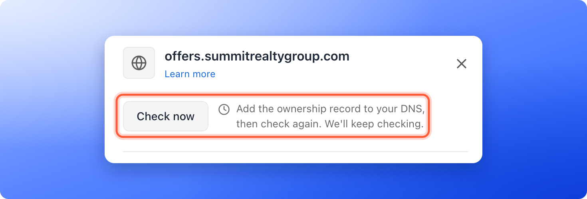

<Callout icon="star" color="#155DFC">
  Available on: **all plans** (Starter, Growth, Scale and Enterprise).
</Callout>

Put your funnels on your own web address, such as `funnel.yourbrand.com`, instead of your free AskFunnel address, such as `summit-realty.askfunnel.com`. It looks more trustworthy in ads and messages and keeps your brand in the link. You connect a domain once for your workspace. After that, you choose which funnels use it.

With a custom domain, you can:

- **Use your own brand in every link.** People see your web address, not askfunnel.com.
- **Keep your main website untouched.** Use a subdomain (a prefix added to your domain, such as `funnel.yourbrand.com`) for your funnels and leave `yourbrand.com` for your website.
- **Choose per funnel.** Turn a domain on for some funnels and leave others on your AskFunnel address.
- **Get a secure link.** AskFunnel secures your address with a certificate for you.

**Before you start**, you need:

- A Workspace Admin or Global Admin role. Only they can add or remove a domain, because **Workspace settings** is for admins only. Content Editors can turn a connected domain on or off for a funnel.
- An active plan. A trial that has ended or a subscription that is inactive cannot add a domain.
- A domain you own, and access to its DNS settings at the company where you bought it, for example Namecheap, GoDaddy or Cloudflare. DNS settings are where that company stores which address each web name opens.
- A subdomain to use, such as `funnel.yourbrand.com` or `survey.yourbrand.com`.

## Important to note

<Warning>
  - Use a subdomain, not a root domain such as `yourbrand.com`. A root domain can conflict with your existing website or email setup.
  - A domain can be connected to only one workspace, and you cannot connect a domain that belongs to askfunnel.com.
  - You add two DNS records: one that proves the domain is yours and one that points it to AskFunnel. The domain is not live until both are in place.
  - An organization on a trial can connect up to 5 domains. A paying organization can connect up to 50.
  - Your default AskFunnel address always keeps working. It cannot be turned off.
</Warning>

## Setup

<Steps>
  <Step title="Add your domain in Workspace settings">
    1. In the sidebar, click **"Settings"**. A menu titled **Workspace settings** opens.
    2. Click **"Domains"**. You see your default address, marked **Always on**, and any domains you have connected.
    3. Click **"Add domain"**.
    4. In the panel **Add a domain**, type your subdomain after **https://**, for example `funnel.yourbrand.com`, and click **"Add domain"** at the bottom of the panel.

    From a funnel, you can also open **Funnel settings**, click **"Domains"**, then click **"Manage domains"**.

    

    

    If you enter a root domain, AskFunnel suggests a subdomain instead. Type any word before your domain, for example "funnel", and click **"Connect"**. Only click **"I understand the risks, use the root domain"** if you are comfortable with DNS settings.
  </Step>
  <Step title="Add the two DNS records at your domain provider">
    The panel now shows two records to add. Each one has copy icons, so you do not have to type anything.

    1. Open a new browser tab and sign in to your domain provider.
    2. Find your **DNS settings** (some providers call it **Advanced DNS**) and add the first record, under **Prove you own the domain**:
       - **Type:** **TXT**
       - **Host:** copy it from AskFunnel. It starts with `_askfunnel-verify`. If your provider adds your main domain name for you, enter only the part before it, for example `_askfunnel-verify.funnel`.
       - **Value:** copy it from AskFunnel. It starts with `askfunnel-verify=`.
    3. Add the second record, under **DNS record**:
       - **Type:** **CNAME**
       - **Host:** the first part of your subdomain. For `funnel.yourbrand.com`, enter **funnel**. If your domain ends in two parts, such as `.co.uk`, still enter only the first part of your subdomain.
       - **Target** (or **Value**): copy it from AskFunnel. It is `funnels.askfunnel.com`.
       - **TTL:** **Auto**, or leave the default.
    4. Save both records.
    5. Go back to AskFunnel and click **"Check now"**. If you are not ready, click **"Finish later"**. Your domain stays in the list as **Pending**.

    

    <Note>
      Using Cloudflare? Set the CNAME record to **DNS only** (the gray cloud), not **Proxied** (the orange cloud).
    </Note>
  </Step>
  <Step title="Wait until the domain is verified">
    AskFunnel checks your records and keeps checking while the panel is open, and the answer appears next to the button. You can also click **"Check now"** again, or close the panel and come back later. To reopen it, click the domain in the list.

    Changes to DNS can take a few minutes, and sometimes up to 24 hours, to reach the whole internet. Until the security certificate is ready, your link may show a security warning.

    When the ownership record is found, you see **Ownership confirmed.** When everything works, you see **Your domain is live**, and the domain shows a green **Verified** label in the list.

    
  </Step>
  <Step title="Choose the domain for your funnel">
    1. Open **"Funnel settings"** for the funnel you want, then click **"Domains"** in the left menu.
    2. Find your domain in the list and turn on the switch next to it. You see **Funnel domains updated**, and the row says **In use**.
    3. Click the copy icon next to the domain to copy the full link for that funnel.

    The change saves right away and goes live within about a minute. You do not need to click **"Save"** or publish again.

    To use the same domain for more funnels, see [Use one custom domain for several funnels, or remove a domain](/funnel-settings/domain-for-several-funnels).
  </Step>
</Steps>

## How do I know it is working?

- In **Workspace settings**, then **Domains**, your domain shows a green **Verified** label.
- In **Funnel settings**, then **Domains**, the switch next to your domain is on and the row says **In use**.
- Paste the copied link into a private browser window. Your funnel opens on your own domain.

## Troubleshooting

<AccordionGroup>
  <Accordion title="My domain stays Pending">
    Open the domain and click **"Check now"**. AskFunnel tells you what it sees:

    - **Add the ownership record to your DNS, then check again.** The TXT record is missing. Add it at your domain provider, then check again.
    - **The ownership record does not match. Copy it again from this page.** The TXT record is there but its **Value** is different. Copy the **Host** and **Value** again with the copy icons.
    - **DNS record not found yet. Add the record at your domain provider, then check again.** Add the CNAME record. Also check that the **Host** is only the first part of your subdomain, for example **funnel**.
    - **The record points to another address instead of funnels.askfunnel.com.** Change the **Target** to `funnels.askfunnel.com`.
    - **Your DNS record points at Cloudflare.** Set the record to **DNS only** (the gray cloud).
    - **Record found. Setting up your domain.** Wait a few minutes and check again.

    For more fixes, see [Fix a custom domain that stays Pending or needs attention](/funnel-settings/fix-custom-domain).
  </Accordion>
  <Accordion title="My domain shows Needs attention">
    Open the domain and read the message at the top of the panel. If it says your domain's settings block certificate issuance, a CAA record at your domain provider is the likely cause. Ask your domain provider to remove it or to allow certificates for your domain, then click **"Check now"**. If it says the domain no longer points to AskFunnel, add the DNS records again, then remove the domain and add it again.
  </Accordion>
  <Accordion title="My browser shows a security warning">
    The security certificate is not ready yet. Wait a few minutes and reload. It usually clears on its own.
  </Accordion>
  <Accordion title="I see This domain is already connected">
    That domain is already connected to a workspace, maybe yours. Open **Workspace settings**, then **Domains** to check. If it belongs to another workspace, remove it there first.
  </Accordion>
  <Accordion title="I see This domain is reserved">
    You cannot connect askfunnel.com or any address that ends in it. Use a domain you own.
  </Accordion>
  <Accordion title="I see Your organization can have up to 5 domains. Remove one first.">
    An organization on a trial can connect up to 5 domains, across all its workspaces. Remove a domain you no longer need, or upgrade your plan. A paying organization can connect up to 50.
  </Accordion>
  <Accordion title="I do not see Settings or Domains">
    Only Workspace Admins and Global Admins can open **Workspace settings**. Ask an admin to add the domain. After that, you can turn it on for your funnels in **Funnel settings**.
  </Accordion>
  <Accordion title="My pending domain disappeared">
    A domain that does not get working DNS records within about 14 days is removed. Add it again and finish the DNS step.
  </Accordion>
</AccordionGroup>

## Manage your domains

- **Turn a domain off for one funnel:** in that funnel's **Funnel settings**, then **Domains**, turn off the switch. The funnel still works on your AskFunnel address.
- **Remove a domain:** in **Workspace settings**, then **Domains**, click the domain, then click **"Remove domain"**. See [Use one custom domain for several funnels, or remove a domain](/funnel-settings/domain-for-several-funnels) before you remove one that funnels use.

<Warning>
  When you remove a domain, your funnels stop working on it right away and links you already shared on it stop working. Your funnels stay available on your AskFunnel address.
</Warning>

## What to do next

<Columns cols={3}>
  <Card title="Set your social preview and favicon" icon="image" href="/funnel-settings/social-preview-and-favicon">
    Choose the title and picture people see when they share your link.
  </Card>
  <Card title="Set up cookies and consent" icon="cookie-bite" href="/funnel-settings/cookies-and-consent">
    Ask people for permission before your funnel tracks them.
  </Card>
  <Card title="Share your funnel" icon="share-nodes" href="/funnels/share-your-funnel">
    Use your new link in ads, messages and social posts.
  </Card>
</Columns>

Need help? Email [support@askfunnel.com](mailto:support@askfunnel.com).
