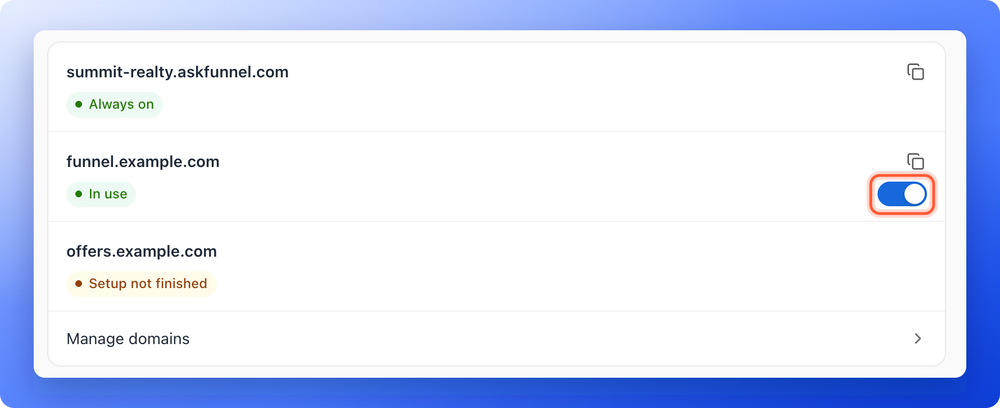
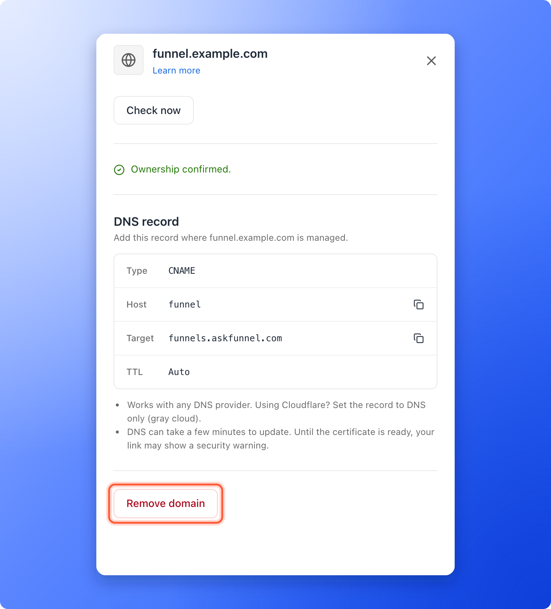
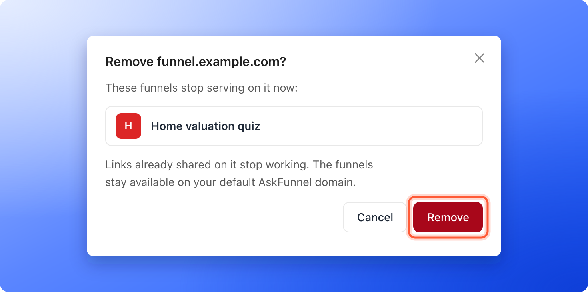

<Callout icon="star" color="#155DFC">
  Available on: **all plans** (Starter, Growth, Scale and Enterprise).
</Callout>

You connect a custom domain once, and then every funnel in your workspace can use it. Each funnel gets its own link on that domain, so one domain such as `funnel.example.com` can serve your home valuation funnel, your buyer guide and your open house funnel at the same time. This page shows how to put several funnels on one domain, how to pick which address a funnel uses, and what happens when you remove a domain.

If you have not connected a domain yet, start with [Connect your custom domain](/funnel-settings/custom-domain).

With one domain for many funnels, you can:

- **Keep one brand in every link.** All your funnels share your domain, and only the end of the link differs.
- **Choose per funnel.** Turn a domain on for some funnels and leave the others on your AskFunnel address.
- **Use several domains for one funnel.** For example one for ads and one for emails.
- **Remove a domain when you no longer need it.** Your funnels stay available on your AskFunnel address.

**Before you start**, you need:

- A domain that shows **Verified** in **Workspace settings**, under **Domains**. See [Connect your custom domain](/funnel-settings/custom-domain).
- To switch a domain on for a funnel, a role that can open **Funnel settings**: Global Admin, Workspace Admin or Content Editor.
- To add or remove a domain, a Workspace Admin or Global Admin role.

## Important to note

<Warning>
  - A funnel's link is your domain, a slash and the funnel's own ending, for example `https://funnel.example.com/home-valuation-x7k2m9p4wd`. The ending is made when the funnel is created and does not change when you rename the funnel.
  - The domain on its own has no page. A visitor who opens only `https://funnel.example.com` is sent to the main part of your domain, `example.com`. If the domain you connected has no subdomain in front of it, visitors are sent to askfunnel.com instead. Always share the full link of a funnel.
  - A domain belongs to one workspace. Funnels of other workspaces cannot use it.
  - Your AskFunnel address, such as `summit-realty.askfunnel.com`, is marked **Always on**. It works for every funnel and cannot be removed or turned off.
  - A funnel is only visible on a domain after you publish it. See [Publish, unpublish and restore an earlier version](/funnels/publish-and-restore).
</Warning>

## Put several funnels on one domain

<Steps>
  <Step title="Check that the domain is Verified">
    In **Workspace settings**, under **Domains**, your domain must show a green **Verified** label. If it shows **Pending** or **Needs attention**, fix it first. See [Fix a custom domain that stays Pending or needs attention](/funnel-settings/fix-custom-domain).
  </Step>
  <Step title="Turn the domain on for your first funnel">
    1. Click **Funnels** in the sidebar, click the funnel, then click **"Settings"** in the funnel's menu. You can also click the three dots (**...**) on the funnel's row, then **"Funnel settings"**.
    2. In the left menu, click **"Domains"**.
    3. Find your domain in the list and turn on the switch next to it. You see **Funnel domains updated**, and the row says **In use**.

    The change saves right away and goes live within about a minute. You do not need to click **"Save"** or publish again.

    
  </Step>
  <Step title="Repeat for your other funnels">
    Open **Funnel settings**, then **Domains**, for each funnel that should use the domain, and turn on the same switch. Every funnel now has its own link on your domain, as in the table below these steps.
  </Step>
  <Step title="Copy each funnel's link and test it">
    Click the copy icon next to the domain to copy the full link of that funnel. You see **Copied**. Paste it into a private browser window to check that the funnel opens on your domain.
  </Step>
</Steps>

For example, three funnels on one domain have these links:

| Funnel | Link |
|---|---|
| Home valuation | `https://funnel.example.com/home-valuation-x7k2m9p4wd` |
| Buyer guide | `https://funnel.example.com/buyer-guide-m4q8z2k7ab` |
| Open house | `https://funnel.example.com/open-house-t9w3c6d1xe` |

## Choose which address a funnel uses

A funnel can be on your AskFunnel address and on several of your domains at the same time. Each domain has its own switch in **Funnel settings**, under **Domains**. A domain that is on says **In use**, and one that is off says **Not in use**. Turn a switch off to stop using that domain for this funnel. The funnel still works on the other addresses.

A domain that is not **Verified** yet says **Setup not finished** and has no switch. Click **"Manage domains"** to finish it.

The **View live** item in the builder's publish menu, the eye icon and **View funnel** in your funnel list open the first custom domain you switched on. If none is on, they open your AskFunnel address. To share a different address, copy it with the copy icon.

## Remove a domain

Remove a domain when you stop using it, or to connect it to a different workspace.

<Steps>
  <Step title="Plan the move">
    Removing a domain stops every funnel from being served on it, and links you already shared on it stop working. If your funnels should keep a custom address, first connect another domain, switch your funnels to it and update the links in your ads, emails and bio.
  </Step>
  <Step title="Remove the domain">
    1. In the sidebar, click **"Settings"**, then **"Domains"**. From a funnel's **Domains** page, you can also click **"Manage domains"**.
    2. Click the domain. A panel opens.
    3. Click **"Remove domain"** at the bottom of the panel.
    4. A window asks **Remove** followed by your domain and a question mark. It lists the funnels that stop serving on the domain right away. Click **"Remove"** to confirm. You see **Domain removed**.

    

    
  </Step>
  <Step title="Clean up at your domain provider">
    AskFunnel does not change your DNS settings. At the company that manages your domain, delete the CNAME record that points to `funnels.askfunnel.com` and the TXT record that starts with `_askfunnel-verify` if you no longer need them.
  </Step>
</Steps>

<Warning>
  Your funnels stay available on your AskFunnel address, but they lose the removed domain from their settings. If you add the domain again later, switch it on again for each funnel.
</Warning>

## How do I know it is working?

- In **Funnel settings**, under **Domains**, the switch next to your domain is on for each funnel that should use it.
- Each funnel's own link opens that funnel in a private browser window.
- After a removal, the domain is gone from **Workspace settings**, and its link no longer opens your funnel.

## Troubleshooting

<AccordionGroup>
  <Accordion title="My visitors land on my main website instead of my funnel">
    They opened the domain without the funnel's ending. A domain has no page of its own, so AskFunnel sends them to the main part of your domain, or to askfunnel.com when the domain has no subdomain in front of it. Share the full link of the funnel, which you can copy with the copy icon under **Domains** in **Funnel settings**.
  </Accordion>
  <Accordion title="There is no switch next to my domain">
    If the row says **Setup not finished**, the domain is not **Verified** yet. Click **"Manage domains"** and finish the setup. See [Fix a custom domain that stays Pending or needs attention](/funnel-settings/fix-custom-domain).
  </Accordion>
  <Accordion title="The funnel does not open on my domain">
    Check that the switch is on, that the funnel is published and shows **Live**, and wait about a minute. Test the full link in a private browser window.
  </Accordion>
  <Accordion title="I do not see Domains in my settings or Remove domain">
    Only Workspace Admins and Global Admins can open **Workspace settings** and add or remove domains. Ask an admin. You can still switch a domain on or off for a funnel in **Funnel settings**.
  </Accordion>
  <Accordion title="I see This domain is already connected when I add it">
    The domain is connected to a workspace already, maybe another one of yours. Open **Workspace settings**, then **Domains** in that workspace and remove it there first. A domain can only be connected to one workspace.
  </Accordion>
  <Accordion title="I removed the wrong domain">
    Add it again in **Workspace settings**, add the DNS records again if AskFunnel asks for them, and switch it back on for each funnel in **Funnel settings**, under **Domains**.
  </Accordion>
  <Accordion title="Can I change the ending of a funnel's link?">
    No. The ending is set when the funnel is created, and renaming the funnel does not change it. A funnel's link stays the same for as long as the funnel exists.
  </Accordion>
  <Accordion title="Can I remove my AskFunnel address?">
    No. It is marked **Always on**, and every funnel always works on it.
  </Accordion>
</AccordionGroup>

## What to do next

<Columns cols={3}>
  <Card title="Connect your custom domain" icon="globe" href="/funnel-settings/custom-domain">
    Add and verify a new domain.
  </Card>
  <Card title="Share your funnel" icon="share-nodes" href="/funnels/share-your-funnel">
    Use your links in ads, messages and social posts.
  </Card>
  <Card title="Track campaigns with UTM links" icon="link" href="/analytics/utm-tracking">
    Add tags to your funnel links.
  </Card>
</Columns>

Need help? Email [support@askfunnel.com](mailto:support@askfunnel.com).
