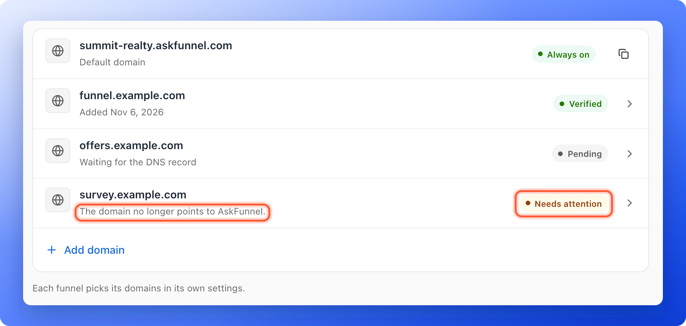
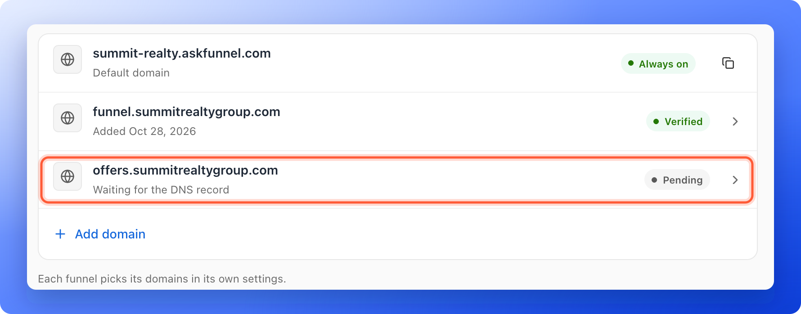
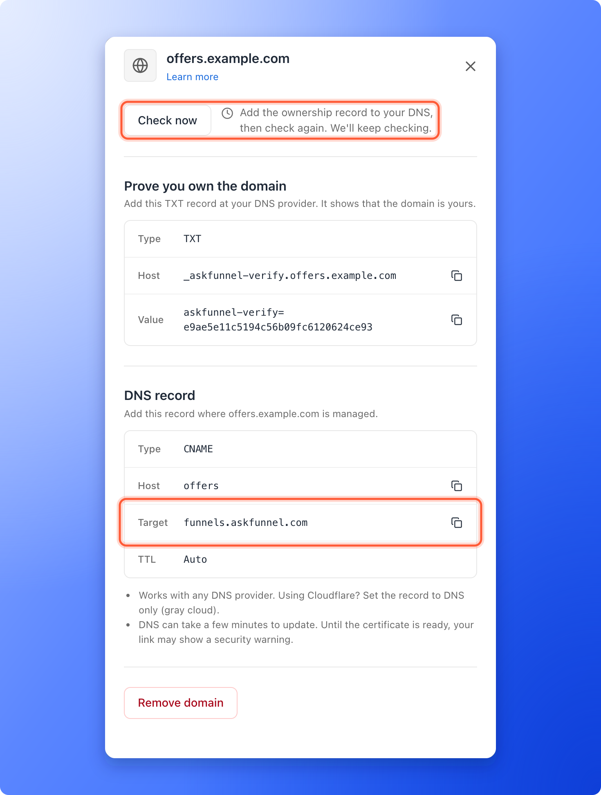

Your domain is connected, but it has not turned green. This page helps you find out why and fix it. Most problems come from the DNS records (the entries at your domain provider that prove the domain is yours and point your web address to AskFunnel), and most fixes take a minute. After you fix them, DNS changes need a few minutes to spread, and sometimes up to 24 hours.

If you have not connected a domain yet, start with [Connect your custom domain](/funnel-settings/custom-domain).

**Before you start**, you need:

- A Workspace Admin or Global Admin role. Only they can open **Workspace settings**, where your domains are listed.
- Access to the DNS settings at the company that manages your domain, for example Namecheap, GoDaddy or Cloudflare.

## What the statuses mean

Each domain in **Workspace settings**, under **Domains**, shows one of three labels.

| Status | What it means | What to do |
|---|---|---|
| **Pending** | AskFunnel is waiting for your DNS records, or for the security certificate after it found them. The line under the domain says **Waiting for the DNS record**. | Follow the steps below. |
| **Verified** | The domain is live. | Turn it on for your funnels in **Funnel settings**. |
| **Needs attention** | Something blocks the domain and waiting will not fix it. The reason is written under the domain name. | See [Fix a domain that needs attention](#fix-a-domain-that-needs-attention). |

## Important to note

<Warning>
  - A domain that never gets working DNS records is removed after about 14 days. Add it again and finish the DNS step.
  - You cannot choose a domain for a funnel until it is **Verified**. In **Funnel settings**, under **Domains**, the domain says **Setup not finished** and has no switch.
  - Your AskFunnel address, such as `summit-realty.askfunnel.com`, keeps working while you fix your domain.
</Warning>

## Fix a Pending domain

<Steps>
  <Step title="Ask AskFunnel what it sees">
    1. In the sidebar, click **"Settings"**, then click **"Domains"**. From a funnel, you can also open **Funnel settings**, click **"Domains"**, then click **"Manage domains"**.
    2. Click your domain in the list. A panel opens with the records to add.
    3. Click **"Check now"**. A line next to the button briefly says **Checking your domain...**, then it tells you what AskFunnel sees.

    
  </Step>
  <Step title="Match the message to a fix">
    The message tells you what to change.

    - **Add the ownership record to your DNS, then check again.** AskFunnel cannot see the TXT record yet. The record is missing, it is in the wrong place, or it has not spread yet. Go to step 3.
    - **The ownership record does not match. Copy it again from this page.** A TXT record is there, but its **Value** is different. Copy the **Host** and the **Value** again. Go to step 3.
    - **DNS record not found yet. Add the record at your domain provider, then check again.** AskFunnel cannot see the CNAME record. Go to step 3.
    - **The record points to another address instead of funnels.askfunnel.com.** The record exists but has the wrong **Target**. Change the **Target** to `funnels.askfunnel.com`. Go to step 3.
    - **Your DNS record points at Cloudflare.** Your domain uses Cloudflare and the record is **Proxied** (the orange cloud). Set it to **DNS only** (the gray cloud). Go to step 3.
    - **Record found. Setting up your domain.** Your records are correct. The security certificate is being set up, which takes a few minutes. Wait, then check again. Your link may show a security warning until it is done.
    - **Waiting for DNS. Check again in a few minutes.** AskFunnel couldn't look up your domain this time. Check again in a few minutes.

    
  </Step>
  <Step title="Correct the records at your domain provider">
    Open a new tab and sign in where your domain's DNS is managed. Find the records for your domain and make them look like this. Use the copy icons in the panel, so nothing is mistyped.

    **The ownership record (TXT):**

    - **Type:** **TXT**
    - **Host:** the **Host** from AskFunnel. It starts with `_askfunnel-verify`. If your provider adds your main domain name for you, enter only the part before it, for example `_askfunnel-verify.funnel`.
    - **Value:** the **Value** from AskFunnel. It starts with `askfunnel-verify=`.

    **The record that points your address to AskFunnel (CNAME):**

    - **Type:** **CNAME**
    - **Host:** everything before your main domain name. For `funnel.yourbrand.com`, enter **funnel**. Do not type the whole address, or some providers add your domain twice and the record never works.
    - **Target** (or **Value**): `funnels.askfunnel.com`
    - **TTL:** **Auto**, or leave the default.

    Then save the records.

    <Tip>
      - A name can have only one CNAME. If the same **Host** already has another record, such as an A record, your provider may refuse the new record or keep using the old one. Delete the old record first.
      - Each domain has its own ownership record. If you removed and added the domain again, copy the new **Value** from the panel.
    </Tip>
  </Step>
  <Step title="Check again and wait">
    Go back to AskFunnel, open the domain and click **"Check now"** again. While the panel is open, AskFunnel keeps checking for you and says **We'll keep checking.**

    When the ownership record is found, you see **Ownership confirmed.** When everything works, you see **Your domain is live** and the domain shows a green **Verified** label. Then [choose the domain for your funnel](/funnel-settings/custom-domain#setup).
  </Step>
</Steps>

## Fix a domain that needs attention

The reason is written under the domain name in the list, and at the top of the domain's panel. The two you are most likely to see:

- **A CAA record blocks the certificate.** A CAA record is a DNS entry that lists which companies may create security certificates for your domain. If yours does not allow AskFunnel's certificate, the domain shows **Needs attention**, with a message that your domain's settings block certificate issuance. Ask your domain provider to remove the CAA record or to allow certificates for your domain, then click **"Check now"**.
- **The domain no longer points to AskFunnel.** If your DNS records were deleted or changed after the domain went live, the domain shows **Needs attention** and your funnels stop opening on it. Add the DNS records again, then remove the domain and add it again. To remove it, open the domain and click **"Remove domain"**.

Open the domain to see the full reason, the records to add and **"Remove domain"**. **"Check now"** looks at the domain again and shows a short line. It says **Your domain is live.** when the domain works again. If the panel only says **We couldn't verify this domain yet. Check the DNS record below, then check again.**, compare your records with step 3.

## Root domains and provider notes

We recommend a subdomain such as `funnel.yourbrand.com`, because a root domain like `yourbrand.com` can conflict with your existing website or email. If you still connect a root domain, the **Host** is **@**, and the provider must support a CNAME at the root:

- **Cloudflare:** does this automatically.
- **Namecheap and Hostinger:** call it an ALIAS record.
- **GoDaddy:** connect `www.yourbrand.com` instead and forward the root domain to it.

Menu names change from time to time, but these are the places to look:

- **Namecheap:** open your domain list, click **Manage** next to the domain, open the **Advanced DNS** tab and add a **TXT Record** and a **CNAME Record**.
- **GoDaddy:** open your domain, go to **DNS** and click **Add** to create a **TXT** record and a **CNAME** record.
- **Cloudflare:** open **DNS**, then **Records**. In the **Proxy status** column, make sure the CNAME record says **DNS only**.

<Note>
  If your domain's name servers (the servers that answer for your domain) are at a different company than the one you bought it from, add the records there. Records added at the wrong company are never seen.
</Note>

## How do I know it is working?

- In **Workspace settings**, under **Domains**, your domain shows a green **Verified** label.
- In **Funnel settings**, under **Domains**, you can turn the switch on next to your domain. The row says **In use** when it is on.
- Your funnel opens on your own domain in a private browser window.

## Troubleshooting

<AccordionGroup>
  <Accordion title="It stays Pending for hours">
    Open the domain and click **"Check now"** to read the message. If it says a record was not found, compare your records with step 3 letter by letter. Also check that you added them at the company that manages your DNS, and that the **Host** holds only the part before your main domain name. If the message says your domain is being set up, wait a little longer. If you never fix it, AskFunnel removes the domain after about 14 days.
  </Accordion>
  <Accordion title="The domain says Verified but my funnel does not open on it">
    Being **Verified** only means the domain is connected. Open **Funnel settings** for the funnel, click **"Domains"** and turn on the switch next to your domain. The funnel must also be published, so check that it shows **Live** in your funnel list. The change goes live within about a minute. See [Publish, unpublish and restore an earlier version](/funnels/publish-and-restore).
  </Accordion>
  <Accordion title="My browser shows a security warning">
    The security certificate is not ready yet. Wait a few minutes and reload. If the domain still says **Pending** after a long time, use **"Check now"**.
  </Accordion>
  <Accordion title="I see This domain is already connected">
    That domain is already connected to a workspace, maybe yours. Open **Workspace settings**, then **Domains** to check. If it belongs to another workspace, remove it there first.
  </Accordion>
  <Accordion title="I see This domain is reserved">
    You cannot connect askfunnel.com or any address that ends in it. Use a domain you own.
  </Accordion>
  <Accordion title="I see Your trial has ended or Your subscription has ended when I add a domain">
    Connecting a domain needs an active plan. If your last payment did not go through, you see **Your last payment didn't go through. Update your card to keep your funnels live.** A Global Admin can subscribe, resubscribe or update the card. See [Upgrade your plan](/billing/upgrade).
  </Accordion>
  <Accordion title="I see We can't add more domains right now">
    Email [support@askfunnel.com](mailto:support@askfunnel.com) and we will help you connect your domain.
  </Accordion>
  <Accordion title="I do not see Settings or Domains">
    Only Workspace Admins and Global Admins can open **Workspace settings**. Ask an admin to fix the domain.
  </Accordion>
</AccordionGroup>

## What to do next

<Columns cols={3}>
  <Card title="Connect your custom domain" icon="globe" href="/funnel-settings/custom-domain">
    The full setup, from adding the domain to choosing it for a funnel.
  </Card>
  <Card title="Share your funnel" icon="share-nodes" href="/funnels/share-your-funnel">
    Use your link in ads, messages and social posts.
  </Card>
  <Card title="Set your social preview and favicon" icon="image" href="/funnel-settings/social-preview-and-favicon">
    Choose the title and picture people see when they share your link.
  </Card>
</Columns>

Need help? Email [support@askfunnel.com](mailto:support@askfunnel.com).
