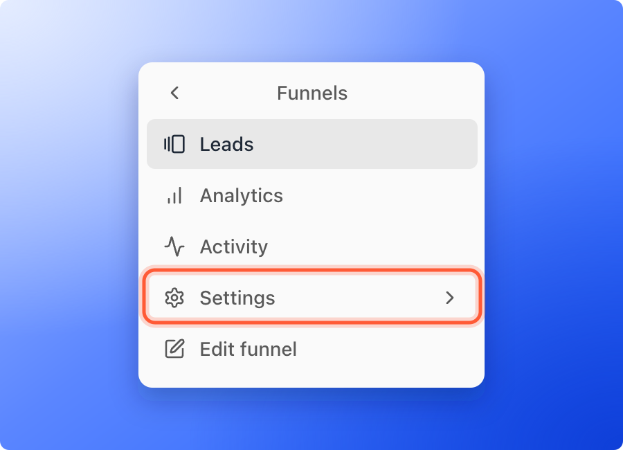
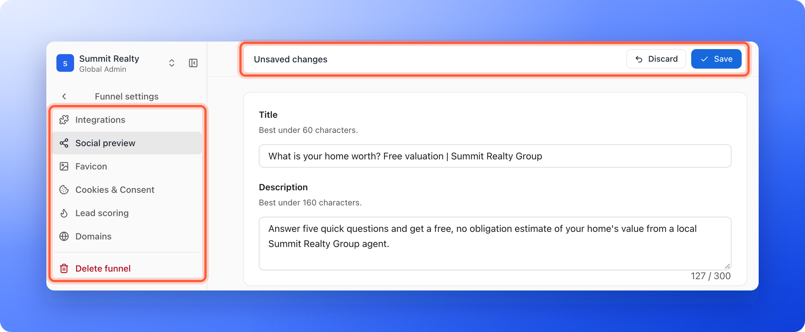
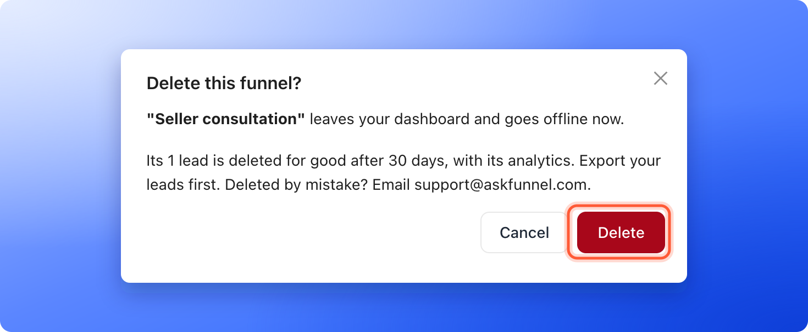

**Funnel settings** is the one place for everything that belongs to a single funnel but is not part of its pages: where its leads go, which tracking it uses, how its link looks when shared, its cookie banner, its lead scoring and its web addresses. This page is a map of the settings pages. It also shows which changes need **"Save"** and how to delete a funnel.

| Page | What you do there | Guide |
| --- | --- | --- |
| **Integrations** | Under **Send leads to**, connect webhooks, GoHighLevel and Google Sheets. Under **Messaging**, see the WhatsApp number of your workspace. Under **Tracking**, connect Meta Pixel, Google Analytics and TikTok Pixel, and set up **Tracking links**. | [Webhooks](/integrations/webhooks), [HighLevel](/integrations/highlevel), [Google Sheets](/integrations/google-sheets), [Meta Pixel](/integrations/meta-pixel), [Google Analytics](/integrations/google-analytics), [TikTok Pixel](/integrations/tiktok-pixel), [Tracking links](/integrations/ad-tracking-links) |
| **Social preview** | Set the title, description and picture people see when they share your link. | [Social preview and favicon](/funnel-settings/social-preview-and-favicon) |
| **Favicon** | Set the small icon in the browser tab. | [Social preview and favicon](/funnel-settings/social-preview-and-favicon) |
| **Cookies & Consent** | Turn the cookie banner on or off, choose how much visitor activity is tracked and add your own privacy and cookie policy links. | [Cookies and consent](/funnel-settings/cookies-and-consent) |
| **Lead scoring** | Set the score ranges that label leads Cold, Warm or Hot. | [Lead scoring](/funnel-settings/lead-scoring) |
| **Domains** | Choose which web addresses open this funnel. | [Custom domain](/funnel-settings/custom-domain) |
| **Delete funnel** | Remove the funnel. Only Global Admins and Workspace Admins see this page. | [Delete a funnel](#delete-a-funnel) |

**Before you start**, you need:

- A funnel, and a role that can open **"Funnel settings"**: Global Admin, Workspace Admin or Content Editor. Contacts Managers do not see **Settings** in a funnel's menu.
- To delete a funnel, a Global Admin or Workspace Admin role.

## Important to note

<Warning>
  - Changes on **Social preview**, **Favicon**, **Cookies & Consent** and **Lead scoring** need **"Save"**. Switching to another page before you save asks you to discard your edits first.
  - Saved changes go live right away. You do not need to publish the funnel again. When the funnel is live, you see **Settings saved. Your live funnel is updated.**
  - Under **Send leads to**, only Workspace Admins and Global Admins can make changes. Content Editors see the cards marked **Admins only**.
  - Deleting a funnel cannot be undone from the app. Its leads, notes and analytics are permanently deleted after 30 days.
</Warning>

## Open Funnel settings

<Steps>
  <Step title="Open the settings of your funnel">
    - **From the funnel:** click **Funnels** in the sidebar, click your funnel, then click **"Settings"** in the funnel's menu on the left.
    - **From your funnels list:** click the three dots (**...**) on the funnel's row, then click **"Funnel settings"**.
    - **From the builder:** click the gear icon at the top right.

    
  </Step>
  <Step title="Pick a page">
    The left menu now says **Funnel settings** and lists the pages. Click one. The settings open on **Integrations**. The title at the top shows the page you are on, with your funnel's name and its status (**Live** or **Draft**) under it. Click the arrow at the top of the menu to go back to the funnel.

    

    On a phone, **Funnel settings** opens on the list of its pages. Tap one to open it.
  </Step>
</Steps>

## Which changes need Save

When you change something that needs saving, a bar with **Unsaved changes** appears at the top, with **"Discard"** and **"Save"**. Click **"Save"** to keep your edits. If a value is not valid, AskFunnel shows **Fix the highlighted fields before saving.** If you switch pages with unsaved edits, a window asks **Discard unsaved changes?** Click **"Keep editing"** to stay or **"Discard changes"** to leave.

These changes need **"Save"**:

- **Social preview** and **Favicon**.
- The cookie banner and the policy links in **Cookies & Consent**.
- **Lead scoring**.

These changes save as you make them:

- **Analytics tracking depth** in **Cookies & Consent**. You see **Analytics tracking depth updated**.
- Webhooks, GoHighLevel and Google Sheets under **Send leads to**.
- Choosing which domains a funnel uses in **Domains**. You see **Funnel domains updated**.

Meta Pixel, Google Analytics and TikTok Pixel each open in a side panel with their own **"Save"**. See the guide of each one.

## Delete a funnel

Delete a funnel you will never use again, such as a finished campaign or a test. If you may want it back, take it offline instead. See [Publish, unpublish and restore an earlier version](/funnels/publish-and-restore).

<Steps>
  <Step title="Export the leads you need">
    You can no longer open the funnel's leads in the dashboard after you delete it. [Export your leads](/leads/export-contacts) first.
  </Step>
  <Step title="Start the delete">
    - **From your funnels list:** click the three dots (**...**) on the funnel's row, then click **"Delete funnel"**. It is the red item at the bottom.
    - **From Funnel settings:** click **"Delete funnel"** at the bottom of the left menu, then click the **"Delete funnel"** button.
  </Step>
  <Step title="Confirm">
    A window titled **Delete this funnel?** names the funnel and says how many leads and notes go with it. Click **"Delete"** to confirm, or **"Cancel"** to keep the funnel. From **Funnel settings**, you see **Funnel deleted** and go back to your funnels list. From the list, the funnel's row disappears.

    
  </Step>
</Steps>

<Warning>
  - A live funnel goes offline immediately, and visitors can no longer open its link.
  - The funnel and its leads disappear from the dashboard, and there is no undo button. If you delete a funnel by mistake, email [support@askfunnel.com](mailto:support@askfunnel.com) within 30 days.
  - Leads you already sent to other tools stay there.
</Warning>

## How do I know it is working?

- After a save, the **Unsaved changes** bar disappears and you see **Settings saved**.
- After a delete, the funnel is gone from your list. From **Funnel settings**, you also see **Funnel deleted**.

## Troubleshooting

<AccordionGroup>
  <Accordion title="I see No access">
    Your role cannot open funnel settings. Contacts Managers work with leads, not with funnel settings. Ask a Global Admin or Workspace Admin to change your role. See [What a Contacts Manager can see and do](/workspaces/contacts-manager).
  </Accordion>
  <Accordion title="I do not see the Delete funnel page or Delete funnel">
    Only Global Admins and Workspace Admins can delete funnels. Content Editors can edit a funnel and its settings, but not delete it.
  </Accordion>
  <Accordion title="The window says my funnel has more than the 400-lead safe delete limit">
    A funnel with more than 400 leads cannot be deleted, from the funnels list or from **Funnel settings**. Export the leads first, then email support to archive the funnel. See [Export your leads](/leads/export-contacts).
  </Accordion>
  <Accordion title="I see Your role doesn't permit deleting funnels in this workspace">
    Deleting needs a Global Admin or Workspace Admin role in this workspace. Ask one of them to delete the funnel.
  </Accordion>
  <Accordion title="I see Couldn't save funnel settings">
    Try again in a minute. If it keeps happening, check that your plan is active, then email support. See [Check your plan and usage](/billing/plan-and-usage).
  </Accordion>
  <Accordion title="I deleted a funnel by mistake">
    There is no undo button. Within 30 days, email [support@askfunnel.com](mailto:support@askfunnel.com) with the name of the funnel and its workspace, and we can restore it with its leads and notes. You then publish it again and reconnect its integrations. After 30 days it is permanently deleted and cannot be restored.
  </Accordion>
  <Accordion title="Does a deleted funnel still count toward my live funnel limit?">
    No. A deleted funnel is taken offline, so it no longer uses one of your live funnels.
  </Accordion>
</AccordionGroup>

## What to do next

<Columns cols={2}>
  <Card title="Set your social preview and favicon" icon="image" href="/funnel-settings/social-preview-and-favicon">
    Choose the title, picture and icon people see.
  </Card>
  <Card title="Set up cookies and consent" icon="cookie-bite" href="/funnel-settings/cookies-and-consent">
    Decide whether visitors see a cookie banner.
  </Card>
  <Card title="Connect your custom domain" icon="globe" href="/funnel-settings/custom-domain">
    Put your funnels on your own web address.
  </Card>
  <Card title="Read your funnels list" icon="table-list" href="/funnels/funnels-list">
    Understand every column and menu of your funnels list.
  </Card>
</Columns>

Need help? Email [support@askfunnel.com](mailto:support@askfunnel.com).
