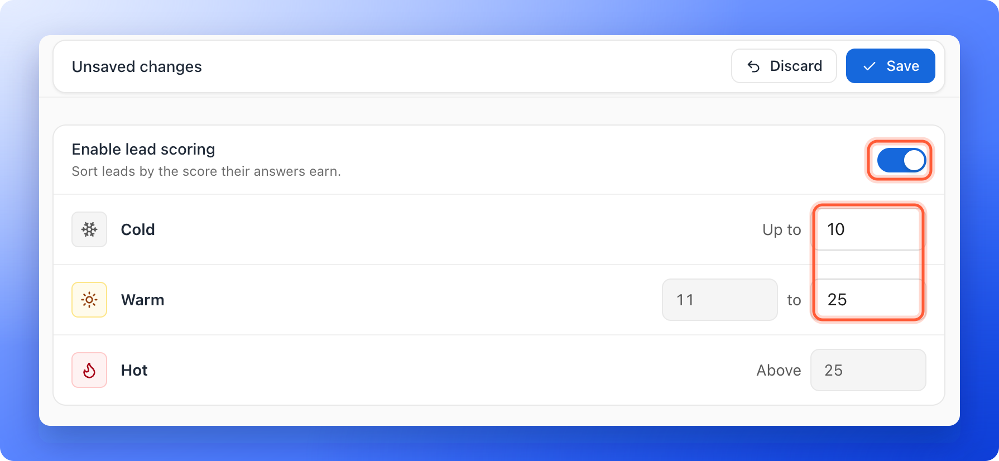
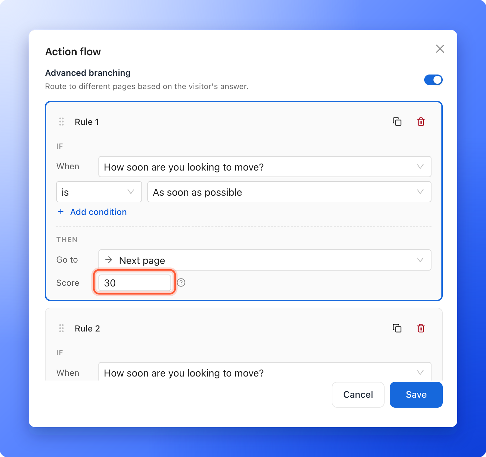
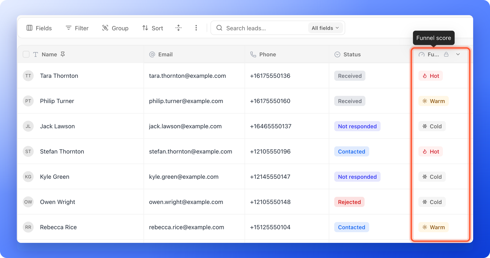

Lead scoring helps you follow up with the right people first. You give points to the quiz answers that signal a serious buyer. When someone finishes your funnel, AskFunnel adds up their points and labels the lead **Cold**, **Warm** or **Hot** in your leads table.

Setting it up has two parts:

1. **Set the score ranges** for Cold, Warm and Hot in your funnel settings.
2. **Give points** to answers in your quiz questions.

**Before you start**, you need:

- A funnel with at least one quiz question. See [Build quiz questions](/funnels/quiz-questions).
- A role that can open **"Funnel settings"**: Global Admin, Workspace Admin or Content Editor.

## Important to note

<Warning>
  - You need both parts. If no answer gives points, every lead scores 0 and lands in **Cold**.
  - The leads table shows the **Cold**, **Warm** or **Hot** label, not the number of points.
  - Points you change apply to new leads after you publish. If you change the ranges, the labels in your leads table follow the new ranges.
</Warning>

## Setup

<Steps>
  <Step title="Turn on lead scoring and set your ranges">
    1. Open **Funnel settings** for your funnel: click the three dots (**...**) on its row in the funnel list, then click **"Funnel settings"**. You can also click your funnel and then **"Settings"** in its menu.
    2. In the left menu, click **"Lead scoring"**.
    3. Turn on **Enable lead scoring**.
    4. On the **Cold** row, enter the highest score that is still **Cold** after **Up to**, for example 10.
    5. On the **Warm** row, enter the highest score that is still **Warm** in the second box, for example 25. The first box fills in for you (11).
    6. The **Hot** row fills in for you. It means **Above** your Warm number, here 25.
    7. Click **"Save"** in the bar at the top.

    

    With these numbers, a lead with 10 points or fewer is **Cold**, 11 to 25 is **Warm**, and 26 or more is **Hot**.
  </Step>
  <Step title="Give points to your quiz answers">
    You set points in the **Action flow** of a quiz, as a rule under **Advanced branching**. Rules only work in a quiz set to **Single**.

    1. Open your funnel in the builder and go to the page with your quiz.
    2. Click the quiz to select it and make sure it is set to **Single**.
    3. In the left panel, find **Action flow** and click the line under it. The **Action flow** window opens.
    4. Turn on **Advanced branching**, then click **"Add a rule"**.
    5. Under **IF**, next to **When**, pick the question, choose **is** and pick an answer, for example "As soon as possible".
    6. Under **THEN**, type the points next to **Score**, for example 30.
    7. To score more answers, click **"Add rule"** and repeat. Click **"Save"** when you are done.

    

    **Go to** is optional. Leave it on **Next page** to keep the normal route and only add points. Choose a page only if you also want to send people there.

    <Tip>
      A rule can look at an earlier question too. Under **When**, pick the question, and use **Add condition** to combine answers with **and** or **or**.
    </Tip>
  </Step>
  <Step title="Publish and check your leads">
    Click **"Publish"** at the top right. When people submit your form, the leads table gets a **Funnel score** column with a **Cold**, **Warm** or **Hot** label for each lead. The column is narrow, so its title shows cut short as **Fu...**. Point at the title to read the full name.

    
  </Step>
</Steps>

## How do I know it is working?

- In **Funnel settings**, **Lead scoring** shows your ranges after you save.
- In the builder, the **Action flow** of your quiz shows how many rules you added, for example **3 rules**.
- Submit a test lead with your best answers, then open your leads table. The **Funnel score** column should show **Hot**. See [View and manage your leads](/leads/view-and-manage-leads).

## How the points add up

AskFunnel adds the points of every rule that matches a lead's answers. Points are whole numbers from -10,000 to 10,000, and you can use a negative number to take points away. A question can have up to 20 rules.

For example, with the ranges above:

- "When do you plan to buy?" Within one month gives 25 points. Within three months gives 15.
- "What is your budget?" Above $500,000 gives 10 points.
- A lead who picks "Within one month" and "Above $500,000" has 35 points and is **Hot**.
- A lead who picks "Within three months" and a lower budget has 15 points and is **Warm**.

## Troubleshooting

<AccordionGroup>
  <Accordion title="Every lead is Cold">
    No answer is giving points yet, or your **Cold** number is too high. Open the **Action flow** of your quiz, check that each rule has a **Score** above 0, and check your ranges in **Funnel settings**.
  </Accordion>
  <Accordion title="There is no Funnel score column in my leads table">
    The column appears once you set your ranges or give points to answers. Without ranges you only see a number, not **Cold**, **Warm** or **Hot**. Turn on **Enable lead scoring** and click **"Save"**.
  </Accordion>
  <Accordion title="Advanced branching says Needs a single answer question">
    It is only available when the quiz is set to **Single**. Select the quiz, click **"Single"**, then open **Action flow** again.
  </Accordion>
  <Accordion title="My ranges will not save">
    If it says **Enter both Cold and Warm values.**, fill in both numbers, or turn off **Enable lead scoring**. If it says **Cold max must be lower than warm max.**, the number in the **Warm** row must be higher than the number in the **Cold** row. For example, use 10 for Cold and 25 for Warm.
  </Accordion>
  <Accordion title="A rule shows Can't match, Always matches or Unavailable question">
    - **Can't match:** a person picks only one answer, so two **is** conditions joined by **and** are never both true. Use **or**, or use **is not**.
    - **Always matches:** **is not** one answer **or** **is not** another is true for everyone. Use **and** if you mean any answer except those two.
    - **Unavailable question:** the rule points to a question that was deleted or moved to a later page. Pick this question or an earlier one.
  </Accordion>
</AccordionGroup>

## What to do next

<Columns cols={3}>
  <Card title="View and manage your leads" icon="table-list" href="/leads/view-and-manage-leads">
    See each lead's label in the Funnel score column.
  </Card>
  <Card title="Filter leads by date" icon="calendar-days" href="/leads/filter-by-date">
    Find the leads from a day, week or month.
  </Card>
  <Card title="Send leads to HighLevel" icon="address-card" href="/integrations/highlevel">
    Every new lead arrives with its answers and lead score.
  </Card>
</Columns>

Need help? Email [support@askfunnel.com](mailto:support@askfunnel.com).
