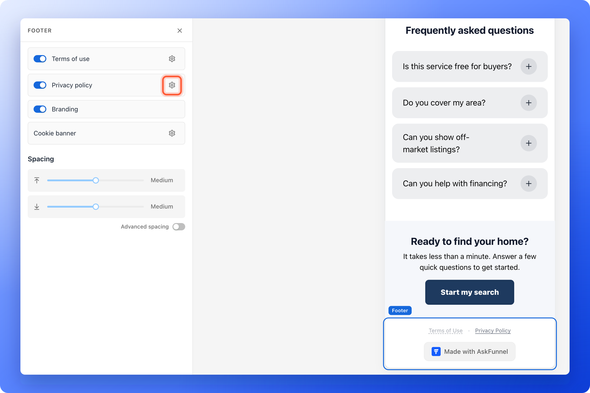
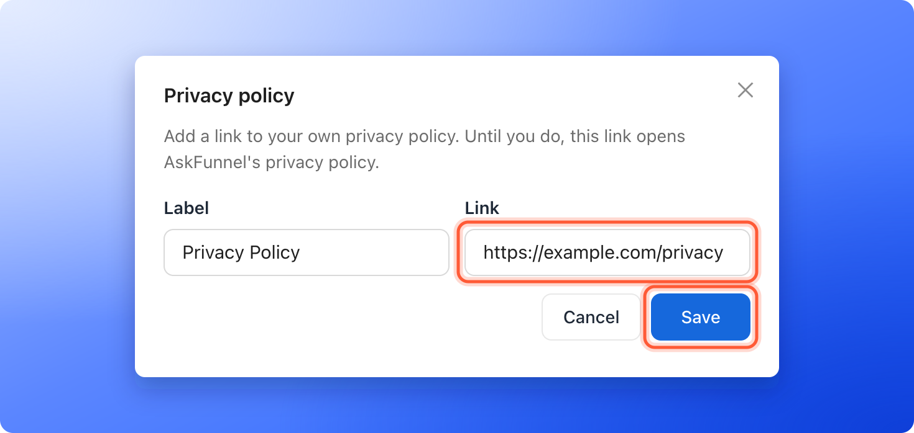
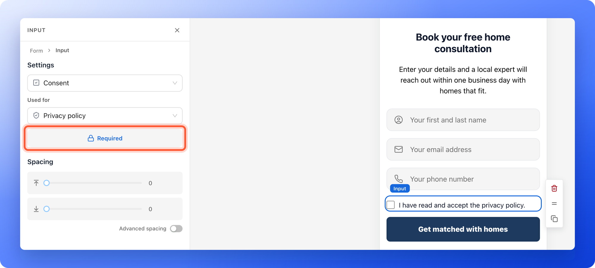

If you advertise to people in the EU or the UK, you often need to show a link to your privacy policy, to ask for consent in some cases, and to have an agreement with the companies that process personal data for you. This page shows where each of those lives in AskFunnel: the **footer** of your funnel, a **Consent** checkbox on your form, and a signed data processing agreement from us.

<Note>
  This page explains what AskFunnel offers. It is not legal advice. The rules depend on where your visitors live and what you do with their data. If you are not sure what you need, ask a legal professional.
</Note>

With these settings, you can:

- **Show your legal links.** Every page of your funnel ends with a footer that can link to your **Terms of Use** and **Privacy Policy**.
- **Ask for permission on the form.** A **Consent** checkbox records that the visitor accepted your text, for example your privacy policy, or agreed to get email or WhatsApp updates.
- **Control cookies.** The footer also holds the **Cookie preferences** link of your cookie banner.
- **Get a signed data processing agreement.** Email [support@askfunnel.com](mailto:support@askfunnel.com) and ask for it.

**Before you start**, you need:

- A privacy policy and, if you want one, terms, published on your own website. AskFunnel does not write them for you. You only add their links.
- A funnel open in the builder, and a role that can edit funnels: Global Admin, Workspace Admin or Content Editor.

## Important to note

<Warning>
  - The footer is part of every funnel and cannot be deleted. Its links only appear to visitors after you publish your funnel.
  - A **Terms of Use** link that is turned on but has no web address is hidden from visitors. Add the address, or turn the link off.
  - The **Privacy Policy** link always works. Until you add your own address, it opens AskFunnel's privacy policy, which is not your policy. Add your own link before you run ads.
  - The **Consent** checkbox is a question on your form. It does not start or stop cookies. Cookies follow your cookie banner. See [Cookies and consent](/funnel-settings/cookies-and-consent).
  - AskFunnel cannot make your funnel compliant by itself. Your funnel, your texts and what you do with your leads also count.
</Warning>

## Add your privacy policy and terms links

<Steps>
  <Step title="Open the footer in the builder">
    In the builder, scroll to the bottom of a page and click the footer, the bar with the links. The left panel shows a row for **Terms of use**, **Privacy policy**, **Branding** and **Cookie banner**.

    
  </Step>
  <Step title="Add your privacy policy address">
    1. Click the gear icon next to **Privacy policy**. A window titled **Privacy policy** opens.
    2. In **Label**, type the words visitors see, or keep **Privacy Policy**.
    3. In **Link**, paste the address of your policy, for example `https://example.com/privacy`.
    4. Click **"Save"**.

    If you type an address without https://, AskFunnel adds it for you. If you see **Enter a valid http:// or https:// URL.**, check the address.

    

    You can also add your policy once for the whole funnel: in **Funnel settings**, open **Cookies & Consent** and fill in **Privacy policy link**. The footer uses the address you type in its own window first, then this one, then AskFunnel's privacy policy.
  </Step>
  <Step title="Add your terms address (optional)">
    Do the same with the gear next to **Terms of use**. If you do not want a link, turn off the switch next to it. A link that is switched off is not shown.
  </Step>
  <Step title="Publish your funnel">
    Click **"Publish"** at the top right. The footer is part of your funnel, so your links only go live when you publish. See [Publish, unpublish and restore an earlier version](/funnels/publish-and-restore).
  </Step>
</Steps>

Visitors see the links at the bottom of every page, in a row such as **Terms of Use · Privacy Policy · Cookie preferences**. They open in a new tab. **Cookie preferences** only shows when your cookie banner is on.

A **Terms of Use** link that is switched on but has no address yet is hidden from visitors. In the builder you still see it, faded and with a dashed underline. Point at it to read **Hidden until you add a link**. The **Privacy Policy** link shows normally. Point at it to read **Opens AskFunnel's privacy policy until you add your own link**.

## Add a consent checkbox to your form

<Steps>
  <Step title="Add a Consent field">
    1. Click your form to open it. To add a field, click a field, then the **Duplicate** icon on its toolbar.
    2. Select the new field. In the dropdown under **Settings** at the top of the left panel, choose **Consent**. A form holds up to 8 fields.
  </Step>
  <Step title="Choose what the checkbox is used for">
    Under **Used for**, choose **Privacy policy** for a checkbox about your privacy policy. It starts as **I have read and accept the privacy policy.** The other choices, **Email updates** and **WhatsApp updates**, are explained below.
  </Step>
  <Step title="Write the text visitors agree to">
    Click the text next to the checkbox and replace it with your own. For example: "I agree to be contacted about my inquiry and I accept the privacy policy."
  </Step>
  <Step title="Choose whether it is required">
    Under **Used for**, the button with a lock icon says **Required**. It is blue when it is on, and it starts on. When it is on, visitors cannot send the form until they tick the box, and they see **Accept to continue.** if they do not. Click it to turn it off if ticking should be their choice.

    
  </Step>
  <Step title="Publish your funnel">
    Click **"Publish"**. Test the form on your live funnel, with the box ticked and unticked.
  </Step>
</Steps>

When a visitor ticks the box, the answer is saved with their lead, and connected tools receive it as **Yes**. See [Set up your lead capture form](/funnels/lead-capture-forms).

## Ask for permission to send email or WhatsApp updates

A second **Consent** field can ask for permission to send offers and news. In **Used for**, choose:

- **Email updates:** the box starts with words such as "Send me updates by email from" and your business name. Add an email field to the form so people who tick it can be emailed.
- **WhatsApp updates:** the box asks for permission to send updates on WhatsApp. It is only offered on a plan that includes WhatsApp, and the form needs a phone field.

These two boxes are never required, because permission to get marketing has to be a free choice. Changing **Used for** starts the words over, so write your own text after you choose. AskFunnel saves the tick with the lead, with the time and the exact words the visitor saw. Your automated emails can go only to the people who ticked the email box. See [Send automated emails to new leads](/messages/automated-emails).

## Cookies and Global Privacy Control

Your footer and your cookie banner work together. Click the gear next to **Cookie banner** in the footer panel to open the same banner choices as **Cookies & Consent** in **Funnel settings**, in a window titled **Manage cookies**.

If a visitor's browser sends the Global Privacy Control signal, which is a browser setting that tells websites not to track, AskFunnel keeps analytics and marketing scripts off for that visitor. This applies even when your cookie banner is off. See [Set up cookies and visitor consent](/funnel-settings/cookies-and-consent).

## Data processing agreement and sub-processors

- **Who owns the lead data.** AskFunnel's Terms of Use say that the leads you collect belong to you, and that you are responsible for giving the notice and getting the consent your local laws require.
- **A signed data processing agreement.** If you need one, for example for the GDPR or the UK GDPR, email [support@askfunnel.com](mailto:support@askfunnel.com) and ask for it.
- **Who helps us process data.** The [list of sub-processors](https://askfunnel.com/legal/sub-processors) names the companies that help us process data, grouped by purpose.

## How do I know it is working?

1. Open your live funnel in a private browser window.
2. Scroll to the bottom. Your links show in the footer. Click **Privacy Policy**. Your policy opens in a new tab.
3. Go to your form. If **Required** is on, click **Submit** without ticking the box. You see **Accept to continue.**
4. Submit a test lead with the box ticked. Open the lead in your **Leads** page and check that the consent answer is saved.

## Troubleshooting

<AccordionGroup>
  <Accordion title="My Privacy Policy link opens AskFunnel's privacy policy">
    You have not added your own address yet. Click the gear next to **Privacy policy**, add the address under **Link**, click **"Save"** and publish again. Or fill in **Privacy policy link** in **Cookies & Consent**.
  </Accordion>
  <Accordion title="I do not see Terms of Use in my footer">
    Check that its switch is on and that it has an address, then publish your funnel again. A **Terms of Use** link without an address is hidden. **Cookie preferences** only shows when **Cookie banner** is set to **Show banner**.
  </Accordion>
  <Accordion title="I cannot find the footer">
    It is the last item at the bottom of every page in the builder. Scroll to the bottom of the canvas and click it.
  </Accordion>
  <Accordion title="I still see Made with AskFunnel in my footer">
    The **Branding** switch is only available on the Growth plan and above. Point at it to see **Available on Growth plans and above**. See [Remove the Made with AskFunnel branding](/funnel-settings/remove-branding).
  </Accordion>
  <Accordion title="Visitors can send my form without ticking the consent box">
    Open the **Consent** field and click the **Required** button so it is on (blue), then publish your funnel. A field used for **Email updates** or **WhatsApp updates** is never required.
  </Accordion>
  <Accordion title="Does the Consent checkbox control my tracking pixels?">
    No. It records the visitor's answer to your form. Pixels and analytics follow your cookie banner. See [Cookies and consent](/funnel-settings/cookies-and-consent).
  </Accordion>
</AccordionGroup>

## What to do next

<Columns cols={3}>
  <Card title="Set up cookies and consent" icon="cookie-bite" href="/funnel-settings/cookies-and-consent">
    Choose whether visitors see a cookie banner.
  </Card>
  <Card title="Set up your lead capture form" icon="address-card" href="/funnels/lead-capture-forms">
    Choose the fields and what visitors see next.
  </Card>
  <Card title="Connect your custom domain" icon="globe" href="/funnel-settings/custom-domain">
    Put your funnel on your own web address.
  </Card>
</Columns>

Need help? Email [support@askfunnel.com](mailto:support@askfunnel.com).
