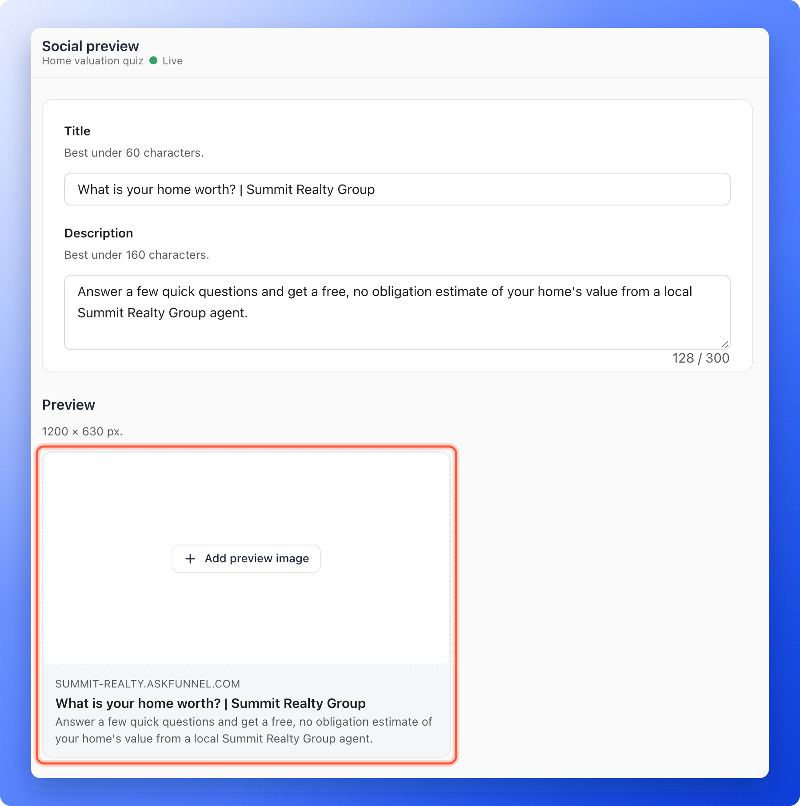
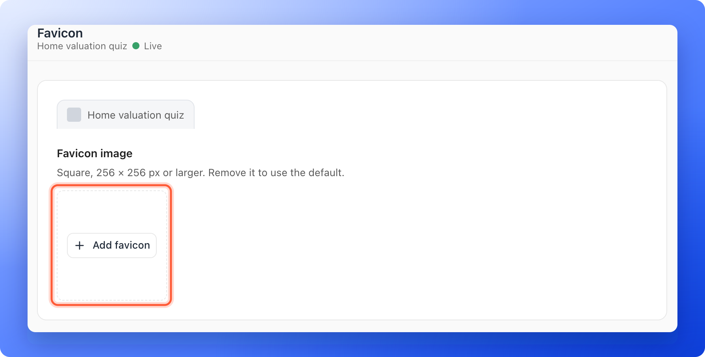

When someone shares your link on Facebook, WhatsApp, LinkedIn or X, the platform shows a preview card with a title, a short description and an image. A clear card makes your link look professional. The favicon is the small icon in the browser tab next to your page title.

You set both in your funnel's settings, one funnel at a time, so every funnel can have its own look. To see where your title and description also show up, including in search engines, read [How search engines and link previews see your funnel](/funnel-settings/search-engines-and-link-previews).

With these settings, you can:

- **Control the share card.** Set the title, the description and the preview image.
- **Brand the browser tab.** Show your own icon instead of the AskFunnel default.
- **Go live without republishing.** When you save, your live funnel is updated right away.

**Before you start**, you need:

- A funnel, and a role that can open **"Funnel settings"**: Global Admin, Workspace Admin or Content Editor.
- Your images ready, if you want them. They must be image files smaller than 5 MB. PNG, JPG and WebP files work well. A crop window opens when you add one, so you can frame it.

## Set up your social preview

<Steps>
  <Step title="Open your funnel settings">
    1. From your funnel list, click the three dots (**...**) on your funnel's row, then click **"Funnel settings"**. You can also click your funnel and then **"Settings"** in its menu, or click the gear icon at the top right inside the builder. See [Funnel settings overview](/funnel-settings/funnel-settings-overview) for a map of every page.
    2. In the left menu, click **"Social preview"**.
  </Step>
  <Step title="Write your title and description">
    - **Title:** a short headline for the share card. Keep it under 60 characters. It can be up to 120 characters. If you leave it empty, AskFunnel uses your funnel name. The title is also the page title in the browser tab.
    - **Description:** one or two sentences that say what people get. It is best under 160 characters. It can be up to 300 characters.

    The **Preview** card below the fields updates as you type, so you can see how it reads.
  </Step>
  <Step title="Add a preview image">
    1. In the **Preview** card, click **"Add preview image"**.
    2. Choose an image from your computer. Use a picture that is 1200 by 630 pixels.
    3. In the crop window, move the picture to frame it and click **"OK"**.

    To replace it later, click **"Change image"** under the picture. To delete it, click **"Remove image"**.

    
  </Step>
  <Step title="Save your changes">
    A bar with **Unsaved changes** appears at the top. Click **"Save"**. You see **Settings saved. Your live funnel is updated.**
  </Step>
</Steps>

## Set up your favicon

<Steps>
  <Step title="Open the Favicon settings">
    In **Funnel settings**, click **"Favicon"** in the left menu. A preview of a browser tab shows your funnel name next to the current icon.
  </Step>
  <Step title="Add your icon">
    1. Click **"Add favicon"**.
    2. Choose a square image that is at least 256 by 256 pixels. A simple version of your logo works best, because the icon is very small.
    3. In the crop window, frame the square and click **"OK"**.

    To change it later, click **"Change image"** under the icon. Click **"Remove image"** to go back to the AskFunnel default icon.

    
  </Step>
  <Step title="Save your changes">
    Click **"Save"** in the bar at the top. Your live funnel shows the new icon. Browsers keep old icons for a while, so reload the page or open it in a private window to check.
  </Step>
</Steps>

<Tip>
  - Put the most important part of your preview image in the center. Platforms crop the edges differently.
  - Keep text on the image short and large. It is small in a feed.
  - Write the description for the person who sees the link in a message, not for search engines.
</Tip>

## How do I know it is working?

- Your funnel link in a new browser tab shows your icon and your title.
- Paste your link into a chat or a post draft. A card with your title, description and image appears.

## Troubleshooting

<AccordionGroup>
  <Accordion title="The old preview still shows when I share the link">
    Social platforms keep a copy of your card for a while, so a new preview may take time to show up for a link that was shared before. Wait a while, or add a small change to the end of your link, such as `?v=2`, so the platform treats it as a new link. Some platforms also have a link checker that refreshes the card.
  </Accordion>
  <Accordion title="My image is rejected">
    If it says **Image must be smaller than 5MB.**, reduce the file size and try again. A 1200 by 630 pixel JPG is usually far smaller than 5 MB. If it says **You can only upload image files.**, choose a picture file, such as a PNG, JPG or WebP. Other file types are not accepted.
  </Accordion>
  <Accordion title="The browser tab still shows the old icon">
    Browsers cache icons. Close the tab, reopen your link, or try a private window. It can take a little while to update.
  </Accordion>
  <Accordion title="I do not see the Unsaved changes bar">
    It only appears after you change something. Change a field or add an image and it shows at the top of the page.
  </Accordion>
</AccordionGroup>

## What to do next

<Columns cols={3}>
  <Card title="Set up cookies and consent" icon="cookie-bite" href="/funnel-settings/cookies-and-consent">
    Decide whether people see a cookie banner before tracking starts.
  </Card>
  <Card title="Connect your custom domain" icon="globe" href="/funnel-settings/custom-domain">
    Put your funnels on your own web address.
  </Card>
  <Card title="View and manage your leads" icon="users" href="/leads/view-and-manage-leads">
    See the leads your shared link brings in.
  </Card>
</Columns>

Need help? Email [support@askfunnel.com](mailto:support@askfunnel.com).
