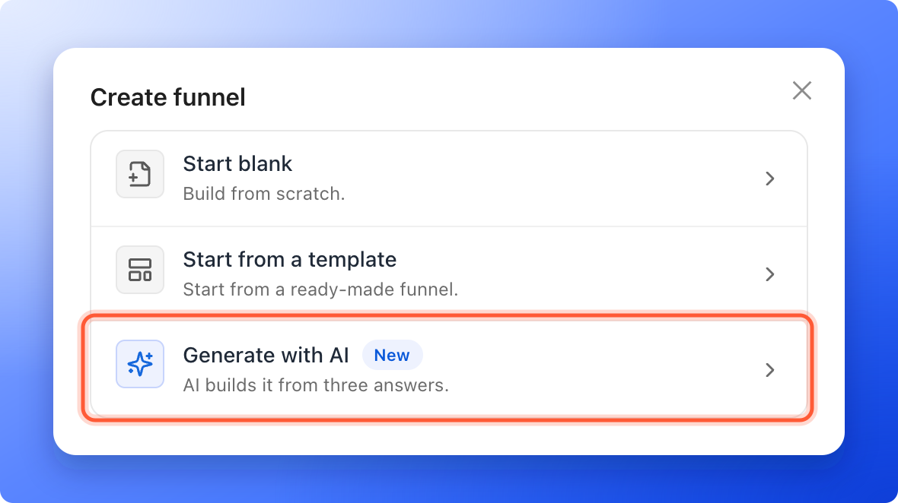
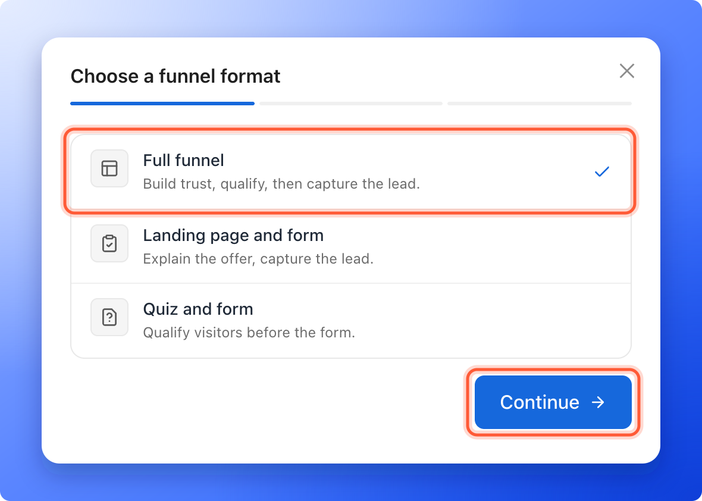
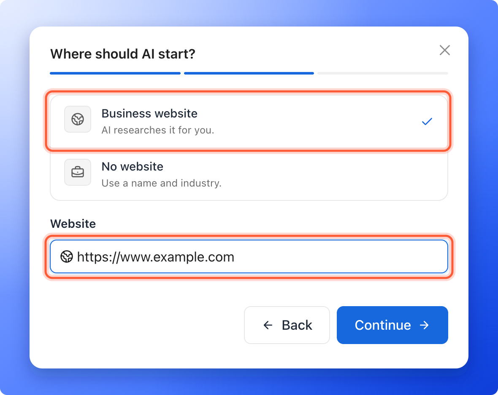
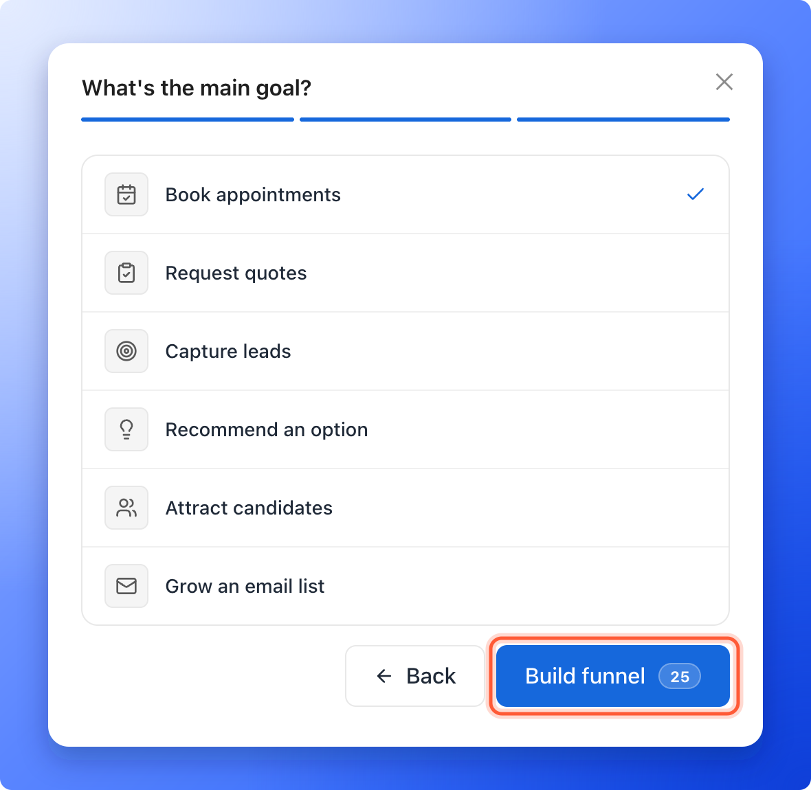

<Callout icon="star" color="#155DFC">
  Available on: **all plans** (Starter, Growth, Scale and Enterprise). A build uses **25 AI credits**.
</Callout>

Answer three quick questions and AI writes a first draft of your funnel: a landing page, quiz questions, a contact form and a thank you screen, depending on the format you choose. You review the draft, change what you like and publish it when you are happy. It is the fastest way to get from an idea to a funnel you can edit.

With AI, you can:

- **Start from your website.** Type your website address and AI researches your business and market for you.
- **Start without a website.** Give a business name and an industry instead.
- **Pick the shape of your funnel.** Choose a full funnel, a landing page with a form, or a quiz with a form.
- **Edit everything afterward.** The result is a normal funnel in the builder, not a locked design. Polish the words with the [AI text tools](/funnels/ai-text-tools).

**Before you start**, you need:

- A role that can create funnels: Global Admin, Workspace Admin or Content Editor.
- A verified email address.
- An active plan or free trial with at least 25 AI credits left. See [How AI credits work](/billing/ai-credits).

## Important to note

<Warning>
  - A build costs 25 AI credits. You are charged only when your draft is ready. If a build fails or you cancel it, your credits are not charged.
  - You can have up to 2 builds running at once. You cannot start a third one until one of them finishes.
  - AI writes a first draft, and it can get details wrong. Read every page before you publish, and replace anything that is not true for your business, such as claims, prices, reviews and names.
  - The funnel is not live until you publish it. See [Publish, unpublish and restore an earlier version](/funnels/publish-and-restore).
</Warning>

## Build your funnel

<Steps>
  <Step title="Start the AI builder">
    1. Click **Funnels** in the sidebar, then click **"Create funnel"** at the top right.
    2. Click **"Generate with AI"**. A window opens on **Choose a funnel format**. The bar under its title has three parts, one for each step.

    
  </Step>
  <Step title="Choose a funnel format">
    Click one row and then **"Continue"**. **Full funnel** is selected when the window opens.

    - **Full funnel:** build trust, qualify, then capture the lead. It has a landing page, a quiz and a contact form.
    - **Landing page and form:** explain the offer, capture the lead. It has a landing page and a contact form.
    - **Quiz and form:** qualify visitors before the form. It has a quiz and a contact form.

    Not sure which one fits? See [Choose the right funnel format and goal](/funnels/choose-format-and-goal).

    
  </Step>
  <Step title="Tell AI where to start">
    Under **Where should AI start?**, choose one:

    - **Business website:** type your website in **Website**, for example `https://www.example.com`. AI researches it for you.
    - **No website:** type your **Business name** and choose an **Industry** from the list (**Home services**, **Healthcare**, **Real estate**, **Professional services**, **Ecommerce and retail**, **SaaS and technology**, **Recruitment and hiring**, **Wellness and supplements**, **Education** or **Other**). If you pick **Other**, type the name of your industry under **Industry name**.

    Click **"Continue"**.

    
  </Step>
  <Step title="Choose the main goal and build">
    Under **What's the main goal?**, click the closest match. **Book appointments** is selected when the step opens.

    - **Book appointments**
    - **Request quotes**
    - **Capture leads**
    - **Recommend an option**
    - **Attract candidates**
    - **Grow an email list**

    Then click **"Build funnel"**. The number on the button is the cost in AI credits.

    
  </Step>
  <Step title="Watch the build">
    AskFunnel opens the **Build with AI** page and shows **Building your funnel**. A progress bar and the **Build progress** list show each stage: **Researching the business and market**, **Defining the ideal client profile**, **Planning the customer journey**, **Writing the funnel**, **Sourcing relevant imagery** and **Ready to edit**.

    You can leave the page. The note on it says **You can leave this page. Your funnel keeps building.** The progress is there when you come back, and a card for the build also shows on your **Funnels** page. To stop a build, click **"Cancel build"**. You see **Build canceled. Your credits were not charged.**
  </Step>
  <Step title="Review your draft">
    When the build is done, the page says **Your editable draft is ready to review.** and shows a **Strategy summary** with the **Ideal audience**, **Primary need**, **Core message** and **Conversion approach**, and **What the research found**. Click **"Open editor"**.

    In the builder, open each page and read it as a visitor would. Edit the text, swap images, check your questions and your contact form, then publish. See [Build quiz questions](/funnels/quiz-questions) and [Set up your lead capture form](/funnels/lead-capture-forms).
  </Step>
</Steps>

## How do I know it is working?

- The progress reaches 100% and the page says **Your editable draft is ready to review.**
- The new funnel is in your **Funnels** list with the status **Draft**.
- **Open editor** opens the builder with your pages, questions and form already filled in.

## Troubleshooting

<AccordionGroup>
  <Accordion title="The Build funnel button is grayed out">
    Look under the goals. **Choose a plan to continue** means you need an active plan or free trial. **Not enough AI credits** means fewer than 25 credits are left this month. The message shows how many you have left. See [How AI credits work](/billing/ai-credits).
  </Accordion>
  <Accordion title="I see Please verify your email address to use AI features">
    Open the verification email we sent you and click its link, then try again.
  </Accordion>
  <Accordion title="It says Enter a website like google.com.">
    The website box needs an address such as `example.com` or `https://www.example.com`. If you have no website, click **"Back"**, choose **No website** and use your business name and industry.
  </Accordion>
  <Accordion title="My build says Your funnel was not built">
    The page shows the reason. You are not charged for a build that did not finish. Click **"Try again"** to start the build again.
  </Accordion>
  <Accordion title="I see Two AI funnels are already being generated">
    You can have up to 2 builds running at the same time. Wait for one to finish, or cancel one with **"Cancel build"**, then start again.
  </Accordion>
  <Accordion title="I cannot find my build">
    Builds you started recently show as a card at the top of your **Funnels** page. Click **"Open editor"**, **"View"** or **"Review"** on it. Click the cross to remove the card. The funnel itself stays in your list. A build's page is kept for 30 days, and after that it says **This build is not available**.
  </Accordion>
  <Accordion title="The draft is not what I expected">
    There is no box to describe your offer, so AI works from your website, or from your business name and industry, plus the format and goal you chose. Edit the draft in the builder. You can also build again with a different format or goal, which uses another 25 credits.
  </Accordion>
  <Accordion title="I do not see Generate with AI">
    Your role in this workspace does not allow creating funnels. Contacts Managers cannot create or edit funnels. Ask a Workspace Admin or Global Admin to change your role.
  </Accordion>
</AccordionGroup>

## What to do next

<Columns cols={2}>
  <Card title="Build quiz questions" icon="list-check" href="/funnels/quiz-questions">
    Edit the questions AI wrote, or add your own.
  </Card>
  <Card title="Set up your lead capture form" icon="address-card" href="/funnels/lead-capture-forms">
    Check what your form asks for.
  </Card>
  <Card title="Publish your funnel" icon="clock-rotate-left" href="/funnels/publish-and-restore">
    Put it live and go back to an earlier version if you need to.
  </Card>
  <Card title="How AI credits work" icon="coins" href="/billing/ai-credits">
    See what uses credits and how to add more.
  </Card>
</Columns>

Need help? Email [support@askfunnel.com](mailto:support@askfunnel.com).
