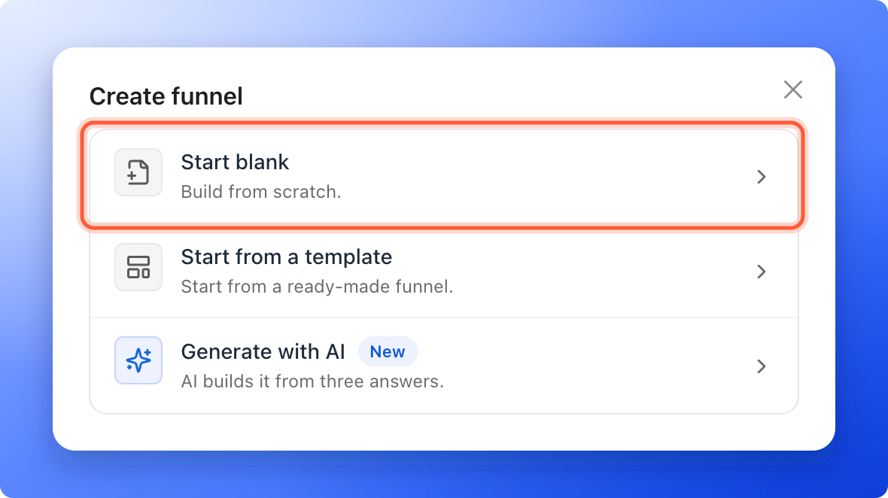
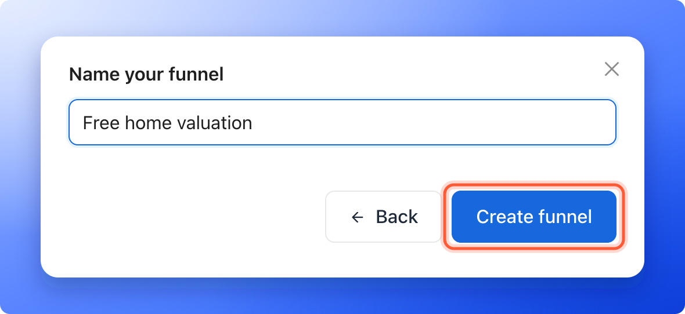
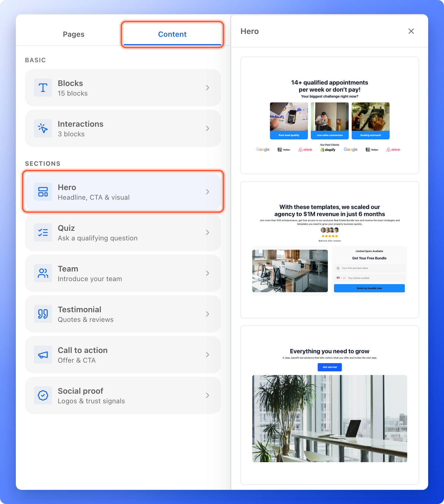

Build a funnel and publish it, even if you have never built one. A funnel is a short series of pages that asks people questions one at a time and ends with a form that collects their details. You do not need design or coding skills.

You can start a funnel in three ways:

- **Start blank.** Build from scratch with complete control. This page shows you how.
- **Start from a template.** Preview ready-made funnels and use one as your starting point. See [Start a funnel from a template](/funnels/start-from-template).
- **Generate with AI.** Answer three quick questions and AI builds the funnel for you. A build uses 25 AI credits. See [Create a funnel with AI](/funnels/create-funnel-with-ai).

**Before you start**, you need:

- An AskFunnel account and a workspace. See [Create your account](/getting-started/create-account).
- A role that can create funnels: Global Admin, Workspace Admin or Content Editor. If you do not see **"Create funnel"**, ask a Workspace Admin or Global Admin.
- A verified email address. You need it to publish, not to build.

## Important to note

<Warning>
  - AskFunnel saves your changes as you work, but people cannot see your funnel until you publish it.
  - Your plan sets how many funnels can be live at once. See [Choose a plan](/billing/choose-a-plan).
</Warning>

## Create and build your funnel

<Steps>
  <Step title="Create a blank funnel">
    1. Click **Funnels** in the sidebar, then click **"Create funnel"** at the top right.
    2. Click **"Start blank"**.

       

    3. Type a name, for example "Free home valuation". Use 2 to 60 characters. The name shows in your funnel list and in the browser tab, unless you set a different title in [Social preview and favicon](/funnel-settings/social-preview-and-favicon).
    4. Click **"Create funnel"**. The funnel builder opens.

    

    A new funnel starts with one page called **Start** and one result called **Thank you**. See [Manage your funnel pages](/funnels/manage-pages) to add more.
  </Step>
  <Step title="Add a ready-made section">
    Sections are ready-made groups of blocks that you drop onto your page and then edit. They are the fastest way to fill a blank page.

    1. In the panel on the left, click the **"Content"** tab. On an empty page, you can also click **"Add block"** on the page itself.
    2. Under **Sections**, click the section you want:
       - **Hero** adds a headline, a call to action and a visual.
       - **Quiz** asks a qualifying question.
       - **Team** introduces your team.
       - **Testimonial** shows quotes and reviews from your customers.
       - **Call to action** drives the next step with an offer and a button.
       - **Social proof** shows logos and trust signals.
    3. A panel opens with several designs. Click the design you like. It is added to your page right away, and the panel stays open so you can add more.
    4. Click any text to type your own words, or click an image to replace it.

    AskFunnel adds the section right after the first section you can see at the top of your screen. On an empty page, it goes to the top. Add as many sections as you like.

    
  </Step>
  <Step title="Add your questions and your form">
    Under **Content**, the **Interactions** group holds the blocks that collect answers: **Quiz**, **Media quiz** and **Form**. Add a question with [Build quiz questions](/funnels/quiz-questions) and collect contact details with [Set up your lead capture form](/funnels/lead-capture-forms).

    Until the funnel has a form that asks for an email or a phone number, a note under the top bar says **This funnel has no form, so it won't collect leads.** Click **"Add a form"** in the note to go to the place where you add one.
  </Step>
  <Step title="Publish your funnel">
    Click **"Publish"** at the top right of the builder. When it is done, you see **Your funnel is live.** and the funnel shows **Live** in the **Status** column of your funnel list. See [Publish, unpublish and restore an earlier version](/funnels/publish-and-restore).
  </Step>
</Steps>

## Troubleshooting

<AccordionGroup>
  <Accordion title="I do not see the Create funnel button">
    Your role in this workspace does not allow creating funnels. Contacts Managers cannot create or edit funnels. Ask a Workspace Admin or Global Admin to change your role, or switch to a workspace where you can edit funnels.
  </Accordion>
  <Accordion title="Generate with AI says Choose a plan to continue or Not enough AI credits">
    Building with AI needs an active plan and enough AI credits. A build costs 25 credits. See [Plan and usage](/billing/plan-and-usage).
  </Accordion>
  <Accordion title="I want to rename my funnel">
    Open the funnel in the builder, click its name at the top, type a new name and press Enter. The link you share does not change when you rename the funnel.
  </Accordion>
  <Accordion title="I see Saving paused. Your edits are kept on this device.">
    AskFunnel could not save your changes, so it stopped trying for now. Your edits stay in this browser. Saving starts again with your next edit, or when your connection is back. If **"Publish"** says **Couldn't save your changes. Publish was not started.**, check your internet connection and try again.
  </Accordion>
  <Accordion title="I see Restore your unsaved changes?">
    You closed the builder before some edits were saved, and the funnel was saved again since. Click **"Restore changes"** to put those edits back, or **"Open the saved funnel"** to leave them behind.
  </Accordion>
  <Accordion title="I see This funnel was changed somewhere else.">
    Another tab, device or teammate saved this funnel while you had it open. Click **"Reload"** to open the saved funnel and drop what this tab holds, or **"Keep mine"** to save what this tab shows over it.
  </Accordion>
</AccordionGroup>

## What to do next

<Columns cols={2}>
  <Card title="Build quiz questions" icon="list-check" href="/funnels/quiz-questions">
    Ask one question per page and choose where each answer leads.
  </Card>
  <Card title="Set up your lead capture form" icon="address-card" href="/funnels/lead-capture-forms">
    Collect the contact details you need to follow up.
  </Card>
  <Card title="Manage your funnel pages" icon="copy" href="/funnels/manage-pages">
    Add, rename, reorder and delete pages and results.
  </Card>
  <Card title="Share your funnel" icon="share-nodes" href="/funnels/share-your-funnel">
    Get your funnel link and start sending people to it.
  </Card>
</Columns>

Need help? Email [support@askfunnel.com](mailto:support@askfunnel.com).
