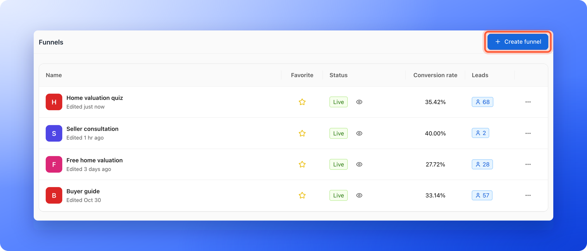
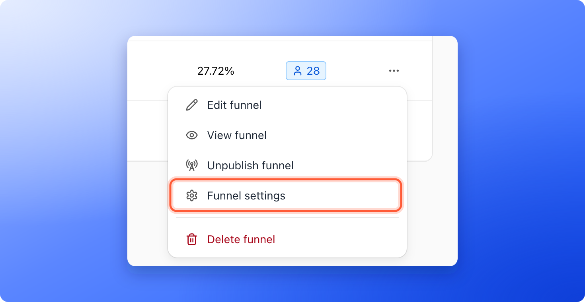

Click **Funnels** in the sidebar to open the **Funnels** page. It lists every funnel in the workspace with its status and its results, and it is the starting point for building, publishing and sharing. This page explains each column, each menu item and the numbers you see.

**"Create funnel"** at the top right starts a new funnel. Your role in this workspace shows under the workspace name at the top of the sidebar.

**Before you start**, you need:

- Access to the workspace. Every role can open the list, but the menus and numbers depend on your role.

## Important to note

<Warning>
  - **Conversion rate** is the figure since the funnel started. It is not for a date range. For a date range, open the funnel's **Analytics** page. See [Read your funnel analytics](/analytics/funnel-analytics).
  - These numbers can differ from your **Leads** page and from Analytics, because each place counts slightly differently. See [Why your lead and analytics numbers differ](/analytics/why-numbers-differ).
  - Content Editors design funnels but do not see lead data. The **Conversion rate** and **Leads** columns are left out of the list for them.
</Warning>

## The columns

| Column | What it shows |
|---|---|
| **Name** | The funnel's name, with its picture or first letter, and when you last changed it, for example **Edited 3 hr ago**, **Edited 1 day ago** or a date. |
| **Favorite** | A star. Click it to mark the funnel as a favorite, and click again to remove the mark. Favorites are shared, so everyone in the workspace sees the same stars. |
| **Status** | **Live** (green) or **Draft** (gray). While a publish is running you see **Publishing...**. An eye icon next to **Live** opens the live funnel. |
| **Conversion rate** | The share of visitors who sent the form, since the funnel started. For example **35.42%**. **No data yet** means the funnel has not had enough visitors and leads to work it out. |
| **Leads** | The number of leads the funnel has, in a blue tag. It is the same total as on the funnel's **Leads** page. Leads that are locked or deleted are not counted. |
| Three dots (**...**) | The menu of the funnel. See below. |

The list shows favorite funnels first. The other funnels follow, with the one you changed most recently at the top. Marking a favorite moves the funnel up, and it does not change its **Edited** time. The list shows 10 funnels per page, and the page buttons at the bottom right show where you are, for example **1 of 2**.

<Note>
  In a narrow browser window the **Conversion rate** column is left out so the rest fits. On a phone, each funnel is a row with its name and its status, then its number of leads for a live funnel, or when it was edited for a draft. The row's three dots menu there also has **Add to favorites** (and **View funnel** for a live funnel), for every role.
</Note>

### What the Status column tells you

- **Live:** the funnel is public. Click the eye icon to open it in a new tab.
- **Draft:** the funnel is not public. It has never been published, or you took it offline.
- **Unpublished changes** (orange dot, under **Live**): you have edited the funnel since you last published it. Point at the note to read the reminder. Open the funnel in the builder and click **"Publish"** to update the live version.

## The three dots menu

Click the three dots (**...**) at the end of a row.

- **Edit funnel:** opens the funnel in the builder.
- **View funnel:** opens the live funnel in a new tab. It only shows for a live funnel.
- **Publish funnel** or **Unpublish funnel:** puts the funnel live, or takes it offline. **Publish funnel** is grayed out until your email address is verified. See [Publish, unpublish and restore an earlier version](/funnels/publish-and-restore).
- **Funnel settings:** opens the settings of the funnel. See [Funnel settings overview and deleting a funnel](/funnel-settings/funnel-settings-overview).
- **Delete funnel:** the red item at the bottom. Only Global Admins and Workspace Admins see it.

If a funnel has no form, or its form asks for neither an email nor a phone number, **Publish funnel** asks you first. See [Publish, unpublish and restore an earlier version](/funnels/publish-and-restore).

### Delete a funnel

**Delete funnel** opens a window titled **Delete this funnel?**. It says the funnel leaves your dashboard and goes offline now, and how many leads and notes it holds. Its leads, notes and analytics are deleted for good after 30 days. If you deleted it by mistake, email [support@askfunnel.com](mailto:support@askfunnel.com) within that time.

A funnel with more than 400 leads cannot be deleted from the dashboard. The window says so. Export its leads first, or contact support to archive it.

## What happens when you click a row

- **Global Admins, Workspace Admins and Contacts Managers:** the funnel's **Leads** page opens. See [View and manage your leads](/leads/view-and-manage-leads).
- **Content Editors:** the builder opens, because they do not have access to lead data.

Inside a funnel, the sidebar shows the funnel's own menu: **Leads**, **Analytics**, **Activity**, **Settings** and an **Edit funnel** button. The row at the top, **Funnels**, takes you back to this list.

## What each role sees

| Role | Create funnel | Three dots menu | Conversion rate and Leads |
|---|---|---|---|
| **Global Admin** and **Workspace Admin** | Yes | All items | Yes |
| **Content Editor** | Yes | All items except **Delete funnel** | No, the columns are left out |
| **Contacts Manager** | No | No menu. The eye icon opens a live funnel. | Yes |

## How do I know it is working?

- Your funnel shows **Live** after you publish, and the eye icon opens it.
- **Leads** goes up when a new lead arrives. Reload the page if you do not see it right away.
- The star of a favorite funnel is filled, and the funnel moves to the top.

## Troubleshooting

<AccordionGroup>
  <Accordion title="I do not see Create funnel or the three dots menu">
    Your role in this workspace cannot edit funnels. Contacts Managers have a read only list. Ask a Workspace Admin or Global Admin to change your role. See [What a Contacts Manager can see and do](/workspaces/contacts-manager).
  </Accordion>
  <Accordion title="My funnel shows Draft but I published it before">
    A funnel that you took offline shows **Draft** in this list. Click **"Publish funnel"** in its three dots menu to put it live again. You do not need to change anything first.
  </Accordion>
  <Accordion title="I see Unpublished changes under Live">
    The live version is older than your latest edits. Open the funnel in the builder and click **"Publish"**.
  </Accordion>
  <Accordion title="Conversion rate shows No data yet">
    The funnel has no visitors or no leads yet, or its leads came in before visitors were counted. Point at **No data yet** to read the reason. The rate appears once the live funnel has had visitors and form submissions.
  </Accordion>
  <Accordion title="Leads shows a different number than the Leads page">
    The list shows the same total as the funnel's **Leads** page. A filter or a search on that page shows fewer leads, and locked or deleted leads are not in either number. See [Why your lead and analytics numbers differ](/analytics/why-numbers-differ).
  </Accordion>
  <Accordion title="There are no Conversion rate and Leads columns">
    If you are a Content Editor, lead numbers are hidden from you. Otherwise, make your browser window wider. The **Conversion rate** column drops out of a narrow window, and a phone shows a short row for each funnel instead.
  </Accordion>
  <Accordion title="The Publish funnel menu item is grayed out">
    Publishing needs a verified email address. Point at the item to read **Verify your email to publish this funnel**, then open the verification email we sent you.
  </Accordion>
  <Accordion title="I see Couldn't load funnels">
    Click **"Try again"**. If it keeps happening, check your internet connection and email support.
  </Accordion>
  <Accordion title="A funnel I started with AI is not in the list">
    While the build runs, and after it, a card for it shows above the list. The funnel itself joins the list when the build has saved your draft. See [Create a funnel with AI](/funnels/create-funnel-with-ai).
  </Accordion>
</AccordionGroup>

## What to do next

<Columns cols={2}>
  <Card title="Funnel settings overview" icon="gear" href="/funnel-settings/funnel-settings-overview">
    See what each settings page does and how to delete a funnel.
  </Card>
  <Card title="Publish, unpublish and restore" icon="clock-rotate-left" href="/funnels/publish-and-restore">
    Put changes live and go back to an earlier version.
  </Card>
  <Card title="View and manage your leads" icon="users" href="/leads/view-and-manage-leads">
    Open a funnel's Leads page and work with its leads.
  </Card>
  <Card title="Find and share your funnel link" icon="share-nodes" href="/funnels/share-your-funnel">
    Copy your link and send people to it.
  </Card>
</Columns>

Need help? Email [support@askfunnel.com](mailto:support@askfunnel.com).
