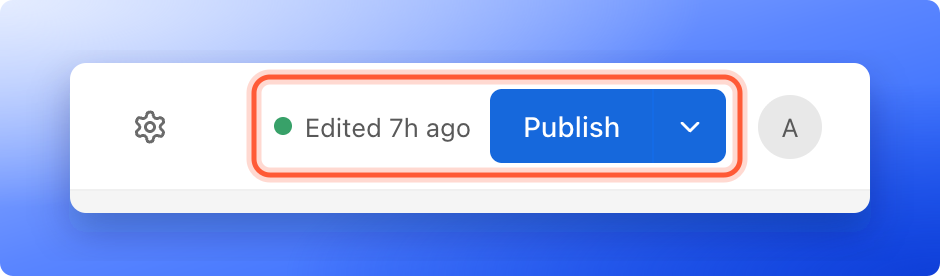
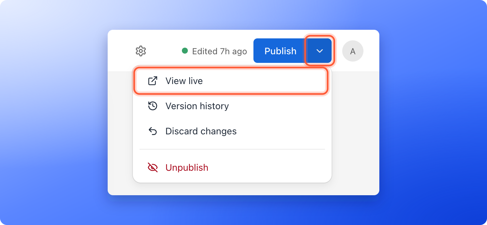
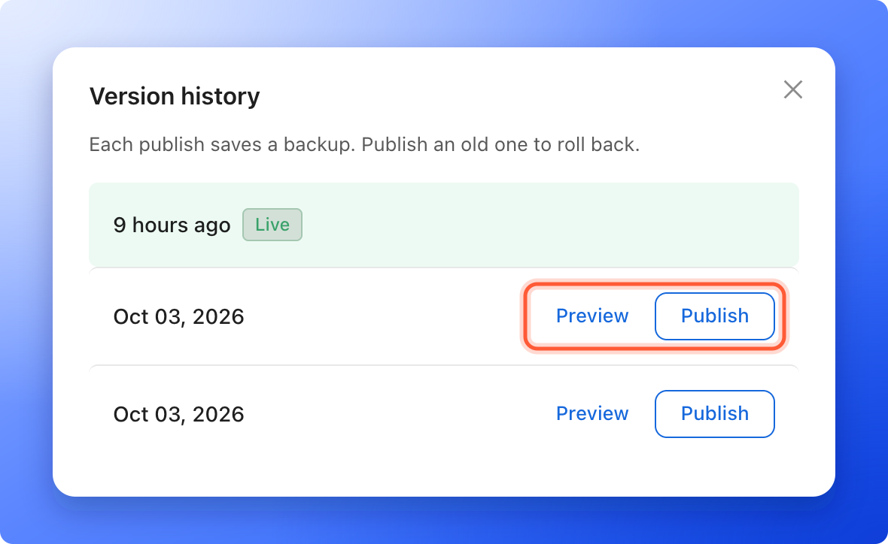
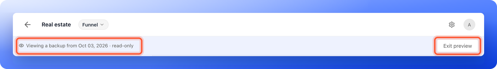

Your funnel has two versions at any time: the **draft** you are editing, and the **live version** your visitors see. AskFunnel saves your edits to the draft as you work, but visitors only see them after you publish. This page shows you how to publish, how to take a funnel offline, and how to go back to an earlier version if a change goes wrong.

With publishing, you can:

- **Put your edits live.** Click **"Publish"** and visitors see the new version within about a minute.
- **Take a funnel offline.** Stop visitors from opening it without losing your work.
- **Throw away edits you do not want.** Go back to what is live.
- **Restore an earlier version.** Every publish saves a backup, and you can publish any of them again. **Version history** lists the 20 most recent.

**Before you start**, you need:

- A role that can edit funnels: Global Admin, Workspace Admin or Content Editor.
- A verified email address. If yours is not verified, AskFunnel shows **Verify your email before publishing this funnel.**
- An active plan. During your free trial, publishing works as usual.

## Important to note

<Warning>
  - There is no private preview link for a draft. To test a change, publish it, then open the live funnel with **"View live"**.
  - Restoring an earlier version puts back its pages and content and throws away your unpublished edits. Your funnel settings, such as your pixels and your cookie banner, stay as they are now.
  - Your plan sets how many funnels can be live at once. See [Choose the right plan](/billing/choose-a-plan).
  - A funnel with no form, or with a form that asks for neither an email nor a phone number, cannot collect leads. AskFunnel warns you before it goes live, and you can still publish it.
</Warning>

## What the status next to Publish tells you

In the builder, the status sits to the left of the **"Publish"** button. A green dot means the funnel is live.

- **Draft:** you have never published this funnel.
- **Edited 2h ago:** you have changes that are not published yet. The time changes, for example **Edited 5m ago**.
- **Live:** the live version is the same as your draft.
- **Offline:** the funnel was published before, but it is taken offline now.

While you look at an earlier version, the bar shows no status and no **Publish** button.

In your funnel list, the **Status** column shows **Live** or **Draft**. An offline funnel shows **Draft** there. A **Live** funnel with **Unpublished changes** under it has changes that are not published yet.

## Publish your changes

<Steps>
  <Step title="Check that you have something to publish">
    Open your funnel in the builder. If the status says **Edited**, you have unpublished changes. If the **"Publish"** button is grayed out, point at it to see why. See [the troubleshooting section](#troubleshooting).
  </Step>
  <Step title="Click Publish">
    Click **"Publish"** at the top right. You see **Your funnel is live.** and the status changes to **Live**.

    You can also publish from your funnel list: click the three dots (**...**) on the funnel's row, then click **"Publish funnel"**.

    

    If the funnel has no form, a window says **This funnel has no form, so it won't collect leads.** Click **"Add a form"** to go and add one, or **"Publish anyway"**. If its form asks for neither an email nor a phone number, the window says **Your form doesn't ask for an email or phone, so you won't be able to contact these leads.** and offers **"Edit form"** or **"Publish anyway"**. Until you fix it, a note under the top bar says the same. After **"Publish anyway"**, AskFunnel does not ask again about the same problem.
  </Step>
  <Step title="Check that it is live">
    Click the small arrow next to **"Publish"**, then click **"View live"**. Your live funnel opens in a new tab. This is exactly what your visitors see, so use it to test your change. For a full checklist, see [Test your funnel before you send traffic](/funnels/test-your-funnel). To get your link, see [Find and share your funnel link](/funnels/share-your-funnel).

    
  </Step>
</Steps>

## Take your funnel offline

Take a funnel offline when you want to stop collecting leads for a while, for example after a campaign ends.

<Steps>
  <Step title="Open the Unpublish option">
    In the builder, click the small arrow next to **"Publish"**, then click **"Unpublish"**. Or click the three dots (**...**) on the funnel's row in your funnel list, then click **"Unpublish funnel"**.
  </Step>
  <Step title="Confirm">
    A window asks **Take this funnel offline?** and explains that visitors will not see it until you publish again. Click **"Take offline"**. You see **Your funnel is now offline.**
  </Step>
</Steps>

Your backups are kept, and your leads stay in AskFunnel. To bring the funnel back, click **"Publish"** again. You do not need to change anything first.

## Discard changes you have not published

If you edited a live funnel and want to go back to what is live:

1. Click the small arrow next to **"Publish"**.
2. Click **"Discard changes"**. This item only shows when you have unpublished edits.
3. In the window **Discard your edits?**, click **"Discard edits"**.

The builder reloads with the live version. The edits are gone and cannot be brought back.

## Restore an earlier version

Every time you publish, AskFunnel saves a backup of that version. You can look at any backup and publish it again.

<Steps>
  <Step title="Open Version history">
    Click the small arrow next to **"Publish"**, then click **"Version history"**. The window says **Each publish saves a backup. Publish an old one to roll back.** and lists your 20 most recent backups, newest first. Each row shows when it was published, for example **9 hours ago**, **yesterday** or **Oct 03, 2026**. It does not show a time of day. The one that is live now has a green **Live** tag.

    
  </Step>
  <Step title="Preview the version (optional)">
    Click **"Preview"** next to a backup. The builder opens that version read-only. A bar under the top bar, starting with a small eye icon, says **Viewing a backup from Oct 03, 2026 · read-only**. The date is when that backup was published, and it can also read **yesterday** or **9 hours ago**. You cannot change anything. Click **"Exit preview"** to go back to your draft.

    
  </Step>
  <Step title="Publish the version">
    Click **"Publish"** next to the backup you want. If you have unpublished edits, a window asks **Publish this backup?** and warns that your edits will be discarded. Click **"Publish"** again. You see **This backup is now live.**

    The restored version becomes your newest backup and your new live version. If that backup has no form, you get the same warning as when you publish.
  </Step>
</Steps>

## On a phone

On a phone, **"Publish"** is a small button at the top right. The status and the other items are in the three dots menu next to it (**More options**), in a sheet titled **Funnel options**: **Funnel settings**, **View live**, **Version history**, **Discard changes** and **Unpublish**.

## How do I know it is working?

- The status shows **Live**, and your funnel list shows **Live** with no **Unpublished changes** note.
- Open **"View live"** and you see the version you expect. If you still see the old one, wait a minute and refresh the page.
- After a restore, the builder shows the restored version.

## Troubleshooting

<AccordionGroup>
  <Accordion title="My changes are not showing on my live funnel">
    Changes only go live when you publish. If the status says **Edited**, click **"Publish"**. Then wait about a minute and refresh the live page. A browser can also keep showing the old page for a moment, so try a private window.
  </Accordion>
  <Accordion title="The Publish button is grayed out">
    Point at the button to see why:

    - **Make a change, then publish to go live.** The funnel has no changes yet.
    - **No new changes to publish.** The live funnel already matches your draft.

    In your funnel list, **"Publish funnel"** is grayed out until your email is verified.
  </Accordion>
  <Accordion title="I see Verify your email before publishing this funnel">
    Publishing needs a verified email address. Open the verification email we sent you and click its link, then publish again.
  </Accordion>
  <Accordion title="I see Plan limit reached">
    Your plan sets how many funnels can be live at once. Take another funnel offline, or click **"Upgrade plan"**. If you moved to a smaller plan and are over its limit, your live funnels keep running, but you cannot publish changes until you are under the limit. See [Upgrade your plan](/billing/upgrade).
  </Accordion>
  <Accordion title="I see Your trial has ended, Your subscription has ended or Your last payment didn't go through">
    Publishing needs an active plan. A Global Admin can subscribe, resubscribe or update the card. See [Upgrade your plan](/billing/upgrade).
  </Accordion>
  <Accordion title="I see Publish limit reached">
    A funnel can be published up to 30 times an hour. Wait a while, then publish again.
  </Accordion>
  <Accordion title="I see Couldn't save your changes. Publish was not started.">
    AskFunnel could not save your latest edits first, so it did not publish. Check your internet connection and click **"Publish"** again.
  </Accordion>
  <Accordion title="I see Your changes were saved, but the live page could not be updated">
    Your edits are safe, but visitors still see the old version. Click **"Publish"** again.
  </Accordion>
  <Accordion title="I see A question or form field in this funnel was copied too many times">
    A question or form field was duplicated many times in a row, so AskFunnel cannot publish it. Delete the extra copies, add the question again, then publish.
  </Accordion>
  <Accordion title="I see 1 question changed type, so it started as a new question">
    You changed what kind of question it is. The answers people gave to the old question stay in your analytics, marked **Removed**. The question works as a new one from now on.
  </Accordion>
  <Accordion title="My funnel went offline and I did not do it">
    When a free trial or a subscription ends, AskFunnel takes your live funnels offline after a grace period, and emails you before it does. When you subscribe again, the funnels we took offline are turned back on, oldest first, up to your plan's live funnel limit. See [Cancel or resume your plan](/billing/cancel-or-resume).
  </Accordion>
  <Accordion title="The version I want is not in Version history">
    **Version history** lists your 20 most recent backups. If the window says **No backups yet. Publish to create one.**, publish your funnel to create the first one.
  </Accordion>
  <Accordion title="Can I change my funnel after it is live?">
    Yes. Edit it in the builder, then click **"Publish"**. Leads you already collected are kept, and your link does not change.
  </Accordion>
</AccordionGroup>

## What to do next

<Columns cols={2}>
  <Card title="Find and share your funnel link" icon="share-nodes" href="/funnels/share-your-funnel">
    Copy your link and use it in ads, messages and social posts.
  </Card>
  <Card title="Connect your custom domain" icon="globe" href="/funnel-settings/custom-domain">
    Put your funnel on your own web address.
  </Card>
  <Card title="Manage your funnel pages" icon="copy" href="/funnels/manage-pages">
    Add, reorder and delete the pages and results of your funnel.
  </Card>
  <Card title="Check your plan and usage" icon="gauge-high" href="/billing/plan-and-usage">
    See how many live funnels your plan includes.
  </Card>
</Columns>

Need help? Email [support@askfunnel.com](mailto:support@askfunnel.com).
