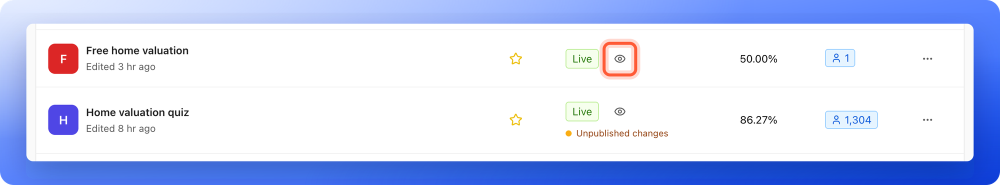
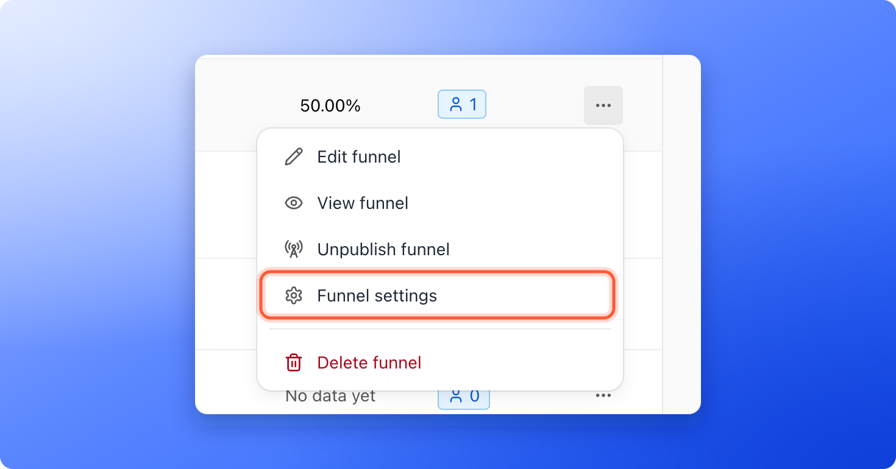
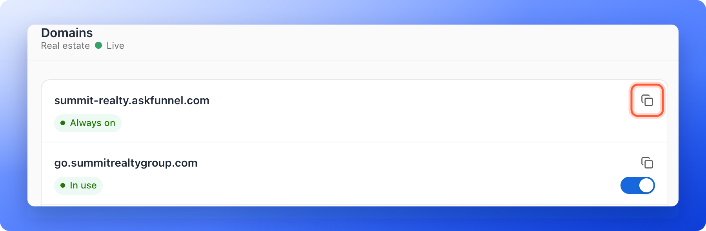

Publish your funnel, copy its link and share it anywhere you want to collect leads: your social media bio, a message to a client, or the landing page of an ad. When you publish a funnel, it goes live on its own web address.

Your link looks like this, with your workspace name first and a unique ending for each funnel:

`https://summit-realty.askfunnel.com/home-valuation-x7k2m9p4qa`

If you connected your own domain, the link starts with your domain instead. See [Connect your custom domain](/funnel-settings/custom-domain).

**Before you start**, you need:

- A funnel you have built. See [Launch your first funnel](/getting-started/launch-your-first-funnel).
- A verified email address. If yours is not verified, AskFunnel shows **Verify your email before publishing this funnel.** Verify it first.

## Important to note

<Warning>
  - Only live funnels have a link that works. A funnel that shows **Draft** in your list is not public yet.
  - Your plan sets how many funnels can be live at once. See [Choose a plan](/billing/choose-a-plan).
  - Your link does not change when you rename the funnel or edit it. After you change a live funnel, click **"Publish"** again so people see the update.
</Warning>

## Publish your funnel and copy the link

<Steps>
  <Step title="Publish the funnel">
    In the builder, click **"Publish"** at the top right. You see **Your funnel is live.** You can also publish from your funnel list: click the three dots (**...**) at the end of the funnel's row, then click **"Publish funnel"**.
  </Step>
  <Step title="Open your live funnel">
    Click **Funnels** in the sidebar. In the **Status** column, the funnel shows a green **Live** badge. Click the eye icon next to it (**View funnel**). Your live funnel opens in a new browser tab.

    

    You can also click the three dots (**...**) on the funnel's row and choose **"View funnel"**. In the builder, open the arrow next to **Publish** and choose **"View live"**.
  </Step>
  <Step title="Copy the link">
    Copy the web address from your browser's address bar.

    Or copy it without opening the funnel: on the funnel row, click the three dots (**...**), then click **"Funnel settings"**. In the menu on the left, click **"Domains"**. Click the copy icon next to the address you want to share. You see **Copied**.

    

    

    The page lists each address the funnel can be opened on. Your workspace address is marked **Always on**. Each of your own domains has a switch, and shows **In use** or **Not in use**, so you copy the link of the address you chose.
  </Step>
</Steps>

## Where to use your link

- **Social media bios:** add it to your Instagram, TikTok or Facebook profile link.
- **Direct messages:** send it in WhatsApp, Messenger or email.
- **Paid ads:** use it as the destination of your ads.

<Tip>
  - **Test it first:** open your live funnel, answer your own questions and submit the form before you send real traffic. See [Test your funnel before you send traffic](/funnels/test-your-funnel).
  - **Track where leads come from:** add UTM parameters (short tags that show where a visit came from) to the end of your link, for example `?utm_source=instagram&utm_campaign=spring-open-house`. AskFunnel reads the UTM source, medium, campaign, term and content from the link.
  - **Make it look good when shared:** set a title, a description and a preview image in [Social preview and favicon](/funnel-settings/social-preview-and-favicon).
</Tip>

## How do I know it is working?

- The **Status** column shows **Live** and the eye icon appears.
- Your link opens the funnel in a private browser window, where you are not signed in.
- If **Unpublished changes** shows under the **Live** badge, you have changes that are not published yet. Click **"Publish"** in the builder to update the live version.

## Troubleshooting

<AccordionGroup>
  <Accordion title="I do not see the eye icon or View funnel">
    They only show for live funnels. Publish your funnel first. If the row shows **Draft**, the funnel is not live.
  </Accordion>
  <Accordion title="The Publish button is grayed out">
    In the builder, hover over the button to see why. It says **Make a change, then publish to go live.** for a funnel you have not changed yet, and **No new changes to publish.** for a live funnel that is up to date. In your funnel list, the **Publish funnel** menu item is grayed out until your email is verified.
  </Accordion>
  <Accordion title="I see Plan limit reached">
    Your plan sets how many funnels can be live at once. Take another funnel offline, or click **"Upgrade plan"**. See [Upgrade your plan](/billing/upgrade).
  </Accordion>
  <Accordion title="People see an old version of my funnel">
    Click **"Publish"** again in the builder. Your edits only go live when you publish. Give it a minute, then refresh your live page.
  </Accordion>
  <Accordion title="I do not see the Funnel settings option">
    **"Funnel settings"** is available to Global Admins, Workspace Admins and Content Editors. The three dots menu is hidden for Contacts Managers. You can still open the eye icon link to copy the link.
  </Accordion>
</AccordionGroup>

## Take your funnel offline

Click the three dots (**...**) on the funnel's row and click **"Unpublish funnel"**. Or, in the builder, open the arrow next to **Publish** and click **"Unpublish"**, then confirm with **"Take offline"**. People cannot see the funnel until you publish it again. Your earlier versions are kept. To go back to one, see [Publish, unpublish and restore an earlier version](/funnels/publish-and-restore).

## What to do next

<Columns cols={2}>
  <Card title="Connect your custom domain" icon="globe" href="/funnel-settings/custom-domain">
    Put your funnels on your own web address.
  </Card>
  <Card title="Set your social preview and favicon" icon="image" href="/funnel-settings/social-preview-and-favicon">
    Choose the title and picture people see when they share your link.
  </Card>
  <Card title="View and manage your leads" icon="users" href="/leads/view-and-manage-leads">
    See every lead with its answers.
  </Card>
  <Card title="Track your ads" icon="bullseye" href="/integrations/meta-pixel">
    Connect a pixel to see which ads bring leads.
  </Card>
</Columns>

Need help? Email [support@askfunnel.com](mailto:support@askfunnel.com).
