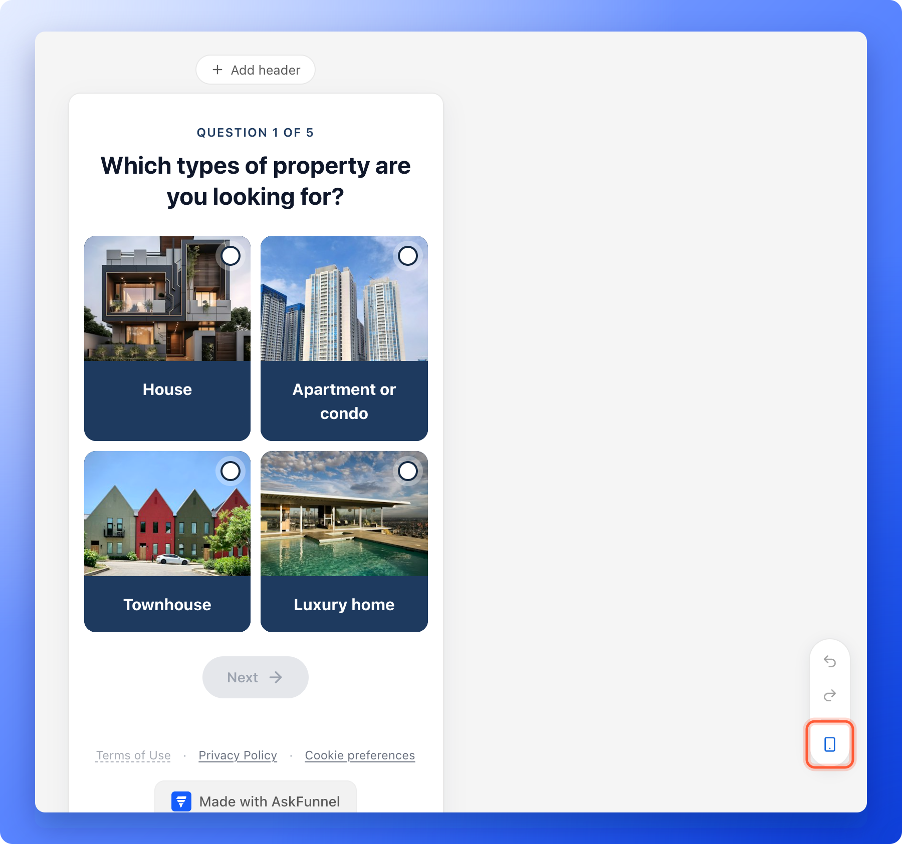
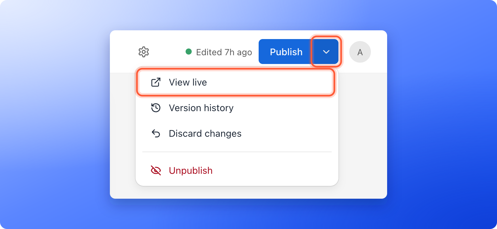

A funnel can look fine in the builder and still hide a cut off headline on a phone, a button that goes to the wrong page or a form that saves no lead. A ten minute test catches these problems before your ads, your clients or your followers do. This page gives you the full routine, from checking the screen sizes to finding your test lead.

AskFunnel has no private preview link for a draft. You test the real thing: you publish the funnel, open it the way a visitor does and look at the lead it creates.

With this routine, you can:

- **Check every screen.** See your pages as they look on a computer, a tablet and a phone.
- **Follow every route.** Try each answer that sends visitors to a different page.
- **Check the lead.** Make sure the contact details and the answers arrive.
- **Check what happens next.** See your thank you screen, your connected tools and your emails.

**Before you start**, you need:

- A funnel with a lead form. See [Set up your lead capture form](/funnels/lead-capture-forms).
- A role that can edit and publish funnels: Global Admin, Workspace Admin or Content Editor.
- A verified email address. Publishing needs it.
- To open the test lead, a role that can see leads: Global Admin, Workspace Admin or Contacts Manager. Content Editors cannot open leads, so ask a teammate who can. See [View and manage your leads](/leads/view-and-manage-leads).

## Important to note

<Warning>
  - A test lead is a real lead. There is no test mode. It counts toward your monthly lead limit, shows in your leads table and in your analytics, and goes to your connected tools and automated emails like any other lead. Use details that are easy to spot, and delete the lead when you finish.
  - Publishing makes the funnel public. Anyone who has the link can open it, so keep the link to yourself until the test is done. If the funnel already has visitors, they see your edits as soon as you publish.
  - The form saves a lead only when the visitor fills in at least one of **Name**, **Email** or **Phone**. Include your email address in your test.
</Warning>

## Run the test

<Steps>
  <Step title="Check each screen size in the builder">
    1. In the builder, find the device button at the right side of the canvas. Its icon shows the view you are in now. The builder opens in **Mobile** view. If your browser window is too narrow for a view, the builder drops to the largest view that fits.
    2. Click it to switch to the next view. The order is **Desktop**, then **Tablet**, then **Mobile**, then back to **Desktop**. Point at the button to see the name of the next view.
    3. On each page, look for text that is cut off or too small, images that are cropped badly and buttons or form fields that sit too far down. On a phone, columns stack one above the other. See [Build multi-column layouts](/funnels/grid-layouts).

    

    When you build on a phone, the builder only shows the **Mobile** view and has no device button.
  </Step>
  <Step title="Publish and open your live funnel">
    1. Click **"Publish"** at the top right and wait until the status says **Live**. See [Publish, unpublish and restore an earlier version](/funnels/publish-and-restore) if the button is grayed out. If the funnel has no form, a window warns you first.
    2. Click the small arrow next to **"Publish"**, then click **"View live"**. Your funnel opens in a new tab and shows exactly what visitors see.
    3. For a clean test, copy the address into a private browser window, where you are not signed in. Then open the same link on your own phone.

    
  </Step>
  <Step title="Walk through it like a visitor">
    - **Answer every question.** If your funnel uses a cookie banner, make a choice like a visitor would. Test it once with the banner accepted and once with it declined. See [Set up cookies and visitor consent](/funnel-settings/cookies-and-consent).
    - **Try each route.** If an answer sends people to a different page, pick it and check that you arrive where you expect. Also try an answer that follows the **Otherwise** route. See [Send visitors to different pages based on their answers](/funnels/branch-by-answer).
    - **Try the form with mistakes.** Leave a required field empty, and type an email address without the @ sign. The form points out the problem before it sends anything.
  </Step>
  <Step title="Submit a test lead">
    1. On the form page, enter details you will recognize as a test, for example your own name with the word test after it. If you use automated emails, enter an email address you can open.
    2. Click the submit button once and wait for the next page.
    3. Read your thank you screen and click its button, if it has one. See [Customize your thank you screen](/funnels/thank-you-screen).
  </Step>
  <Step title="Find the lead and check it">
    1. Click **Funnels** in the sidebar and click your funnel's row. Its **Leads** page opens.
    2. Click the magnifier icon and type the name you used.
    3. Hover over the lead's name and click the **"Open lead"** icon. In the **Profile** tab, check that the contact details and every answer match what you entered.

    Finding the lead is the check that matters. Reaching the thank you screen alone does not prove that a lead was saved.
  </Step>
  <Step title="Check what happens next and clean up">
    - **Connected tools.** Open the lead in your tool, or the delivery log of your webhook, where the lead shows **Delivered**. See [Send your leads to a webhook](/integrations/webhooks), [Send your leads to Google Sheets](/integrations/google-sheets) and [Send your leads to HighLevel](/integrations/highlevel).
    - **Emails.** Check your inbox for the automated email and your team's inbox for the alert, if you set them up. See [Send automated emails to new leads](/messages/automated-emails) and [Email your team when a lead arrives](/messages/team-alerts).
    - **Clean up.** Delete the test lead. See [Delete leads](/leads/delete-leads). Other tools keep their copy, so delete it there too.
  </Step>
</Steps>

<Tip>
  Test again after every change that touches your questions, your form or your page order. Edit, publish, then repeat steps 3 to 5. A small test takes a minute when you have done it once.
</Tip>

## How do I know it is working?

- Each page reads well on **Desktop**, **Tablet** and **Mobile**, and on your own phone.
- Every answer leads where you planned, and the form points out mistakes.
- After you submit, you reach your thank you screen.
- The test lead is in the **Leads** page with the right contact details and answers.
- Your connected tools and emails received it, if you use them.

## Troubleshooting

<AccordionGroup>
  <Accordion title="I do not see my changes on the live funnel">
    Changes only go live when you publish. If the status says **Edited**, click **"Publish"**, then wait about a minute and refresh the page. Use a private browser window so your browser does not show an old copy. See [Publish, unpublish and restore an earlier version](/funnels/publish-and-restore).
  </Accordion>
  <Accordion title="I reached the thank you screen but cannot find the lead">
    - The form saved no lead because the **Name**, **Email** and **Phone** fields were all empty.
    - You are in the **Leads** page of a different funnel, or a filter or search hides the lead. Clear them, or click **View options**, then **"Reset view"**.
    - Your plan's monthly lead limit is used up. The lead is saved but locked and hidden. See [What happens when you reach your monthly lead limit](/billing/monthly-lead-limit).
  </Accordion>
  <Accordion title="I do not see View live">
    **"View live"** only shows for a live funnel. Click **"Publish"** first.
  </Accordion>
  <Accordion title="I cannot open the Leads page">
    Content Editors design funnels but cannot see leads. Ask a Global Admin, Workspace Admin or Contacts Manager to check the lead for you, or to change your role. See [Invite a teammate or client to a workspace](/workspaces/give-access).
  </Accordion>
  <Accordion title="The funnel looks different on my phone than in Mobile view">
    The device views in the builder are a guide. Trust the live funnel on a real phone. If something looks wrong, fix it in the builder, publish and check again.
  </Accordion>
  <Accordion title="My test lead still shows in my analytics after I deleted it">
    Analytics counts the form submission, and it can keep counting it after the lead is deleted. See [Why your lead and analytics numbers differ](/analytics/why-numbers-differ).
  </Accordion>
  <Accordion title="The automated email did not arrive">
    Check your spam folder first. If it is not there, see [Keep your emails out of spam](/messages/email-deliverability).
  </Accordion>
</AccordionGroup>

## What to do next

<Columns cols={2}>
  <Card title="Find and share your funnel link" icon="share-nodes" href="/funnels/share-your-funnel">
    Copy your link and use it in ads, messages and social posts.
  </Card>
  <Card title="Track campaigns with UTM links" icon="link" href="/analytics/utm-tracking">
    Test a tagged link and see where the lead came from.
  </Card>
  <Card title="Connect your custom domain" icon="globe" href="/funnel-settings/custom-domain">
    Put your funnel on your own web address, then test it again.
  </Card>
  <Card title="Why your numbers differ" icon="scale-balanced" href="/analytics/why-numbers-differ">
    Understand your leads and analytics once the traffic arrives.
  </Card>
</Columns>

Need help? Email [support@askfunnel.com](mailto:support@askfunnel.com).
