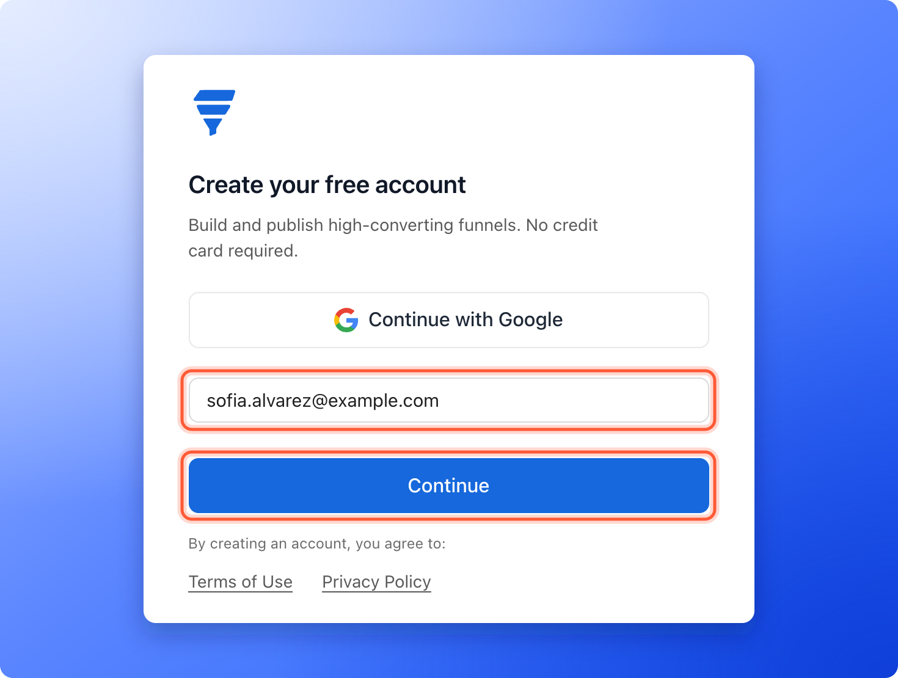
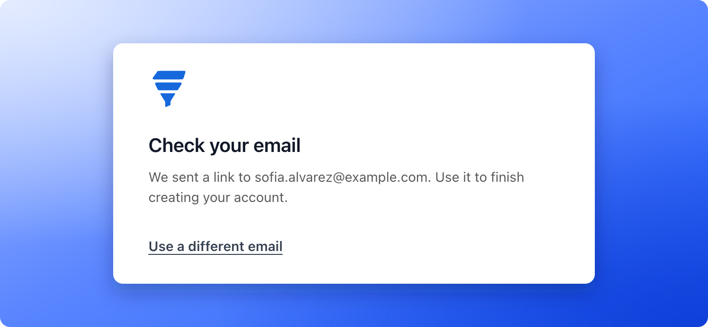
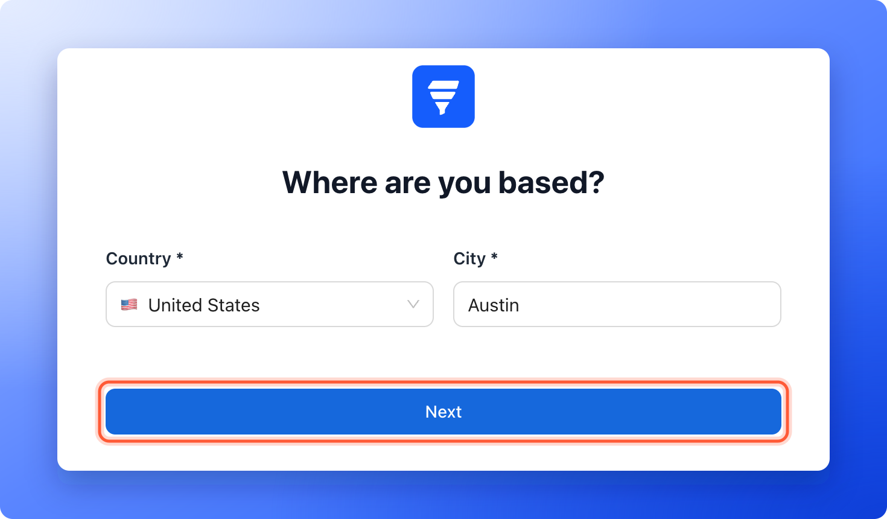
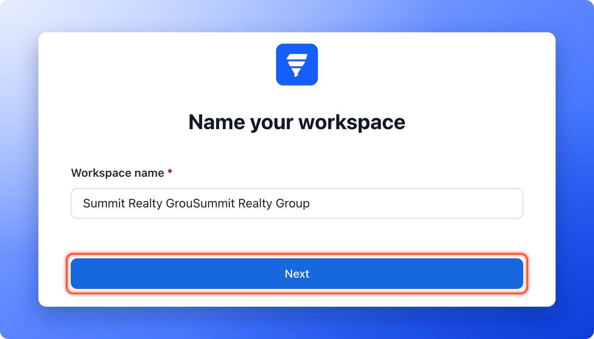
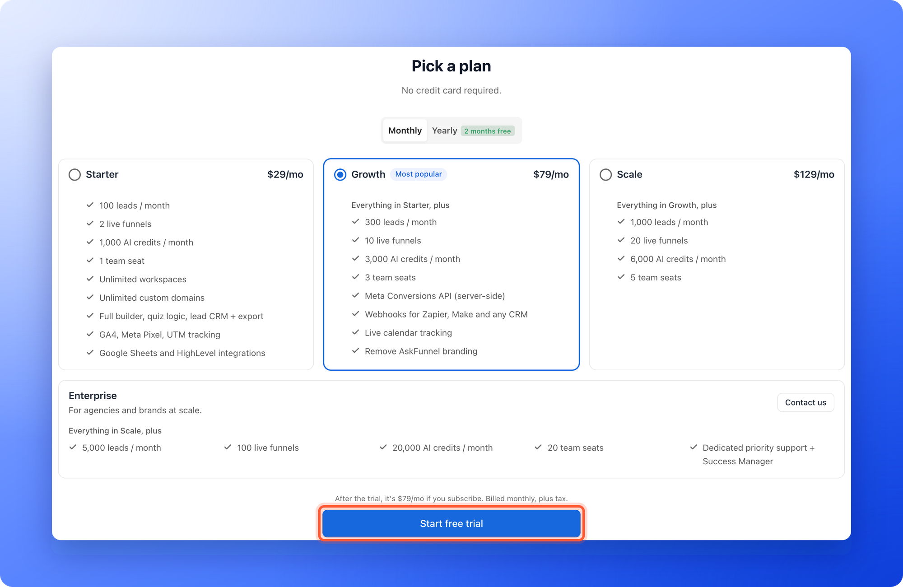
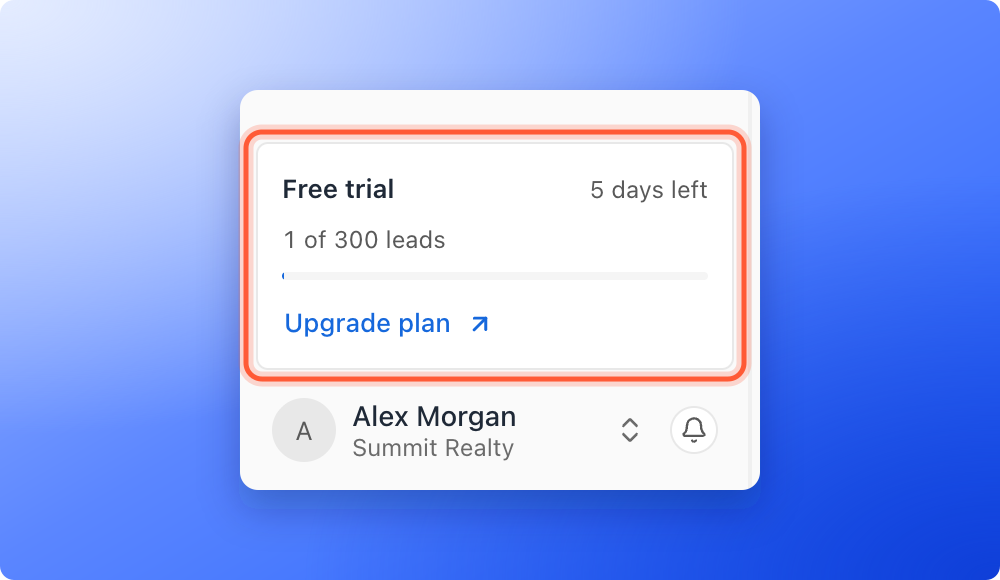

Create your AskFunnel account and start your 14-day free trial in a few minutes. You sign up with your email or your Google account, answer a few setup questions and pick a plan. You do not need a credit card.

**Before you start**, you need:

- A permanent email address you can open right now (for example your work email), or a Google account. Free trials are not available with temporary or disposable email addresses.

<Note>
  Joining a team you were invited to? Use the link in your invitation email instead. See [Invite a teammate](/workspaces/give-access). Already have an account? See [Sign in to AskFunnel](/getting-started/sign-in).
</Note>

## Sign up

<Steps>
  <Step title="Enter your email or use Google">
    1. Go to [dash.askfunnel.com](https://dash.askfunnel.com) and click **"Create an account"**.
    2. Enter your email address and click **"Continue"**.

    To skip the email step, click **"Continue with Google"** instead and follow the Google window. Then skip ahead to **Answer the setup questions**.

    
  </Step>
  <Step title="Open the email we send you">
    AskFunnel does not use passwords. You see a **Check your email** message that says "We sent a link to" the address you entered.

    

    1. Open the email with the subject **Create your AskFunnel account**.
    2. Click **"Create my account"**. You are signed in and taken to the setup questions.

    <Note>
      The link expires soon and works once. If it stops working, go back to the sign up page and enter your email again.
    </Note>
  </Step>
  <Step title="Answer the setup questions">
    The setup shows one question at a time. Click **"Next"** to move on, or the back arrow at the top left to return to the one before.

    1. **Welcome to AskFunnel:** Enter your **Full name**. Your email is already filled in. **Phone** is optional.
    2. **Where are you based?:** Choose your **Country**, then start typing your **City**.
    3. **Name your workspace:** This names your first [workspace](/workspaces/what-is-a-workspace). You can rename it later.
    4. **Pick a template:** Choose a template and click **"Use this template"**, or choose **Start blank** to build from scratch. You may not see this screen if no templates are available.
    5. **Your website:** Enter your company website, or click **"Skip"**. It is optional.

    

    
  </Step>
  <Step title="Choose a plan and start your trial">
    The last screen is **Pick a plan**.

    1. Choose **Monthly** or **Yearly** billing. **Yearly** shows **2 months free**.
    2. Click the plan you want. **Growth** is selected first and marked **Most popular**. **Enterprise** has a **"Contact us"** button instead of a trial.
    3. Click **"Start free trial"** under the plans. A line above the button says what the plan costs if you subscribe after the trial.

    

    Your trial starts right away. See [How the 14-day free trial works](/billing/free-trial), or [choose the right plan](/billing/choose-a-plan) first.
  </Step>
</Steps>

## How do I know it is working?

- You see the message "Your 14-day free trial has started. Welcome to AskFunnel!"
- You land on **Home** in your first workspace. If you picked a template, you land in the funnel builder with your first funnel open instead.
- The plan card at the bottom of the sidebar shows **Free trial** and how many days are left.

## Troubleshooting

<AccordionGroup>
  <Accordion title="I did not get the email">
    Check your spam or junk folder, then check that the address on the **Check your email** screen is correct. If it is wrong, click **"Use a different email"** and try again. If the email still does not arrive after a few minutes, email support.
  </Accordion>
  <Accordion title="The link says it is invalid or expired">
    The page says **Invalid link** and gives the reason. Click **"Back to sign in"** and request a new link. Each link works once and expires soon.
  </Accordion>
  <Accordion title="I am asked to confirm my email">
    This happens when you open the link on a different device or browser than the one you signed up on. Enter the same email address you signed up with and click **"Continue"**.
  </Accordion>
  <Accordion title="It tells me to use a permanent email address">
    Sign up again with a permanent address, such as your work email. Temporary or disposable addresses cannot start a free trial.
  </Accordion>
  <Accordion title="It says I already used my free trial">
    Each person gets one free trial. To keep using AskFunnel, subscribe to a plan. See [Choose the right plan](/billing/choose-a-plan). If you think this is a mistake, email support.
  </Accordion>
  <Accordion title="I closed the page before I finished">
    Sign in again. AskFunnel takes you back to the setup questions, and the answers you already entered are kept in the same browser.
  </Accordion>
</AccordionGroup>

## What to do next

<Columns cols={3}>
  <Card title="Launch your first funnel" icon="flag-checkered" href="/getting-started/launch-your-first-funnel">
    Start from a template and publish your first funnel in about 15 minutes.
  </Card>
  <Card title="Find your way around" icon="compass" href="/getting-started/dashboard-tour">
    A tour of the sidebar, your plan card and your account menu.
  </Card>
  <Card title="Book an onboarding call" icon="calendar-check" href="/getting-started/onboarding-call">
    Get a live walkthrough with the AskFunnel team.
  </Card>
</Columns>

Need help? Email [support@askfunnel.com](mailto:support@askfunnel.com).
