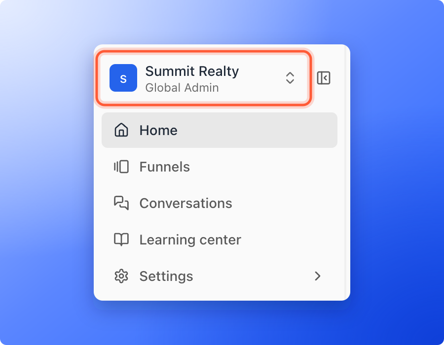
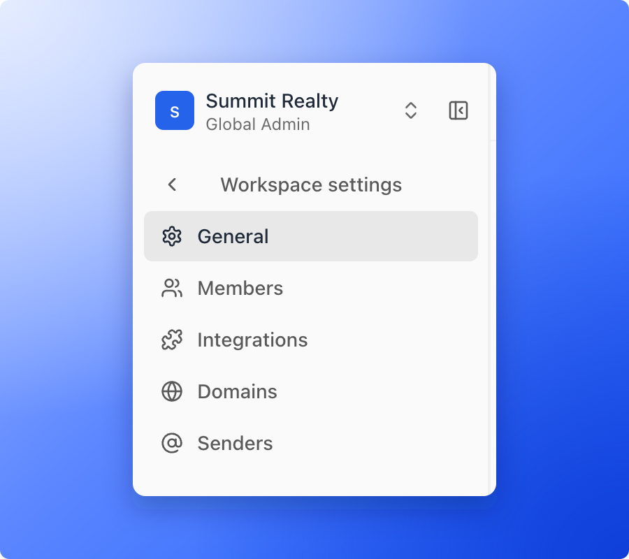
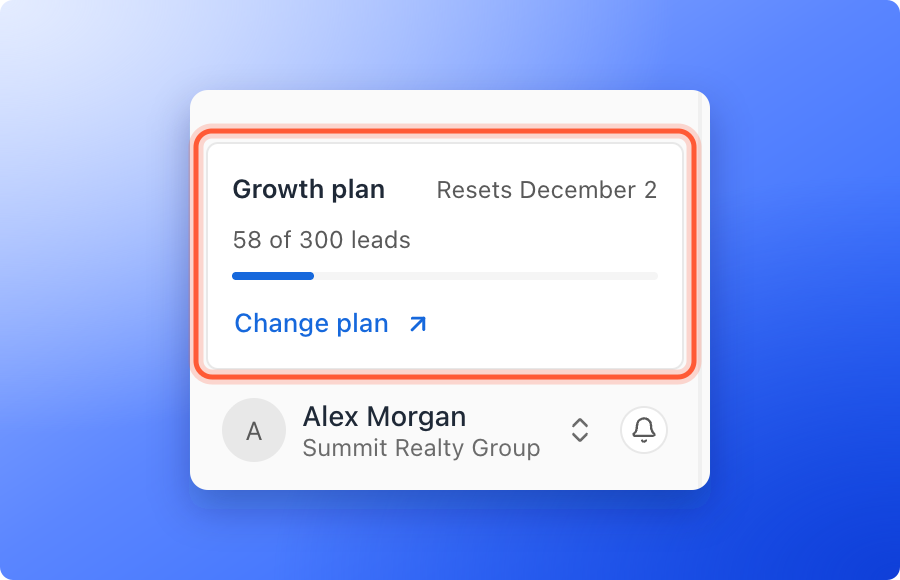
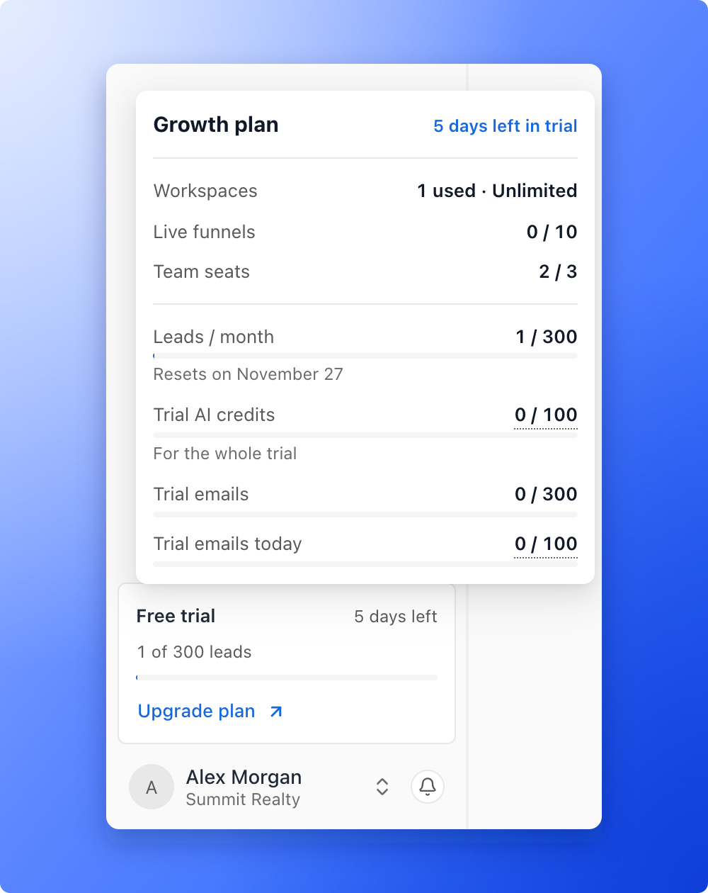
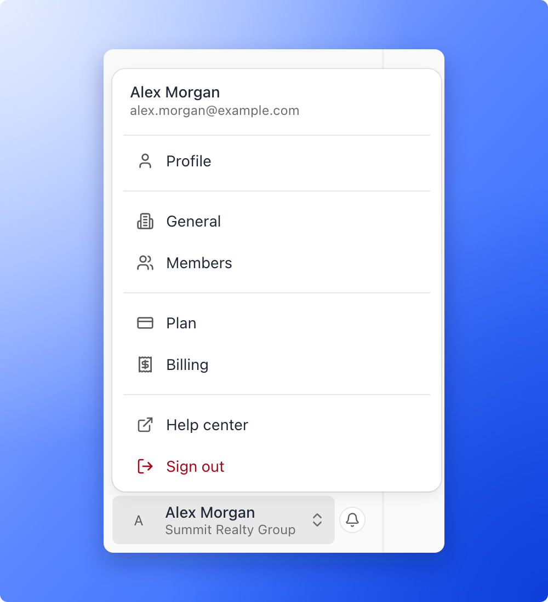
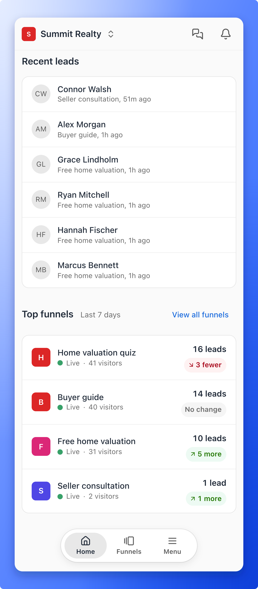
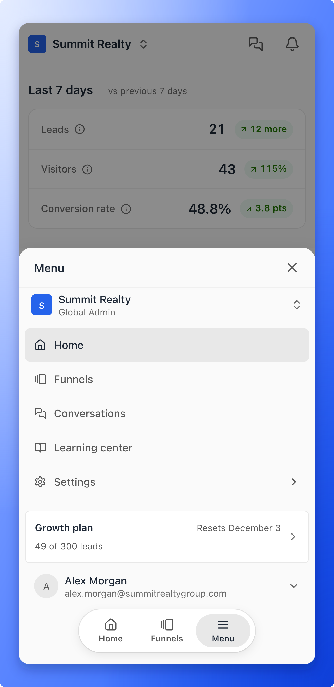

Everything in AskFunnel starts from the sidebar on the left. It stays with you on every page, so you can switch workspace, open your funnels, check your plan and reach your account without searching for them. On a phone the same things sit in a bar at the bottom of the screen.

## The top of the sidebar

- **Workspace switcher:** Shows the workspace you are in and your role there. Click it to open another workspace, or, as a Global Admin, to create one. See [Switch between workspaces](/workspaces/switch-workspaces).
- **Home:** Your numbers for the last 7 days and what needs your attention. See [Read your Home overview](/getting-started/home-overview).
- **Funnels:** Every funnel in the workspace. Open one to see its leads, analytics and activity, or to edit it.
- **Conversations:** The chats with your leads. It shows for people who manage leads.
- **Learning center:** Short video lessons for the main tasks. See [Learn AskFunnel with the lessons in the Learning center](/getting-started/learn-tab).
- **Settings:** Opens a second menu called **Workspace settings** with **General**, **Members**, **Integrations**, **Domains** and **Senders**. Click the arrow at the top of that menu to go back. Global Admins and Workspace Admins see this row.

To give the page more room, click the **Collapse sidebar** button at the top of the sidebar. The sidebar shrinks to a narrow strip of icons, and **Expand sidebar** brings it back.

## The bottom of the sidebar

- **Plan card:** Shows your plan, the day your leads count starts again and how many leads you have used. During a free trial it shows **Free trial** and the days left. Global Admins also see a link to change the plan. Click the card to see everything your plan includes and how much of it you use.
- **Your name and organization:** Opens your account menu. See below.
- **Notifications bell:** Opens your notifications. See [Notifications](/getting-started/notifications).

The plan menu lists **Workspaces**, **Live funnels**, **Team seats** and **Leads / month**, then your AI credits and automated emails, each with what you have used. On a paid plan these are **AI credits / month**, **Automated emails / month** and **Automated emails / day**. During a free trial they are **Trial AI credits**, **Trial emails** and **Trial emails today**. For the numbers each plan includes, see [Check your plan and usage](/billing/plan-and-usage).

### Your account menu

Click your name at the bottom of the sidebar.

- **Profile:** Your name, photo, email address and contact details. See [Your profile](/getting-started/your-profile).
- **General:** Your organization's name.
- **Members:** Your team and its invitations. Global Admins only. See [Invite a teammate or client](/workspaces/give-access).
- **Plan** and **Billing:** Your subscription and your invoices. Global Admins only. See [Check your plan and usage](/billing/plan-and-usage).
- **Help center:** Opens this Help Center in a new tab.
- **Sign out:** Signs you out of AskFunnel.

When you open one of these pages, the sidebar shows **Back** at the top and groups the pages under **Account**, **Organization** and **Subscription**.

## Inside a funnel

When you open a funnel, the sidebar turns into that funnel's menu. The top row, **Funnels**, takes you back to the list. Below it are **Leads**, **Analytics**, **Activity** and **Settings**, and an **Edit funnel** button. The page title shows the funnel's name and whether it is live.

## What you see depends on your role

| Row | Global Admin | Workspace Admin | Content Editor | Contacts Manager |
| --- | --- | --- | --- | --- |
| **Home**, **Funnels**, **Learning center** | Yes | Yes | Yes | Yes |
| **Conversations** | Yes | Yes | No | Yes |
| **Settings** | Yes | Yes | No | No |
| **All workspaces** in the switcher | Yes | No | No | No |
| **Members**, **Plan** and **Billing** in the account menu | Yes | No | No | No |

Everyone sees **Profile** and **General** in the account menu. To see what each role can do, see [Invite a teammate or client](/workspaces/give-access).

## On a phone

On a phone there is no sidebar. The same things are in three places.

- **At the top:** The workspace switcher, and icons for conversations (for people who manage leads) and notifications. Tap the workspace name to switch workspace. It opens full screen with a **Find a workspace** box.
- **At the bottom:** A bar with **Home**, **Funnels** and **Menu**.
- **Menu:** Tap **Menu** to open a sheet with the same rows as the sidebar, your plan card and your account. Tap your name to open **Profile**, **General** and the other account pages, and **Sign out**.

## What to do next

<Columns cols={3}>
  <Card title="Read your Home overview" icon="house" href="/getting-started/home-overview">
    Your numbers for the last 7 days and what needs your attention.
  </Card>
  <Card title="Switch between workspaces" icon="right-left" href="/workspaces/switch-workspaces">
    Open the workspace you want to work in.
  </Card>
  <Card title="Launch your first funnel" icon="flag-checkered" href="/getting-started/launch-your-first-funnel">
    From a template to a live funnel in about 15 minutes.
  </Card>
</Columns>

Need help? Email [support@askfunnel.com](mailto:support@askfunnel.com).
