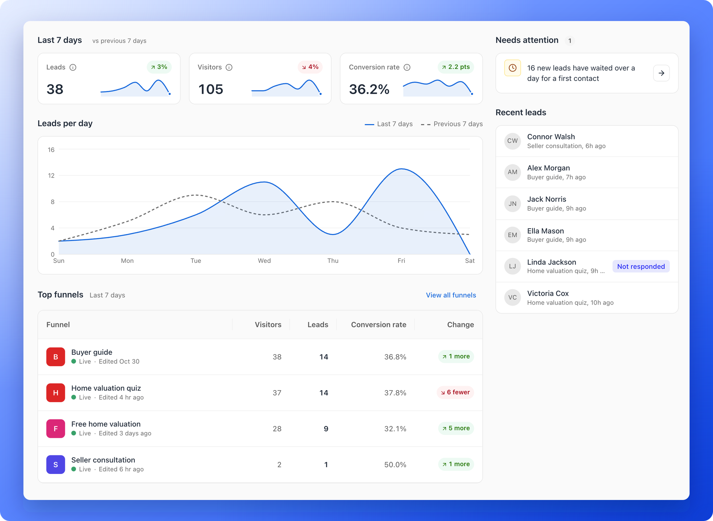
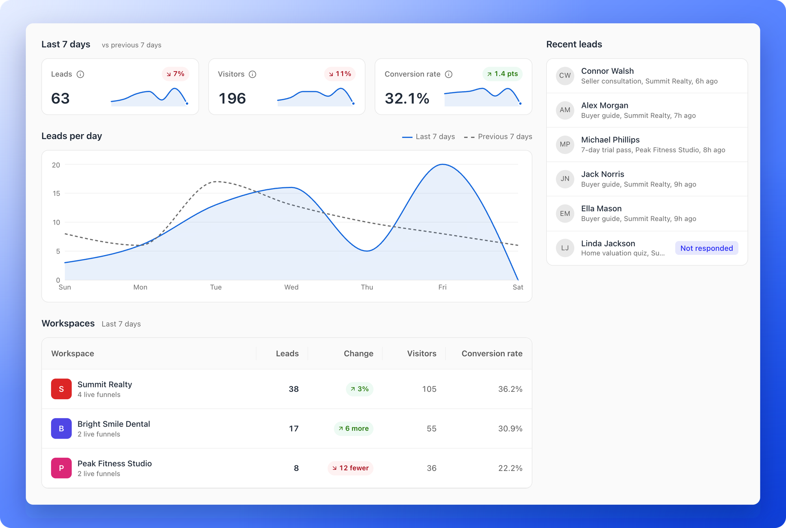

**Home** is the first page you see after you sign in. It answers three questions in one place: how are my funnels doing this week, what should I fix, and who just signed up. Click **Home** in the sidebar at any time to come back to it.

## What is on Home

- **Last 7 days:** Three cards, **Leads**, **Visitors** and **Conversion rate**, each with the change against the 7 days before, green when it went up and red when it went down (for example **3%** or **2.2 pts**). Click the **i** icon on a card to see what it counts.
- **Leads per day:** A chart with one line for the last 7 days and a dashed line for the 7 days before, so you can see a good or bad day at a glance.
- **Top funnels:** Your best funnels this week, with their **Visitors**, **Leads**, **Conversion rate** and **Change**. Click a funnel to open it, or click **"View all funnels"**.
- **Needs attention:** A short list of things worth fixing, each with a button that takes you there.
- **Recent leads:** The newest leads, with the funnel they came from and how long ago.

<Note>
  The numbers cover the last 7 days. **Leads** counts every form submission in the workspace, including leads that your plan has locked. **Visitors** counts each person once a day, so someone who comes back on another day counts again. **Conversion rate** is leads divided by visitors. See [Why your lead and analytics numbers differ](/analytics/why-numbers-differ).
</Note>

## What Needs attention can tell you

Each line has a button on its right. Lines show only when they apply.

- **A failing integration:** For example **Your webhook is failing**. The button is **Fix it** and opens the funnel's integrations.
- **Leads waiting:** For example **16 new leads have waited over a day for a first contact**. The button is **Open leads**.
- **A funnel with visitors and no leads:** A funnel that had visitors but no leads in 7 days. The button is **Open funnel**.
- **Drafts:** Funnels you have not published yet. The button is **Publish** for one funnel, or **Open funnels** for several.
- **Your lead limit:** When you are close to your plan's monthly leads or have used them all. Only Global Admins see this line. The button is **View plan**.

## See all your workspaces at once

If you are a Global Admin, open the workspace switcher at the top of the sidebar and click **All workspaces**. Home then adds up every workspace and shows a **Workspaces** table with the **Leads**, **Change**, **Visitors** and **Conversion rate** of each one, and how many live funnels it has. Click a row to open that workspace.

Everyone else opens straight into their own workspace. When you sign in, AskFunnel opens the workspace you used last.

## What other roles see

- **Workspace Admins and Contacts Managers** see the numbers, the chart and the lists described above for the workspaces they belong to.
- **Content Editors** do not work with lead data. Their Home shows the funnels they edited most recently, with a **Create funnel** button.
- In a workspace with no funnels yet, Home says **Create your first funnel**.

## How do I know it is working?

- A new workspace shows **Your numbers show here in a few minutes.** until the first numbers arrive.
- The chart, the cards and the table change as new visitors and leads come in.

## Troubleshooting

<AccordionGroup>
  <Accordion title="My numbers are zero">
    Home counts the last 7 days. A funnel that is not live yet, or that you have just published, has no visitors to count. See [Publish and restore](/funnels/publish-and-restore).
  </Accordion>
  <Accordion title="Home says my numbers are taking longer than usual">
    Wait a few minutes and open **Home** again. If it still does not load, email support.
  </Accordion>
  <Accordion title="I do not see All workspaces">
    Only Global Admins see **All workspaces**. Everyone else opens the workspaces they were added to. See [Switch between workspaces](/workspaces/switch-workspaces).
  </Accordion>
  <Accordion title="Leads on Home do not match my funnel's analytics">
    Home counts the last 7 days, and the funnel's analytics count the period you pick. See [Why your lead and analytics numbers differ](/analytics/why-numbers-differ).
  </Accordion>
</AccordionGroup>

## What to do next

<Columns cols={3}>
  <Card title="Funnel analytics" icon="chart-line" href="/analytics/funnel-analytics">
    Conversion rates and where people leave a funnel.
  </Card>
  <Card title="View and manage your leads" icon="users" href="/leads/view-and-manage-leads">
    Follow up with the leads that wait for a first contact.
  </Card>
  <Card title="Find your way around" icon="compass" href="/getting-started/dashboard-tour">
    A tour of the sidebar and the account menu.
  </Card>
</Columns>

Need help? Email [support@askfunnel.com](mailto:support@askfunnel.com).
