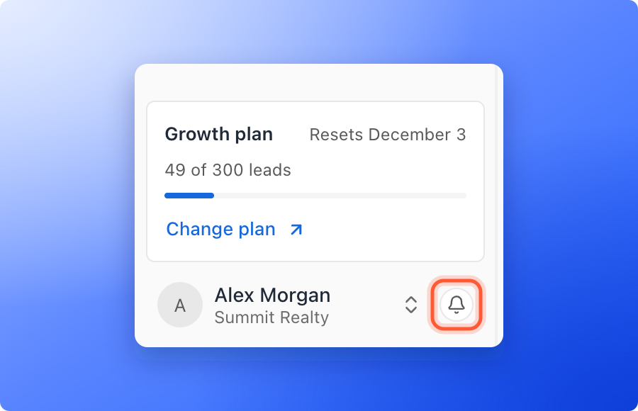
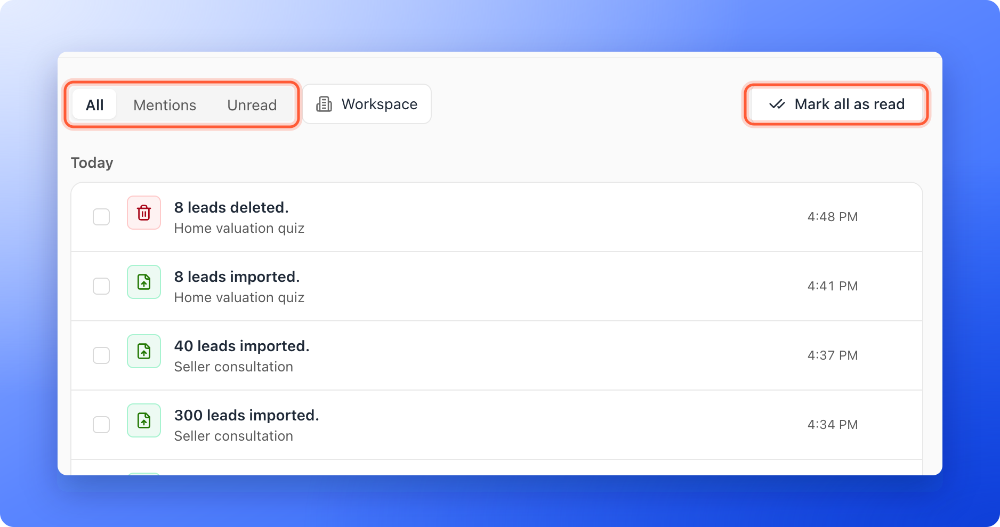

The bell is where AskFunnel tells you what happened while you were away: a new lead, a note a teammate wrote, a mention of your name, a funnel someone published. A blue dot on the bell means something is unread.

## Open your notifications

<Steps>
  <Step title="Click the bell">
    Click the bell next to your name at the bottom of the sidebar. On a phone, tap the bell at the top right of the screen.

    
  </Step>
  <Step title="Choose what to look at">
    The list opens with three tabs:

    - **All:** Everything, newest first, grouped by day.
    - **Mentions:** Only the notes where someone mentioned you.
    - **Unread:** Only what you have not read yet. A number beside the tab says how many.
  </Step>
  <Step title="Open one">
    Click a notification to open what it is about, for example the lead. It is marked as read. To mark one as read or unread without opening it, click the small envelope on its row.
  </Step>
  <Step title="Mark everything as read">
    Click the three dots (**Notification options**) at the top of the list, then **"Mark all as read"**.
  </Step>
</Steps>

Click **"See all notifications"** at the bottom of the list to open the full page.

## The Notifications page

The full page shows the same tabs, **All**, **Mentions** and **Unread**, with the list grouped as **Today**, **Yesterday**, **This week** and **Earlier**.

- **Filter by workspace and funnel:** Click **Workspace** and choose one. A **Funnel** filter then appears for that workspace.
- **Mark all as read:** Click **"Mark all as read"** at the top right.
- **Select several:** Tick the boxes at the left of the rows. A bar shows how many you selected and offers **Mark as read**, **Mark as unread**, **Select page** and **Delete**.

## What you are told about

- A new lead came in through a funnel, and leads that were imported, moved, deleted or unlocked.
- A lead's status or tags changed.
- A note was added, edited or deleted, and a note that mentions you.
- A funnel was created, published, unpublished or deleted.
- Email sending was paused for a workspace, and WhatsApp messages and chats that need you.

What you see depends on your role and on the workspaces you work in.

## How do I know it is working?

- New activity adds a blue dot to the bell, and the **Unread** tab shows a number.
- After you open a notification or click **"Mark all as read"**, the dot and the number go away.

## Troubleshooting

<AccordionGroup>
  <Accordion title="I see You're all caught up">
    You have nothing unread. Click the **All** tab to see older notifications.
  </Accordion>
  <Accordion title="I see Couldn't load notifications">
    Check your connection and click **"Try again"**.
  </Accordion>
  <Accordion title="I do not see a notification I expected">
    Notifications are about the workspaces you were added to, so ask a Global Admin to [add you to the workspace](/workspaces/give-access). If it is a lead, check the funnel's **Leads** page too.
  </Accordion>
</AccordionGroup>

## What to do next

<Columns cols={3}>
  <Card title="Activity log" icon="clock-rotate-left" href="/analytics/activity-log">
    See everything that happened in one funnel.
  </Card>
  <Card title="Team alerts" icon="bell-concierge" href="/messages/team-alerts">
    Get an email when a new lead arrives.
  </Card>
  <Card title="Find your way around" icon="compass" href="/getting-started/dashboard-tour">
    A tour of the sidebar and the account menu.
  </Card>
</Columns>

Need help? Email [support@askfunnel.com](mailto:support@askfunnel.com).
