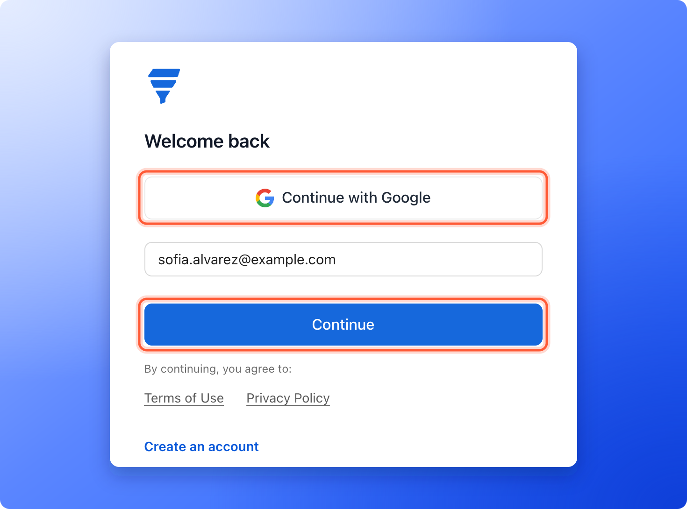
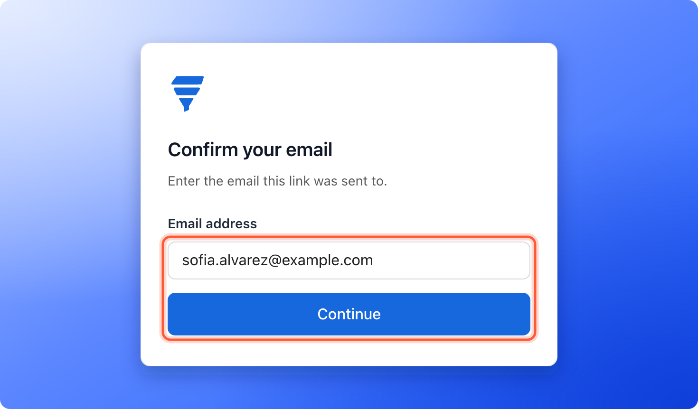
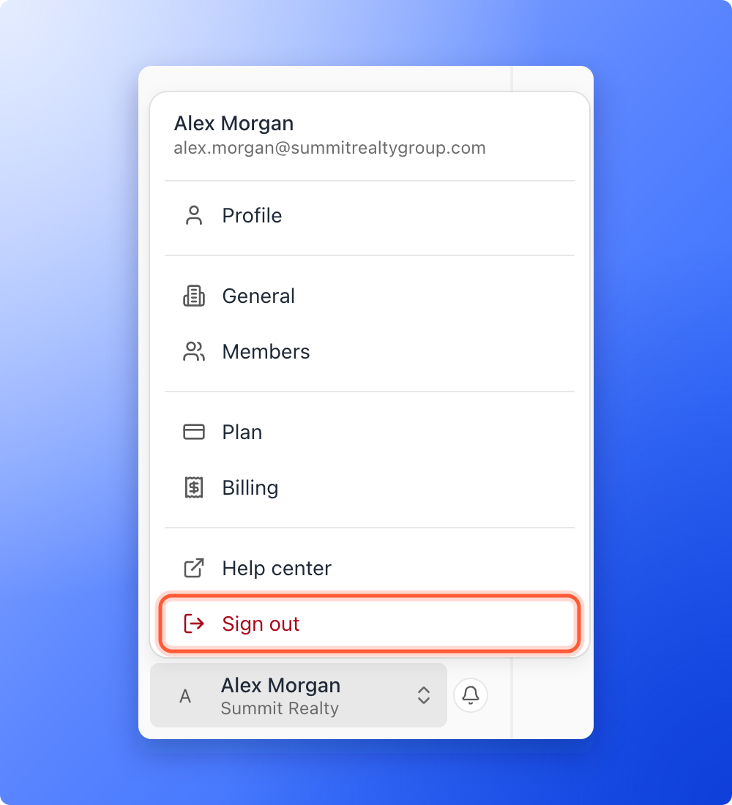

AskFunnel has no passwords. You sign in one of two ways: with your Google account, or with a link that we email to you. This page shows both, what each screen says and what to do when a link does not work.

With these two ways, you can:

- **Sign in with Google.** One click, if you signed up with a Google account.
- **Sign in with an email link.** Enter your email address, open our message and click the link.
- **Forget about passwords.** There is nothing to remember, change or reset.

**Before you start**, you need:

- An AskFunnel account. See [Create your account and start your free trial](/getting-started/create-account).
- Access to the Google account, or to the email inbox, that you used to sign up.

## Important to note

<Warning>
  - Use the same email address you signed up with. If you enter an address that has no account, AskFunnel emails you a link to create a new account instead. An email with the subject **Create your AskFunnel account**, when you expected to sign in, usually means you typed a different address.
  - A sign in link works once and expires soon. Do not forward it.
  - If your free trial or subscription has ended, you see a page about that after you sign in.
</Warning>

## Sign in

<Steps>
  <Step title="Open the sign in page">
    Go to [dash.askfunnel.com](https://dash.askfunnel.com). If you are not signed in, you see the page **Welcome back**.

    
  </Step>
  <Step title="Choose how to sign in">
    - **With Google:** click **"Continue with Google"** and choose your account in the Google window. When it closes, you land on **Home** in the workspace you used last. If you close the Google window yourself, nothing happens. Click the button again.
    - **With an email link:** type your address in **Enter email address** and click **"Continue"**. You see **Check your email** and a line that says "We sent a link to" your address. If you made a typing mistake, click **"Use a different email"**.
  </Step>
  <Step title="Open the email and click the link">
    The email has the subject **Sign in to AskFunnel** and a button **"Sign in"**. Click it. A page says **Signing you in...** and then opens **Home** in the workspace you used last.

    If you have an invitation waiting for this address, AskFunnel takes you to the invitation page first. See [Invite a teammate or client to a workspace](/workspaces/give-access).
  </Step>
  <Step title="Confirm your email if you are asked">
    If you open the link in a different browser, or on a different device, than the one where you asked for it, you see **Confirm your email** and the line **Enter the email this link was sent to.** Type the same address you used and click **"Continue"**.

    
  </Step>
</Steps>

## Sign out

Click your name at the bottom of the sidebar, then click **"Sign out"** at the bottom of the menu. On a phone, tap **"Menu"** at the bottom of the screen, then your name, then **"Sign out"**. The same menu opens your profile and your organization settings, and Global Admins also see their plan and billing there.

## How do I know it is working?

- You land on **Home** and see your workspace's name at the top of the sidebar.
- Your name shows at the bottom of the sidebar.

## Troubleshooting

<AccordionGroup>
  <Accordion title="I cannot find Forgot password">
    There is none, because AskFunnel does not use passwords. Click **"Continue with Google"**, or type your email address, click **"Continue"** and use the link we send you.
  </Accordion>
  <Accordion title="The email did not arrive">
    Check your spam or junk folder. Then check that the address on the **Check your email** screen is the right one. If it is wrong, click **"Use a different email"**. If you asked for several links in a row, wait a minute before you try again. If it still does not arrive, email support.
  </Accordion>
  <Accordion title="The email says Create your AskFunnel account, but I already have an account">
    You entered an address that has no account, for example a different work address or a personal one. Go back, click **"Use a different email"** and enter the address you signed up with. If you signed up with Google, click **"Continue with Google"** instead.
  </Accordion>
  <Accordion title="I see Invalid link">
    The page shows the reason: **This link has expired. Request a new one.** or **This link was already used or isn't valid. Request a new one.** Click **"Back to sign in"** and ask for a new link. Each link works once and expires soon.
  </Accordion>
  <Accordion title="I am asked to confirm my email">
    You opened the link in a different browser or on a different device than the one where you asked for it. Type the same address you used and click **"Continue"**. If you see **That address doesn't match this link**, check the address and try again.
  </Accordion>
  <Accordion title="Continue with Google does nothing or fails">
    Google opens in a small pop-up window. Allow pop-ups for dash.askfunnel.com in your browser, then click the button again. If you see **Couldn't sign in with Google. Try again.**, try again, or use an email link instead.
  </Accordion>
  <Accordion title="I see This account has been disabled">
    The page title is **Couldn't sign you in** and the line says **This account has been disabled. Write to support@askfunnel.com.** Email support and tell us which address you use.
  </Accordion>
  <Accordion title="After I sign in, I see that my free trial or subscription has ended">
    Your sign in worked. The page **Your free trial has ended**, **Your subscription has ended** or **Your last payment didn't go through** asks you to choose a plan or update your card. Click **"Upgrade plan"**, **"Resubscribe"** or **"Update card"**. Only a Global Admin or the account owner can do this, so if you are not one, ask them. See [Upgrade your plan](/billing/upgrade).
  </Accordion>
  <Accordion title="I see Still loading your workspace">
    The page opens by itself when it is ready. If it takes long, click **"Try again"**, or check your internet connection.
  </Accordion>
</AccordionGroup>

## What to do next

<Columns cols={3}>
  <Card title="Find your way around" icon="compass" href="/getting-started/dashboard-tour">
    A tour of the sidebar, your plan card and your account menu.
  </Card>
  <Card title="Switch between workspaces" icon="right-left" href="/workspaces/switch-workspaces">
    Open the workspace you want to work in.
  </Card>
  <Card title="Contact AskFunnel support" icon="life-ring" href="/getting-started/contact-support">
    Tell us what you were trying to do and what happened.
  </Card>
</Columns>

Need help? Email [support@askfunnel.com](mailto:support@askfunnel.com).
