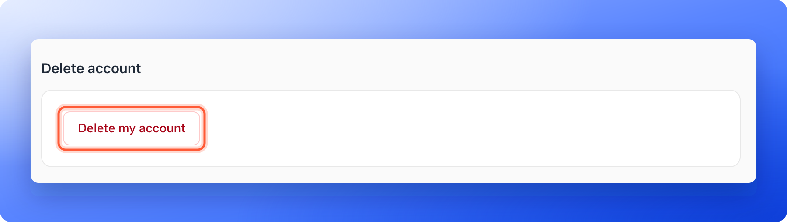

Your profile is the one page about you, not about a workspace. Teammates see your name on notes, mentions and leads, so it is worth keeping it right. You can also rename your organization from here, and delete your account if you no longer need it.

## Update your profile

<Steps>
  <Step title="Open your profile">
    Click your name at the bottom of the sidebar, then click **"Profile"**. On a phone, tap **"Menu"** at the bottom of the screen, then your name, then **"Profile"**.
  </Step>
  <Step title="Change what you need">
    The page has three groups:

    - **Personal information:** Your **Profile photo** (JPG, PNG or WebP, up to 5 MB), **Full name**, **Email** and **Phone**. To change your email address, follow [Change your email address](/getting-started/change-your-email).
    - **Location:** Your **Country** and **City**.
    - **Online presence:** Your **Company website**, **LinkedIn**, **Facebook page**, **Twitter / X** and **Instagram**. All are optional.

    Full name, Email, Country and City are required. A new photo saves as soon as you pick it.
  </Step>
  <Step title="Save your changes">
    When you change a field, a bar at the top says **Unsaved changes**. Click **"Save"** to keep them, or **"Discard"** to go back to what was saved. You see **Profile updated.**
  </Step>
</Steps>

## Rename your organization

Your organization is the account that holds your workspaces, team and plan. Its name is shown to your team, under your name at the bottom of the sidebar.

1. Click your name at the bottom of the sidebar, then click **"General"**.
2. Change the **Name**, then click **"Save"**. You see **Organization name updated.**

Everyone can open this page, but only Global Admins can change the name. Others see **Only Global Admins can change the organization name.**

## Delete your account

<Danger>
  Deleting your account cannot be undone. It deletes your sign in, your profile and your pictures, and removes you from your organization. The notes and activity you wrote stay for your team, with your name taken off.
</Danger>

<Steps>
  <Step title="Open your profile">
    Click your name at the bottom of the sidebar, then click **"Profile"**. The last group on the page is **Delete account**.

    
  </Step>
  <Step title="Click Delete my account">
    Click **"Delete my account"**. A window titled **Delete your account?** repeats what will happen. Click **"Delete my account"** to confirm, or **"Cancel"** to keep your account.
  </Step>
  <Step title="Sign in again if asked">
    For your safety you must have signed in recently. If you have not, you see **Check your email for a sign in link. After signing in, come back here and delete your account within five minutes.** Click the link in the email, then repeat the steps within five minutes.
  </Step>
</Steps>

## Important to note

<Warning>
  - The owner of the organization does not see a delete button. The group says **You own this organization. To delete your account, email support@askfunnel.com.** Email us and we will help you with the next step.
  - Deleting your account removes you from the organization. It does not delete the organization, its workspaces or its leads. To delete a workspace, see [Delete a workspace](/workspaces/delete-workspace).
</Warning>

## Troubleshooting

<AccordionGroup>
  <Accordion title="I do not see Delete my account">
    You are the owner of the organization, so the group tells you to email support instead. Write to [support@askfunnel.com](mailto:support@askfunnel.com).
  </Accordion>
  <Accordion title="I see Couldn't delete your account. Try again.">
    Try again in a minute. If the message names a reason, follow it. If it keeps happening, email support and tell us which address you use.
  </Accordion>
  <Accordion title="I changed my name but others still see the old one">
    Click **"Save"** in the **Unsaved changes** bar. Until you save, the change stays on your screen only.
  </Accordion>
  <Accordion title="My photo did not upload">
    Use a JPG, PNG or WebP file up to 5 MB. If you see **Couldn't upload your photo. Try again.**, try again with a smaller file.
  </Accordion>
</AccordionGroup>

## What to do next

<Columns cols={3}>
  <Card title="Change your email address" icon="user-pen" href="/getting-started/change-your-email">
    Confirm it is you and move your account to a new address.
  </Card>
  <Card title="Invite a teammate or client" icon="envelope" href="/workspaces/give-access">
    Give your team access to your workspaces.
  </Card>
  <Card title="Contact AskFunnel support" icon="life-ring" href="/getting-started/contact-support">
    Tell us what you were trying to do and what happened.
  </Card>
</Columns>

Need help? Email [support@askfunnel.com](mailto:support@askfunnel.com).
