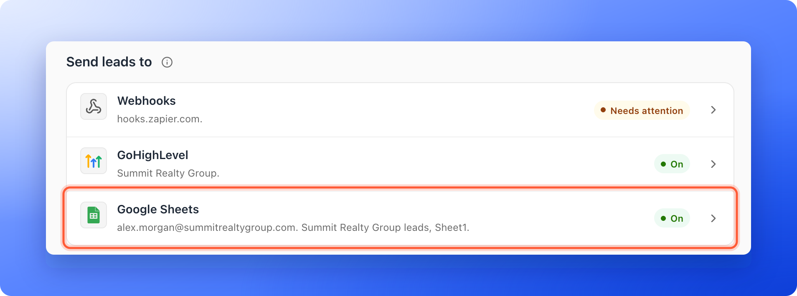
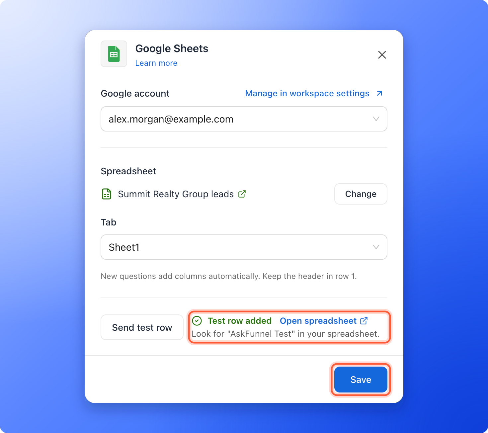
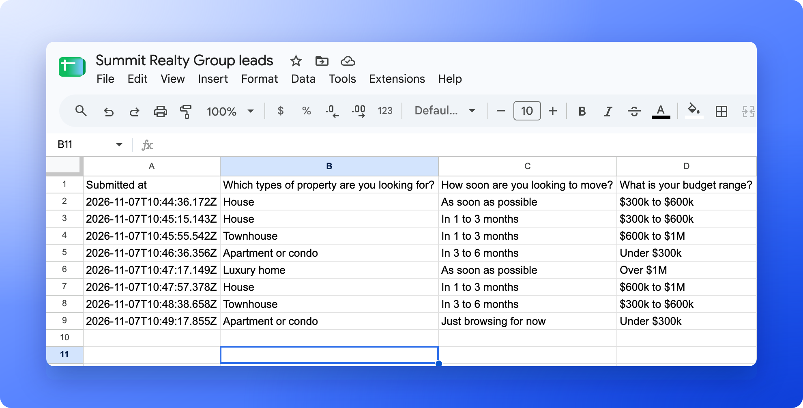
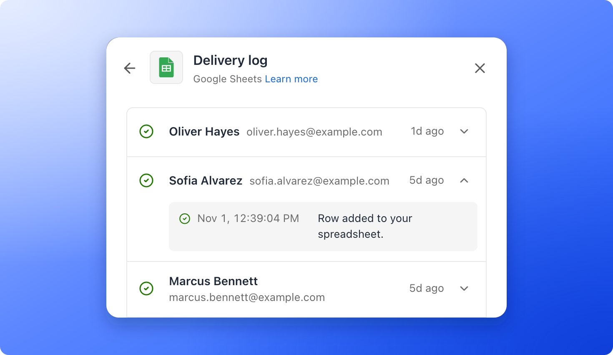
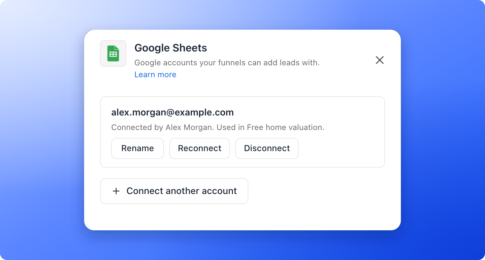

<Callout icon="star" color="#155DFC">
  Available on: **all plans** (Starter, Growth, Scale and Enterprise).
</Callout>

Send every new funnel lead to a spreadsheet as a new row, with their answers, lead score (a Cold, Warm or Hot label based on their answers) and ad source. Google Sheets is the free spreadsheet app from Google. You connect it with your Google login.

With the Google Sheets integration, you can:

- **Get every lead in a spreadsheet.** No Zapier and no exports.
- **Share only what you choose.** You pick the spreadsheet in Google's own file picker, and AskFunnel can use only that file. It cannot see your other Google Drive files.
- **See every answer in its own column.** Each question gets a column, plus the time, lead ID, funnel, score and where the lead came from. New questions get a column automatically.
- **Never lose a lead quietly.** AskFunnel tries again automatically for about a day, shows every lead in a delivery log, and emails the organization owner if something needs attention.

**Before you start**, you need:

- A Workspace Admin or Global Admin role. Only they can set up integrations.
- A Google account that can edit the spreadsheet you want to use. You can also start from a blank spreadsheet. AskFunnel writes the column headers for you.
- A funnel to connect. See [Launch your first funnel](/getting-started/launch-your-first-funnel).

## Important to note

<Warning>
  - Each funnel sends its leads to one tab of one spreadsheet. Several funnels can share the same tab. The **Funnel** column tells them apart.
  - Keep the header in row 1. AskFunnel adds its headers to the right of yours and never changes the cells you already have.
  - Rows are added at the bottom in the order they are delivered. A lead that needed a retry can land below newer leads, so sort by **Submitted at** if the order matters.
  - Only new leads from your funnel are sent. Leads that arrived before you connected Google Sheets, and leads you import, are not. A lead saved over your monthly lead limit is locked, and is added to the sheet once it unlocks (a new billing period, a plan upgrade or a leads add-on).
</Warning>

## Setup

<Steps>
  <Step title="Connect your Google account">
    1. Click **Funnels** in the sidebar, then click the funnel you want to connect.
    2. In the funnel's menu, click **"Settings"**. If **Integrations** is not open, click it.
    3. Under **Send leads to**, click the **Google Sheets** row. A panel opens on the right.
    4. Click **"Connect Google"**. Your browser goes to Google.
    5. Sign in to Google if asked, choose the account that can edit your spreadsheet, and approve access. AskFunnel asks for your email address, to show which account is connected, and for access to only the spreadsheets you pick.
    6. Back in AskFunnel, the **Google Sheets** panel opens with your account selected under **Google account**.

    

    <Note>
      Approve every permission Google lists. If you skip one, AskFunnel asks you to allow every permission and connect again. Finish connecting in the same browser you started from.
    </Note>

    <Tip>
      You connect a Google account once for the whole workspace, and every funnel can choose from your connected accounts. To connect, rename or disconnect accounts without opening a funnel, see [Manage your connected accounts](#manage-your-connected-accounts).
    </Tip>
  </Step>
  <Step title="Choose your spreadsheet and tab">
    1. Next to **Spreadsheet**, click **"Choose spreadsheet"**. Google Drive's file picker opens.
    2. Pick your spreadsheet. Spreadsheets in My Drive and in shared drives are both listed.
    3. Under **Tab**, choose the tab that should receive your leads.

    **"Send test row"** and **"Save"** turn on once a spreadsheet and a tab are chosen. The UTM, referrer and ad columns are always added after your questions, so there is nothing to switch on.

    

    <Tip>
      - Only Google spreadsheets are listed. If your file is an Excel file, open it in Google Sheets and choose **File**, then **Save as Google Sheets**.
      - Only the person who connected a Google account can choose spreadsheets with it.
    </Tip>
  </Step>
  <Step title="Test and save">
    1. Click **"Send test row"**. AskFunnel adds a row for a sample lead named **AskFunnel Test** (test@askfunnel.test) and shows **Test row added**. Click **"Open spreadsheet"** next to the result to see it, then delete the row if you like.
    2. Click **"Save"**. AskFunnel writes its column headers into row 1, shows **Google Sheets is connected** and where new leads will be added, and starts sending leads.

    

    And that's it: every new lead now arrives as a row in your spreadsheet, with the time, every answer and the contact details.

    
  </Step>
</Steps>

## How do I know it is working?

- On the funnel's **Integrations** page, the **Google Sheets** row shows **On** and the name of your spreadsheet and tab.
- In the Google Sheets panel, click **"Delivery log"**. A delivered lead has a check mark. A lead that is being tried again shows **Retrying**, and one that could not be sent shows **Failed**. Open a lead to see every attempt. Tests are listed as **Test**.
- If Google cannot be reached, AskFunnel tries again automatically for about a day. After that, the lead shows **Failed** and you can send it again with **"Retry"**.
- If something needs your attention, the row shows **Needs attention**, and the organization owner gets an email.

## Troubleshooting

<AccordionGroup>
  <Accordion title="Google Drive does not open when I click Choose spreadsheet">
    AskFunnel shows **Google Drive didn't open** when the file picker is blocked. Allow pop-ups and scripts for dash.askfunnel.com, turn off any ad blocker for that site, then click **"Try again"**. If it still does not open, try another browser.
  </Accordion>
  <Accordion title="I cannot choose a spreadsheet with an account someone else connected">
    Only the person who connected a Google account can use it to pick spreadsheets. Open the **Google account** list, click **"Connect another account"** and sign in with your own Google account, then choose the spreadsheet.
  </Accordion>
  <Accordion title="AskFunnel says the Google account can't edit the spreadsheet">
    Open the spreadsheet in Google Sheets, click **Share**, and give that Google account **Editor** access. Or ask the owner to do it. Then pick the spreadsheet again, or choose another one. AskFunnel shows **This Google account can't edit that spreadsheet. Ask the owner for edit access or choose another.**
  </Accordion>
  <Accordion title="A lead shows Failed in the delivery log">
    Open the lead in the delivery log to see the reason, fix it, then click **"Retry"**, or **"Retry failed"** to send all failed leads again. Common reasons:

    - **The spreadsheet tab was deleted.** Open the panel, choose another **Tab** and click **"Save"**.
    - **The spreadsheet was deleted or is no longer shared with this Google account.** Restore it or share it again, or click **"Change"** to choose another spreadsheet, then click **"Save"**.
    - **This Google account can't edit the spreadsheet.** Give the account edit access in Google Sheets.
    - **Too many columns.** AskFunnel can write up to 250 columns to one sheet. Email us and we will help.

    When you save new settings, leads that failed are sent again automatically.
  </Accordion>
  <Accordion title="The row says Needs attention">
    Open the Google Sheets panel and click **"Reconnect Google"** in the notice. You can also reconnect from your workspace's **Integrations** settings, as described in [Manage your connected accounts](#manage-your-connected-accounts). New leads are sent again right away, and leads that failed while access was broken are sent again too. Check the delivery log to see them arrive.
  </Accordion>
  <Accordion title="A new column appeared at the far right">
    AskFunnel adds a column when you add a question to the funnel, and also when a header it uses was renamed or deleted in the sheet. If you renamed a header, change it back, then delete the extra column. To hide a column you do not want to see, use Google Sheets' **Hide column** instead of deleting it.
  </Accordion>
  <Accordion title="The same lead appears twice">
    This is rare. It can happen when Google does not confirm that a row was added and AskFunnel tries again, especially if the **Lead ID** column was renamed or removed. Use the **Lead ID** column to find and delete the extra row.
  </Accordion>
</AccordionGroup>

## What AskFunnel writes to your sheet

Each lead becomes one row. The columns are, in this order:

1. **Submitted at.** The date and time of the submission, in UTC (standard world time), for example 2026-10-01T14:32:08.000Z.
2. **One column for each question** in your funnel and each contact detail (name, email and phone), named after the question. Multiple choice answers are joined with commas.
3. **Lead ID.** AskFunnel's ID for the lead.
4. **Funnel.** The name of the funnel.
5. **Score.** The [lead score](/funnel-settings/lead-scoring).
6. **Marketing cookies.** TRUE if the visitor accepted marketing cookies, FALSE if not.
7. **UTM source**, **UTM medium**, **UTM campaign**, **UTM term**, **UTM content**, **Referrer**, **Ad platform**, **Campaign ID**, **Ad set ID**, **Ad ID** and **Placement**. **Ad set ID** is the ad group ID for Google and TikTok.

Your own columns are fine too. If your sheet already has a header that matches one of these (upper or lower case, extra spaces do not matter), for example **Email**, AskFunnel writes into that column. Headers it does not find are added to the right. You can move columns around, and columns you add yourself stay empty for new rows.

<Warning>
  - Do not rename or delete the headers AskFunnel uses. AskFunnel finds each column by its header. If a header is renamed or deleted, AskFunnel adds the original header again at the far right and writes new answers there.
  - If you rename a question in your funnel, the sheet keeps using the original header, so the answers stay in the same column.
  - A sheet can hold up to 250 columns.
</Warning>

## Tracking where your leads come from

There is nothing to set up. UTM parameters are tags on your link (source, medium, campaign, term and content) that show where a visit came from. When someone lands on your funnel, AskFunnel captures them and the referrer (the page they came from) automatically. If your funnel shows a cookie banner and the visitor declines analytics cookies, the UTM values are left empty. They are written to the UTM columns and the **Referrer** column of each row.

Leads that come from ads with your [ad tracking links](/integrations/ad-tracking-links) also fill **Ad platform**, **Campaign ID**, **Ad set ID**, **Ad ID** and **Placement**. They follow the same cookie rule: they are left empty when the visitor declines analytics cookies. If your sheet already had the UTM columns, these five columns are added to the right with the next lead, like a new question.

## Manage the integration

- **Pause it for one funnel:** open the Google Sheets panel and turn off the **Active** switch. The row shows **Paused**. Leads that arrive while it is paused are not sent later.
- **Send to another spreadsheet or tab:** open the Google Sheets panel, click **"Change"** next to **Spreadsheet**, or pick another **Tab**, then click **"Save"**. Rows already in the old spreadsheet stay there.
- **Remove it from one funnel:** open the Google Sheets panel, click **"Remove from funnel"** and confirm. Your Google account stays connected.

## Manage your connected accounts

Google accounts belong to the workspace, so you look after them in one place.

1. In the sidebar, click **Settings**, then **Integrations**.
2. Under **Send leads to**, click the **Google Sheets** row. The panel lists your Google accounts, who connected each one and which funnels use it.
3. Click **"Connect another account"** to add an account, **"Rename"** to give an account a name you will recognize, **"Reconnect"** when Google access needs renewing, or **"Disconnect"** to remove it.

If the person who connected an account leaves your team or stops being an admin, AskFunnel pauses that account. The funnels that use it show **Needs attention** until a Workspace Admin or Global Admin clicks **"Reconnect"**, and then they start sending again.

From a funnel's Google Sheets panel, click **"Manage in workspace settings"** next to **Google account** to get there. You can also remove AskFunnel's access yourself in your Google Account, at [myaccount.google.com/permissions](https://myaccount.google.com/permissions).

<Warning>
  When you disconnect a Google account, AskFunnel asks Google to end its access, unless the same Google account is also connected in another AskFunnel workspace. Every funnel that uses the account stops sending leads to Google Sheets, and the confirmation lists them. The funnels keep their spreadsheet choices, so if you connect the same Google account again later, they start sending again, except any you paused yourself. Rows already in your spreadsheet stay there.

  Disconnecting also removes AskFunnel from the apps linked to your Google account. If you sign in to AskFunnel with Google, Google asks you to confirm once more the next time you sign in.
</Warning>

## What to do next

<Columns cols={3}>
  <Card title="Send leads to a webhook" icon="bolt" href="/integrations/webhooks">
    Connect Zapier, Make, n8n or your own server.
  </Card>
  <Card title="Send leads to HighLevel" icon="address-card" href="/integrations/highlevel">
    Every new lead becomes a contact in HighLevel.
  </Card>
  <Card title="Track your ads" icon="bullseye" href="/integrations/meta-pixel">
    Connect Meta Pixel to see which ads bring leads.
  </Card>
</Columns>

Need help? Email [support@askfunnel.com](mailto:support@askfunnel.com).
