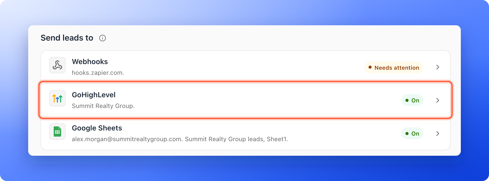
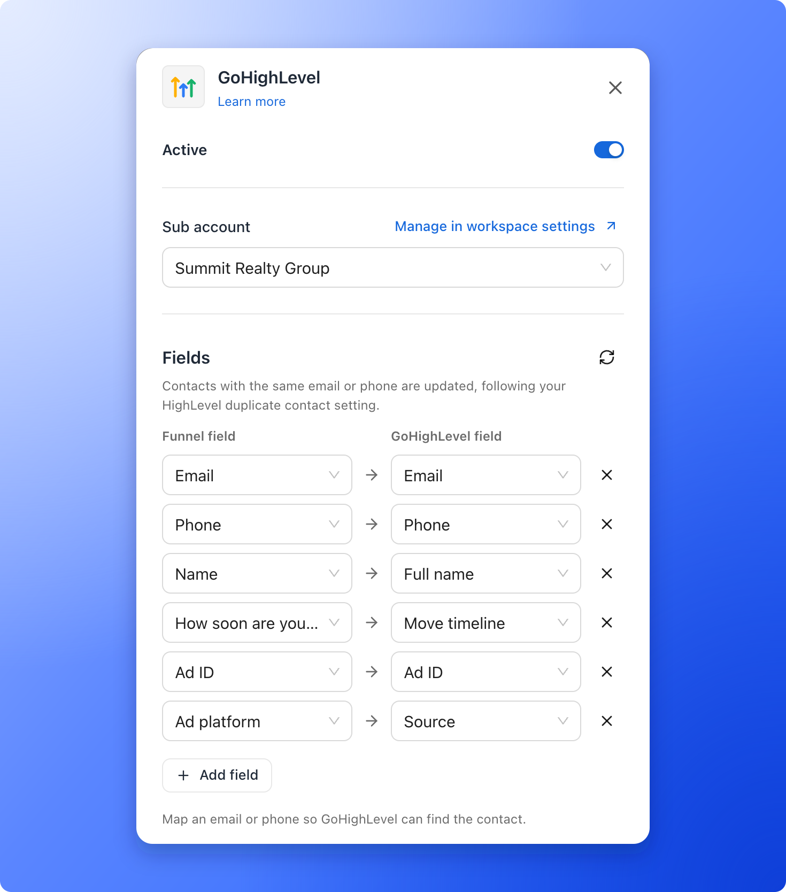
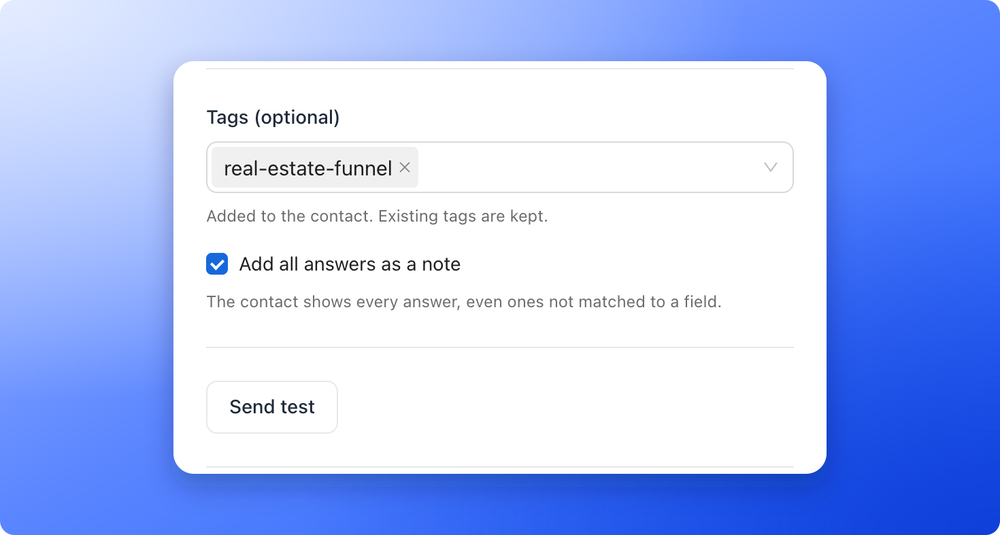
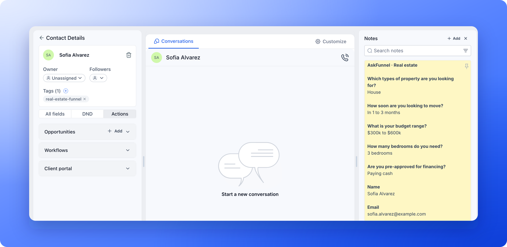
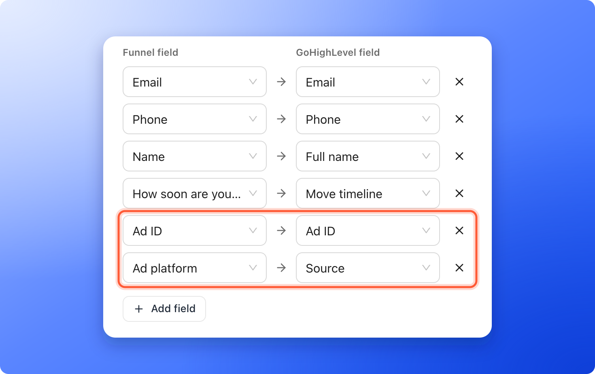
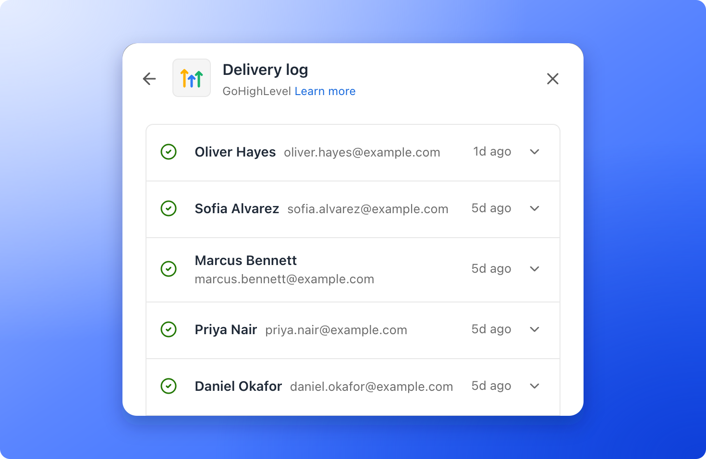
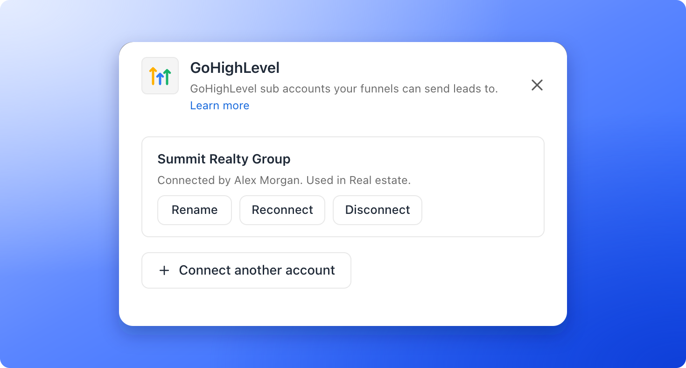

<Callout icon="star" color="#155DFC">
  Available on: **all plans** (Starter, Growth, Scale and Enterprise).
</Callout>

Send every new funnel lead to HighLevel as a contact, with their answers, lead score (a Cold, Warm or Hot label based on their answers) and ad source. HighLevel is the all-in-one sales and marketing platform many agencies and businesses use to follow up with their leads.

With the HighLevel integration, you can:

- **Send leads straight to HighLevel.** No Zapier, no exports and no API key. You connect with your HighLevel login.
- **Keep every answer on the contact.** Put answers into standard or custom contact fields, and get a note with every question and answer, the lead score and where the lead came from.
- **Start your follow-up right away.** Add tags that start your HighLevel workflows. Tags are added after the answers are saved, so the workflow already has everything it needs.
- **Never lose a lead quietly.** AskFunnel tries again automatically for about a day, shows every lead in a delivery log, and emails the organization owner if something needs attention.

**Before you start**, you need:

- A Workspace Admin or Global Admin role. Only they can manage where leads are sent.
- A HighLevel account with a sub account (a separate space for one business inside HighLevel) to receive your leads.
- Any custom fields you want to fill, created in HighLevel first. In HighLevel, go to **Settings**, then **Custom Fields**. You cannot choose a field that does not exist yet.

## Important to note

<Warning>
  - HighLevel keeps contacts inside a sub account, so each funnel sends its leads to one sub account.
  - If a contact with the same email or phone already exists, AskFunnel updates that contact, and the fields you match replace the values already there. This follows your HighLevel duplicate contact setting.
  - Only new leads from your funnel are sent. Leads that arrived before you connected HighLevel, and leads you import, are not.
  - A lead saved over your monthly lead limit is locked. It is sent to HighLevel once it unlocks (a new billing period, a plan upgrade or a leads add-on).
</Warning>

## Setup

<Steps>
  <Step title="Connect your HighLevel account">
    1. Click **Funnels** in the sidebar, then click the funnel you want to connect.
    2. In the funnel's menu, click **"Settings"**. If **Integrations** is not open, click it.
    3. Under **Send leads to**, click the **GoHighLevel** row. A panel opens on the right.
    4. Click **"Connect GoHighLevel"**. A HighLevel window opens.
    5. Sign in to HighLevel if asked, choose the sub account that should receive your leads, and approve access.
    6. Back in AskFunnel, the panel opens with the sub account selected under **Sub account**. If you signed in as an agency, AskFunnel lists your sub accounts. Choose one and click **"Connect sub account"**.

    <Note>
      HighLevel may first show a message titled **"Install Private App"**. That is expected for AskFunnel's HighLevel app. Click **"Proceed to Install"** to continue.
    </Note>

    

    <Tip>
      You connect an account once for the whole workspace, and every funnel can choose from your connected accounts. To connect, rename or disconnect accounts without opening a funnel, see [Manage your connected accounts](#manage-your-connected-accounts).
    </Tip>
  </Step>
  <Step title="Match your answers to contact fields">
    1. Under **Fields**, each row sends a funnel field (left) to a HighLevel field (right). Email, phone and name are matched for you.
    2. Click **"Add field"** to send more answers, for example your budget question to a custom field.
    3. Keep at least an email or phone in the list, so HighLevel can find the contact.

    

    <Tip>
      - Matching an answer to a HighLevel dropdown, radio or checkbox field? Its options must be written exactly the same in both places. AskFunnel checks this when you save and tells you which answers do not match.
      - Added a custom field in HighLevel after connecting? Click the refresh icon next to **Fields** to see it.
    </Tip>
  </Step>
  <Step title="Add tags and the answers note">
    - **Tags (optional):** choose existing tags or type new ones. They are added to the contact, and tags the contact already has are kept.
    - **Add all answers as a note:** on by default. The contact gets a note with every answer, even ones you did not match to a field, plus the lead score and where the lead came from.

    
  </Step>
  <Step title="Test and save">
    1. Click **"Send test"**. AskFunnel sends a sample lead named **AskFunnel Test** (test@askfunnel.test) to HighLevel and shows **Test contact saved**. Open HighLevel to check the contact, then delete it if you like.
    2. Click **"Save"**.

    And that's it: AskFunnel shows **GoHighLevel is connected. New leads will be sent automatically.** and every new lead now arrives in HighLevel.

    
  </Step>
</Steps>

## Tracking where your leads come from

There is nothing to set up. UTM parameters are tags on your link (source, medium, campaign, term and content) that show where a visit came from. When someone lands on your funnel, AskFunnel captures them and the referrer (the page they came from) automatically. If your funnel shows a cookie banner and the visitor declines analytics cookies, the UTM values are left empty.

- They always appear in the answers note.
- You can also match them to contact fields, for example **UTM source** to HighLevel's **Source** field.

### Send the ad behind each lead

When a lead comes from an ad that carries your [ad tracking links](/integrations/ad-tracking-links), AskFunnel knows its platform, campaign, ad set and ad. You can put them on the HighLevel contact:

1. Create a text custom field in HighLevel for each one you want, for example **Campaign ID**, **Ad set ID** and **Ad ID**.
2. In the GoHighLevel panel, click the refresh icon next to **Fields**, then click **"Add field"**.
3. Under **Ad details** in the funnel field list, choose **Ad platform**, **Campaign ID**, **Ad set ID**, **Ad ID** or **Placement**, and match it to your HighLevel field. **Ad platform** can go to HighLevel's **Source** field.

For the names, match **UTM campaign** (campaign name), **UTM term** (ad set name) and **UTM content** (ad name) the same way. Google ads fill these with IDs, because Google has no placeholder for names.

<Note>
  - Nothing changes until you match these fields. Existing setups keep sending exactly what they sent before.
  - They are empty when the visitor declined analytics cookies or the lead did not come from a tracked ad. The field is left blank, and the lead is still delivered.
  - HighLevel does not let other apps fill its built-in attribution section, so the ad details go into contact fields you choose.
</Note>

## Start a HighLevel workflow for new leads

1. In HighLevel, go to **Automation**, then **Workflows**, and click **"Create Workflow"**. Choose **"Start from Scratch"**.
2. Add the **Contact Tag** trigger and set the filter to **Tag Added** with the tag you chose in AskFunnel, for example real-estate-funnel.
3. Add your follow-up steps, such as a text message, an email or a task for your team, and publish the workflow.

Because AskFunnel adds tags last, the contact already has every answer when the workflow starts, so you can use them in your messages and conditions.

## How do I know it is working?

- On the funnel's **Integrations** page, the **GoHighLevel** row shows **On** and the name of your sub account.
- In the GoHighLevel panel, click **"Delivery log"**. A delivered lead has a check mark. A lead that is being tried again shows **Retrying**, and one that could not be sent shows **Failed**. Open a lead to see every attempt.
- If HighLevel cannot be reached, AskFunnel tries again automatically for about a day. After that, the lead shows **Failed** and you can send it again with **"Retry"**.
- If something needs your attention, the row shows **Needs attention**, and the organization owner gets an email.

## Troubleshooting

<AccordionGroup>
  <Accordion title="I don't see a new contact for my test">
    If you test with the same email or phone more than once, HighLevel updates the existing contact instead of creating a new one. Search HighLevel for that email, or test with a fresh email address.
  </Accordion>
  <Accordion title="A lead shows Failed in the delivery log">
    Open the lead in the delivery log to see the reason, fix it, then click **"Retry"**, or **"Retry failed"** to send all failed leads again. Common reasons:

    - None of the fields you send has a usable email or phone, for example the field that holds it is not matched, or HighLevel rejects its format. The lead is still saved in AskFunnel. Match the email or phone field, then click **"Retry"**.
    - A HighLevel field you matched was deleted or renamed. Click the refresh icon next to **Fields** and match it again.
    - HighLevel access was removed. See the next question.
  </Accordion>
  <Accordion title="The row says Needs attention, or a notice says to reconnect">
    Open the GoHighLevel panel and click **"Reconnect GoHighLevel"** in the notice. You can also reconnect from your workspace's **Integrations** settings, as described in [Manage your connected accounts](#manage-your-connected-accounts). New leads are sent again right away. Leads that failed while access was broken are listed in the delivery log; click **"Retry failed"** to send them.
  </Accordion>
  <Accordion title="I installed AskFunnel from the HighLevel Marketplace but no leads arrive">
    You will see a page that says **AskFunnel is installed**. To finish, connect from your funnel as described in [Setup](#setup).
  </Accordion>
</AccordionGroup>

## Manage the integration

- **Pause it for one funnel:** open the GoHighLevel panel and turn off the **Active** switch. The row shows **Paused**. Leads that arrive while it is paused are not sent later.
- **Remove it from one funnel:** open the GoHighLevel panel, click **"Remove from funnel"** and confirm. Your connected account stays connected.

## Manage your connected accounts

Accounts belong to the workspace, so you look after them in one place.

1. In the sidebar, click **Settings**, then **Integrations**.
2. Under **Send leads to**, click the **GoHighLevel** row. The panel lists your sub accounts, who connected each one and which funnels use it.
3. Click **"Connect another account"** to add a sub account, **"Rename"** to give an account a name you will recognize, **"Reconnect"** when HighLevel access needs renewing, or **"Disconnect"** to remove it.

From a funnel's GoHighLevel panel, click **"Manage in workspace settings"** next to **Sub account** to get there.

If the person who connected an account leaves your team or stops being an admin, AskFunnel pauses that account. The funnels that use it show **Needs attention** until a Workspace Admin or Global Admin clicks **"Reconnect"**, and then they start sending again.

<Warning>
  When you disconnect an account, every funnel that uses it stops sending leads to HighLevel, and AskFunnel asks HighLevel to uninstall its app from that sub account, unless the same sub account is also connected in another AskFunnel workspace. The confirmation lists the funnels that stop. If HighLevel does not allow the uninstall, AskFunnel tells you, and you can uninstall the app yourself in HighLevel under App Marketplace, Installed Apps. The funnels keep their settings, so if you connect the same account again later, they start sending again, except any you paused yourself. Contacts already in HighLevel stay there.
</Warning>

## What to do next

<Columns cols={2}>
  <Card title="Send leads to Google Sheets" icon="table" href="/integrations/google-sheets">
    Every new lead becomes a row in your spreadsheet.
  </Card>
  <Card title="Send leads to a webhook" icon="bolt" href="/integrations/webhooks">
    Connect Zapier, Make, n8n or your own server.
  </Card>
  <Card title="Email new leads automatically" icon="paper-plane" href="/messages/automated-emails">
    Send a welcome email the moment someone submits.
  </Card>
  <Card title="Track your ads" icon="bullseye" href="/integrations/meta-pixel">
    Connect Meta Pixel to see which ads bring leads.
  </Card>
</Columns>

Need help? Email [support@askfunnel.com](mailto:support@askfunnel.com).
