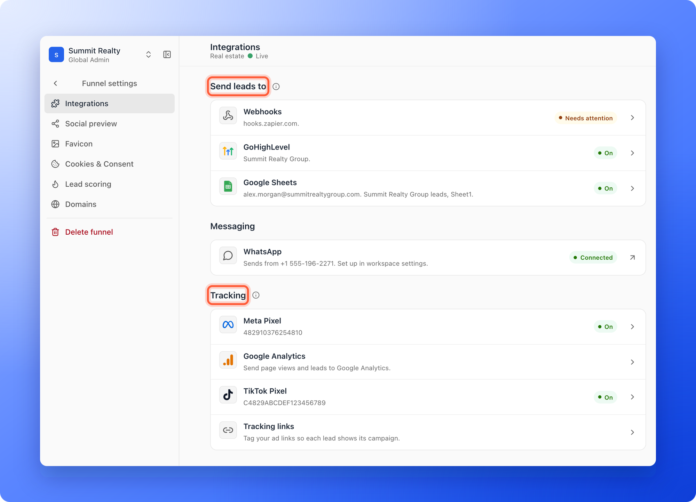

The **Integrations** page of a funnel's settings has three groups, and they do different jobs. Under **Send leads to**, AskFunnel hands each new lead to another tool, such as your CRM or a spreadsheet. Under **Messaging**, the **WhatsApp** row shows the number your workspace messages leads from. Under **Tracking**, AskFunnel tells an ad or analytics tool what visitors do on your funnel, so you can see which ads work. This page explains the difference and points you to the right guide.

With integrations, you can:

- **Send every new lead to the tool you work in.** A HighLevel contact, a Google Sheets row, or a message to Zapier, Make, n8n or your own server.
- **Track your ads.** See which Facebook, Instagram, TikTok or Google visits turn into leads.
- **Connect any tool.** If a tool is not listed, a webhook can reach it through Zapier or Make.

**Before you start**, you need:

- A funnel.
- A role that can open the funnel's **Settings**: Global Admin, Workspace Admin or Content Editor. Only Global Admins and Workspace Admins can change where leads are sent. Others see **Admins only** on those rows.

## Important to note

<Warning>
  - Where leads go, and what is tracked, are set for one funnel. To use a tool on another funnel, set it up there too. The accounts you connect, such as your HighLevel and Google accounts, belong to the workspace, so you connect each one once.
  - Only new leads from your funnel are sent to a tool. Leads that arrived before you connected it, and leads you import, are not sent. A lead saved over your monthly lead limit is sent once it unlocks.
  - Webhooks need the Growth plan or above. Google Sheets, HighLevel, the three tracking tools and tracking links work on every plan, and the Meta Conversions API needs Growth and above.
  - Tracking follows your cookie banner. When it is on, visitors must accept cookies before tracking starts. See [Cookies and consent](/funnel-settings/cookies-and-consent).
</Warning>

## The two kinds of integration

| | Send leads to | Tracking |
|---|---|---|
| **What it does** | Sends each new lead, with their answers, to another tool. | Reports what visitors do, such as page views, answers and form submissions, to an ad or analytics tool. |
| **Tools** | **Webhooks**, **GoHighLevel** and **Google Sheets**. | **Meta Pixel**, **Google Analytics** and **TikTok Pixel**, plus **Tracking links** for your ads. |
| **When** | Right after a visitor submits your form. | While visitors move through your funnel. |
| **Who can change it** | Global Admin and Workspace Admin. | Global Admin, Workspace Admin and Content Editor. |
| **How it saves** | Click **Save** in the panel. The **Active** switch, which pauses a tool, works at once. | Click **Save** in the panel. Turning the **Active** switch off or on also needs **Save**. |
| **If something goes wrong** | AskFunnel tries again automatically and emails the organization owner if a tool keeps failing. | Check the row and test in the ad tool. |

## Find your integrations

<Steps>
  <Step title="Open the Integrations page">
    1. Click **Funnels** in the sidebar, then click the funnel.
    2. In the funnel's menu, click **"Settings"**. **Integrations** is the first page. On a phone, pick **Integrations** from the list of pages.

    
  </Step>
  <Step title="Pick the row you need">
    Click the row you want. Its panel opens on the right (on a phone, from the bottom), and its **Learn more** link opens the matching guide. Follow the guide for that integration.
  </Step>
  <Step title="Connect it and test it">
    Each guide ends with a test you can run. For lead destinations, use **Send test**. For tracking tools, check the ad tool's test view.
  </Step>
</Steps>

## Accounts your workspace shares

Some integrations use an account you sign in to once, and every funnel of the workspace can choose from it. You manage these accounts in your workspace's settings.

1. In the sidebar, click **Settings**, then **Integrations**.
2. You see three groups. **Send leads to** lists your **GoHighLevel** and **Google Sheets** accounts. **Messaging** has your **WhatsApp** number. **Booking** has **Calendly** and **Cal.com**.
3. Click a row to connect, rename, reconnect or disconnect it.

Only Global Admins and Workspace Admins can open a workspace's settings. For the steps, see [Send your leads to HighLevel](/integrations/highlevel), [Send your leads to Google Sheets](/integrations/google-sheets) and [Let visitors book a call with Calendly or Cal.com](/integrations/calendars).

## Which row should I use?

| You want to | Use | Guide |
|---|---|---|
| Create or update a contact in HighLevel for every lead | **GoHighLevel** | [Send your leads to HighLevel](/integrations/highlevel) |
| Add a row to a spreadsheet for every lead | **Google Sheets** | [Send your leads to Google Sheets](/integrations/google-sheets) |
| Start a Zap in Zapier | **Webhooks** | [Send leads to Zapier](/integrations/zapier) |
| Start a scenario in Make | **Webhooks** | [Send leads to Make](/integrations/make) |
| Send leads to n8n or your own server | **Webhooks** | [Send your leads to a webhook](/integrations/webhooks) |
| See which Facebook and Instagram ads bring leads | **Meta Pixel** | [Track your Facebook and Instagram ads with Meta Pixel](/integrations/meta-pixel) |
| Measure your traffic and funnel steps | **Google Analytics** | [Track your traffic with Google Analytics (GA4)](/integrations/google-analytics) |
| See which TikTok ads bring leads | **TikTok Pixel** | [Track your TikTok ads with TikTok Pixel](/integrations/tiktok-pixel) |
| Tell ad platforms which steps matter | **Meta Pixel** or **TikTok Pixel** | [Map your funnel steps to standard events](/integrations/event-mapping) |
| See which ad each lead came from | **Tracking links** | [See which ad each lead came from](/integrations/ad-tracking-links) |

<Note>
  A booking calendar, such as Calendly or Cal.com, is turned on in your lead form, and connected in your workspace's **Integrations** settings under **Booking**. See [Let visitors book a call with Calendly or Cal.com](/integrations/calendars).
</Note>

## What the status chip means

Each row on a funnel's **Integrations** page can show a chip.

- **No chip:** nothing is set up yet.
- **On:** it is on and working.
- **Paused:** you turned the **Active** switch off in its panel. Your setup is kept. Leads that arrive while a lead destination is paused are not sent to it later.
- **Needs attention:** the last lead could not be sent, an account needs to be reconnected, or your plan no longer includes webhooks. The panel says why. Open the delivery log to send failed leads again.
- **Not saved:** you changed a tracking setting and have not clicked **Save** yet.
- **Not available:** webhooks are not included in your plan, or AskFunnel has not turned that integration on yet.
- **Admins only:** you can see the row but only an admin can change it.

On your workspace's **Integrations** settings, the chips say **Connected**, **Needs attention** or **Not available**.

## How do I know it is working?

- The row shows **On**.
- A test shows in the other tool: a **Test delivered**, **Test contact saved** or **Test row added** message and a sample lead for a lead destination, or events in the ad tool's test view for a tracking tool.
- After a real lead, a contact, a row or an automation run shows in your other tool.

## Troubleshooting

<AccordionGroup>
  <Accordion title="The row says Admins only">
    Your role cannot change where leads are sent. Ask a Workspace Admin or Global Admin to set it up. See [Invite a teammate or client to a workspace](/workspaces/give-access).
  </Accordion>
  <Accordion title="The Webhooks row says Not available, or its panel says to upgrade">
    Webhooks are available on the Growth plan and above. See [Upgrade your plan](/billing/upgrade). Google Sheets and GoHighLevel are available on every plan.
  </Accordion>
  <Accordion title="A row says Not available and Check back soon">
    That integration cannot be connected yet. Try again later, or email support.
  </Accordion>
  <Accordion title="The row says Needs attention">
    Open the row, then open its **Delivery log**, read the reason, fix it and send the failed leads again. For webhooks, see [Read your webhook delivery log](/integrations/webhook-delivery-log).
  </Accordion>
  <Accordion title="My tool is not in the list">
    Connect it with a webhook through Zapier or Make. Both can reach thousands of apps. See [Send leads to Zapier](/integrations/zapier) and [Send leads to Make](/integrations/make).
  </Accordion>
  <Accordion title="My tracking setup does not show events">
    Check that you clicked **Save**, that the row is not **Paused**, and that visitors accepted cookies if your banner is on. See [Check that your Meta Pixel and Conversions API are working](/integrations/meta-pixel-troubleshooting).
  </Accordion>
  <Accordion title="Do I have to set this up for each funnel?">
    Yes, for where leads go and for your tracking IDs: each funnel has its own. The HighLevel and Google accounts you connect are shared by the workspace, so each funnel only has to choose one.
  </Accordion>
</AccordionGroup>

## What to do next

<Columns cols={3}>
  <Card title="Send your leads to HighLevel" icon="address-card" href="/integrations/highlevel">
    Every new lead becomes a contact.
  </Card>
  <Card title="Send your leads to a webhook" icon="bolt" href="/integrations/webhooks">
    Zapier, Make, n8n or your own server.
  </Card>
  <Card title="Send leads to Google Sheets" icon="table" href="/integrations/google-sheets">
    Every new lead becomes a row.
  </Card>
  <Card title="Track your Facebook and Instagram ads" icon="bullseye" href="/integrations/meta-pixel">
    See which ads bring leads.
  </Card>
  <Card title="Track your traffic with Google Analytics" icon="chart-simple" href="/integrations/google-analytics">
    See how visitors move through your funnel.
  </Card>
  <Card title="Track your TikTok ads" icon="bullseye" href="/integrations/tiktok-pixel">
    See which TikTok ads bring leads.
  </Card>
</Columns>

Need help? Email [support@askfunnel.com](mailto:support@askfunnel.com).
