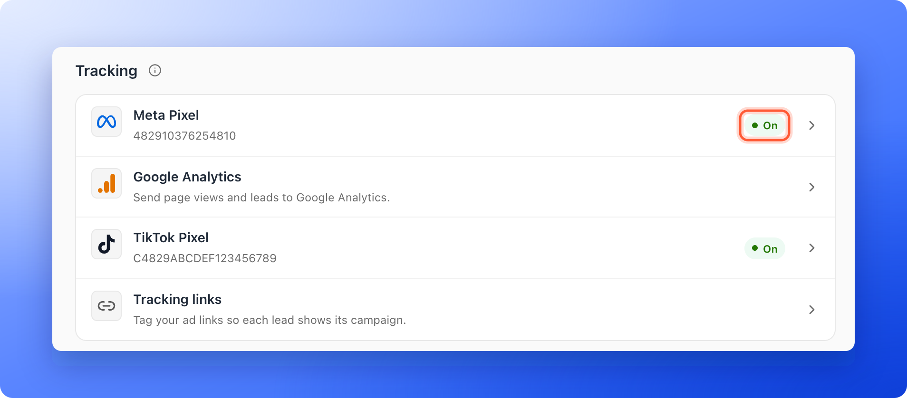
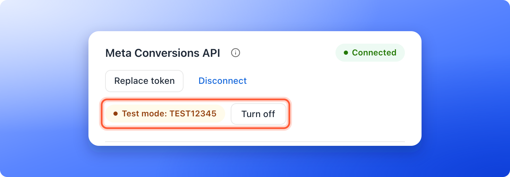

<Callout icon="star" color="#155DFC">
  Available on: **all plans** (Starter, Growth, Scale and Enterprise). The Conversions API, which sends events straight to Meta, needs **the Growth plan and above**.
</Callout>

You connected Meta, but is it really working? This page gives you a short routine to test it, and a checklist of the reasons events go missing. The browser pixel is the small piece of code that runs in your visitor's browser. The Conversions API sends the same events straight to Meta, not through the browser, so ad blockers cannot stop them.

If you have not connected Meta yet, start with [Track your Facebook and Instagram ads with Meta Pixel](/integrations/meta-pixel).

With this routine, you can:

- **See your events arrive.** Watch them appear live in Meta's **Test events** tab.
- **Check the server events too.** Use a test events code to see the Conversions API events next to the browser ones.
- **Find what blocks an event.** Go through the list of causes, one by one.
- **Switch to live ads.** Turn off test mode so your events count for your ads again.

**Before you start**, you need:

- Your Meta Pixel connected to the funnel, with your funnel published. See [Meta Pixel](/integrations/meta-pixel).
- Access to Meta Events Manager for your pixel.
- A role that can open the funnel's **Settings**: Global Admin, Workspace Admin or Content Editor.

## Important to note

<Warning>
  - The pixel only runs on your live funnel. It does not run in the builder, so test on the live page.
  - When your cookie banner is on, nothing is sent until the visitor accepts marketing cookies. A browser that sends the Global Privacy Control signal stays off even if you accept, and even when your cookie banner is off. See [Cookies and consent](/funnel-settings/cookies-and-consent).
  - Ad blockers and some privacy browsers block the browser pixel. Test with your ad blocker turned off.
  - Events sent with a test events code never reach your ads. Turn test mode off when you finish testing.
</Warning>

## Test your setup

<Steps>
  <Step title="Check the Meta Pixel row">
    1. Click **Funnels** in the sidebar, then click the funnel. In the funnel's menu, click **"Settings"**. If **Integrations** is not open, click it.
    2. Under **Tracking**, look at the **Meta Pixel** row. It shows your Pixel ID and must say **On**. **Paused** means the **Active** switch in the panel is off. No chip means no Pixel ID is saved. **Not saved** means you changed something and have not clicked **Save** yet.
    3. Click the row and compare **Pixel ID** with the ID of your pixel in Meta Events Manager, under **Data sources**. They must be the same, with no spaces. If you changed it, click **"Save"**.

    
  </Step>
  <Step title="Watch the browser events in Test events">
    1. In Meta Events Manager, open your pixel and click **Test events**.
    2. In another tab of the same browser, open your live funnel. Accept the cookies if a banner shows.
    3. Click through your funnel, and submit the form with a test name and email.

    You should see **PageView** first, then one event for each page, answer and button you used, then **Form Started** and **Lead**. The names are listed in [Map your funnel steps to standard events](/integrations/event-mapping#what-each-step-sends-when-you-do-not-map-it). Events can take a few minutes to show.
  </Step>
  <Step title="Test the Conversions API (Growth and above)">
    Open the **Meta Pixel** row again and scroll to **Meta Conversions API**. It must show **Connected**.

    To see these server events in **Test events** too, add a test events code:

    1. In Meta's **Test events** tab, copy the test code, for example `TEST12345`.
    2. In AskFunnel, click **"Replace token"**, paste your access token again, and paste the code into **Test events code (optional)**.
    3. Click **"Save"**. You see **Conversions API connected. Meta verified your token.**
    4. Submit a test lead on your live funnel with marketing cookies accepted. A server **Lead** event arrives.

    Under **Meta Conversions API**, the chip **Test mode** now shows your code, with a **"Turn off"** button next to it. Meta counts the browser copy and the server copy of the same Lead as one, because they share one event ID.

    
  </Step>
  <Step title="Turn off test mode">
    When your events look right, click **"Turn off"** next to **Test mode**. You see **Test mode turned off.** From then on, server events reach your ads. Until you do this, they are excluded from your ads.
  </Step>
</Steps>

## Why a server event is not sent

The Conversions API sends a **Lead** for a new lead only when everything on this list is true:

| Needs | What to check |
|---|---|
| The Growth plan or above | Without it, the section shows an upgrade message. A funnel whose plan dropped below Growth stops sending server events. |
| A saved Pixel ID | The **Meta Pixel** row shows your Pixel ID, not an empty line. |
| Meta not paused | The **Active** switch in the **Meta Pixel** panel is on. |
| A working token | **Connected** shows without the red message **Meta rejected the saved token.** If it shows, click **"Reconnect"**, paste a new token and click **"Save"**. |
| Marketing cookies accepted | The visitor accepted marketing cookies, or your cookie banner is off, and their browser does not send the Global Privacy Control signal. |
| A lead that counts | The lead is new, and not locked because you reached your monthly lead limit. See [What happens when you reach your monthly lead limit](/billing/monthly-lead-limit). |
| Test mode off | **Test mode** is not shown under **Meta Conversions API**, so events reach your ads. |

Leads that arrived before you connected the Conversions API, or while one of these was missing, are not sent later.

<Note>
  Along with each server event, AskFunnel sends the lead's email and phone number in a scrambled form that Meta cannot read back (hashed), plus cookie details when the visitor accepted marketing cookies. A form that asks for both an email and a phone number gives Meta more to match to a person.
</Note>

## How do I know it is working?

- The **Meta Pixel** row says **On**, and the **Meta Conversions API** section says **Connected** without a red message.
- In **Test events**, you see the events of your test visit, and with a test code also the server **Lead**.
- After you turn test mode off, new leads reach Meta as usual and count for your ads. They can take a while to appear in your ad reports.

## Troubleshooting

<AccordionGroup>
  <Accordion title="I do not see any events in Test events">
    Check these, in order:

    - The **Meta Pixel** row shows **On**, and the Pixel ID matches your pixel exactly.
    - You clicked **"Save"** after you pasted the Pixel ID.
    - You opened the live funnel, not the builder, and accepted marketing cookies if your banner is on.
    - Your ad blocker is off, and the browser does not send the Global Privacy Control signal.
    - A few minutes have passed.
  </Accordion>
  <Accordion title="Browser events show, but the server Lead does not">
    Go through the table in **Why a server event is not sent**. The most common causes are a missing test events code (so you cannot see server events in **Test events**), the Growth plan, and a visitor who did not accept marketing cookies.
  </Accordion>
  <Accordion title="I see two Lead events for one visit">
    The browser Lead and the server Lead share one ID, so Meta counts them once. If you see two from the browser, another funnel step is probably mapped to **Lead**. Open **Map events to standard events** in the Meta Pixel panel and change that entry. See [Map your funnel steps to standard events](/integrations/event-mapping).
  </Accordion>
  <Accordion title="I see Add your Meta Pixel ID above first">
    The Conversions API sends to the Pixel ID of the funnel. Type your Pixel ID in **Pixel ID** at the top of the panel, then click **"Save"**. One **Save** stores the ID and connects the token. If you see **Save your Meta Pixel ID first**, do the same.
  </Accordion>
  <Accordion title="I see Meta rejected this token">
    The token is wrong, expired or has no permission. In Meta Events Manager, open your dataset's **Settings**, find **Conversions API** and generate a new token. Paste it whole.
  </Accordion>
  <Accordion title="I see Meta couldn't find this Pixel ID for this token">
    The token was made for a different pixel. Check the Pixel ID, and generate the token from the same dataset.
  </Accordion>
  <Accordion title="I see Meta couldn't verify this token right now, or Couldn't reach Meta">
    Meta did not answer in time. Wait a minute and click **"Save"** again.
  </Accordion>
  <Accordion title="Test mode is still on">
    Click **"Turn off"** next to **Test mode**. Server events sent in test mode were not counted for your ads, and they are not sent again.
  </Accordion>
</AccordionGroup>

## What to do next

<Columns cols={3}>
  <Card title="Map your funnel steps to standard events" icon="diagram-project" href="/integrations/event-mapping">
    Tell Meta which steps count as a lead or a purchase.
  </Card>
  <Card title="Set up cookies and consent" icon="cookie-bite" href="/funnel-settings/cookies-and-consent">
    Choose when tracking starts for your visitors.
  </Card>
  <Card title="Why your lead and analytics numbers differ" icon="scale-balanced" href="/analytics/why-numbers-differ">
    Understand differences with Meta Ads Manager.
  </Card>
</Columns>

Need help? Email [support@askfunnel.com](mailto:support@askfunnel.com).
