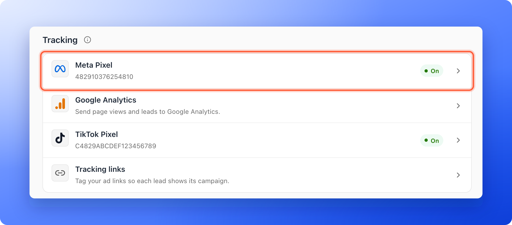
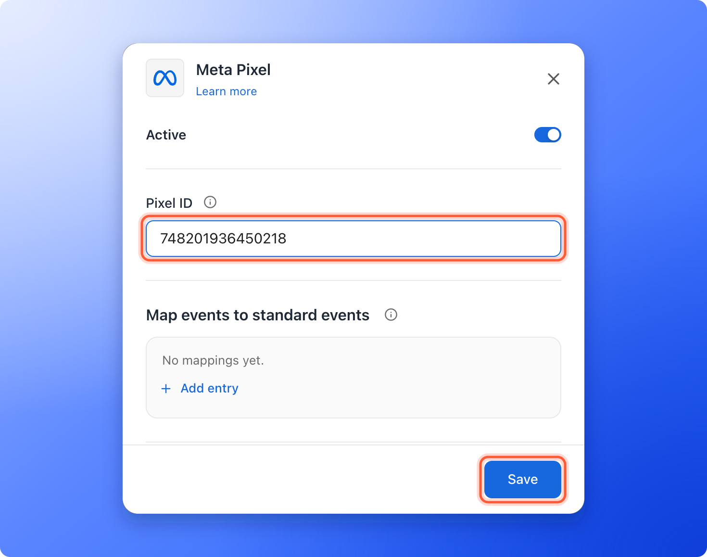
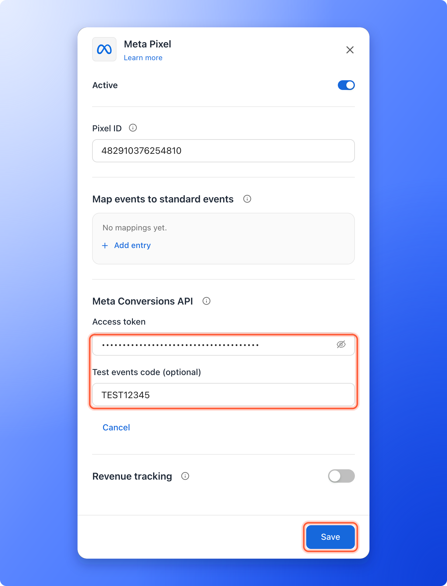

<Callout icon="star" color="#155DFC">
  Available on: **all plans** (Starter, Growth, Scale and Enterprise). The Conversions API, which sends events without the visitor's browser, is available on **the Growth plan and above**.
</Callout>

Tell Meta who opened your funnel, what they did and who became a lead, so you can see which Facebook and Instagram ads work. A pixel is a small piece of code that reports what people do on your funnel back to an ad platform. Connect your Meta Pixel and AskFunnel sends the events for you.

With the Meta Pixel integration, you can:

- **See who visited.** AskFunnel sends Meta a **PageView** when someone opens your funnel.
- **See who became a lead.** When a visitor submits your form, AskFunnel sends a **Lead** event.
- **Follow every step.** Each funnel page, answer and button click is sent to Meta as its own event, so you can see where visitors drop off.
- **Tell Meta what counts.** Map any step to one of Meta's standard events. See [Map your funnel steps to standard events](/integrations/event-mapping).
- **Get past ad blockers.** On the Growth plan and above, the Conversions API also sends events straight to Meta, so ad blockers cannot stop them.

**Before you start**, you need:

- A Meta Pixel and its Pixel ID. You find the ID in Meta Events Manager.
- A funnel to track. See [Launch your first funnel](/getting-started/launch-your-first-funnel).

## Important to note

<Warning>
  - When your cookie banner is on, the pixel only tracks visitors who accept marketing cookies. See [Cookies and consent](/funnel-settings/cookies-and-consent).
  - Ad blockers and some privacy browsers block the pixel. Test with your ad blocker turned off.
  - Each funnel uses one Meta Pixel.
  - The text of an answer a visitor picks is never sent to Meta. The click is still counted as **Answer Selected**, or as the standard event you mapped it to.
</Warning>

## Setup

<Steps>
  <Step title="Open the Meta Pixel settings">
    1. Click **Funnels** in the sidebar, then click the funnel you want to track.
    2. In the funnel's menu, click **"Settings"**. If **Integrations** is not open, click it.
    3. Under **Tracking**, click the **Meta Pixel** row. A panel opens on the right.

    
  </Step>
  <Step title="Paste your Pixel ID">
    1. Next to **Pixel ID**, paste your number, for example 1234567890.
    2. Click **"Save"** at the bottom of the panel. If your funnel is published, AskFunnel shows **Settings saved. Your live funnel is updated.** The panel closes, and the **Meta Pixel** row shows your Pixel ID and **On**.

    

    <Tip>
      In Meta Events Manager, open **Data sources**, select your dataset and copy its **ID**. A dataset is Meta's name for a pixel.
    </Tip>
  </Step>
  <Step title="Match your funnel steps to Meta events (optional)">
    Under **Map events to standard events**, click **"Add entry"**, pick a funnel step on the left and the Meta event it should send on the right. Standard events are Meta's fixed list of event names, such as Lead or Purchase. Anything you do not map is still sent as a custom event. The full guide is in [Map your funnel steps to standard events](/integrations/event-mapping).
  </Step>
</Steps>

## Add the Conversions API (optional, Growth and above)

Browsers with ad blockers or strict privacy settings often block the pixel, so those leads never reach Meta. The Conversions API sends the same events straight to Meta, without the visitor's browser, and Meta removes the duplicates.

1. Make sure your **Pixel ID** is filled in above. Server events are sent to that pixel.
2. In Meta Events Manager, open your dataset's **Settings**, find **Conversions API** and generate an access token. Copy it.
3. In AskFunnel, under **Meta Conversions API**, paste the token into **Access token**.
4. Optional: to check your setup first, paste the code from Meta's **Test events** tab into **Test events code (optional)**.
5. Click **"Save"**. One **Save** stores your Pixel ID and connects the token. AskFunnel shows **Conversions API connected. Meta verified your token.** Server events start right away. You do not need to publish.

Once connected, AskFunnel sends a server **Lead** event for each new lead, and a custom event named after the new status whenever you change a lead's status, for example Qualified. Only leads who accepted marketing cookies are sent. The Conversions API does not bypass consent choices or Meta's data rules.

<Warning>
  While a test events code is set, **Test mode** shows under **Meta Conversions API**. Events sent in test mode appear in Meta's **Test events** tab but never reach your ads. When your setup works, click **"Turn off"** next to **Test mode**.
</Warning>

## Report revenue to Meta (optional, Growth and above)

Once the Conversions API is connected, you can tell Meta when a lead turns into revenue, so it finds buyers and not only form fillers.

1. Turn on the **Revenue tracking** switch.
2. Under **When a lead reaches**, pick the status that means a closed deal, and next to **send its Deal Value in**, pick your currency. Click **"Turn on"**. AskFunnel shows **Revenue tracking is on. The Deal Value column was added to your leads table.**
3. Your team types each lead's value into **Deal Value**, before or after moving the lead to that status.

When a lead is in that status and has a value, AskFunnel sends Meta one **Purchase** event with that amount. Leads without a value send no Purchase, and only leads who accepted marketing cookies are sent. Do not also map a funnel step to Purchase, or buyers are counted twice.

## How do I know it is working?

- The **Meta Pixel** row shows your Pixel ID and **On**.
- In Meta Events Manager, open your dataset and click **Test events**. Open your funnel in another tab in the same browser and accept the cookies. You see **PageView**, then an event for each page and answer as you click through, then **Lead** when you submit the form.
- With the Conversions API connected, Meta also shows the server events.

## Troubleshooting

For a step by step test and a checklist for server events, see [Check that your Meta Pixel and Conversions API are working](/integrations/meta-pixel-troubleshooting).

<AccordionGroup>
  <Accordion title="I do not see any events in Meta">
    Check these, in order:

    - The row shows **On**, not **Paused**, and no **Not saved**. A row with no chip has no Pixel ID saved yet.
    - You clicked **"Save"** after pasting the Pixel ID, and the ID has no extra spaces.
    - You accepted marketing cookies on the funnel, if your cookie banner is on.
    - Your ad blocker or browser privacy setting is off for the test.
    - A few minutes have passed. Meta can take a little while to show events.
  </Accordion>
  <Accordion title="The row says Paused">
    The **Active** switch in the panel is off. Your setup is kept. Turn the switch on and click **"Save"**.
  </Accordion>
  <Accordion title="Conversions API events do not reach my ads">
    Look for **Test mode** under **Meta Conversions API**. Events sent in test mode never reach your ads. Click **"Turn off"**.
  </Accordion>
  <Accordion title="Meta rejected the saved token">
    The token may have expired or been revoked, so server events are not sending. Generate a new token in Meta Events Manager, then click **"Reconnect"**, paste it into **Access token** and click **"Save"**.
  </Accordion>
  <Accordion title="Save is grayed out, or I see Add your Meta Pixel ID above first">
    The token is connected to the Pixel ID of this funnel, so a token needs a **Pixel ID**. Type your Pixel ID above, then click **"Save"**. If you see **That access token is too short. Paste the whole token.**, copy the whole token from Meta again.
  </Accordion>
  <Accordion title="I see Upgrade to Growth under Meta Conversions API">
    The Conversions API is on the Growth plan and above. Click **"Upgrade to Growth"** or see [Upgrade your plan](/billing/upgrade). The browser pixel keeps working on every plan.
  </Accordion>
</AccordionGroup>

## Manage the integration

- **Pause it:** turn off the **Active** switch in the panel, then click **"Save"**. Your Pixel ID, mappings and token are kept.
- **Change the pixel:** replace the **Pixel ID** and click **"Save"**.
- **Replace the token:** under **Meta Conversions API**, click **"Replace token"**, paste the new one and click **"Save"**.
- **Remove it from the funnel:** if the Conversions API is connected, click **"Disconnect"** first and confirm. Server events stop and the saved token is deleted. Then clear the **Pixel ID** and click **"Save"**.

## What to do next

<Columns cols={2}>
  <Card title="Map your funnel steps to standard events" icon="diagram-project" href="/integrations/event-mapping">
    Tell Meta and TikTok which steps count as a lead or a purchase.
  </Card>
  <Card title="Track your traffic with Google Analytics" icon="chart-simple" href="/integrations/google-analytics">
    See how visitors move through your funnel.
  </Card>
  <Card title="Track your TikTok ads" icon="bullseye" href="/integrations/tiktok-pixel">
    Connect TikTok Pixel to see which ads bring leads.
  </Card>
  <Card title="See how your funnel performs" icon="chart-line" href="/analytics/funnel-analytics">
    Visitors, conversions and where people drop off.
  </Card>
</Columns>

Need help? Email [support@askfunnel.com](mailto:support@askfunnel.com).
