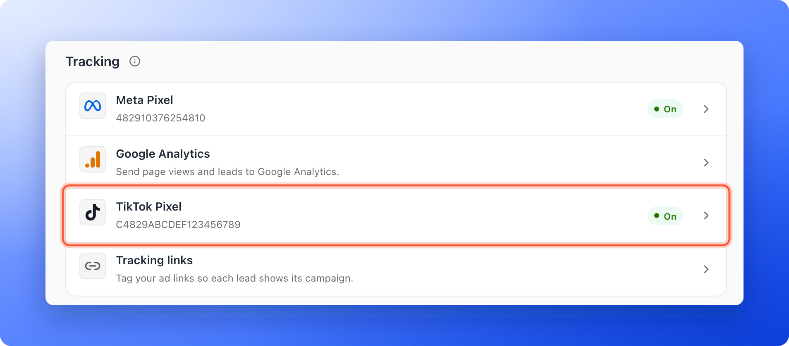
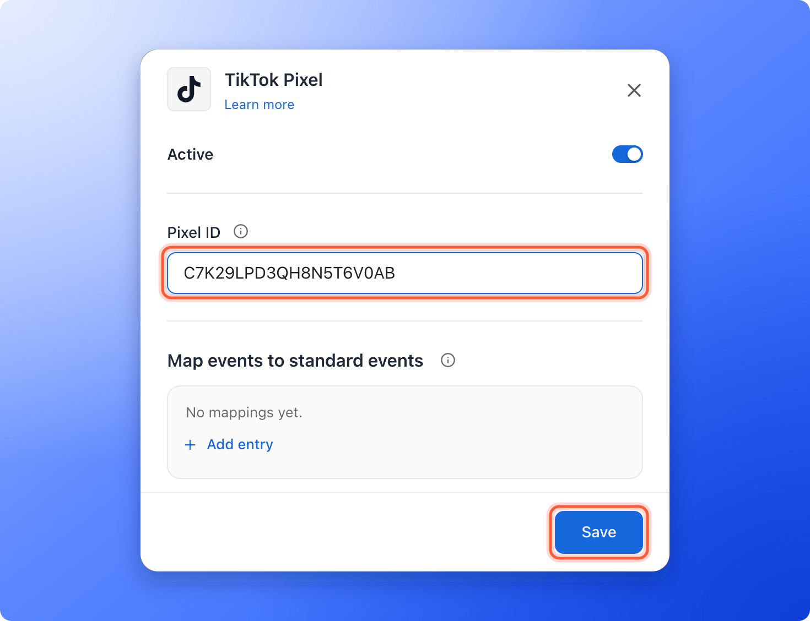
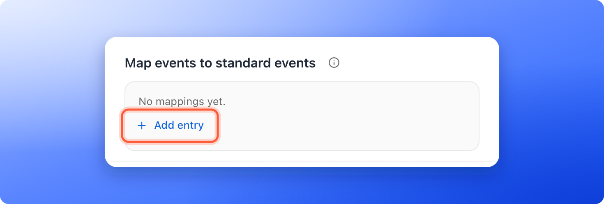

<Callout icon="star" color="#155DFC">
  Available on: **all plans** (Starter, Growth, Scale and Enterprise).
</Callout>

Tell TikTok who opened your funnel, what they did and who submitted your form, so you can see which TikTok campaigns work. A pixel is a small piece of code that reports what people do on your funnel back to an ad platform. Connect your TikTok Pixel and AskFunnel sends the events for you.

With the TikTok Pixel integration, you can:

- **See who visited.** AskFunnel sends TikTok a page event when someone opens your funnel.
- **See who became a lead.** When a visitor submits your form, AskFunnel sends a **SubmitForm** event.
- **Follow every step.** Each funnel page, answer and button click is sent to TikTok as its own event, so you can see where visitors drop off.
- **Tell TikTok what counts.** Map any step to one of TikTok's standard events. See [Map your funnel steps to standard events](/integrations/event-mapping).

**Before you start**, you need:

- A TikTok Pixel and its Pixel ID. No pixel yet? In TikTok Events Manager, click **Connect data source** and create a web pixel.
- A funnel to track. See [Launch your first funnel](/getting-started/launch-your-first-funnel).

You do not need to install TikTok's code. AskFunnel adds the pixel to your funnel for you, so you only need the Pixel ID. You can skip TikTok's steps for installing code.

## Important to note

<Warning>
  - When your cookie banner is on, the pixel only tracks visitors who accept marketing cookies. See [Cookies and consent](/funnel-settings/cookies-and-consent).
  - Ad blockers and some privacy browsers block the pixel. Test with your ad blocker turned off.
  - Each funnel uses one TikTok Pixel.
  - The text of an answer a visitor picks is never sent to TikTok. The click is still counted as **Answer Selected**, or as the standard event you mapped it to.
</Warning>

## Setup

<Steps>
  <Step title="Open the TikTok Pixel settings">
    1. Click **Funnels** in the sidebar, then click the funnel you want to track.
    2. In the funnel's menu, click **"Settings"**. If **Integrations** is not open, click it.
    3. Under **Tracking**, click the **TikTok Pixel** row. A panel opens on the right.

    
  </Step>
  <Step title="Paste your Pixel ID">
    1. In TikTok Events Manager, open **Data sources**, select your pixel and copy the **Pixel ID** shown under its name. It is a mix of letters and numbers, like C123456ABCDEFG.
    2. Back in AskFunnel, paste it into **Pixel ID**.
    3. Click **"Save"** at the bottom of the panel. If your funnel is published, AskFunnel shows **Settings saved. Your live funnel is updated.**

    

    <Note>
      TikTok may keep showing its own setup checklist until your funnel sends its first events. That is normal.
    </Note>
  </Step>
  <Step title="Match your funnel steps to TikTok events (optional)">
    Under **Map events to standard events**, click **"Add entry"**, pick a funnel step on the left and the TikTok event it should send on the right. You can add several entries. Anything you do not map is still sent as a custom event. The full guide is in [Map your funnel steps to standard events](/integrations/event-mapping).

    
  </Step>
  <Step title="Save your changes">
    Click **"Save"** at the bottom of the panel. The panel closes, and the **TikTok Pixel** row now shows your Pixel ID and **On**.
  </Step>
</Steps>

## How do I know it is working?

- The **TikTok Pixel** row shows your Pixel ID and **On**.
- In TikTok Events Manager, open your pixel and click **Test events**. Open your funnel in another tab in the same browser and accept the cookies. You see the page event, then an event for each page and answer as you click through, then **SubmitForm** when you submit the form.
- Data can take up to 30 minutes to show on the pixel's **Overview** tab.

## Troubleshooting

<AccordionGroup>
  <Accordion title="I do not see any events in TikTok">
    Check these, in order:

    - The row shows **On**, not **Paused**, and no **Not saved**. A row with no chip has no Pixel ID saved yet.
    - You clicked **"Save"** after pasting the Pixel ID, and the ID has no extra spaces.
    - You copied the **Pixel ID** of the pixel, not an account or business ID.
    - You accepted marketing cookies on the funnel, if your cookie banner is on.
    - Your ad blocker or browser privacy setting is off for the test.
    - A little while has passed. TikTok can take up to 30 minutes to show data.
  </Accordion>
  <Accordion title="The row says Paused">
    The **Active** switch in the panel is off. Your setup is kept. Turn the switch on and click **"Save"**.
  </Accordion>
  <Accordion title="My mapping does not seem to work">
    Mappings only take effect when a **Pixel ID** is set. Check that the row shows **On**, that you clicked **"Save"**, and that both sides of the entry are filled in. See [Map your funnel steps to standard events](/integrations/event-mapping).
  </Accordion>
</AccordionGroup>

## Manage the integration

- **Pause it:** turn off the **Active** switch in the panel, then click **"Save"**. Your Pixel ID and mappings are kept.
- **Change the pixel:** replace the **Pixel ID** and click **"Save"**.
- **Remove it from the funnel:** clear the **Pixel ID** and click **"Save"**. The row goes back to showing no chip.

## What to do next

<Columns cols={3}>
  <Card title="Map your funnel steps to standard events" icon="diagram-project" href="/integrations/event-mapping">
    Tell TikTok which steps count as a lead.
  </Card>
  <Card title="Track your Facebook and Instagram ads" icon="bullseye" href="/integrations/meta-pixel">
    Connect Meta Pixel to see which ads bring leads.
  </Card>
  <Card title="See how your funnel performs" icon="chart-line" href="/analytics/funnel-analytics">
    Visitors, conversions and where people drop off.
  </Card>
</Columns>

Need help? Email [support@askfunnel.com](mailto:support@askfunnel.com).
