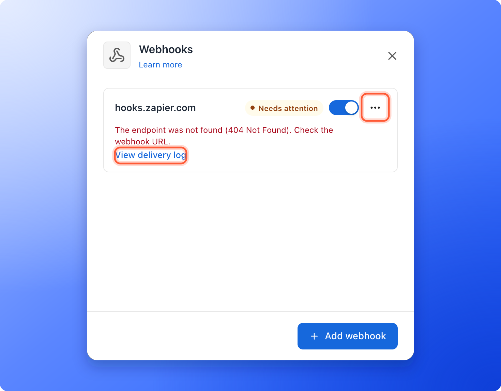
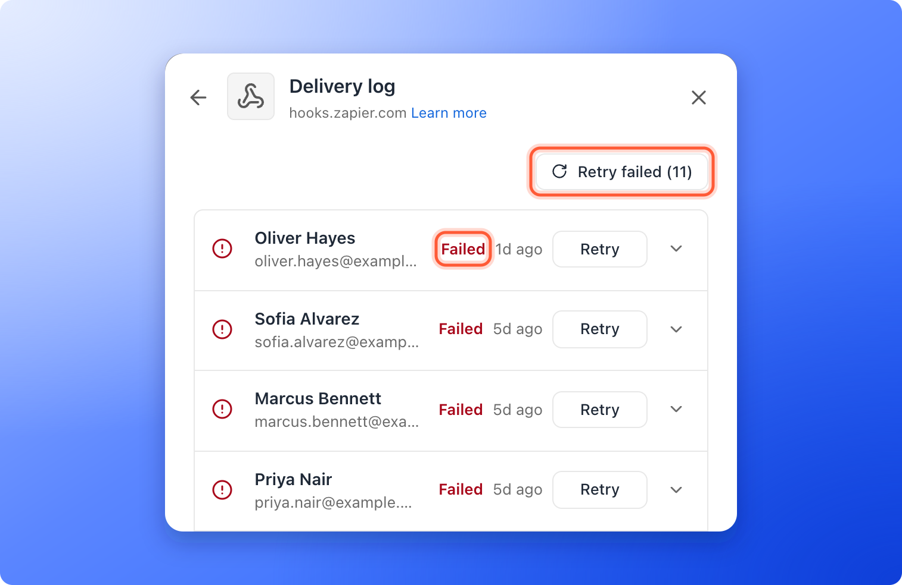
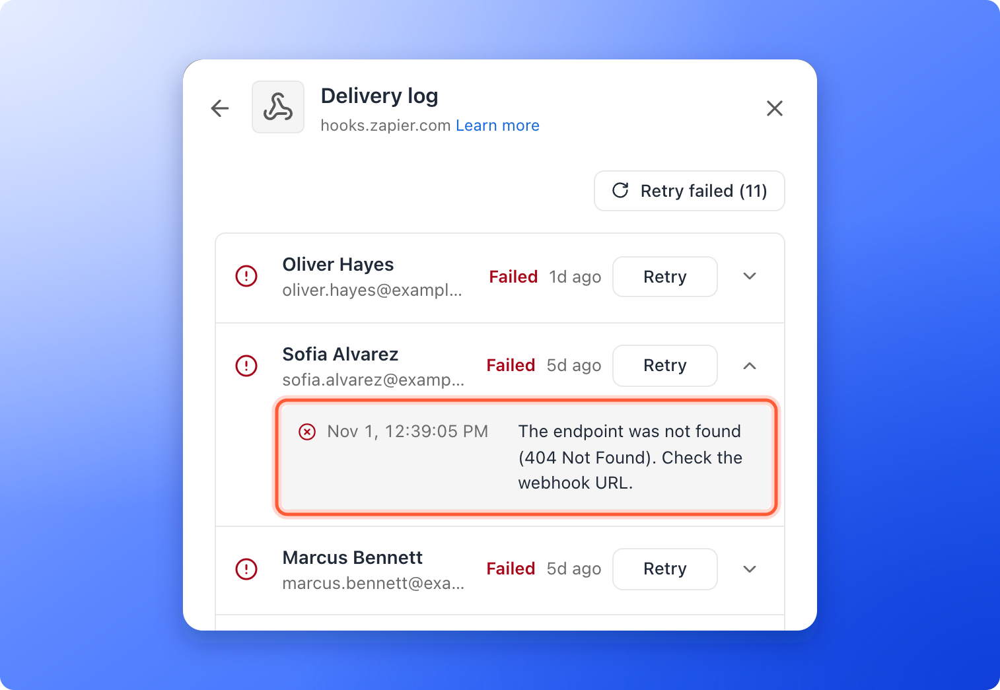
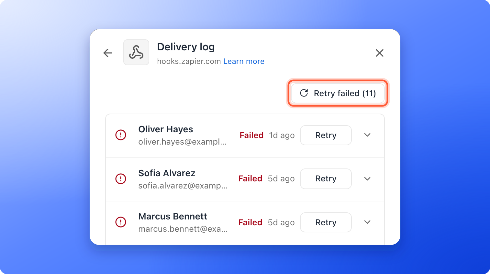

<Callout icon="star" color="#155DFC">
  Available on: **the Growth plan and above**. Only Global Admins and Workspace Admins can open it.
</Callout>

Each webhook has a delivery log. It lists the leads AskFunnel sent to that webhook, whether the receiving tool accepted each one, and every attempt along the way. Use it to check that a lead arrived, to find out why one did not, and to send failed leads again after you fix the problem. A [webhook](/integrations/webhooks) is a web address that receives each new lead.

With the delivery log, you can:

- **Check a lead.** See whether it was delivered, is still being tried again, or **Failed**.
- **Read the reason.** Every failed lead shows what the receiving server answered.
- **See every attempt.** Open a lead to see the time and result of each try, and when the next one is planned.
- **Send leads again.** Retry one lead or all failed leads with one click.

**Before you start**, you need:

- A webhook added to a funnel. See [Send your leads to a webhook](/integrations/webhooks).
- A Workspace Admin or Global Admin role.
- The Growth plan or above to send leads again. Reading the log works on any plan.

## Important to note

<Warning>
  - Only new leads from your funnel are sent to a webhook, so the log starts with the first lead after you added it. Leads that arrived earlier, while the webhook was paused, or while your plan did not include webhooks are not in it and are not sent later. Leads you import never go to a webhook.
  - A lead saved over your monthly lead limit is locked. It joins the log, and is sent, once it unlocks (a new billing period, a plan upgrade or a leads add-on).
  - A lead you send again can reach your tool a second time. It arrives with the same ID, so your tool can ignore repeats. See [Retries and what counts as success](/integrations/webhook-reference#retries-and-what-counts-as-success).
  - The log shows the last 30 days. Older entries disappear, and so does the chance to send them again.
  - Every webhook has its own log. If a funnel has several webhooks, open the log of the one you care about.
</Warning>

## Open and read the log

<Steps>
  <Step title="Open the delivery log">
    1. Click **Funnels** in the sidebar, then click the funnel. In the funnel's menu, click **"Settings"**. If **Integrations** is not open, click it.
    2. Under **Send leads to**, click the **Webhooks** row. A panel opens on the right.
    3. Click the three dots (**...**) on the webhook, then **"Delivery log"**. The panel is titled **Delivery log**, with the name of the webhook under it.

    If a webhook shows **Needs attention**, its row says what went wrong in one line, with **"View delivery log"** under it. Click that instead. To go back to your webhooks, click the back arrow at the top left of the panel.

    
  </Step>
  <Step title="Read a row">
    Each row is one lead. From left to right you see:

    - **A status icon.** A green check means the lead was delivered.
    - **The lead.** Their name and, next to it, their email or phone. Click the name to open the lead in a new tab. A lead you deleted shows as **Deleted lead**, and a test shows as **Test**.
    - **A status word**, for a lead that is not delivered yet or has failed. See the table below.
    - **The time** the lead was sent. Point at it to see the exact time.
    - **"Retry"**, on failed leads.
    - **An arrow** that opens the details of the lead.

    
  </Step>
  <Step title="See every attempt">
    Click the arrow at the right of a row. The lead opens to show one line per attempt, with the exact time and the result, for example **Delivered (200 OK).** or the reason it failed. If another try is planned, a last line shows **Next retry** and its time. This is also where you read why a lead failed.

    
  </Step>
</Steps>

## What the statuses mean

| Status | What it means |
|---|---|
| **Waiting to send** | The lead is waiting to be sent for the first time. |
| **Sending** | AskFunnel is sending it right now. |
| **Retrying** | The last try failed, and AskFunnel will try again. Open the lead to see when. |
| A green check | Your tool answered with a success code, so the lead counts as received. |
| **Failed** | AskFunnel stopped trying. Read the reason, fix it, then send the lead again. |
| **Test** | A sample lead sent with **Send test**. Tests cannot be retried. |

AskFunnel tries again on its own for about a day. See [Retries and what counts as success](/integrations/webhook-reference#retries-and-what-counts-as-success) for what your server must answer.

## Fix a failed lead and send it again

<Steps>
  <Step title="Read why it failed">
    Open the lead with the arrow to read the reason. The messages and their fixes are the same as for a failed test. See [Troubleshooting](/integrations/webhooks#troubleshooting).
  </Step>
  <Step title="Fix the cause">
    Change what the reason points to: the webhook address, a header such as an API key, or your own server or automation. If you change the address or a header, click the webhook's name to open **"Edit webhook"** and click **"Save"**.

    When you save a change to a webhook that needs attention, AskFunnel clears the warning and sends its failed leads again by itself.
  </Step>
  <Step title="Check with a test">
    Click the three dots (**...**) on the webhook, then **"Send test"**. When you see **Test delivered**, the webhook works again, and it stops showing **Needs attention**.
  </Step>
  <Step title="Send the failed leads again">
    Open the delivery log.

    - To retry one lead, click **"Retry"** on its row. You see **Retrying 1 lead.**
    - To retry all failed leads, click **"Retry failed"** at the top right. The button shows how many, for example **Retry failed (3)**. A plus sign, such as **(20+)**, means more failed leads are further down the list. You see **Retrying 3 leads.** If a lot are left afterwards, click it again. If there is nothing to send, you see **There is nothing to retry.**

    Each lead starts a fresh round of automatic tries.

    
  </Step>
</Steps>

## When you get an email about it

When a lead fails for good, the webhook shows **Needs attention** with the reason, and so does the **Webhooks** row. AskFunnel also emails the organization owner with the subject **An integration needs your attention**. It sends at most one email a day for each destination, and the email links to your integration settings. The warning goes away after the next delivered lead, a successful test or a saved fix.

## How do I know it is working?

- A new lead shows at the top of the log with a green check, and its details say **Delivered (200 OK).** or another success code.
- The webhook's row and the **Webhooks** row show **On**, without **Needs attention**.
- The lead appears in your receiving tool, for example in your Zap's run history.

## Troubleshooting

<AccordionGroup>
  <Accordion title="The log says No leads sent yet">
    No lead has arrived since you added the webhook. Click **"Send test"** to see a **Test** row. Real leads show up as soon as someone submits your live funnel.
  </Accordion>
  <Accordion title="A lead is missing from the log but I can see it in my Leads">
    Check that the webhook existed and was on when the lead arrived, that your plan included webhooks, that the lead came through your funnel (imported leads are never sent) and that the lead is not older than 30 days. A lead that is locked because you reached your monthly lead limit is saved but not sent. It is sent once it unlocks. See [What happens when you reach your monthly lead limit](/billing/monthly-lead-limit).
  </Accordion>
  <Accordion title="A lead stays on Retrying">
    AskFunnel is waiting for the next planned try. Open the lead to read the reason and the time of **Next retry**. If you have already fixed the cause, you can send it now: click **"Retry"** once the lead shows **Failed**.
  </Accordion>
  <Accordion title="A lead shows Failed with Your plan does not include this destination">
    Your plan changed to one without webhooks after the lead arrived, so AskFunnel did not send it. Upgrade to Growth or above, then click **"Retry"** on the lead, or **"Retry failed"** for all of them.
  </Accordion>
  <Accordion title="The Retry buttons are grayed out">
    Sending leads again needs the Growth plan or above. Point at the button to see **Upgrade to Growth to send these leads again.** Test rows have no **Retry** button.
  </Accordion>
  <Accordion title="I see This lead can no longer be sent">
    The lead's data is no longer available, for example because the lead was deleted, so there is nothing left to send. Add the contact to your tool by hand if you still need it. Use [Export your leads](/leads/export-contacts) if you need the data.
  </Accordion>
  <Accordion title="The same lead is in my tool twice">
    AskFunnel delivers each lead at least once. A slow answer, or a click on **"Retry"**, can send the same lead again with the same ID. Ignore a lead whose ID you already handled.
  </Accordion>
  <Accordion title="Only 20 rows show">
    The log loads a page of leads at a time. Click **"Load more"** at the bottom to see older ones, up to 30 days back.
  </Accordion>
</AccordionGroup>

## What to do next

<Columns cols={3}>
  <Card title="Send your leads to a webhook" icon="bolt" href="/integrations/webhooks">
    Add a webhook, headers and a signing secret.
  </Card>
  <Card title="What AskFunnel sends" icon="code" href="/integrations/webhook-reference">
    The request, the signature and the retry rules, for developers.
  </Card>
  <Card title="How integrations work" icon="diagram-project" href="/integrations/how-integrations-work">
    Where leads go, and what each integration tracks.
  </Card>
</Columns>

Need help? Email [support@askfunnel.com](mailto:support@askfunnel.com).
