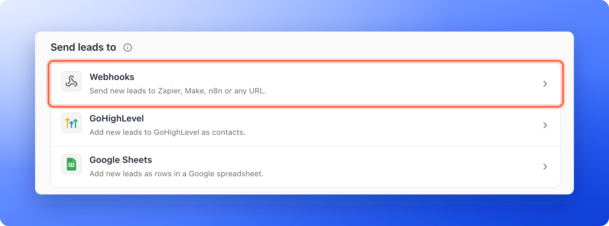
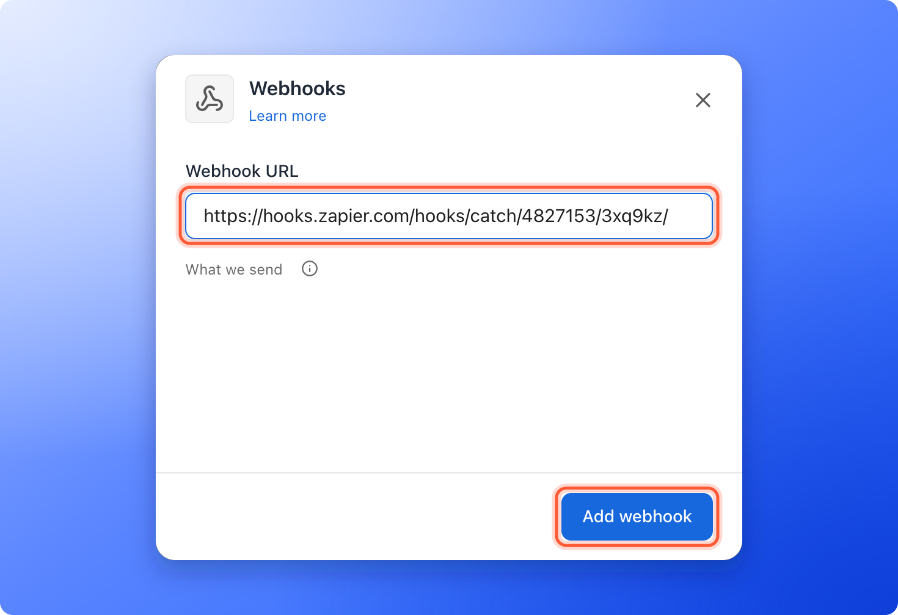
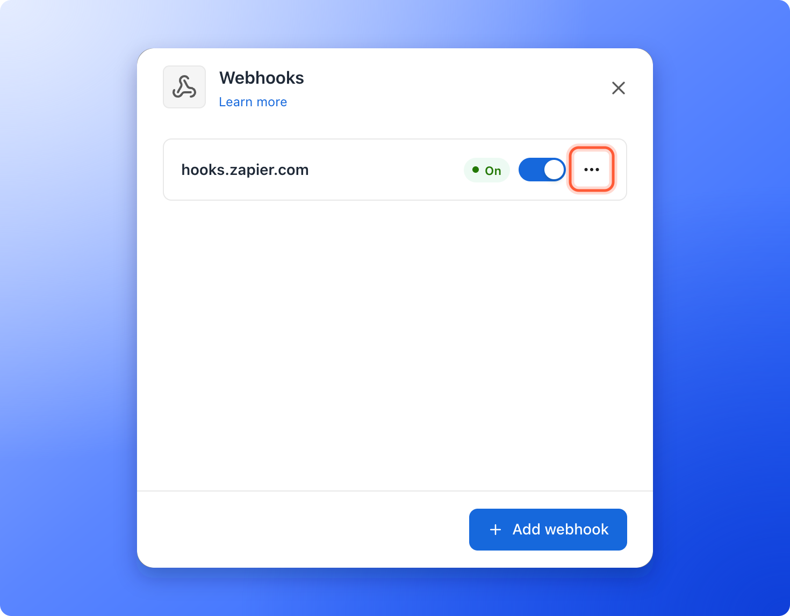
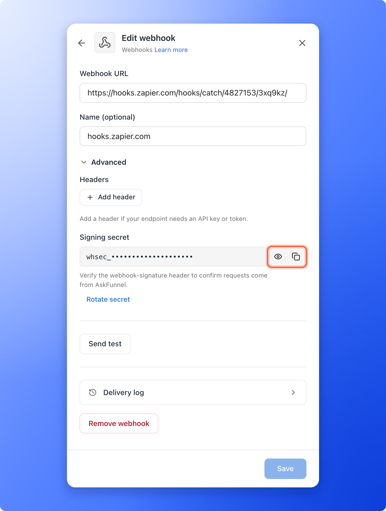
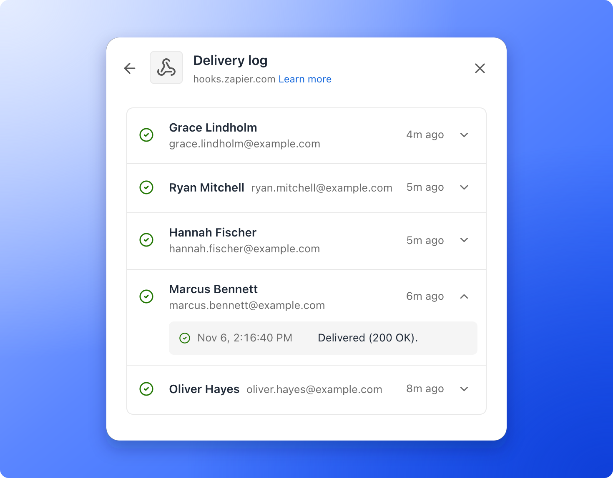

<Callout icon="star" color="#155DFC">
  Available on: **the Growth plan and above**.
</Callout>

A webhook sends each new lead, with all their answers, to a web address the moment it arrives. Your tool can then add the lead to your CRM, post in Slack, send an email or start any other automation.

With webhooks, you can:

- **Connect almost any tool.** Paste the webhook URL from Zapier, Make, n8n or your own server. No API key from AskFunnel is needed.
- **Send every answer in one request.** Each lead arrives as JSON (a standard text format that software reads easily) with the contact details, every answer, the lead score (a Cold, Warm or Hot label) and where the lead came from.
- **Keep it secure.** Every request is signed, so your server can check it came from AskFunnel. You can also add your own headers, such as an API key.
- **Never lose a lead quietly.** AskFunnel tries again automatically for about a day, shows every lead in a delivery log, and emails the organization owner if something needs attention.

**Before you start**, you need:

- The Growth plan or above. See [Upgrade your plan](/billing/upgrade).
- A Workspace Admin or Global Admin role. Only they can manage webhooks.
- An account with the tool that will receive your leads, such as Zapier, Make or n8n, or an endpoint from your developer.

## Important to note

<Warning>
  - Only new leads from your funnel are sent. Leads that arrived before you added the webhook, and leads you import, are not.
  - A lead saved over your monthly lead limit is locked. It is sent to your webhooks once it unlocks (a new billing period, a plan upgrade or a leads add-on).
  - If your plan drops below Growth, your webhooks and their settings are kept, but new leads are no longer sent to them and you cannot add, change or test a webhook until you upgrade. Leads that arrive in the meantime are not sent later.
</Warning>

## Setup

<Steps>
  <Step title="Get a webhook URL from your tool">
    Every tool that can receive data gives you a URL for it. Copy that URL.

    - **Zapier:** create a Zap, choose **Webhooks by Zapier** as the trigger and pick the **Catch Hook** event. Copy the webhook URL Zapier shows.
    - **Make:** add the **Webhooks** module as the first step of a scenario and choose **Custom webhook**. Create the webhook and copy its address.
    - **n8n:** add a **Webhook** node, set the HTTP method to **POST** and copy its URL. n8n shows a Test URL and a Production URL. See [Build your automation](#build-your-automation).
    - **Your own server:** ask your developer for an endpoint that accepts a POST request with a JSON body. They will find everything they need in [What AskFunnel sends](/integrations/webhook-reference).
  </Step>
  <Step title="Add the webhook to your funnel">
    The URL must start with https://, use the standard port (443) and be reachable from the internet. Addresses inside a private network, such as localhost, are refused. It cannot contain a username, a password or a # fragment.

    1. Click **Funnels** in the sidebar, then click the funnel you want to connect.
    2. In the funnel's menu, click **"Settings"**. If **Integrations** is not open, click it.
    3. Under **Send leads to**, click the **Webhooks** row. A panel opens on the right.
    4. Paste your URL into **Webhook URL** and click **"Add webhook"**.

    The webhook is on straight away, and AskFunnel shows **Webhook added. New leads will be sent to it.**

    

    
  </Step>
  <Step title="Send a test">
    Put your tool in listening mode first, so it can receive the test.

    1. In the **Webhooks** panel, click the three dots (**...**) on the webhook's row, then **"Send test"**.
    2. AskFunnel sends a sample lead named **AskFunnel Test** (test@askfunnel.test), built from your funnel's own questions. If your server accepts it, you see **Test delivered** and the status it answered with, for example **Test delivered (200 OK)**. The request contains `"test": true`, so your tool can tell it apart from a real lead.
    3. In your tool, use the test request to set up the next steps, for example to add a row in your CRM.

    

    <Tip>
      A test is a real request to your URL. Your server or tool will receive it, so delete the test contact afterwards if you like.
    </Tip>
  </Step>
  <Step title="Name it and add headers (optional)">
    1. Click the webhook's name to open **"Edit webhook"**.
    2. **Name (optional)** is only shown in AskFunnel. Without a name, the webhook is named after its host, for example hooks.zapier.com.
    3. Click **Advanced**. Under **Headers**, click **"Add header"** to send your own header (extra information sent with every request), for example **Authorization** with the value `Bearer your-token`. You can add up to 10. Values are hidden once saved. To change one, type a new value.
    4. The **Signing secret** is a private code your server can use to check that a request came from AskFunnel. It starts with whsec_. A new webhook gets its signing secret when you save it. Click the eye icon to show it and the copy icon to copy it. You need it only if your server checks signatures. See [Verify the signature](/integrations/webhook-reference#verify-the-signature).
    5. Click **"Save"**.

    

    <Note>
      Some header names are reserved, such as Content-Type and anything that starts with webhook-. AskFunnel shows **AskFunnel sets this header itself** if you try to use one.
    </Note>
  </Step>
</Steps>

<Card title="For developers: payload, headers and signature" icon="code" href="/integrations/webhook-reference" horizontal>
  The exact request AskFunnel sends, how to verify its signature and which answers count as delivered.
</Card>

## Read the webhook list

The **Webhooks** panel lists every webhook of the funnel. Each row shows:

- **The name** and, under it, the host of its address.
- **A status**, the same words as on the **Webhooks** row: **On** (it is sending), **Needs attention** (the last lead could not be sent, or your plan no longer includes webhooks) or **Paused** (you turned it off).
- **A switch** to turn it on or off, and the three dots (**...**) menu with **Edit**, **Send test**, **Delivery log** and **Remove**.

When a webhook needs attention, one line under its name says why, with **"View delivery log"** under it. At the bottom of the panel, click **"Add webhook"** to add another one. When **"Add webhook"** is grayed out, a line under the list says why. See [Troubleshooting](#troubleshooting).

## Build your automation

Zapier, Make and n8n each have a trigger that waits for a webhook, often called a "catch hook". For step by step guides, see [Send leads to Zapier](/integrations/zapier) and [Send leads to Make](/integrations/make). After your test arrives, your tool knows the fields of a lead. Build the rest of your automation:

1. Pick fields such as the contact's email from the test lead.
2. Use the `test` field in a filter step if you want to skip test leads.

<Tip>
  - n8n shows a Test URL, which works only while you click to listen for a test event, and a Production URL, which works once your workflow is active. Use the Test URL while you build, then switch to the Production URL in AskFunnel before you go live.
  - Answers are named after your questions. If you rename a question later, its name in your automation changes too. To avoid that, map fields by their `id` in the `fields` list instead. See [The JSON body](/integrations/webhook-reference#the-json-body).
</Tip>

## Tracking where your leads come from

There is nothing to set up. UTM parameters are tags on your link (source, medium, campaign, term and content) that show where a visit came from. When someone lands on your funnel, AskFunnel captures them and the referrer (the page they came from) automatically. They arrive in the `attribution` part of the request when the visitor allowed analytics cookies. If your funnel shows a cookie banner and the visitor declined analytics, the UTM fields are empty.

For leads that come from ads with your [ad tracking links](/integrations/ad-tracking-links), the same part also holds the ad platform and the campaign, ad set and ad IDs (`attribution.platform` and `attribution.ads`). They follow the same cookie rule as the UTM fields.

## How do I know it is working?

- The **Webhooks** row shows **On** and the address of your webhook, for example hooks.zapier.com. With several webhooks, it shows the first one and how many more you have.
- In the **Webhooks** panel, click the three dots (**...**) on a webhook, then **"Delivery log"**. A delivered lead has a check mark. A lead that is being tried again shows **Retrying**, and one that could not be sent shows **Failed**. Open a lead to see every attempt. Tests are listed as **Test**. For a full guide, see [Read your webhook delivery log and send failed leads again](/integrations/webhook-delivery-log).
- If your server cannot be reached, AskFunnel tries again automatically, as described in [Retries](/integrations/webhook-reference#retries-and-what-counts-as-success).
- If something needs your attention, the webhook shows **Needs attention** with the reason, the row shows **Needs attention**, and the organization owner gets an email.

## Troubleshooting

<AccordionGroup>
  <Accordion title="My test fails with Test failed">
    The message under it says why. The most common ones:

    - **Use an https:// URL on port 443, without a username, password or #fragment.** Fix the URL.
    - **The webhook URL points to a private or non-public address.** The URL must be reachable from the internet. A server on your own computer or office network will not work.
    - **Could not reach the endpoint. Check the webhook URL.** The address is wrong or the server is down.
    - **The endpoint did not respond in time.** Your server took longer than 15 seconds.
    - **The endpoint refused the request.** Your server answered 401 or 403. Check the webhook's headers, such as the API key.
    - **The endpoint was not found.** Your server answered 404 or 410. Check the webhook URL.
    - **The endpoint rejected the request.** Your server answered with another error, such as 400. Check what your server expects.
    - **The endpoint redirected. Use the final URL.** Paste the address you end up at, not the one that redirects.
  </Accordion>
  <Accordion title="A lead shows Failed in the delivery log">
    Open the lead in the delivery log to see the reason, fix it, then click **"Retry"**, or **"Retry failed"** to send all failed leads again. The reasons are the same as for a failed test.
  </Accordion>
  <Accordion title="The webhook says Needs attention">
    Open the delivery log, fix the reason shown, then click **"Retry failed"**. Saving the webhook after you change its URL or headers also sends the leads that failed again.
  </Accordion>
  <Accordion title="The same lead arrived twice">
    AskFunnel delivers each lead at least once. If your server was slow and AskFunnel tried again, or you clicked **"Retry"**, the same lead arrives again with the same `webhook-id` header and the same `id`. Ignore a lead whose ID you have already handled. See [Retries](/integrations/webhook-reference#retries-and-what-counts-as-success).
  </Accordion>
  <Accordion title="The Webhooks row says Not available, or the panel says to upgrade">
    Webhooks are available on the Growth plan and above. Click **"Upgrade to Growth"** in the **Webhooks** panel, or see [Upgrade your plan](/billing/upgrade). If you had webhooks before, the row and each webhook show **Needs attention**. Your webhooks and their settings are kept, and they start sending new leads again once your plan includes webhooks.
  </Accordion>
  <Accordion title="The Add webhook button is grayed out">
    A line under the list says why. With 10 webhooks it says **You can add up to 10 webhooks.** Remove one you do not use, or reuse an existing webhook. If your plan does not include webhooks, it says **Upgrade to Growth to add a webhook.**
  </Accordion>
</AccordionGroup>

## Manage the integration

- **Send to several tools:** click **"Add webhook"** at the bottom of the **Webhooks** panel to add another URL, up to 10.
- **Pause one webhook:** turn off the switch on its row. Its status changes to **Paused**. Leads that arrive while it is paused are not sent later.
- **Change a URL or a header:** click the webhook's name, edit it and click **"Save"**. Saved header values are kept only while the URL stays on the same website. If you point the webhook to a different website, enter the header values again.
- **Change the signing secret:** in **"Edit webhook"**, open **Advanced** and click **"Rotate secret"**, then confirm. Requests signed with the old secret will fail verification, so update your server right after.
- **Remove a webhook:** click **"Remove webhook"** in **"Edit webhook"**, or **"Remove"** in the webhook's three dots menu, then confirm. New leads stop being sent to it.

<Warning>
  Removing a webhook also removes its headers and signing secret. Leads that were still waiting to be sent to it end as failed. Leads your tool already received stay there.
</Warning>

## What to do next

<Columns cols={3}>
  <Card title="What AskFunnel sends" icon="code" href="/integrations/webhook-reference">
    The request, headers and signature, for developers.
  </Card>
  <Card title="Send leads to HighLevel" icon="address-card" href="/integrations/highlevel">
    Every new lead becomes a contact in HighLevel.
  </Card>
  <Card title="Track your ads" icon="bullseye" href="/integrations/meta-pixel">
    Connect Meta Pixel to see which ads bring leads.
  </Card>
</Columns>

Need help? Email [support@askfunnel.com](mailto:support@askfunnel.com).
