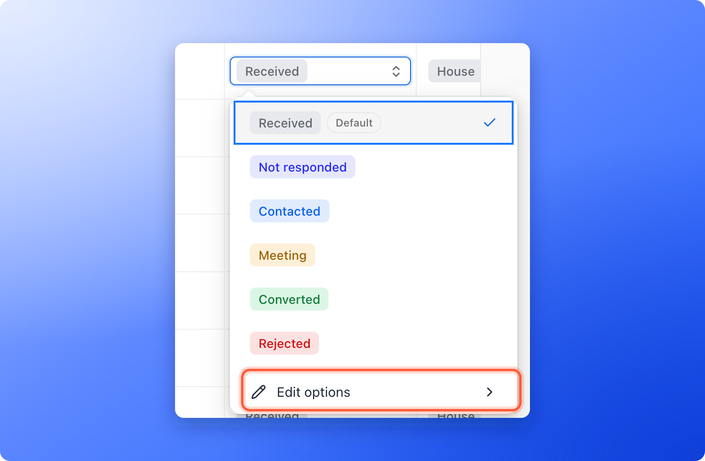
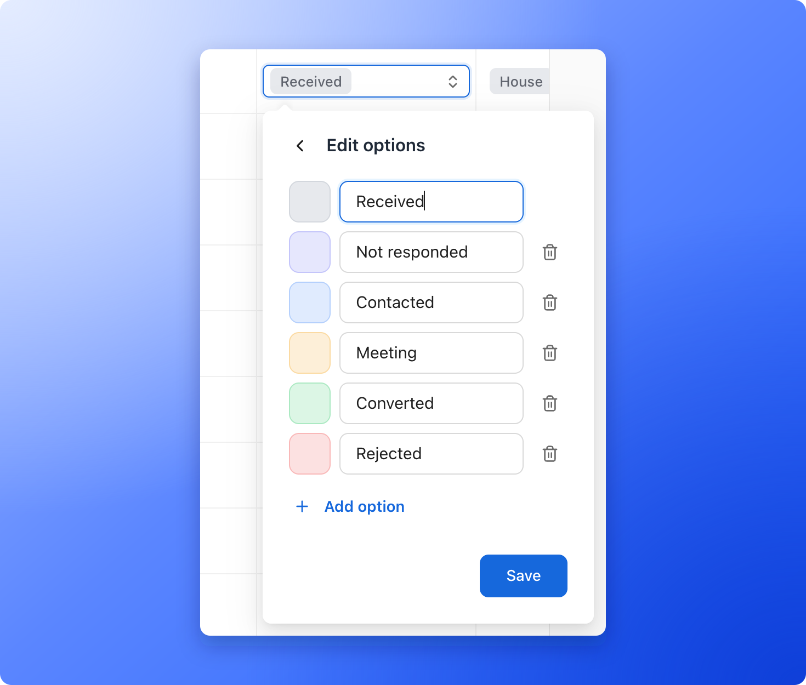
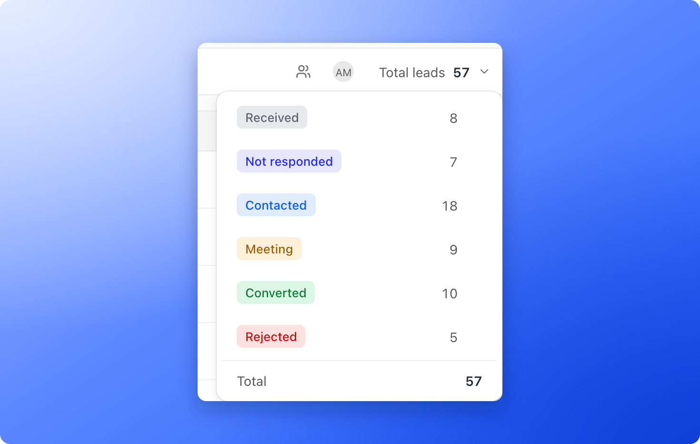

Use statuses to show where each lead is in your follow-up, so your whole team sees the same picture. Every new lead starts as **Received**. As you or your team work with the lead, you update its status.

**Before you start**, you need:

- A role that can change statuses: Global Admin, Workspace Admin or Contacts Manager.
- A funnel with at least one lead. See [View and manage your leads](/leads/view-and-manage-leads).

## Important to note

<Warning>
  Statuses belong to one funnel. Statuses you create in one funnel do not appear in another, and a funnel can have up to 50 statuses.
</Warning>

## The default statuses

- **Received:** a new lead. This is the default status.
- **Not responded**
- **Contacted**
- **Meeting**
- **Converted:** the lead became a customer.
- **Rejected**

Use them in the way that fits your team, or create your own below.

## Change a lead's status

1. Open your funnel's **Leads** page.
2. Click the lead's **Status** cell. A list of statuses opens.
3. Click the status you want. It saves right away.

You can also change the status from a lead's side panel: click the status at the top, or the **Status** row in the **Profile** tab.

Each change is recorded in the [activity log](/analytics/activity-log), for example from **Received** to **Meeting**. Statuses also start and stop [automated emails](/messages/automated-emails), because a flow begins when a lead reaches the status you choose as its trigger.

## Create, rename or delete a status

Add statuses that match how you work, such as "High potential" or "Follow up next week". You manage them all in one place, the options editor of the **Status** cell.

<Steps>
  <Step title="Open the options editor">
    Click any **Status** cell, then click **"Edit options"** at the bottom of the list.

    
  </Step>
  <Step title="Change the list">
    1. To add a status, click **"Add option"** and type a name.
    2. To recolor a status, click the color square at its left and pick a color.
    3. To rename a status, click its name and type.
    4. To remove a status, click the trash icon (**Delete option**) at its right.

    
  </Step>
  <Step title="Save">
    Click **"Save"**. Use the back arrow at the top to leave without saving.
  </Step>
</Steps>

The new status is available for every lead in this funnel, and the table shows it in the color you picked. **Received** is marked **Default**: you can rename or recolor it, but you cannot delete it, because every new lead starts there.

<Tip>
  If leads still have a status you delete, AskFunnel asks where they should go. A window says how many leads have the status and lets you pick a new one for them (**Received** unless you choose another). Click **"Move and delete"** to confirm.
</Tip>

## See how many leads are in each status

Click **Total leads** at the right end of the toolbar. The menu lists every status with its number of leads and a **Total** at the bottom. Tick one or more statuses to filter the table to them, and untick them to clear the filter.

The **Lead statuses** section in your [funnel analytics](/analytics/funnel-analytics) shows the same breakdown for the leads created in a date range.

## What to do next

<Columns cols={3}>
  <Card title="Set up lead scoring" icon="fire" href="/funnel-settings/lead-scoring">
    Rank leads as Cold, Warm or Hot so you know who to call first.
  </Card>
  <Card title="Email new leads automatically" icon="paper-plane" href="/messages/automated-emails">
    Start an email when a lead reaches a status.
  </Card>
  <Card title="Filter leads by date" icon="calendar-days" href="/leads/filter-by-date">
    Find the leads from a day, week or month.
  </Card>
</Columns>

Need help? Email [support@askfunnel.com](mailto:support@askfunnel.com).
