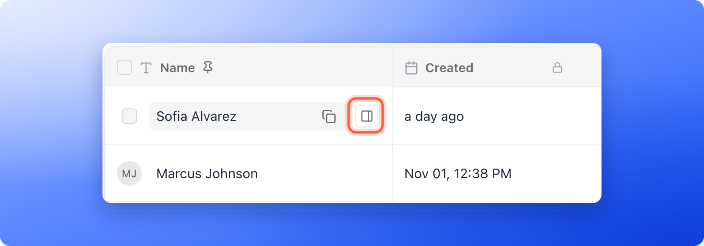
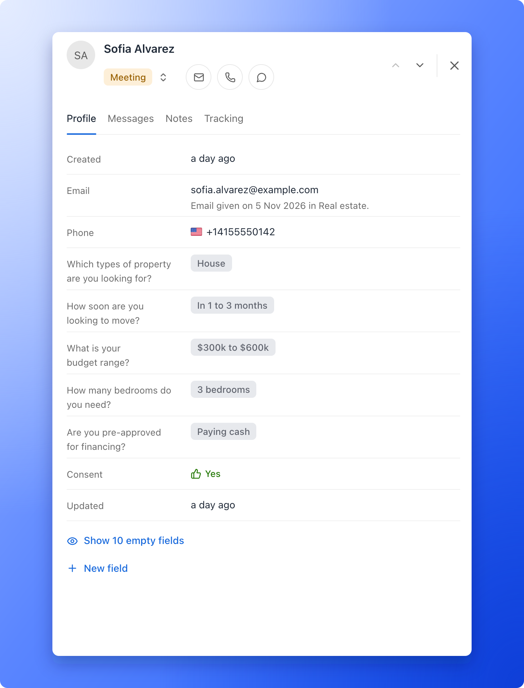

AskFunnel includes a built-in CRM (a place to keep track of the people you talk to). Every person who completes a funnel becomes a lead, with a full profile you can use to follow up without a separate spreadsheet. You may also hear leads called contacts or CRM contacts. Each lead is one row in your funnel's **Leads** page and one profile in the side panel.

**Before you start**, you need:

- A role that can see lead profiles: Global Admin, Workspace Admin or Contacts Manager. Content Editors do not have access.

## Important to note

<Warning>
  - AskFunnel adds a new lead every time someone submits your funnel. If the same person completes it twice, you see two leads.
  - Deleting a lead removes its profile, notes and activity history for good. See [Delete leads](/leads/delete-leads).
  - Leads you import appear as leads too, but they never count toward your monthly lead limit. See [Import leads from a spreadsheet](/leads/import-leads).
</Warning>

## What a lead profile holds

- **Contact details:** the name, email and phone your form collected. A line under the email says when it was given, for example **Email given on 5 Nov 2026 in Real estate.** For an imported lead it says **Imported on** the date. In the table, hover over an email or phone to see a shield that shows whether it was verified.
- **Answers:** one field for every quiz question and form field in your funnel, with what the person chose or typed. Fields with no value are tucked behind one button, for example **"Show 10 empty fields"**.
- **Status:** where the lead is in your follow-up. New leads start as **Received**. See [Track leads with statuses](/leads/contact-status).
- **Score:** **Hot**, **Warm** or **Cold**, shown only when [lead scoring](/funnel-settings/lead-scoring) is on for the funnel.
- **Assigned To and Tags:** who owns the lead and how you group it.

## The tabs of the side panel

- **Profile:** the contact details, answers, status and the other fields above. Click a value to edit it.
- **Messages:** the automated emails and WhatsApp messages the lead is in or has received, grouped by [email flow](/messages/automated-emails), with an **All**, **Email** and **WhatsApp** switch. It also shows what the lead agreed to by email. Before any message is sent it says **No flow messages yet.**
- **Notes:** comments from you and your team. See [Write notes on a lead](/leads/lead-notes).
- **Tracking:** where the lead came from and what device they used. See [See where a lead came from](/analytics/lead-insights).

## Open a lead profile

1. Open your funnel's **Leads** page. See [View and manage your leads](/leads/view-and-manage-leads).
2. Hover over the lead's row and click the **"Open lead"** icon at the right edge of the name cell.
3. The top of the panel shows the lead's name, their status and icon buttons to email, call or message them on WhatsApp. The buttons appear when the lead has an email address or phone number. Click the status to change it.
4. Use the up and down arrows to move to the previous or next lead, and the close icon to go back to the table.

You can edit the fields in **Profile** the same way as in the table, except fields with a lock icon. Drag a field by its handle to change its order, and the table columns follow. **"New field"** at the bottom adds a field of your own. See [Create a custom field](/leads/custom-contact-fields).

## What to do next

<Columns cols={3}>
  <Card title="Track leads with statuses" icon="list-check" href="/leads/contact-status">
    Show where each lead is in your follow-up.
  </Card>
  <Card title="Set up lead scoring" icon="fire" href="/funnel-settings/lead-scoring">
    See who to call first.
  </Card>
  <Card title="See where a lead came from" icon="location-dot" href="/analytics/lead-insights">
    Find the ad, device and page behind each lead.
  </Card>
</Columns>

Need help? Email [support@askfunnel.com](mailto:support@askfunnel.com).
