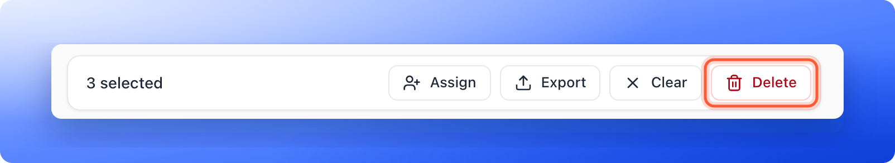
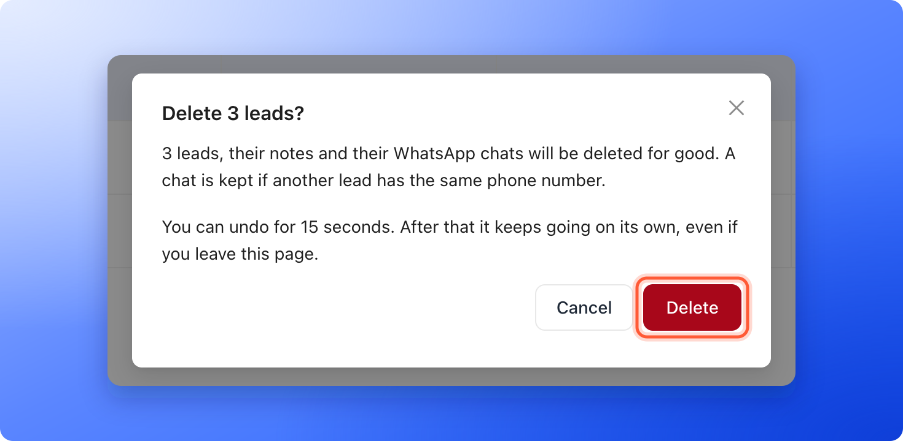

Permanently delete leads you do not need, such as spam, tests or leads you marked **Rejected**. Deleting works on one lead or on many at once. A large delete runs in the background, so you do not have to keep the page open.

**Before you start**, you need:

- A role that can delete leads: Global Admin, Workspace Admin or Contacts Manager.
- A backup, if you might need the contact details later. [Export your leads](/leads/export-contacts) first.

## Important to note

<Danger>
  Deleting a lead cannot be undone, apart from the 15 seconds of **Undo** before a delete of two leads or more starts.

  - The lead, its notes and its activity history are removed for good. The [activity log](/analytics/activity-log) keeps a line that a lead was deleted, without the lead's name.
  - Email flows stop for that lead. Emails the lead was still waiting to receive are canceled. If the lead was in a flow, AskFunnel also stops sending that email address flow emails from this workspace.
  - Other tools keep their copy. A lead you already sent to HighLevel, Google Sheets or a webhook is not removed there.
  - Deleting does not give back your monthly lead allowance and does not unlock locked leads. See [What happens when you reach your monthly lead limit](/billing/monthly-lead-limit).
</Danger>

## Delete leads

<Steps>
  <Step title="Find the leads">
    Open your funnel's **Leads** page. To delete a group, narrow the table first, for example with **Filter**, **Status**, **is any of**, **Rejected**. See [View and manage your leads](/leads/view-and-manage-leads).
  </Step>
  <Step title="Select them">
    Hover over a lead's avatar in the **Name** column to show its checkbox, then tick each lead to delete. To tick every lead you can see, use the checkbox in the header row. When the view has more leads than the table has loaded, the bar then offers **Select all 640 leads** (or **Select all 215 matching leads** when a filter narrows the table). Click it to choose every lead in the view, including the ones you have not scrolled to.
  </Step>
  <Step title="Check the selection and click Delete">
    A bar appears over the toolbar with the number of leads selected. Check the number. Click **"Clear"** to start over. Then click **"Delete"**.

    
  </Step>
  <Step title="Confirm">
    A window titled **Delete this lead?** (or **Delete N leads?**) says what goes with the leads: their notes and their WhatsApp chats. A chat is kept if another lead has the same phone number. From 100 leads, type the number of leads to confirm, for example **Type 640 to confirm**. Click **"Delete"** to confirm, or **"Cancel"** to keep them.

    
  </Step>
</Steps>

## What happens after you confirm

One lead is deleted at once. For two leads or more, the delete is held for 15 seconds so you can change your mind:

1. A card appears at the corner of the page: **5,000 leads will be deleted in 15 seconds.** Click **"Undo"** to cancel. Nothing is deleted, and the card says **Delete canceled.**
2. After 15 seconds the card counts as it goes: **Deleting 1,240 of 5,000 leads. You can leave this page.** The leads leave the table as they are deleted. Click **"Stop"** to stop. Leads already deleted stay deleted, and the card says, for example, **Stopped. 1,240 leads deleted, 3,760 kept.**
3. When it ends, the card says **5,000 leads deleted.** Close it with the X. If you left the page, the notification bell tells you when it ended, and the card is there when you come back. A teammate who opens the funnel sees who started it, for example **Maya is deleting 60 of 600 leads.**

## Troubleshooting

<AccordionGroup>
  <Accordion title="Some leads were not deleted">
    If a few deletions fail, the card says, for example, **Deleted 4,980 of 5,000. 20 couldn't be deleted and are still in your list.** Click **"Try again"** on the card. If there is no button any more, select the leads again later, or email [support@askfunnel.com](mailto:support@askfunnel.com) if it keeps happening.
  </Accordion>
  <Accordion title="A message says the funnel is already deleting or importing leads">
    A funnel does one big job at a time. **This funnel is already deleting leads. Wait for it to finish.** and **This funnel is importing leads. Delete them when it finishes.** both mean you can start again once the card at the corner shows it has ended. If your organization has several jobs running, you may see **Too many jobs are running for your organization. Wait for one to finish.**
  </Accordion>
  <Accordion title="A message says more leads match now">
    New leads arrived after you chose **Select all**, so more leads match than you confirmed. **More leads match now. Select them again.** Choose the leads again and check the new number before you confirm.
  </Accordion>
  <Accordion title="I deleted a lead by mistake">
    Deleted leads cannot be recovered, except that you can click **"Undo"** during the 15 seconds before a delete of two leads or more starts. If you have an earlier export, you can bring back contact details with **"Import leads"** in the **View options** menu. See [Import leads from a spreadsheet](/leads/import-leads). Notes and history do not come back.
  </Accordion>
</AccordionGroup>

## What to do next

<Columns cols={2}>
  <Card title="Export your leads" icon="file-export" href="/leads/export-contacts">
    Keep a copy of your leads as a file.
  </Card>
  <Card title="Email new leads automatically" icon="paper-plane" href="/messages/automated-emails">
    Follow up with the leads you keep.
  </Card>
</Columns>

Need help? Email [support@askfunnel.com](mailto:support@askfunnel.com).
