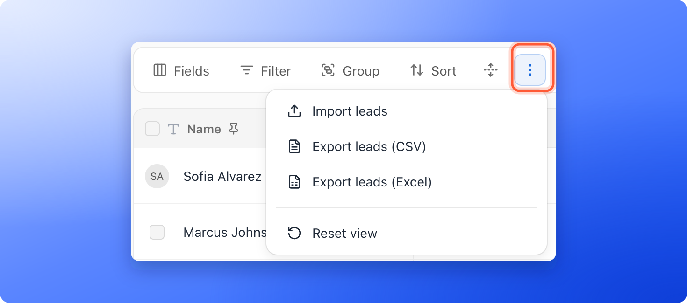

Download the leads you see in the table, or only the ones you pick, as a file for backups, reports or another system. You can choose a CSV file (a simple spreadsheet format that almost every tool opens) or an Excel file.

**Before you start**, you need:

- A funnel with leads in its **Leads** page. See [View and manage your leads](/leads/view-and-manage-leads).

## Important to note

<Warning>
  - An export covers up to 3,000 leads (newest first). If your funnel has more, the menu says, for example, **"Export the newest 3,000 leads (CSV)"** and the file contains only those.
  - **Select all** across pages does not work with **Export**. Tick the leads you want instead. Once every lead is chosen, **Export** is greyed out and says **Export works on the leads you tick, not on Select all.**
  - Your file may contain personal data. Store and share it with the same care as the data in AskFunnel.
</Warning>

## Export the leads in your table

The file matches your current view, so set it up first. Use search and filters to choose which leads go in, and use **Fields** to show the columns you want.

<Steps>
  <Step title="Open the View options menu">
    Open your funnel's **Leads** page and click the three vertical dots (**View options**) in the toolbar.
  </Step>
  <Step title="Choose a file format">
    Click **"Export leads (CSV)"** for a file that works almost everywhere, or **"Export leads (Excel)"** for an Excel workbook. Once all the leads of your view are loaded, the menu names how many, for example **"Export 120 leads (CSV)"**.

    
  </Step>
  <Step title="Open the file">
    Your browser downloads **leads-export.csv** or **leads-export.xlsx**. Open it in Excel, Google Sheets or any other tool.
  </Step>
</Steps>

## Export only some leads

1. Hover over a lead's avatar in the **Name** column to show its checkbox, then tick each lead you want. To tick every lead you can see, use the checkbox in the header row.
2. A bar appears over the toolbar with the number of leads selected and the buttons **Assign**, **Export**, **Clear** and **Delete**. Click **"Export"**.

Exports of selected leads are always CSV files.

## What is in the file

- One column for each field you can see, in the same order as the table, with a header row. Hidden fields are left out.
- Choices appear as their names, checkboxes as **Yes** or **No**, and dates as a date and time. Columns that hold a moment, such as **Created**, name your time zone in the header, for example **Created (Europe/London)**. Fields with several choices list them separated by commas.
- The **Score** column exports as a number, not as **Hot**, **Warm** or **Cold**.
- Locked leads (leads over your plan's monthly limit) are not included.

## Troubleshooting

<AccordionGroup>
  <Accordion title="A column is missing from my file">
    Hidden fields are not exported. Click **Fields**, turn the field on and export again.
  </Accordion>
  <Accordion title="Some cells start with an apostrophe">
    If a value starts with an equals, plus, minus or at sign, AskFunnel adds an apostrophe so spreadsheet apps show it as text instead of running it as a formula.
  </Accordion>
  <Accordion title="The export did not start">
    A notice says **Couldn't export your leads.** Click **Try again**. If nothing downloads, check that your browser is allowed to download files from dash.askfunnel.com.
  </Accordion>
  <Accordion title="My file has only some of my leads">
    Clear your search and filters first, then open **View options** and check the number in the export option.
  </Accordion>
</AccordionGroup>

## What to do next

<Columns cols={3}>
  <Card title="Delete leads" icon="trash" href="/leads/delete-leads">
    Remove spam, tests and leads you do not need. Export first to keep a copy.
  </Card>
  <Card title="Download your analytics as CSV" icon="chart-line" href="/analytics/export-conversions">
    Get your funnel numbers instead of your leads.
  </Card>
  <Card title="Send leads to Google Sheets" icon="table" href="/integrations/google-sheets">
    Skip manual exports and send every new lead to a spreadsheet.
  </Card>
</Columns>

Need help? Email [support@askfunnel.com](mailto:support@askfunnel.com).
