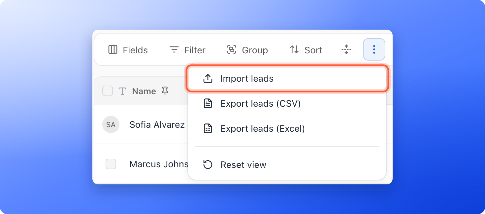
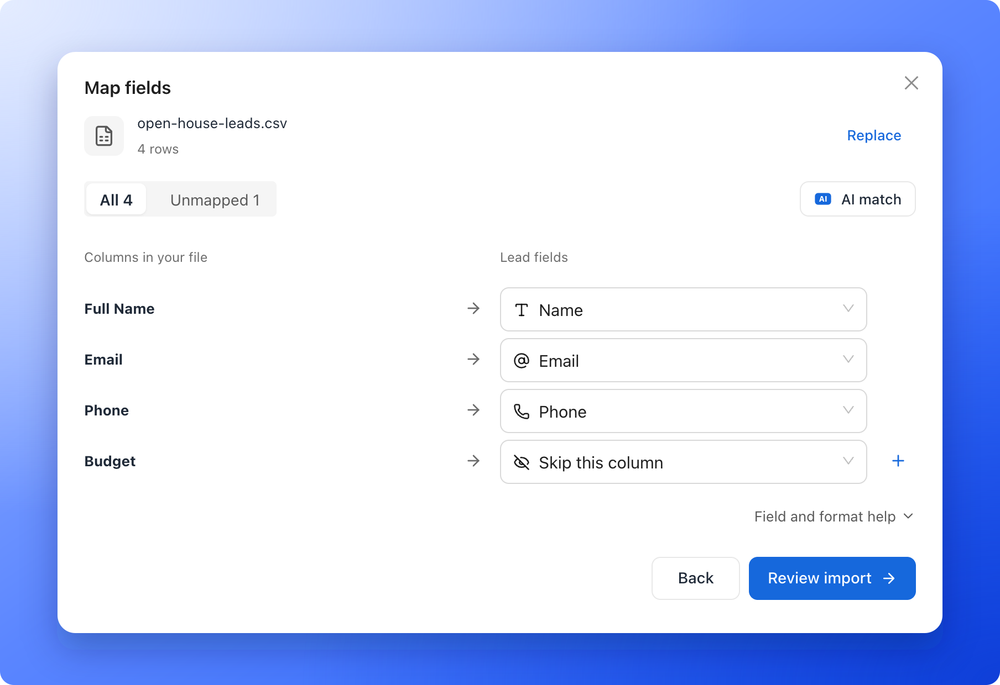
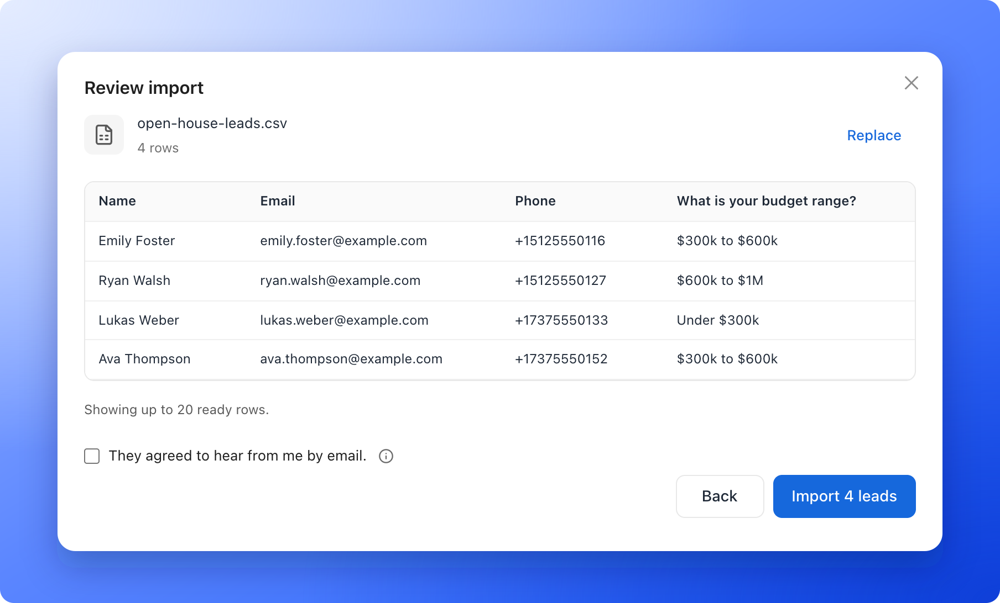

Already have leads in a spreadsheet, an old CRM or an export from another tool? Import them into a funnel's **Leads** page so your whole follow-up lives in one place. You upload a CSV or Excel file, match its columns to your fields and review the result before anything is saved.

**Before you start**, you need:

- A role that can manage leads: Global Admin, Workspace Admin or Contacts Manager.
- A CSV or Excel file with the column names in the first row, up to 5 MB and 5,000 rows. To start from a ready layout, click **"Download template"** in the import window. It is a CSV with your funnel's field names as the first row.

## Important to note

<Warning>
  - Imported leads never count toward your monthly lead limit, and they are never locked.
  - Every row needs a valid email address or phone number. A row with neither is skipped. A row that repeats an email address from earlier in the same file is skipped too. Skipped rows are listed under **Issues** in the review step.
  - A funnel does one big job at a time. While an import runs you cannot delete leads in that funnel, and while a delete runs you cannot import.
  - Imported leads did not come through a visitor, so their **Tracking** tab says **No tracking data captured** and they do not count in your conversion rate. See [Why your lead and analytics numbers differ](/analytics/why-numbers-differ).
</Warning>

## Import a file

<Steps>
  <Step title="Open the import window">
    Open your funnel's **Leads** page, click the three vertical dots (**View options**) in the toolbar and click **"Import leads"**.

    
  </Step>
  <Step title="Choose your file">
    Click **Choose a CSV or Excel file**, or drop the file on the window. If an Excel file has several sheets, pick the one you want in **Worksheet**. To use another file, click **"Replace"**.
  </Step>
  <Step title="Match the columns">
    The **Map fields** step lists **Columns in your file** on the left and **Lead fields** on the right. AskFunnel matches the columns it recognizes, such as **Full Name**, **Email** and **Phone**. A column it does not recognize, such as **Budget** in this file, starts as **Skip this column**: pick the lead field it belongs to, here the question **What is your budget range?**. For each column you can:

    - Pick a different lead field from the list.
    - Pick **Skip this column** to leave it out.
    - Click **"AI match"** (the button with the blue **AI** tile) to get suggestions for matching your columns. **AI match reads column names only.** Review each suggestion, marked as an AI suggestion. When every column has a match, the button goes away, because it has nothing left to do.
    - Click the plus next to a column to create a new field from it (**Create a field for this column**). The new field's form shows the **Values in your file** so you can pick the right type. When two or more columns have no match, the link **Create fields for N columns** makes a field for each of them in one go. See [Create a custom field](/leads/custom-contact-fields).

    Use the **All** and **Unmapped** switch to see only the columns without a match. When no column is left, **Unmapped** is dimmed (**Unmapped 0**). Click **Field and format help** for the rules: write dates as YYYY-MM-DD, and separate the values of a multi-select field with commas, semicolons or a pipe (|). A column mapped to **Status** brings in each lead's follow-up status.

    
  </Step>
  <Step title="Review and import">
    Click **"Review import"**. A preview shows up to 20 rows as they will be saved. The switch **Ready** and **Issues** shows how many rows will be imported and how many are skipped, and **Download issues** gives you a file that says why each row has a problem. A phone number with no country code is read in the country most of your numbers use, or in your workspace's country. A number AskFunnel cannot read is saved as you wrote it, and that lead gets no WhatsApp messages.

    Tick **They agreed to hear from me by email.** only if the people in your file agreed to get emails from you. A ticked lead is treated like a person who ticked the email box on your form. For a lead that is not ticked, [automated emails](/messages/automated-emails) meant only for people who ticked that box skip them. Emails to everyone still reach them.

    Click **"Import N leads"** to start.

    
  </Step>
</Steps>

## While the import runs

The import runs in the background. The window says **You can close this. We'll keep importing.** A card at the corner of the page shows **Importing leads** with how many are saved, for example **340 of 5,000**, and a **"Stop"** button. You can leave the page. The leads appear in the table as they are saved.

When it ends, the card says, for example, **5,000 of 5,000 leads were imported.** and the notification bell shows **5,000 leads imported.**

## How do I know it is working?

- The card at the corner of the page counts up while the import runs.
- **Total leads** and the table show the new leads. Clear your search and filters if you do not see them.
- The [activity log](/analytics/activity-log) shows the leads as **imported**.

## Troubleshooting

<AccordionGroup>
  <Accordion title="Import leads is greyed out">
    The funnel is deleting leads. **This funnel is deleting leads. Import when it finishes.** Wait until the delete card at the corner of the page says it has ended.
  </Accordion>
  <Accordion title="This file is too large">
    **This file is too large. Split it and try again.** Keep each file to 5 MB and 5,000 rows, and import the parts one after the other.
  </Accordion>
  <Accordion title="AskFunnel could not read my file">
    **Couldn't read this file. Save it as CSV and try again.** Open the file in your spreadsheet app, save it as a CSV and choose the new file.
  </Accordion>
  <Accordion title="The import stopped or failed">
    The card says **Import stopped.** with how many leads were saved, or **Couldn't finish importing.** Leads that were saved stay in the funnel. Click **"Try again"** on the card when it is there. It continues without saving a lead twice.
  </Accordion>
  <Accordion title="Some rows are missing">
    Open the **Issues** view in the review step before you import, or click **Download issues**. Rows without a valid email or phone, and rows that repeat an email address from earlier in the file, are skipped.
  </Accordion>
</AccordionGroup>

## What to do next

<Columns cols={2}>
  <Card title="View and manage your leads" icon="table-list" href="/leads/view-and-manage-leads">
    Search, filter and edit the leads you imported.
  </Card>
  <Card title="Email new leads automatically" icon="paper-plane" href="/messages/automated-emails">
    Follow up with the leads who agreed to hear from you.
  </Card>
</Columns>

Need help? Email [support@askfunnel.com](mailto:support@askfunnel.com).
