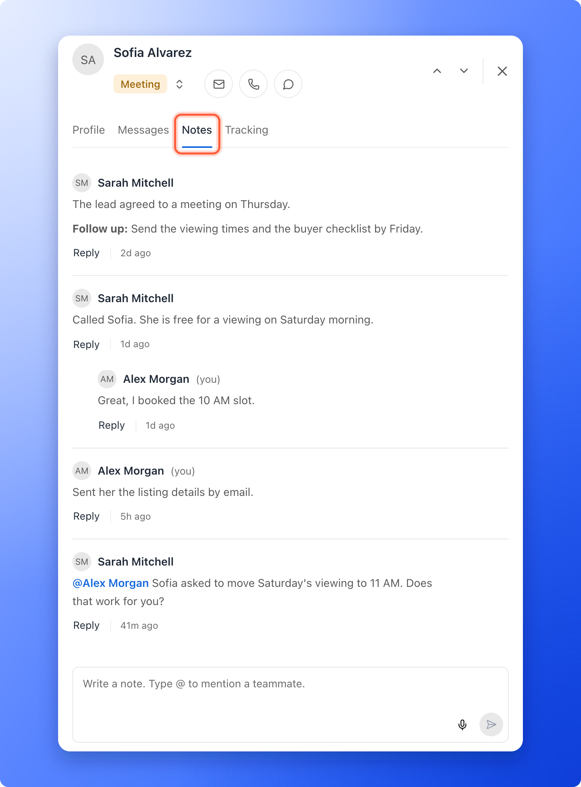

Notes are how your team keeps one story for each lead: who called, what was said and what happens next. Every note shows who wrote it and when, and the whole team sees it in the lead's **Notes** tab and in the funnel's [activity log](/analytics/activity-log).

**Before you start**, you need:

- A role that can see leads: Global Admin, Workspace Admin or Contacts Manager. Content Editors do not have access to lead data.
- A lead. Open your funnel's **Leads** page, hover over the lead's row and click the **"Open lead"** icon. See [View and manage your leads](/leads/view-and-manage-leads).

## Important to note

<Warning>
  - Notes belong to the lead. When you delete a lead, its notes are deleted too. See [Delete leads](/leads/delete-leads).
  - Dictating a note by voice is part of the Growth plan and above, and each started minute of recording uses 1 AI credit. See [AI credits](/billing/ai-credits).
</Warning>

## Write a note

<Steps>
  <Step title="Open the Notes tab">
    In the lead's side panel, click **Notes**.

    
  </Step>
  <Step title="Type your note and send it">
    Type in the box that says **Write a note. Type @ to mention a teammate.** and click the send arrow. The words you have typed are kept if you close the panel before you send them.
  </Step>
</Steps>

## What you can do with a note

- **Mention a teammate:** type **@** and pick a name from the list. The name shows in blue in the note, and your teammate gets a notification. They find it in the bell, under **Mentions**. The list holds the teammates who can see this lead: Global Admins, and the Workspace Admins and Contacts Managers of the workspace.
- **Reply:** click **"Reply"** under a note to answer it in place. The reply sits under the note. On a phone, replies open in a view of their own, with a **Back** button.
- **React:** point at a note and click the smiley to add one of six reactions. The reactions show under the note with who gave them.
- **Edit or delete a note:** point at your note and open its menu. A note you edited shows an edited mark. You can change or delete your own notes. A Global Admin or Workspace Admin can also delete a note written by someone who has left the organization.

## Dictate a note

<Callout icon="star" color="#155DFC">Available on: **the Growth plan and above**.</Callout>

Instead of typing, you can speak. This is quick after a phone call.

1. Click the microphone icon in the note box (**Dictate a note**) and allow your browser to use the microphone.
2. Speak. The box shows a timer. Click the square to stop, or the X to throw the recording away. A note can be up to 5 minutes long.
3. Wait for **Transcribing...**. AskFunnel turns what you said into a short, clear note, in English or in Roman Urdu if you spoke Urdu, and may add a **Follow up** line. The words appear in the box for you to read and change. Nothing is sent until you click the send arrow.

After you dictate, AskFunnel may also suggest a status for the lead, for example **Suggested status Meeting**. Save the note, then click **"Update status"** to apply it, or ignore it. Click the info icon (**Why this status?**) to see the reason. If the suggestion is a status your funnel does not have yet, the button says **Review status** and **Create and apply** adds it. Afterward the note says **Status updated to Meeting**.

## Troubleshooting

<AccordionGroup>
  <Accordion title="The microphone icon is greyed out">
    Voice notes are available on the Growth plan and above. Point at the icon to see which plan you need, and see [Upgrade your plan](/billing/upgrade).
  </Accordion>
  <Accordion title="Nothing was recorded">
    **Couldn't record. Check your microphone and try again.** Check that your browser may use the microphone for dash.askfunnel.com, then try again.
  </Accordion>
  <Accordion title="I do not see a teammate when I type @">
    Only teammates who can see this lead are listed. A Content Editor, or someone with no role in this workspace, is not.
  </Accordion>
</AccordionGroup>

## What to do next

<Columns cols={2}>
  <Card title="See where a lead came from" icon="magnifying-glass-chart" href="/analytics/lead-insights">
    Open a lead's Tracking tab for the source and device.
  </Card>
  <Card title="Track lead and team activity" icon="clock-rotate-left" href="/analytics/activity-log">
    See every note, status change and assignment in one timeline.
  </Card>
</Columns>

Need help? Email [support@askfunnel.com](mailto:support@askfunnel.com).
