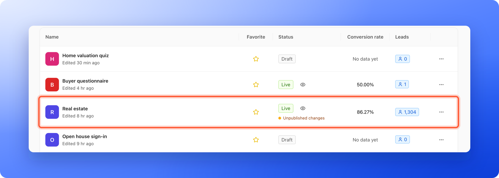
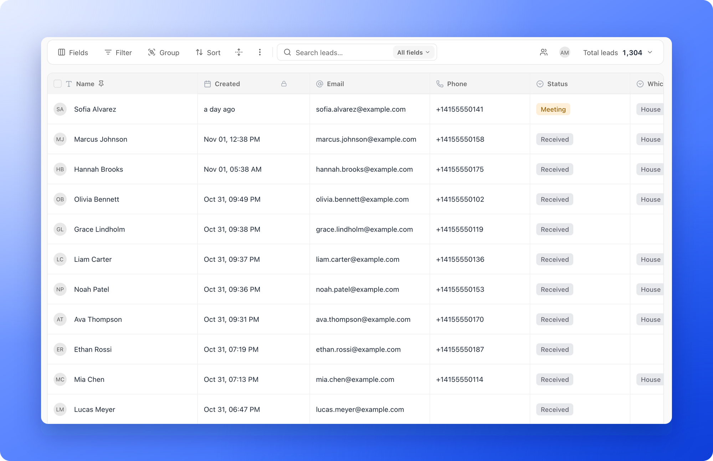

Every person who completes your funnel becomes a lead. Each funnel has its own **Leads** page: a table that works like a spreadsheet. Click a cell to edit it, and use the toolbar above the table to search, filter, sort and group.

**Before you start**, you need:

- A role that can see leads: Global Admin, Workspace Admin or Contacts Manager. Content Editors design funnels but do not have access to lead data, analytics or the activity log.

## Important to note

<Warning>
  - Your view is saved per funnel, in this browser only. Filters, sorts, groups, hidden fields and row height are not shared with your team. To start over, click **View options**, then **"Reset view"**.
  - Leads over your plan limit are locked. If you go over your monthly lead limit, a banner above the table tells you how many leads are locked and has an **"Upgrade plan"** button. Locked leads do not appear in the table or in exports until you upgrade or add a leads add-on. Leads you import never count toward the limit and are never locked.
  - The table loads 100 leads at a time as you scroll. In a funnel with more than 3,000 leads, search, filters, groups and exports cover the newest 3,000, and a notice under the toolbar says so, for example **Filters cover the newest 3,000 leads.**
</Warning>

## Open your leads

<Steps>
  <Step title="Click the funnel">
    1. Click **Funnels** in the sidebar. Each row shows the funnel's **Conversion rate** (the share of people who become leads) and its number of **Leads**. See [Read your funnels list](/funnels/funnels-list).
    2. Click anywhere on the funnel's row. Its **Leads** page opens.

    
  </Step>
  <Step title="Find your way around">
    The sidebar now shows the funnel's menu: **Leads**, **Analytics**, **Activity**, **Settings** and **Edit funnel**, with **Funnels** at the top to go back to your funnel list. The funnel's name and a status dot (green when it is live) sit under the page title. On a phone, the bar at the top shows the page and the funnel's name, and **Menu** in the bottom bar opens the funnel's menu. Above the table, the toolbar has **Fields**, **Filter**, **Group** and **Sort**, then a row height button, the **View options** menu (three vertical dots) and the **Search leads...** box. On the right are the assignee filter, your avatar (**Me mode**) and **Total leads**, which shows how many leads you have and lets you filter by status.

    
  </Step>
</Steps>

Every question and form field in your funnel becomes a column, next to **Name**, **Email**, **Phone**, **Status**, **Created**, **Assigned To**, **Tags** and more. To choose which columns you see, read [Show, hide and reorder lead fields](/leads/contact-fields).

## What you can do

- **Open a lead:** hover over the lead's row and click the **"Open lead"** icon at the right edge of the name cell. A side panel opens with the tabs **Profile**, **Messages**, **Notes** and **Tracking**. Use the up and down arrows at the top to move to the previous or next lead. See [What is a CRM contact?](/leads/crm-contacts).
- **Edit in the table:** click a cell, type, then press **Enter** or click away to save. Fields with a small lock icon (**Created**, **Score**, **Updated** and **Appointment**) are filled in by AskFunnel and cannot be edited.
- **Change a status:** click the **Status** cell and pick a new one. See [Track leads with statuses](/leads/contact-status).
- **Assign and tag:** click the **Assigned To** cell to give a lead to a teammate, or the **Tags** cell to add tags. To assign several leads at once, tick them and use **"Assign"** in the bar that appears.
- **Write notes:** open a lead and use its **Notes** tab to keep a record of calls and next steps, reply to teammates and mention them. See [Write notes on a lead](/leads/lead-notes).
- **Import leads you already have:** click **View options**, then **"Import leads"**. See [Import leads from a spreadsheet](/leads/import-leads).
- **Export or delete leads:** see [Export your leads](/leads/export-contacts) and [Delete leads](/leads/delete-leads).

## Find the leads you need

- **Search:** type in the **Search leads...** box. By default AskFunnel searches all fields. To search one field, click **All fields** and pick the field. Press **Esc** or click the clear icon to clear the search.
- **Filter:** click **Filter**, then **"Add filter"**. Choose a field, how to compare it and a value. Add more conditions and join them with **and** or **or**, or click **"Add filter group"** to combine conditions in a group. A number on the button shows how many conditions are active. To filter by date, see [Filter leads by date](/leads/filter-by-date).
- **Filter by status:** click **Total leads** and tick the statuses you want. The menu also shows how many leads are in each status.
- **Filter by teammate:** click the people icon (**Filter leads by assignee**) and pick **Unassigned** or one or more teammates. Click your avatar (**Filter for your leads**, also called **Me mode**) to show only the leads assigned to you. These controls appear once your funnel has its first lead.
- **Sort and group:** click **Sort** and **"Add sort"** to order the table by any field. Click **Group** and **"Add group"** to group leads by a field, up to three levels deep.
- **Change the row height:** click the row height icon and choose **Short**, **Medium**, **Tall** or **Extra tall**.

## Troubleshooting

<AccordionGroup>
  <Accordion title="I can't see Leads, Analytics or Activity">
    Your role does not include lead data. Ask a Workspace Admin to give you the Contacts Manager role, or a Workspace Admin role if you also need to edit funnels.
  </Accordion>
  <Accordion title="The table says No leads match your filters">
    A filter or search is hiding every lead. Click **"Clear filters"** in the table, or open **Filter** and click **Clear all**.
  </Accordion>
  <Accordion title="A lead I expect is missing">
    Check for a number on the **Filter** button, a search in the search box, a status picked in **Total leads** or a teammate filter. If none apply, look for a banner about locked leads above the table.
  </Accordion>
  <Accordion title="I can't edit a cell">
    Fields with a lock icon are managed by AskFunnel. Every other cell can be edited.
  </Accordion>
</AccordionGroup>

## What to do next

<Columns cols={2}>
  <Card title="What is a CRM contact?" icon="id-card" href="/leads/crm-contacts">
    See what a lead profile holds and how to open it.
  </Card>
  <Card title="Track leads with statuses" icon="list-check" href="/leads/contact-status">
    Move leads through your follow-up.
  </Card>
  <Card title="Export your leads" icon="file-export" href="/leads/export-contacts">
    Download your leads as a file.
  </Card>
  <Card title="Email new leads automatically" icon="paper-plane" href="/messages/automated-emails">
    Send a welcome email the moment someone submits.
  </Card>
</Columns>

Need help? Email [support@askfunnel.com](mailto:support@askfunnel.com).
