<Callout icon="star" color="#155DFC">
  Available on: **all plans** (Starter, Growth, Scale and Enterprise). Starter flows can send one message. Flows with several messages need the Growth plan or above.
</Callout>

Build a flow that emails your leads on its own. A flow is a set of messages that sends automatically. A common use is a welcome email with a downloadable guide or a discount code, sent the moment a lead completes your funnel. Each flow belongs to one funnel and starts when a lead reaches the status you choose.

**Before you start**, you need:

- A verified sender, which is the from address your leads see. See [Add and verify a sender email](/messages/custom-sender-email).
- A funnel whose form has an **Email** field and a **Consent** field set to **Email updates**. An email goes only to leads who ticked that box, unless you choose otherwise in step 5. See [Set up your lead capture form](/funnels/lead-capture-forms).
- A business address for your workspace. You are asked for it the first time you publish, and you can add it ahead of time under **Settings**, **General**, **Business address**.

## Important to note

<Warning>
  - A flow only starts for leads who reach its trigger status after it is live. Leads that already have that status when you publish are not added, and each lead goes through a flow once. The same email address (or phone number) also starts a flow only once a day: a second lead with the same address inside 24 hours is saved as usual, but the flow does not start for it.
  - Every email has a footer you cannot remove. It says "You got this email because you filled in" and your funnel's name, then **Unsubscribe**, and under it your business name and address. Growth and above can turn off the AskFunnel branding: click the footer and switch off **Branding**.
  - A flow with more than one message needs the Growth plan or above. If your plan moves below it, for example after a [downgrade](/billing/downgrade), the flow is kept and each lead still gets the first message. The other messages wait and show **Paused** on the lead. They send right away when you upgrade, and one that waited more than 3 days is skipped.
  - Each plan has a monthly email allowance: 1,000 on Starter, 3,000 on Growth, 6,000 on Scale and 20,000 on Enterprise. It starts again on your billing date. Each plan also has a daily limit. If you reach either, your sequences pause and the emails wait. They are not lost. See [Email limits and paused sequences](#email-limits-and-paused-sequences).
  - A free trial has two limits instead: 300 emails in total and 100 emails a day. See [Free trial email limits](#free-trial-email-limits).
</Warning>

## Create a flow

<Steps>
  <Step title="Open the Flows editor">
    1. In the sidebar, click **Funnels** and open your funnel.
    2. Click **Edit funnel** in the funnel's menu.
    3. At the top, next to the funnel's name, click the **Funnel** button and choose **"Flows"**.
    4. On a funnel with no flows, click **"New flow"** under **Create your first flow**. Otherwise click **"New flow"** at the end of the **Flows** list on the left. To rename a flow, click the three dots on its row and choose **"Rename"**.

    On a phone, the three-dot menu at the top right of the editor switches between **Funnel** and **Flows** and holds the publish controls. The flows show as a list, and you tap one to open it.

    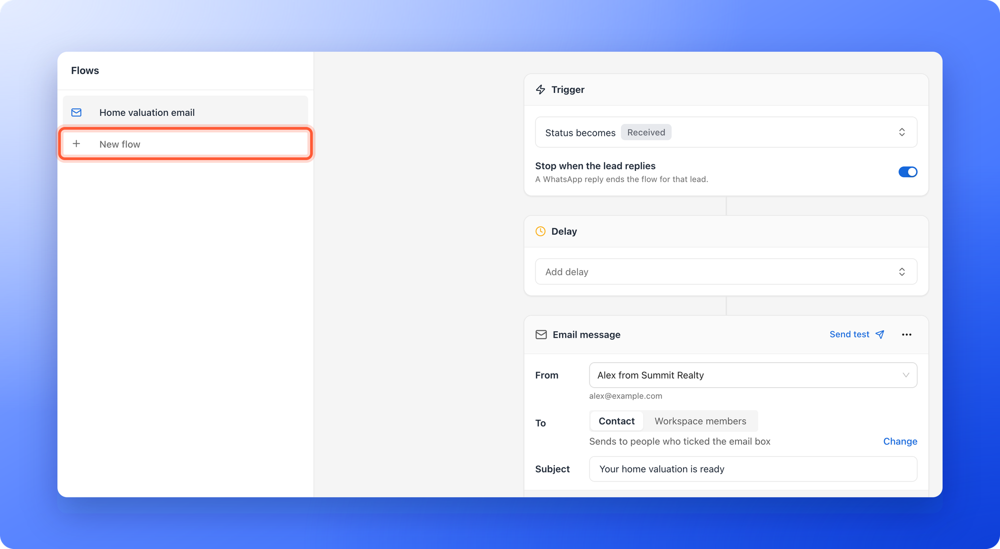
  </Step>
  <Step title="Choose when it starts">
    The trigger is the status that starts the flow.

    1. Click the **Trigger** card. It says **Add rules** until you choose a status. The **Trigger** window opens.
    2. Under **Status becomes**, pick the status that starts the flow. **Received** means every new lead.
    3. Optional: click **"Add rule"** to send only to some leads. Pick a field from **Contact fields** or **Funnel answers**, choose how to compare, for example **Is exactly**, and pick the answer. Add more rules and join them with **And** or **Or**.
    4. Click **"Save"**. The card now reads **Status becomes** and your status.

    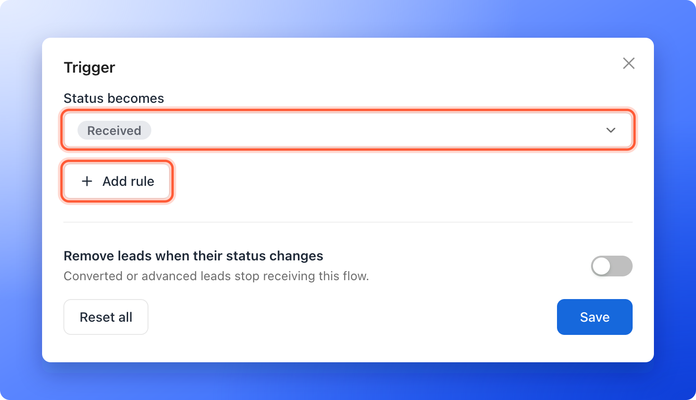
  </Step>
  <Step title="Add the email">
    Click **"Add a message"** at the end of the flow and choose **Email**. A **Delay** card and an **Email message** card appear. Leave the delay empty to send right away, or click it to wait first. See [Send a series of follow-up emails](/messages/email-sequences).

    <Tip>
      Starting from nothing? A new flow also offers **Create a follow up with AI**. Choose **Email** or **WhatsApp** and AskFunnel writes three messages from your funnel's questions, each choice showing its price in AI credits. You review everything before anything is sent. The email choice needs the Growth plan or above.
    </Tip>
  </Step>
  <Step title="Write the email">
    1. Next to **From**, choose your verified sender. The sender's address shows under it. If you have none yet, the list says **No verified sender yet** and offers **"Add new sender"** and **"Manage senders"**.
    2. Under **To**, leave **Contact** chosen. The email goes to the lead's email address.
    3. Click **Subject**, which says **Add a subject**, and type your subject line.
    4. Write your message in the text block. Type **@** to insert a detail from the lead, such as their name. Pick the field, then type a fallback that is used when the field is empty, for example "there", or click **"No fallback"**.
    5. To add more, click the **+** below the message and pick a block: **Text**, **Image**, **Button**, **Divider**, **Graphics**, **List**, **Spacer** or **File**.
  </Step>
  <Step title="Choose who gets the email">
    Under **To**, a line says who the email goes to. A new email goes to **people who ticked the email box**. Click **Change** to choose:

    - **Only people who ticked the email box:** for offers, tips and news.
    - **Everyone in this flow:** only for emails they asked for, such as results, confirmations and reminders.

    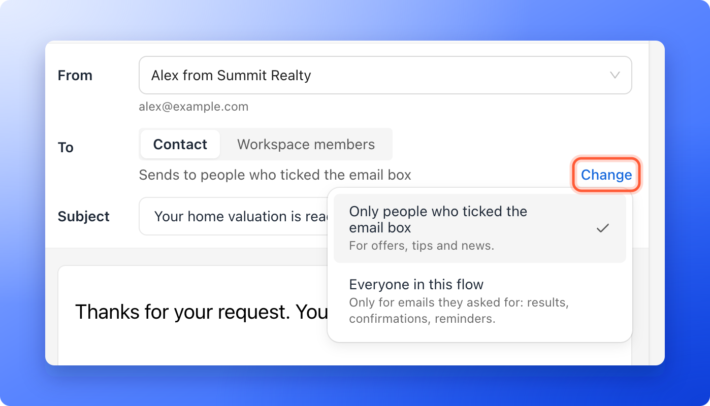

    If your funnel's form has no **Consent** field set to **Email updates**, nobody can tick the box, so the editor warns **No one gets this email yet. Add a Consent field set to “Email updates” to the funnel's form.** Click **Open the funnel** to add it. A flow made before this choice existed says **Emails in this flow go to everyone, ticked or not.** at the top, with **Choose who gets each email** to review each one.

    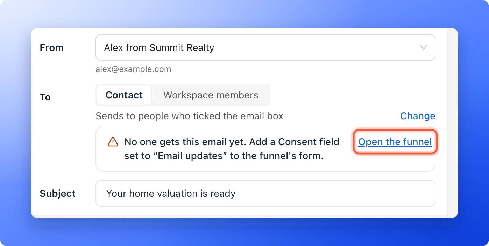
  </Step>
  <Step title="Add a file or link (optional)">
    To send a guide, price list or discount, click the **+** below your text and choose **File**.

    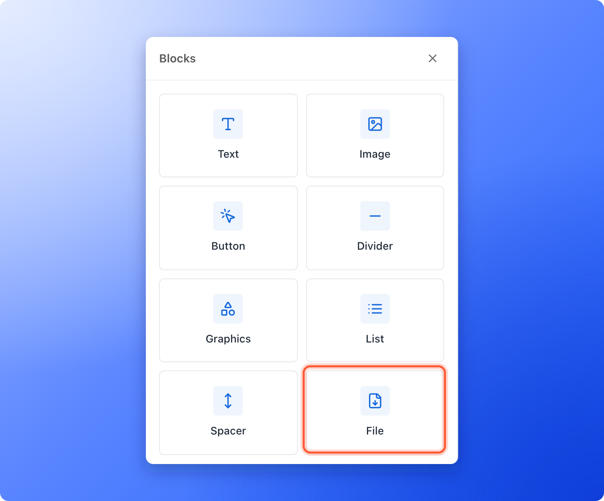

    1. Under **File link**, paste a public link to your file, such as a PDF in Google Drive.
    2. Under **File name**, type what the lead sees.
    3. Change **Button label** from **Download** if you like, for example to "Get the discount guide".

    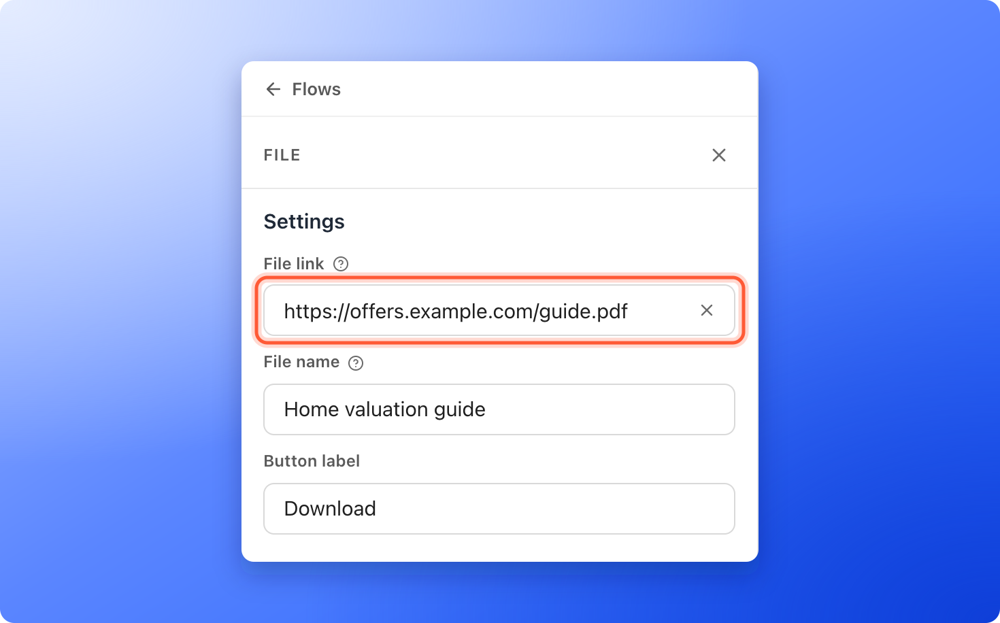

    The lead receives a button that opens your link. AskFunnel does not attach files. For a link to a web page, use the **Button** block instead.
  </Step>
  <Step title="Send yourself a test">
    Click **"Send test"** at the top of the email card. A copy arrives in your own inbox with **[Test]** in front of the subject, and AskFunnel says "Test email sent to" your address. The link works after you choose a sender, and your organization can send up to 20 test emails per hour.
  </Step>
  <Step title="Publish the flow">
    Click **"Publish"** at the top right. When it says "Flow published.", the flow is **Live** and new leads who reach your trigger status start receiving it.

    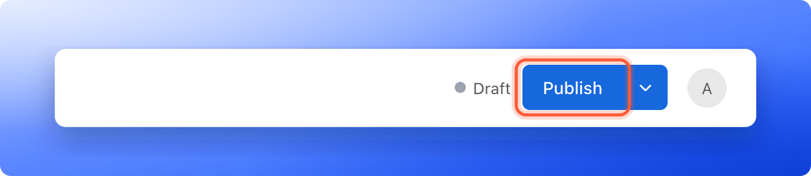

    If your workspace has no business address yet, the **Add your business address** window opens first. It asks for the **Street address**, **City**, **State or region**, **Postal code** and **Country**, because email rules ask for a postal address in every email. Use your business address, or a PO box if you work from home. Click **"Save and publish"**. The address is saved for the workspace and shown in every email footer.
  </Step>
</Steps>

## How do I know it is working?

- **In the editor:** the top bar shows **Live**. A flow that is off shows **Offline**, and a flow you changed after publishing shows **Changes available**. Once the flow has been published, a line above the **Trigger** card counts the leads, for example **3 enrolled · 0 active · 3 completed**, and each email shows its counts under the card: **sent**, **delivered**, **clicked**, **bounced**, and **opened** when open tracking is on.
- **On a lead:** open the lead and click the **Messages** tab. It lists each flow the lead is in, with its state (**Running**, **Waiting**, **Paused**, **Completed**, **Failed**, **Stopped** or **Not started**) and each message sent.

Clicks and opens are counted only when you turn on click or open tracking for your sender's domain. See [Add and verify a sender email](/messages/custom-sender-email). To read each number, see [See whether your automated emails are delivered, opened and clicked](/messages/email-delivery-stats).

## Email limits and paused sequences

When a limit is reached, your sequences **pause** and the emails **wait**. Nothing fails and nothing is lost. The emails go out when the limit lifts.

### Free trial email limits

A free trial can send up to **300 emails in total** and up to **100 emails a day**. Team alerts count too, one for each person who gets the alert.

- **At 100 emails in a day,** your sequences pause until midnight UTC (standard world time). They continue by themselves the next day.
- **At 300 emails in total,** your sequences pause until you subscribe. They continue within a day of subscribing. See [Upgrade your plan](/billing/upgrade).

### Monthly and daily limits on a paid plan

If you reach your plan's monthly email limit, your sequences pause until your billing date, when the count starts again. They also continue within a day of an upgrade that gives you more room. See [Check your plan and usage](/billing/plan-and-usage).

Each plan also has a daily limit. When you reach it, sending continues the next day.

### Where to see your usage and the warnings

- **The plan card.** Click it at the bottom of the sidebar to see **Automated emails / month** and **Automated emails / day**, or **Trial emails** and **Trial emails today** on a free trial. A dot on the card turns amber from 80% of a limit and red when it is reached. See [Check your plan and usage](/billing/plan-and-usage).
- **Warning emails.** The organization owner and every Global Admin get an email at 80% of the limit and another when it is reached, once for each period.
- **The Flows editor.** When emails wait for a limit, a banner appears at the top. It says what is paused, how many emails wait and when they send. Its button names the plan that has enough room, and only a Global Admin sees the button. Everyone else reads "Ask a Global Admin to upgrade the plan." You can close the banner with the **X**. A short line under **Flows** then keeps saying that sending is paused, for example **Sending is paused until November 3.**

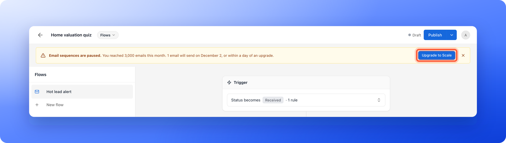

The banner reads:

- **Email sequences are paused.** You reached the monthly limit. The button is **"Upgrade to Scale"**, or the plan that fits.
- **Your plan sent 2,000 emails today.** The waiting emails send tomorrow. There is no button, because it clears by itself. The number is your plan's daily limit.
- **Your free trial has sent its 300 emails.** Sequences are paused until you subscribe. The button is **"Subscribe to Growth"**, or the plan you are trying.
- **Your free trial sent 100 emails today.** The waiting emails send tomorrow. There is no button.
- **Sequences with more than one email are paused.** Your plan sends only the first email of each sequence. The rest send as soon as you upgrade.
- **Emails are waiting to send.** The limit has lifted, for example after an upgrade, and the waiting emails go out within a day.

On a free trial, a line under **Flows** also shows how many emails are left and the daily limit, for example **Free trial: 50 of 300 emails left, up to 100 a day.**

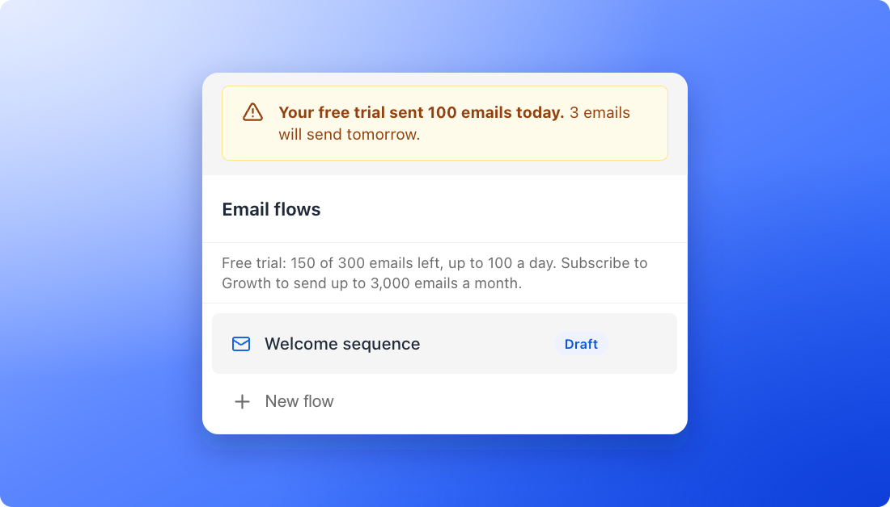

### Emails that wait more than 3 days

If an email waits more than 3 days for a limit or a pause to end, AskFunnel skips it and the flow moves on to its next step. This way a lead never gets a follow-up that is days out of date. A skipped email does not count toward your limit. Team alerts are not skipped, they send late.

### What a lead's timeline says

Open a lead and click the **Messages** tab. A flow that waits for a limit or a pause shows **Paused** and the reason:

- **Your free trial can send 100 emails a day. Sending continues tomorrow.**
- **Your plan sends up to 2,000 emails a day. Sending continues tomorrow.**
- **Your free trial has sent its 300 emails. Subscribe to keep your sequences running.**
- **You reached this month's email limit. Sending continues on October 26, or within a day of an upgrade.**
- **Your subscription is inactive. Sequences continue when you subscribe again.**
- **Too many emails bounced, so sending is on hold to protect your email reputation.** It can also say **Too many emails were marked as spam**. See [Keep your emails out of spam](/messages/email-deliverability).

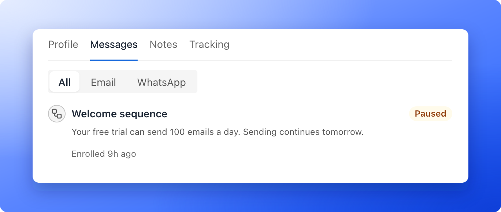

An email that waited more than 3 days shows **More than 3 days late** with a skipped mark. The next email sends as normal.

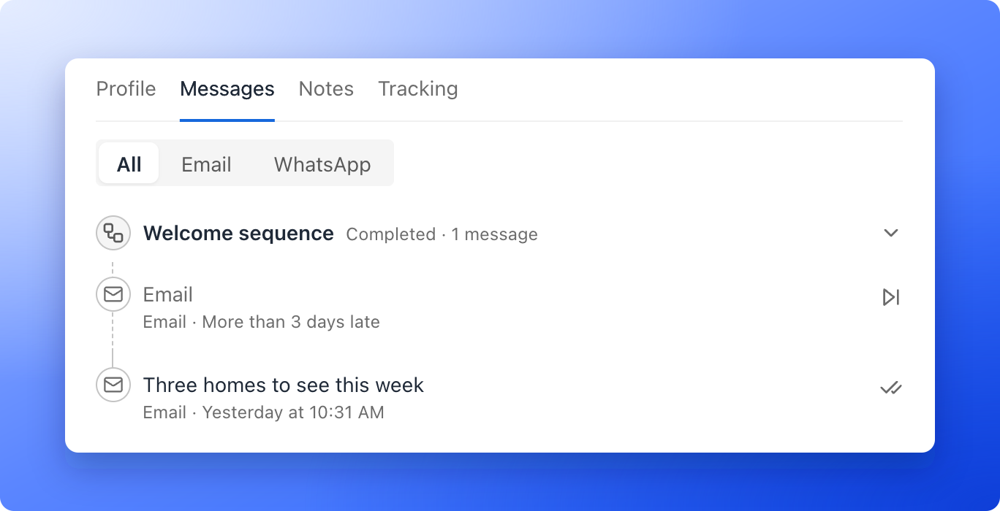

## Edit or turn off a flow

- **Edit a live flow:** a status of **Changes available** means you edited a live flow. Click **"Publish"** again to send the changes live. Leads already in the flow finish with the version they started on.
- **Turn a flow off:** click the arrow next to **Publish** and choose **"Unpublish"**, then confirm **Turn this flow off?** with **"Turn off"**. You can also click the three dots on the flow's row in the **Flows** list and choose **"Turn off"**. This stops it for everyone. Leads still waiting for their next email will not get it. To bring it back, choose **"Set live"** on its row or publish again.
- **Delete a flow:** click the three dots on its row and choose **"Delete"**.

## Troubleshooting

<AccordionGroup>
  <Accordion title="Publish shows an error">
    Each step that needs attention says so in its own card, and the editor scrolls to the first one. The messages you may see are:

    - **Choose which lead status starts this flow.** Open the **Trigger** card and pick a status.
    - **Choose a sender for this email.** Pick a sender under **From**.
    - **Every email needs a subject line.** Type a subject.
    - **Add content to this email before publishing.** Add text or another block.
    - **Choose at least one member to notify.** Pick the teammates under **To**.
    - **Add a message to publish.** A flow needs at least one email or WhatsApp message.
    - **Multiple messages require a higher plan.** Starter flows can only send one message.
  </Accordion>
  <Accordion title="A lead's flow says Paused. Sequences with more than one email are on the Growth plan">
    Your plan does not include flows with more than one email, so only the first email was sent. The other emails are waiting and nothing is lost. Upgrade, and they send right away. An email that waited more than 3 days is skipped, so a lead never gets a follow up that is days old. See [Upgrade your plan](/billing/upgrade).
  </Accordion>
  <Accordion title="The From list says No verified sender yet">
    Click **"Add new sender"** in the list and finish verification. See [Add and verify a sender email](/messages/custom-sender-email).
  </Accordion>
  <Accordion title="The From row says Sender chosen by an admin">
    Only a Global Admin or Workspace Admin can see the list of senders, so a Content Editor sees that an admin chose one. Ask an admin to change it if it is wrong.
  </Accordion>
  <Accordion title="A lead did not get the email">
    Open the lead and check the **Messages** tab. The most common reason is that the lead did not tick the email box, which shows as **Skipped** with **Did not tick email updates**. Choose **Everyone in this flow** only for emails the lead asked for. People who unsubscribe are skipped automatically, and so are addresses that bounced or marked a message as spam. Other common reasons: the lead has no email address, the lead reached the status before the flow went live, the flow is off, your monthly or daily limit or your free trial's limit is used up (the lead's flow says **Paused** and why), the email waited more than 3 days and was skipped, or sending is on hold to protect deliverability (whether your emails reach the inbox). See [Keep your emails out of spam](/messages/email-deliverability).
  </Accordion>
  <Accordion title="My test email shows a different name">
    Test emails use sample details. The lead's name appears as Alex Example and other **@** fields show their fallback text.
  </Accordion>
</AccordionGroup>

## What to do next

<Columns cols={2}>
  <Card title="Send a series of follow-up emails" icon="hourglass-half" href="/messages/email-sequences">
    Add delays and more emails to your flow.
  </Card>
  <Card title="Email your team when a lead arrives" icon="bell" href="/messages/team-alerts">
    Get an alert the moment a lead submits.
  </Card>
  <Card title="Keep your emails out of spam" icon="shield-halved" href="/messages/email-deliverability">
    Help your emails reach the inbox.
  </Card>
  <Card title="Track leads with statuses" icon="list-check" href="/leads/contact-status">
    Choose which status starts each flow.
  </Card>
</Columns>

Need help? Email [support@askfunnel.com](mailto:support@askfunnel.com).
