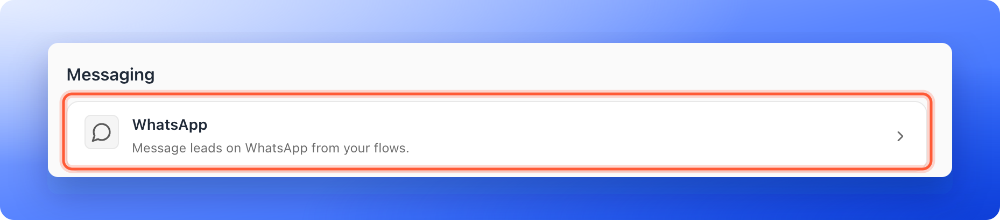
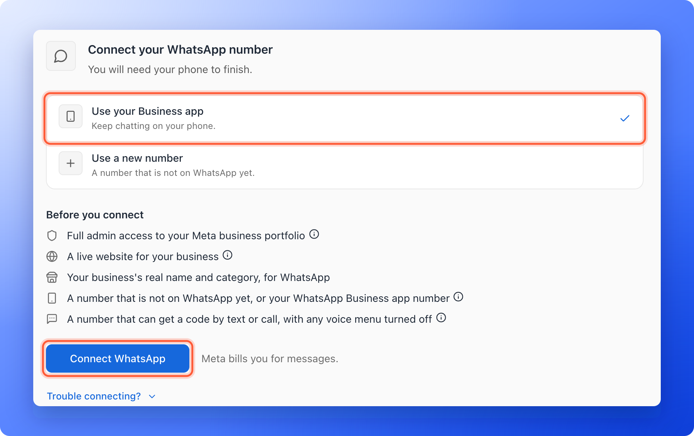
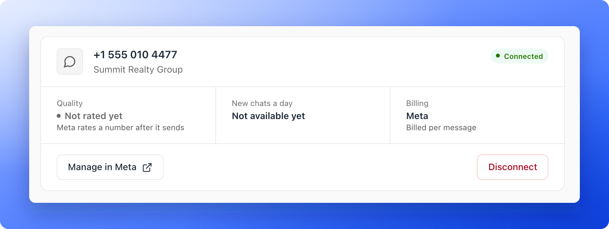

<Callout icon="star" color="#155DFC">
  Available on: **the Growth plan and above**, for Global Admins and Workspace Admins.
</Callout>

Connect one WhatsApp number to a workspace to send messages from your flows and to answer your leads in [Conversations](/messages/whatsapp-conversations). You connect it through a window from Meta, the company behind WhatsApp. You will need your phone to finish.

## Important to note

<Warning>
  - A workspace has one WhatsApp number. Every funnel in the workspace sends from it.
  - Meta bills you for the messages you send. Your number's page says **Billing**, **Meta**, **Billed per message**.
  - With **Use your Business app**, open the WhatsApp Business app on your phone at least every 14 days. Meta disconnects a number whose app is not opened for 14 days.
  - Only a Global Admin or a Workspace Admin can connect or disconnect. Everyone else who opens **Conversations** reads **Ask an admin to connect WhatsApp.**
</Warning>

## Before you connect

Have these ready. They are the things Meta's window asks for:

- **Full admin access to your Meta business portfolio.** This is your business's account at Meta (it used to be called Business Manager). Only a full admin can add a WhatsApp number.
- **A live website for your business.** Meta asks for it when you set up a new business portfolio, to check that your business is real.
- **Your business's real name and category, for WhatsApp.**
- **A number that is not on WhatsApp yet, or your WhatsApp Business app number.** A number used on personal WhatsApp can't connect until that WhatsApp account is deleted.
- **A number that can get a code by text or call, with any voice menu turned off.** Meta sends a code to confirm the number. If calls to it go through a voice menu, turn that off first, or the code can't reach you.

## Connect the number

<Steps>
  <Step title="Open the WhatsApp page">
    1. In the sidebar, click **Settings**, then **"Integrations"**.
    2. Under **Messaging**, click **"WhatsApp"**.

    

    You can also click **Connect WhatsApp** on the **Conversations** page, or **Connect** in a flow's WhatsApp message. Both lead here.
  </Step>
  <Step title="Choose the kind of number">
    The page says **Connect your WhatsApp number** and **You will need your phone to finish.** Choose one:

    - **Use your Business app:** keep chatting on your phone. This is for a number you already use in the WhatsApp Business app, and it is where the choice starts.
    - **Use a new number:** a number that is not on WhatsApp yet.

    
  </Step>
  <Step title="Click Connect WhatsApp">
    Click **"Connect WhatsApp"**. Meta's window opens and the button says **Waiting for Meta…** with **Finish in Meta's window.** under it. Follow Meta's steps there: sign in, choose your business portfolio and confirm your number with the code Meta sends you. To stop, click **Cancel**.
  </Step>
  <Step title="Wait for the connection">
    When Meta's window closes, the button says **Connecting…**. Then AskFunnel says "WhatsApp connected." and the page shows your number.

    If you close Meta's window early, the page says **Meta's window closed before finishing. Connect again when you are ready.** Click **"Connect WhatsApp"** to try again.
  </Step>
</Steps>

## Read the state of your number

The page shows the number, your business's name and a status. The same status shows as a chip on the **WhatsApp** row of the **Integrations** page, and on the **WhatsApp** row of a funnel's **Integrations** settings, which links back here.

- **Connected:** the number works. You can send and receive.
- **Needs attention:** something stopped it, for example Meta restricted it or it has to be connected again. The reason shows in amber, such as **WhatsApp needs to be connected again.** Click **"Connect again"** and go through Meta's window once more. Your team also gets a **WhatsApp needs attention** notification in the bell, and the **Conversations** page shows a banner with **Open settings**.

Under the number you see its health, as Meta reports it:

- **Quality:** **High**, **Medium** (**Some blocks or reports**), **Low** (**Many blocks or reports**) or **Not rated yet** (**Meta rates a number after it sends**). Keep it high by messaging only people who agreed to hear from you.
- **New chats a day:** how many new chats your number may start in a day, as Meta sets it. It says **Not available yet** until Meta has a figure.
- **Phone app:** for a Business app number, **Linked**, when the app was last used and **Open it every 14 days**.
- **Billing:** **Meta**, **Billed per message**.

Click **"Manage in Meta"** to open your number in WhatsApp Manager at Meta, where you look after billing, your business profile and the number's health.

## Disconnect the number

Click **"Disconnect"**. A window asks you to confirm and lists the funnels whose flows stop sending WhatsApp messages. It says "Your leads and messages stay, and you can connect again any time." Click **"Disconnect"** to confirm. Your chats stay readable in Conversations as history, and the page offers **Connect WhatsApp** again.

On a plan without WhatsApp, for example after a downgrade, a number you already connected stays on this page so you can read and disconnect it, but you cannot connect again until you upgrade.

## Troubleshooting

Click **Trouble connecting?** under the Connect button for the common problems. These are the sentences Meta's window may show and what to do:

<AccordionGroup>
  <Accordion title="User does not have permission to create WhatsApp Business Accounts.">
    You need full control of the business portfolio you picked. Ask its admin for it, or pick one you manage.
  </Accordion>
  <Accordion title="This number is registered to an existing WhatsApp account.">
    If it is your WhatsApp Business app number, choose **Use your Business app**. If not, back up its chats and delete that WhatsApp account, or use another number.
  </Accordion>
  <Accordion title="Your phone number doesn't appear to be valid.">
    Check the country code and the number. Turn off any voice menu or call forwarding, wait 5 minutes and try again.
  </Accordion>
  <Accordion title="The code does not arrive">
    Choose a phone call instead of a text in Meta's window. A landline gets the code by call.
  </Accordion>
  <Accordion title="You have guessed too many times.">
    Wait about 12 hours, then connect again and pick the same business and number.
  </Accordion>
  <Accordion title="Your verified name violates WhatsApp guidelines.">
    Use your business's real name, as it shows on your website and signs, then try again.
  </Accordion>
  <Accordion title="Update your WhatsApp Business App to the latest version to use this phone number.">
    Update the app on your phone, then connect again.
  </Accordion>
  <Accordion title="Please disconnect your business platform to continue.">
    In the WhatsApp Business app, open **Settings**, **Account**, **Business Platform** and disconnect. Wait 15 minutes, then connect again.
  </Accordion>
  <Accordion title="Your phone number isn't eligible to connect to the WhatsApp Business Platform.">
    Keep using the number in the WhatsApp Business app for a while, then try again. Or choose **Use a new number**.
  </Accordion>
  <Accordion title="This feature is unavailable for phone numbers from this region.">
    This option is not offered for numbers from your country yet. Choose **Use a new number**.
  </Accordion>
  <Accordion title="Something has gone wrong.">
    Often a short problem at WhatsApp. Wait a few minutes and try again.
  </Accordion>
</AccordionGroup>

Still stuck? Email [support@askfunnel.com](mailto:support@askfunnel.com) with what Meta's window said.

## What to do next

<Columns cols={2}>
  <Card title="Send WhatsApp messages from a flow" icon="paper-plane" href="/messages/whatsapp-template">
    Write the messages your leads get automatically.
  </Card>
  <Card title="Reply to leads on WhatsApp" icon="comments" href="/messages/whatsapp-conversations">
    Answer chats from one inbox.
  </Card>
</Columns>

Need help? Email [support@askfunnel.com](mailto:support@askfunnel.com).
