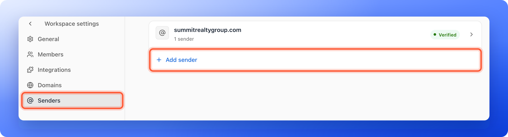
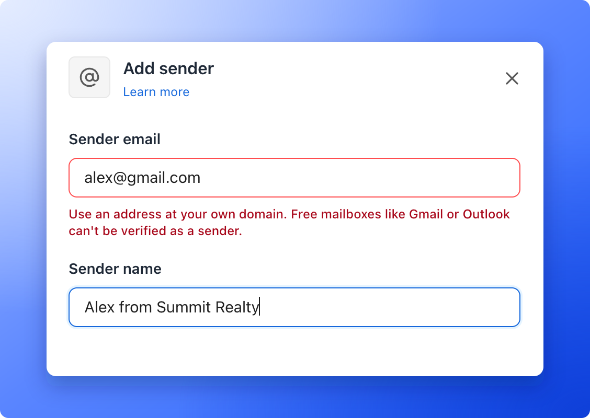
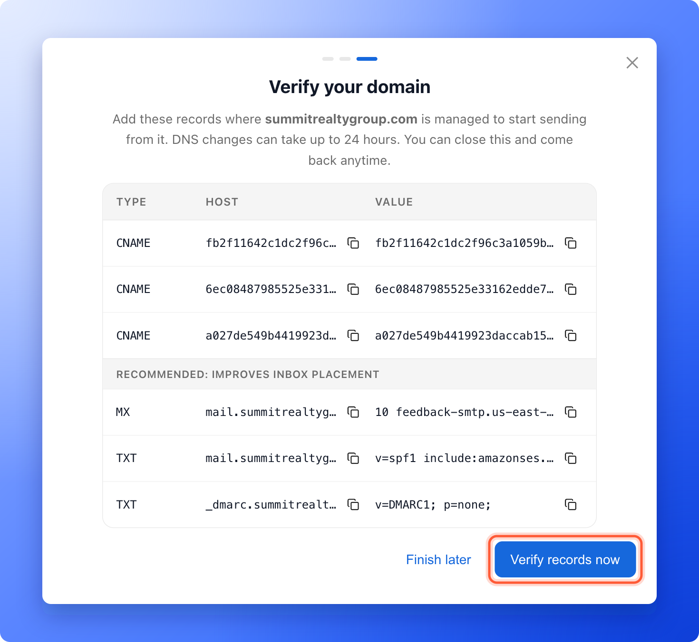
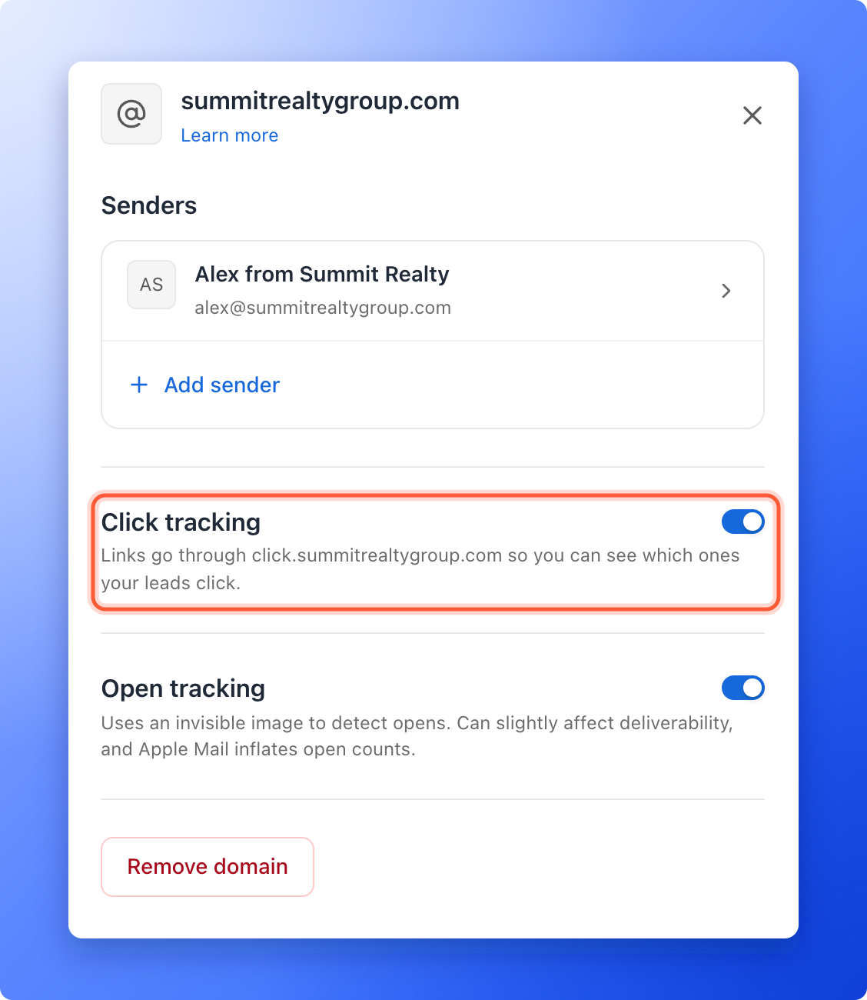

The sender is the from address. AskFunnel sends only from an address on your own domain that you have verified. This protects your emails from spam filters and lets leads see your brand, not ours. You need a verified sender before you can publish an [automated email](/messages/automated-emails).

**Before you start**, you need:

- A Global Admin or Workspace Admin role. Only they can manage senders. Senders belong to a workspace, so every funnel in that workspace can use them.
- An email address on your own domain, such as you@yourcompany.com. Free addresses from Gmail, Outlook or Yahoo cannot be verified.
- Access to the DNS settings where your domain is managed, such as Namecheap, GoDaddy or Cloudflare. DNS records are settings that prove you own the domain.

## Add a sender

<Steps>
  <Step title="Open the Senders page">
    1. In the sidebar, click **Settings**. A second menu opens under the heading **Workspace settings**.
    2. Click **"Senders"**.

    

    You can also start from a flow: in an email's **From** list, click **"Add new sender"**. The **Add sender** panel opens, and the back arrow at the top of the menu takes you back to your flow.
  </Step>
  <Step title="Enter the address and name">
    1. Click **"Add sender"**. On a workspace with no senders yet, the page says **No senders yet** and has the same button.
    2. Under **Sender email**, type an address on your own domain, for example you@yourcompany.com.
    3. Under **Sender name**, type the name leads see in their inbox, for example "Jane from Acme".
    4. Click **"Continue"**. The button stays gray until both fields are filled in.

    

    If you type a free address from Gmail, Outlook or Yahoo, the panel says **Use an address at your own domain. Free mailboxes like Gmail or Outlook can't be verified as a sender.**
  </Step>
  <Step title="Verify your domain">
    If the domain is new to your workspace, the panel is now titled **Verify your domain**. It says "Add these records where your domain is managed. DNS changes can take up to 24 hours." and lists each record with a **Type**, a **Host** and a **Value**.

    1. Log in to the place where your domain is managed.
    2. Add each record exactly as shown. Use the copy icons next to the **Host** and **Value**.
    3. The records under **Recommended: improves inbox placement** are optional, but they help your emails reach the inbox.
    4. Back in AskFunnel, click **"Verify records"**.

    When the records are found, AskFunnel says "Domain verified. Your sender is ready." and the panel closes. If they are not found yet, the panel says **Records not found yet.** or **We couldn't find these records yet. Confirm they're saved exactly with your DNS provider, then check again.** Wait a little and click **"Verify records"** again.

    

    To leave and come back later, click **"Finish later"**. The domain stays on the **Senders** page as **Pending**. Click its row, then **"Verify records"**.
  </Step>
</Steps>

On the **Senders** page every row is a domain. Its status is **Pending** while the records are not confirmed, **Verified** when they are, and **Needs attention** when they could not be found. A domain that needs attention says why under its name, for example "We couldn't find this domain's DNS records."

## Add another sender on a verified domain

Click the domain's row, then **"Add sender"** in its **Senders** list. Type only the part before the @, add a **Sender name** and click **"Add sender"**. The sender is ready right away, with no new DNS records. A domain that is still **Pending** has no **Add sender** link until it is verified.

## Turn on click and open tracking

To see which links your leads click, open the domain's row and turn on **Click tracking**.

AskFunnel shows one more record to add at your DNS provider, for a branded address such as click.yourcompany.com. Add it, then click **"Verify record"**. When it says "Click tracking is active.", the switch stays on.

After that, an **Open tracking** switch appears. It uses an invisible image to detect opens. This can slightly affect deliverability (whether your emails reach the inbox), and Apple Mail inflates open counts, so turn it on only if you need it.

Tracking results appear on each email in your flow. See [See whether your automated emails are delivered, opened and clicked](/messages/email-delivery-stats).

## Manage your senders

Open a domain's row to manage what is on it.

- **Rename a sender:** click the sender, change **Sender name** and click **"Save"**. The address itself cannot change. To send from another address, add a new sender.
- **Remove a sender:** click the sender, then **"Remove sender"**. AskFunnel lists the funnels whose flows can't send from it until you choose another sender. Confirm with **"Remove"**.
- **Turn off tracking:** turn off the **Click tracking** switch and confirm with **"Turn off"**. Link click and open tracking stop for emails from this domain. You can set them up again.
- **Remove a domain:** click **"Remove domain"** and confirm. Its senders are removed too, and flows cannot send from it until you add and verify it again.

If your emails bounce or are marked as spam too often, a notice **Sending is on hold** appears at the top of the **Senders** page. See [Keep your emails out of spam](/messages/email-deliverability).

## Troubleshooting

<AccordionGroup>
  <Accordion title="My sender does not appear in the From list">
    Only senders on a **Verified** domain appear. Open **Senders**, check the domain's status and finish verification.
  </Accordion>
  <Accordion title="My domain stays Pending or shows Needs attention">
    Check that every record was saved exactly as shown, with the same **Host** and **Value**. Some DNS providers add your domain to the end of the host automatically, so you may need to type only the first part. Wait up to 24 hours, then click **"Verify records"** again.
  </Accordion>
  <Accordion title="I see Only Workspace Admins can change these settings">
    Ask a Workspace Admin or Global Admin to add the sender, or to give you the Workspace Admin role.
  </Accordion>
  <Accordion title="A lead's flow says This email's sender isn't verified or was removed">
    The sender of that email was removed, or its domain is no longer verified. Fix it under **Settings**, **Senders**, or choose another sender in the email's **From** list. An email that waits more than 3 days for a working sender is skipped.
  </Accordion>
</AccordionGroup>

## What to do next

<Columns cols={2}>
  <Card title="Send automated emails to new leads" icon="envelope" href="/messages/automated-emails">
    Build a flow that emails each new lead with your new sender.
  </Card>
  <Card title="Keep your emails out of spam" icon="shield-halved" href="/messages/email-deliverability">
    Help your emails reach the inbox.
  </Card>
</Columns>

Need help? Email [support@askfunnel.com](mailto:support@askfunnel.com).
