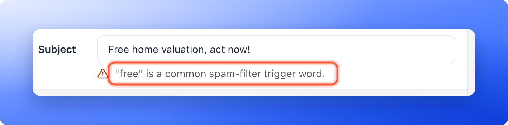

Keep your emails out of the spam folder so your leads actually see them. Deliverability means how many of your emails reach the inbox. Email flows only work if your messages get there. These habits keep your bounce rate (emails that could not be delivered) and spam rate (people marking your email as spam) low, and AskFunnel adds a few protections of its own.

## Send from your own verified domain

- **Use your own domain:** send from an address such as you@yourcompany.com. Free addresses from Gmail, Yahoo or Outlook cannot be verified, and AskFunnel does not accept them as senders.
- **Finish the domain setup:** add every DNS record AskFunnel shows you. DNS records are settings at your domain provider. The records listed under **Recommended: improves inbox placement** are optional, but adding them helps your emails reach the inbox.
- **Use a sender name people recognize:** for example "Jane from Acme". Avoid emoji in the name, which can look spammy and may be stripped.

See [Add and verify a sender email](/messages/custom-sender-email) for the steps.

## Write emails people want to open

- **Keep the subject short and plain:** AskFunnel shows a soft warning under the subject when it is mostly capital letters, contains an emoji, contains a common spam word (such as free, act now, limited time, click here, buy now, guarantee, winner or urgent) or is longer than 120 characters.
- **Match the email to the lead:** send follow-ups that fit what the lead answered, and use **@** to add their name.
- **Keep it light on links and exclamation marks:** emails full of links and capital letters are more likely to be filtered.
- **Give people a way out:** every email already has an **Unsubscribe** link in its footer, and you cannot remove it. This keeps people from marking your messages as spam.

The warnings are only advice. They never block a test or a publish.

## Keep your list clean

- **Send to people who agreed:** a new email goes only to leads who ticked the email box in your form. Choose **Everyone in this flow** only for emails a lead asked for, such as results or confirmations. See [Send automated emails to new leads](/messages/automated-emails).
- **Collect real addresses:** use the **Email** field in your lead form, which checks that an address looks valid. See [Lead capture forms](/funnels/lead-capture-forms).
- **Delete junk leads:** remove test and spam leads so you do not email them. See [Delete leads](/leads/delete-leads).
- **Watch your email results:** after a flow has sent, each email shows how many were **delivered** and **bounced**. A rising number of bounces means your list needs attention.

## What AskFunnel does for you

- **Unsubscribes, bounces and spam complaints are respected:** someone who unsubscribes, whose address permanently bounces or who marks an email as spam is skipped in future flows from that workspace.
- **Sending can go on hold to protect you:** if too many emails bounce or are marked as spam in the last 7 days, AskFunnel puts sending on hold for the workspace. The workspace's members get an **Email sending on hold** notification that says whether bounces or spam complaints caused it, and a notice **Sending is on hold** appears at the top of **Settings**, **Senders**. It shows the spam complaints and permanent bounces of the last 7 days. Leads' flows show **Paused** with the reason (**Too many emails bounced** or **Too many emails were marked as spam**). Emails are not lost while it lasts. The hold lifts by itself when the rate is back to normal, and a workspace admin can click **Resume sending** on the notice to let the held emails go out now. If too many bounce again, sending goes on hold again. An email that waits more than 3 days is skipped, so a lead never gets a follow-up that is days out of date.
- **Every email includes the legal footer:** it says why the lead got the email, with an **Unsubscribe** link, and shows your business name and address.

## Troubleshooting

<AccordionGroup>
  <Accordion title="I got an Email sending on hold notification">
    Open the leads whose **Messages** tab shows **Bounced** or **Marked as spam**, then fix or delete those addresses. Review your subject lines and content against the tips above. When you are ready, open **Settings**, **Senders** and click **Resume sending**, or wait for the hold to lift by itself. If you need help, email [support@askfunnel.com](mailto:support@askfunnel.com).
  </Accordion>
  <Accordion title="My emails go to spam even though my domain is verified">
    Check that the optional records listed under **Recommended: improves inbox placement** in the **Verify your domain** step are saved at your DNS provider. Then review the subject line and the email for capital letters, spam words and too many links, and ask recipients to mark your emails as "not spam".
  </Accordion>
</AccordionGroup>

## What to do next

<Columns cols={3}>
  <Card title="Send automated emails to new leads" icon="envelope" href="/messages/automated-emails">
    Build a flow with your verified sender.
  </Card>
  <Card title="Reply to leads on WhatsApp" icon="message" href="/messages/whatsapp-conversations">
    Chat with leads who prefer WhatsApp.
  </Card>
  <Card title="Let visitors book a call" icon="calendar-check" href="/integrations/calendars">
    Let leads pick a time with you.
  </Card>
</Columns>

Need help? Email [support@askfunnel.com](mailto:support@askfunnel.com).
